

  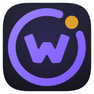

<h1 align="center">WittyMediaServer</h1>

  <b>Your films, shows, discs, music, books and games, on every screen in your home.</b> 
  A self-hosted media server that plays DVDs and Blu-rays <i>with their real menus</i>, in any browser.

  
  
  

  <a href="docs/GETTING_STARTED.md"><b>Get started</b></a> ·
  <a href="#install">Install</a> ·
  <a href="#guides">Guides</a> ·
  <a href="CHANGELOG.md">What's new</a>

> **Alpha.** Version 0.8.x-alpha versions are still changing quickly and can fail or lose data. Keep backups, and back up your data folder before you upgrade. A MAJOR currently known issue is Emulation isn't working. This is due to a new streaming pipeline to work with our newly created iOS and tvOS builds (due to apple being very restrictive on what we can and can't run on those platforms). Right now, the new WittyMediaClient apps crash if games are attempted, and the browser will just perpetually load. 0.6.x Alpha versions still work with emulation, but still suffer from the connection issue dialogue not going away. 

## Install

Install the server on the computer or NAS that holds your media. Downloads are on the **[Releases page](https://github.com/wittywilla/WittyMediaServer/releases)**, and FFmpeg comes with them. When it's running, open `http://<that computer>:9797/` in a browser to set it up.

| On | Do this | Full guide |
|---|---|---|
| **Windows** 10 or 11 | Download `windows-amd64.msi` (`arm64` for ARM PCs), open it, and choose who it's for. Setup opens in your browser | [Windows](docs/INSTALL.md#windows) |
| **macOS** 11 or later | Download `macos-arm64.pkg` (Apple silicon) or `macos-amd64.pkg` (Intel), open it, then open **WittyMediaServer** from Applications. *Not yet run on a real Mac* | [macOS](docs/INSTALL.md#macos) |
| **Debian, Ubuntu** | `sudo apt install ./wittymediaserver-<version>-linux-amd64.deb`: the service is running | [Linux](docs/INSTALL.md#linux) |
| **Fedora, RHEL** | `sudo dnf install ./wittymediaserver-<version>-linux-amd64.rpm`: the service is running | [Linux](docs/INSTALL.md#linux) |
| **Any other Linux** | Unpack `linux-amd64.tar.gz` (or `arm64`, `armv7`, `386`), then `sudo ./install.sh` for a service, or `./WittyMediaServer` to just run it | [Linux](docs/INSTALL.md#linux) |
| **FreeBSD** 14 or later | `pkg add wittymediaserver-<version>-freebsd-amd64.pkg`, `sysrc wittymediaserver_enable=YES`, `service wittymediaserver start` | [FreeBSD](docs/INSTALL.md#freebsd) |
| **Docker** | `docker run -d -p 9797:9797 -v wms-config:/config -v /path/to/media:/media:ro ghcr.io/wittywilla/wittymediaserver:alpha`, or a [ready compose file](deploy/docker/compose.yml) | [Docker](docs/DOCKER.md) |
| **A NAS** | Docker, with a guide for each: [UGREEN](docs/DOCKER-UGREEN.md) · [Synology](docs/DOCKER-SYNOLOGY.md) · [QNAP](docs/DOCKER-QNAP.md) · [Unraid](docs/DOCKER-UNRAID.md) · [TrueNAS SCALE](docs/DOCKER-TRUENAS.md) · [Asustor](docs/DOCKER-ASUSTOR.md) | [A NAS](docs/INSTALL.md#a-nas) |

**Then watch from any device.** Every phone, tablet, computer and TV with a browser can open the server's address and use everything. The app, **WittyMediaClient**, adds finding the server by itself and a TV-friendly view. It's early: [Apps and devices](docs/APPS.md) says how far each has been run.

| Device | Get WittyMediaClient |
|---|---|
| Windows, macOS, Linux, FreeBSD, Plasma Big Screen | The installer for your system from the [WittyMediaClient releases page](https://github.com/wittywilla/WittyMediaClient/releases) (`.exe`, `.dmg`, `.deb`, `.rpm`, `.pacman`, `.AppImage`, `.pkg`) |
| Android phones, tablets and TVs | The `.apk` from the same page, installed by hand (`adb install` on a TV). *Run on emulators only so far* |
| iPhone, iPad, Apple TV | Not available yet: use the browser. Apple TV has no browser, so it can't be used yet |

[Getting started](docs/GETTING_STARTED.md) walks through everything with no command line, and [Installing](docs/INSTALL.md) covers services, updating, and what each download is.

<!-- hero -->

<a href="docs/images/home.webp">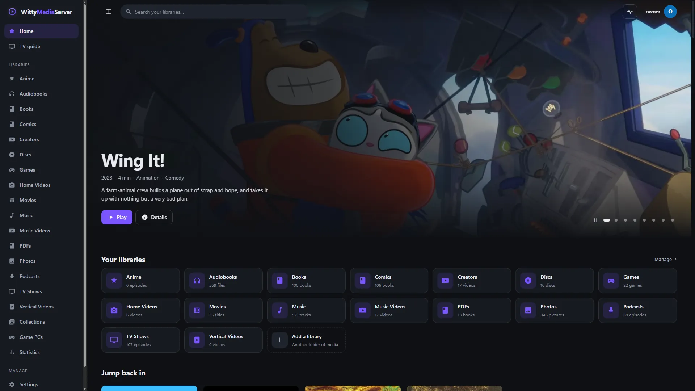</a> The home page. <a href="https://commons.wikimedia.org/wiki/File:WING_IT!_-_Blender_Open_Movie-full_movie.webm">Wing It!</a>, Blender Studio, <a href="https://creativecommons.org/licenses/by/4.0/">CC BY 4.0</a>. Everything shown is <a href="docs/images/CREDITS.md">openly licensed</a>.

<!-- /hero -->

## What it does

- **Films and TV.** Posters, plots and ratings, *Continue watching*, skip intro and instant seeking. Information arrives with no API key, and you can add free keys or your own agents for more.
- **DVDs and Blu-rays.** Disc images play like a disc player: intros, animated menus, scene selection, extras and the disc's own subtitles.
- **Live TV and channels.** Channels made from your library, a guide, tuners, IPTV and recording.
- **Music, audiobooks and podcasts.** Albums and artists, lyrics and karaoke, books that remember your place, and shows you follow.
- **Books and comics.** EPUB, PDF, comics and manga, with highlights, notes and a pen.
- **Photos and videos.** A timeline, albums and an offline map, a feed of vertical videos, and creators' videos by channel.
- **Games.** Your own game files, played in a browser with a gamepad, keyboard or touch.
- **Everyone at home.** *Who's watching?* profiles with their own progress, and Kids profiles that only show titles for their age.
- **Yours.** It runs on your computer. No accounts with anyone, no telemetry and no cloud. No media comes with it.

Discs, games, photos, readers and tuners are modules: separate programs you add from a store inside the app, each with its own [repository](docs/REPOSITORIES.md). The server works without any of them.

<!-- gallery -->
## A look around

A test server, filled with openly licensed media to show what it can do. No media comes with it. Every work on that server is named in [the credits](docs/images/CREDITS.md), with its licence. See [every step of first-time setup](docs/FIRST-TIME-SETUP.md) too.

<table>
<tr>
<td width="50%"><a href="docs/images/movies.webp">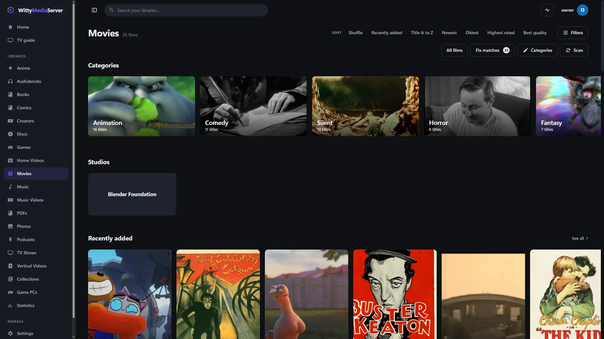</a> <b>Films</b> Open-licence and public-domain media, <a href="docs/images/CREDITS.md">credited here</a></td>
<td width="50%"><a href="docs/images/film-page.webp">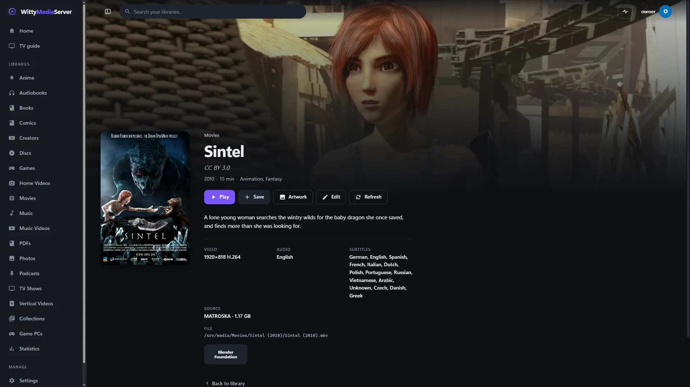</a> <b>A film's page</b> <a href="https://durian.blender.org/">Sintel</a>, Blender Foundation, <a href="https://creativecommons.org/licenses/by/3.0/">CC BY 3.0</a></td>
</tr>
<tr>
<td width="50%"><a href="docs/images/dvd-menu.webp">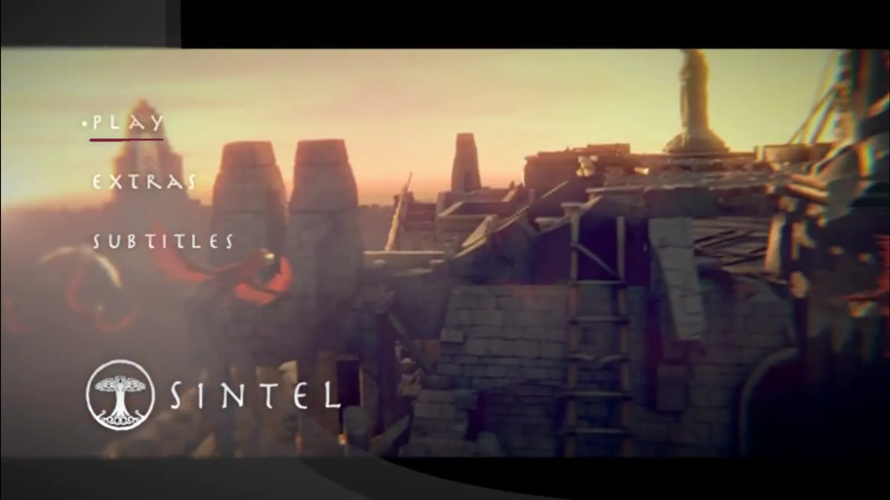</a> <b>A DVD's real menu, in a browser</b> <a href="https://durian.blender.org/">Sintel</a>, Blender Foundation, <a href="https://creativecommons.org/licenses/by/3.0/">CC BY 3.0</a>, from its original DVD</td>
<td width="50%"><a href="docs/images/bluray-menu.webp">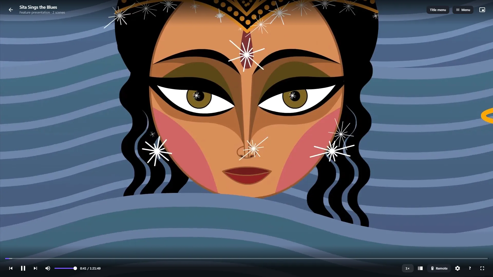</a> <b>Blu-rays too</b> <a href="https://archive.org/details/SitaSingsTheBlues_201812">Sita Sings the Blues</a>, Nina Paley, <a href="https://creativecommons.org/publicdomain/zero/1.0/">CC0</a></td>
</tr>
<tr>
<td width="50%"><a href="docs/images/wittytv-guide.webp">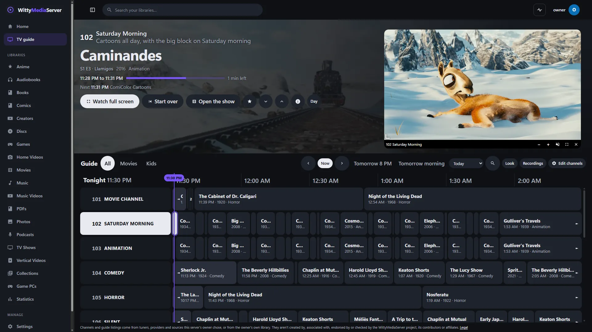</a> <b>WittyTV: channels made from your library</b> <a href="https://commons.wikimedia.org/wiki/File:Caminandes_3_-_Llamigos_-_Blender_Animated_Short.webm">Caminandes: Llamigos</a>, Pablo Vazquez, Blender Foundation, <a href="https://creativecommons.org/licenses/by/3.0/">CC BY 3.0</a></td>
<td width="50%"><a href="docs/images/wittytv-classic.webp">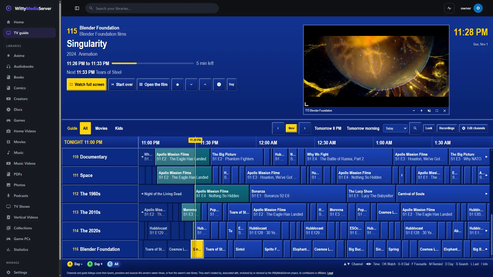</a> <b>Looks of its own to choose from</b> <a href="https://commons.wikimedia.org/wiki/File:SINGULARITY_-_Blender_Open_Movie-full_movie.webm">Singularity</a>, Blender Studio, <a href="https://creativecommons.org/licenses/by/4.0/">CC BY 4.0</a></td>
</tr>
<tr>
<td width="50%"><a href="docs/images/music-visualizer.webp">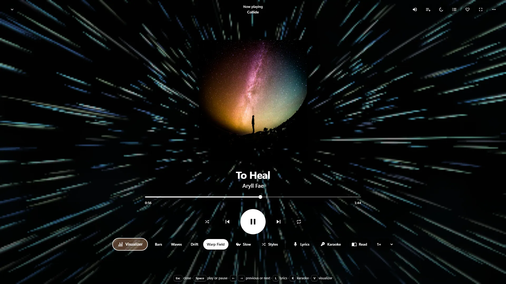</a> <b>Music, with WittyVisualizer</b> <a href="https://archive.org/details/SRS08807">Collide</a>, Aryll Fae, <a href="https://creativecommons.org/licenses/by/4.0/">CC BY 4.0</a></td>
<td width="50%"><a href="docs/images/music-lyrics.webp">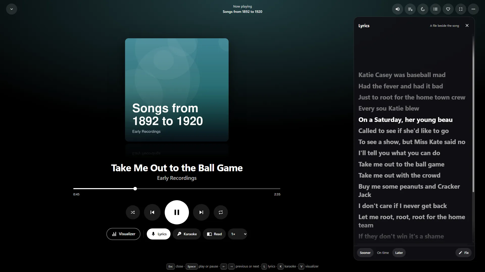</a> <b>Lyrics and karaoke</b> "Take Me Out to the Ball Game", 1908, public domain</td>
</tr>
<tr>
<td width="50%"><a href="docs/images/gameplay-ucity.webp">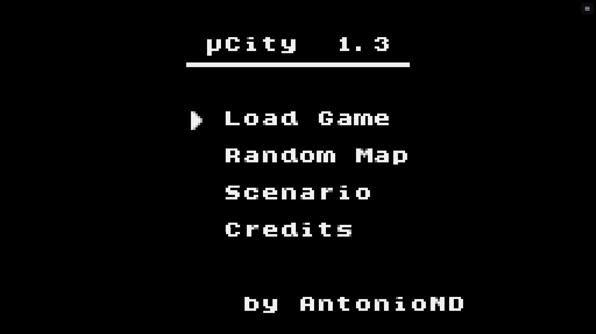</a> <b>Games, played in a browser</b> <a href="https://github.com/AntonioND/ucity">µCity</a>, Antonio Niño Díaz, GPL-3.0-or-later and CC BY-SA 4.0</td>
<td width="50%"><a href="docs/images/games.webp">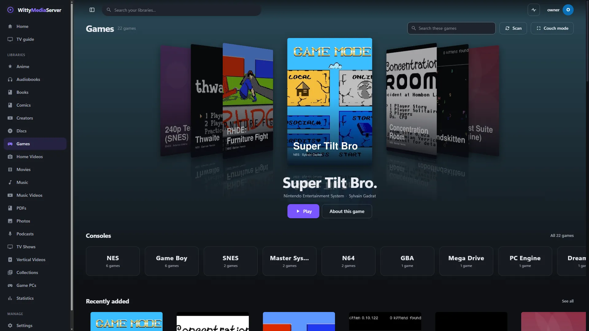</a> <b>Open-licence homebrew on many consoles</b> Each <a href="docs/images/CREDITS.md">credited here</a></td>
</tr>
<tr>
<td width="50%"><a href="docs/images/gameplay-thwaite.webp">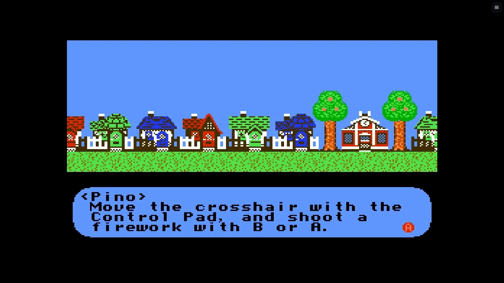</a> <b>Thwaite</b> <a href="https://github.com/pinobatch/thwaite-nes">Thwaite</a>, Damian Yerrick, GPL-3.0-or-later</td>
<td width="50%"><a href="docs/images/gameplay-super-tilt-bro.webp">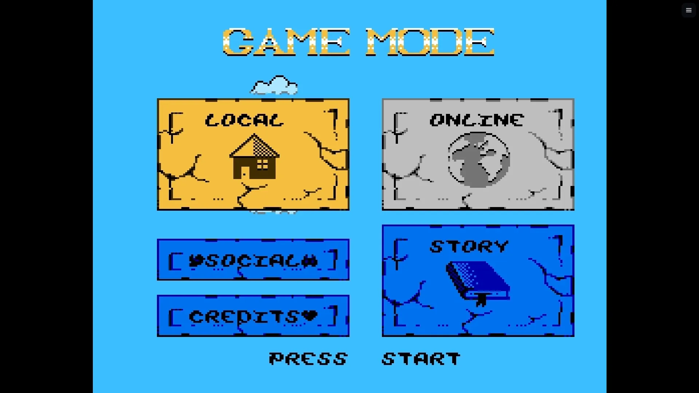</a> <b>Super Tilt Bro</b> <a href="https://github.com/sgadrat/super-tilt-bro">Super Tilt Bro</a>, Sylvain Gadrat, WTFPL</td>
</tr>
<tr>
<td width="50%"><a href="docs/images/reader-epub.webp">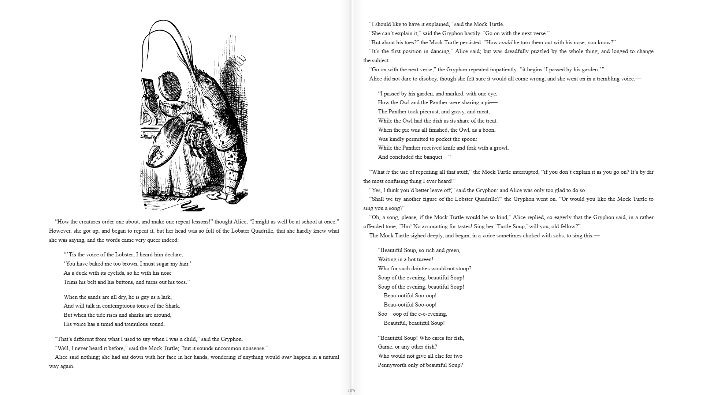</a> <b>Books</b> <a href="https://standardebooks.org/">Standard Ebooks</a>, <a href="https://creativecommons.org/publicdomain/zero/1.0/">CC0</a></td>
<td width="50%"><a href="docs/images/reader-comic.webp">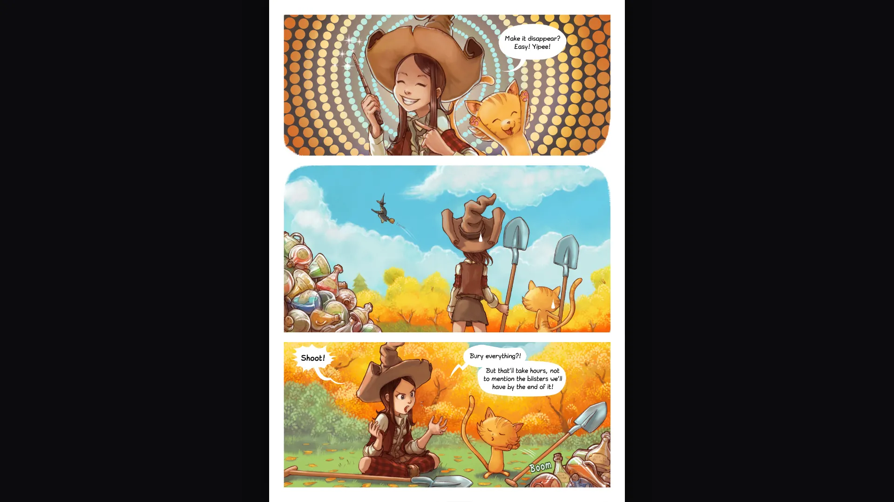</a> <b>Comics</b> <a href="https://www.peppercarrot.com/">Pepper&amp;Carrot</a>, David Revoy, <a href="https://creativecommons.org/licenses/by/4.0/">CC BY 4.0</a></td>
</tr>
<tr>
<td width="50%"><a href="docs/images/photos.webp">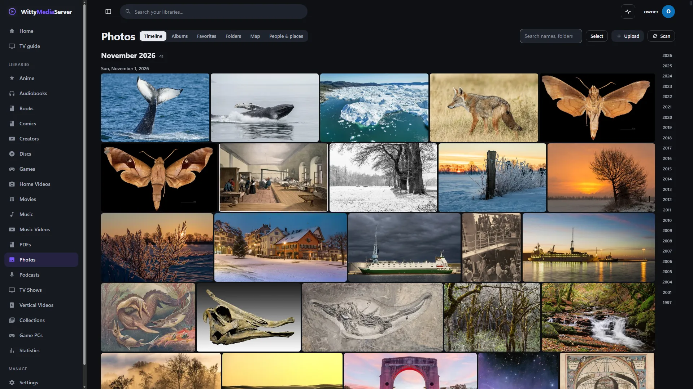</a> <b>Photos</b> From Wikimedia Commons, <a href="docs/images/CREDITS.md">credited here</a></td>
<td width="50%"><a href="docs/images/tv-show-page.webp">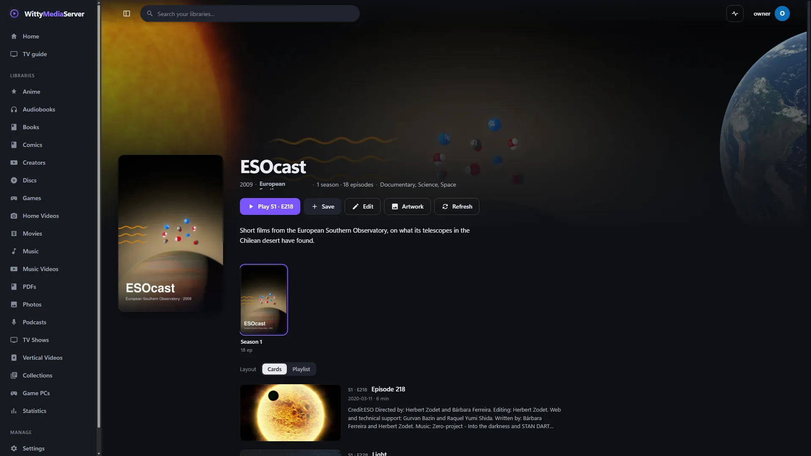</a> <b>TV shows</b> Open-licence and public-domain media, <a href="docs/images/CREDITS.md">credited here</a></td>
</tr>
<tr>
<td width="50%"><a href="docs/images/podcasts.webp">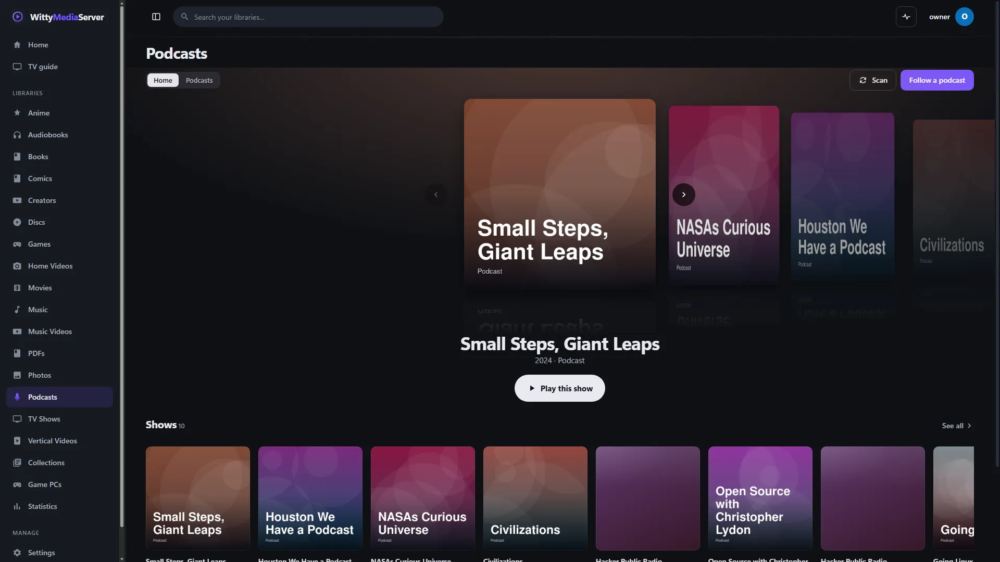</a> <b>Podcasts and audiobooks</b> <a href="docs/images/CREDITS.md">Credited here</a></td>
<td width="50%"><a href="docs/images/shorts.webp">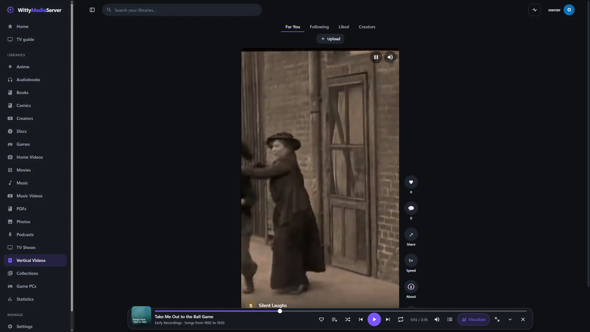</a> <b>Vertical videos</b> Clips cropped from open films, <a href="docs/images/CREDITS.md">credited here</a></td>
</tr>
<tr>
<td width="50%"><a href="docs/images/theme-light-home.webp">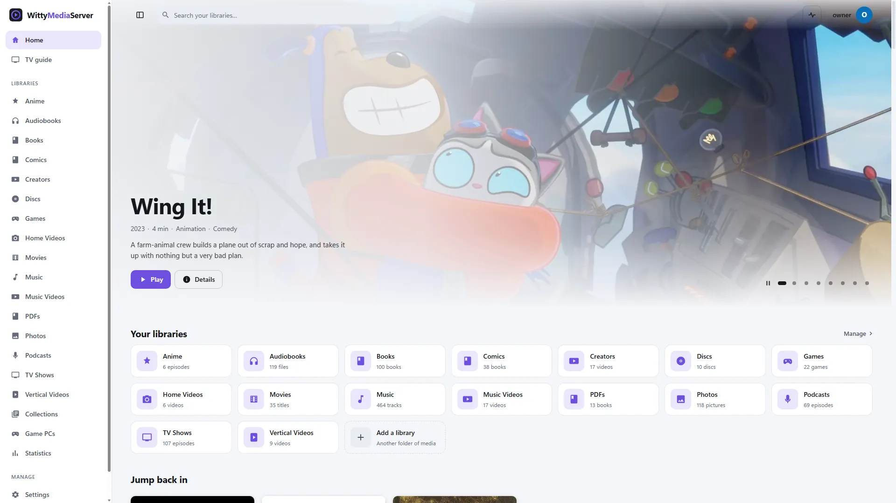</a> <b>Themes</b> Open-licence and public-domain media, <a href="docs/images/CREDITS.md">credited here</a></td>
<td width="50%"><a href="docs/images/tv-mode.webp">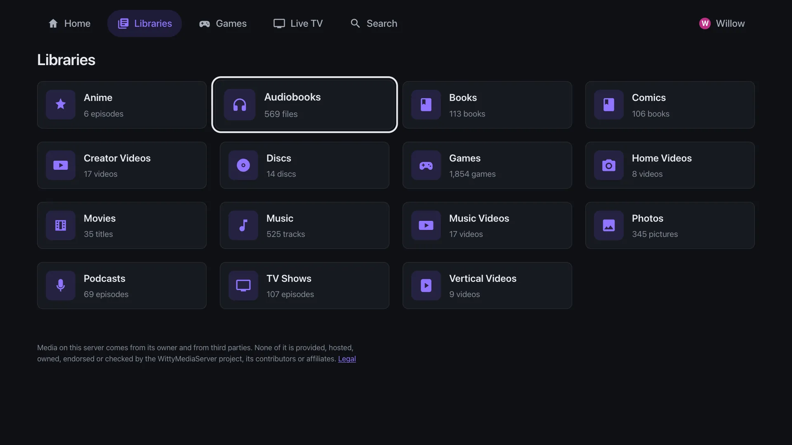</a> <b>TV mode, like the TV apps, for the couch</b> Driven with a remote or a game controller</td>
</tr>
<tr>
<td width="50%"><a href="docs/images/module-store.webp">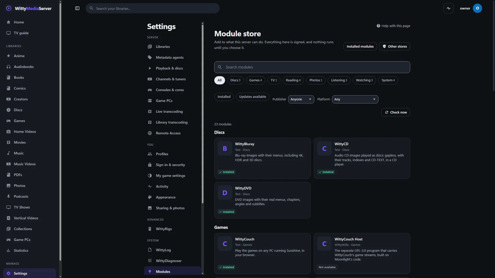</a> <b>Add only what you want from the store</b> From a local test catalogue</td>
<td width="50%"><a href="docs/images/settings-libraries.webp">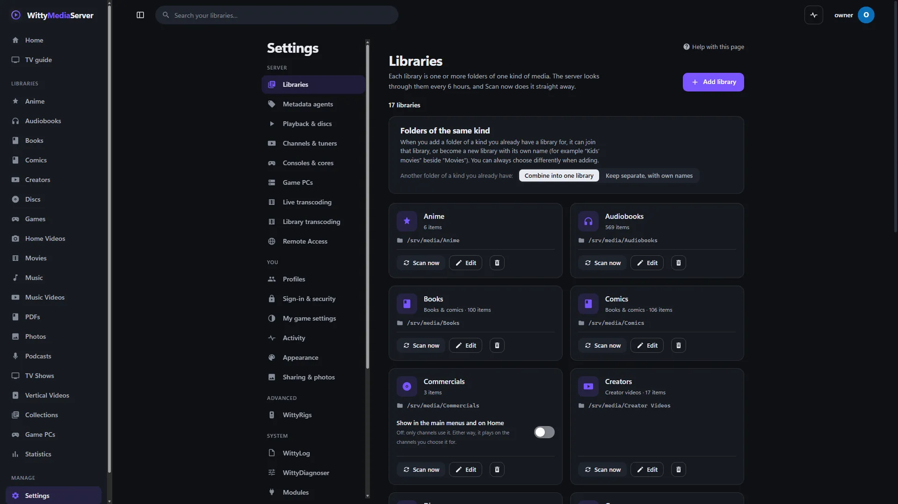</a> <b>Everything is in plain settings</b> Settings, Libraries</td>
</tr>
</table>

<!-- /gallery -->

## Get started

1. [Install it](#install) on the computer or NAS that holds your media.
2. Open `http://<that computer>:9797/`. On a desktop, the installer opens it for you.
3. Create your account, point it at your folders and press **Start watching**.

[Getting started](docs/GETTING_STARTED.md) has the full walkthrough, and [First-time setup](docs/FIRST-TIME-SETUP.md) shows every page of it with pictures.

The server is on your home network only until you turn on **Settings → Remote Access** and follow its steps. See [Remote access](docs/REMOTE.md).

## Where it has been run

The server is written for Windows, Linux, macOS and FreeBSD, and runs in Docker. Linux gets the most testing, with its packages installed, upgraded and removed on Debian, Ubuntu and Fedora. The Windows installers have been tested under Wine, not on real Windows. Nothing has been run on a real Mac yet. FreeBSD's package and service have run in virtual machines. The Docker image has run in WSL, not yet on a NAS. [What has been tested](docs/INSTALL.md#what-has-been-tested) has the details.

WittyMediaClient adds Android, Android TV, iOS, tvOS and Plasma Big Screen. Android has been run on emulators only, and iOS and tvOS have never been built. A web browser is the way to reach everything today. See [Apps and devices](docs/APPS.md).

## Guides

**Everything here is also inside the app, under Help,** so you don't need this page once you're running.

| Getting going | |
|---|---|
| [Getting started](docs/GETTING_STARTED.md) | From install to your first film |
| [First-time setup, step by step](docs/FIRST-TIME-SETUP.md) | Every page of setup, with a picture of each |
| [Installing](docs/INSTALL.md) | Downloads, the tray app, services, updating and removing it |
| [Docker](docs/DOCKER.md) | The image, compose files, graphics cards, and a guide for each make of NAS |
| [Libraries](docs/LIBRARIES.md) | Adding your media, and naming your files |
| [Accounts and profiles](docs/ACCOUNTS.md) | People, passwords, limits and sign-in |
| [Apps and devices](docs/APPS.md) | Every device, and how far each has been run |
| [Settings tour](docs/SETTINGS.md) | Where every setting lives |
| [Troubleshooting](docs/TROUBLESHOOTING.md) | Common problems, by what you're seeing |

| Your media | |
|---|---|
| [Watching and listening](docs/PLAYING.md) | The player, keys, tracks and remotes |
| [What each media type supports](docs/MEDIA-TYPES.md) · [Supported formats](docs/SUPPORTED-FORMATS.md) | Which library to make, and every file type |
| [DVDs](docs/DVD.md) · [Blu-rays](docs/BLURAY.md) | Menus, the remote, audio and subtitles |
| [TV shows](docs/TV.md) · [Channels and live TV](docs/CHANNELS.md) | Show folders, channels, tuners and the guide |
| [Music](docs/MUSIC.md) · [Lyrics and karaoke](docs/LYRICS-KARAOKE.md) | Music, audiobooks, podcasts and singing along |
| [Books, PDFs and comics](docs/BOOKS.md) · [Photos](docs/PHOTOS.md) | Reading and looking |
| [Vertical videos](docs/SHORTS.md) · [Creator videos](docs/CREATOR-VIDEOS.md) | Feeds, channels and concerts |
| [Collections, radio and Your year](docs/COLLECTIONS.md) | Smart playlists and internet radio |
| [Games](docs/GAMES.md) | Your own games, from a folder to playing |

| Running a server | |
|---|---|
| [Metadata](docs/METADATA.md) · [Fixing wrong details](docs/FIXING-METADATA.md) · [The metadata folder](docs/METADATA-FOLDER.md) | Posters, plots and wrong matches |
| [Live transcoding](docs/TRANSCODING.md) · [Library transcoding](docs/LIBRARY-TRANSCODING.md) · [Using Tdarr](docs/TDARR.md) | Converting video |
| [Modules and the store](docs/MODULE-STORE.md) | Adding, updating and trusting modules |
| [Remote access](docs/REMOTE.md) | Watching away from home, safely |
| [Backup and restore](docs/BACKUP.md) · [Repair](docs/REPAIR.md) · [WittyDiagnoser](docs/DIAGNOSER.md) | Keeping it healthy |
| [Config file and logs](docs/CONFIG.md) · [Statistics](docs/STATS.md) · [Themes](docs/THEMES.md) | Fine tuning |

**For developers:** [Contributing](CONTRIBUTING.md), [Repositories](docs/REPOSITORIES.md), [Reference](docs/REFERENCE.md), [Client API](docs/CLIENT-API.md), [Making a module](docs/MODULES.md), [Security model](docs/SECURITY-REVIEW.md) and the [Changelog](CHANGELOG.md).

## Privacy and security

- **No telemetry, no accounts with anyone, no cloud.** Logs stay on your computer and never contain passwords or session tokens.
- **Your files stay here.** By default, names taken from your file and folder names go to the metadata services you keep switched on, and the server asks GitHub for updates twice a day. **Settings → Legal → Privacy** lists every outside service, what it receives and what controls it.
- **Limits by default.** Cross-site requests are refused, feeds and agents can't reach other devices on your network, and modules run in a sandbox where the system offers one.
- **Copy protection is never bypassed.** Encrypted discs, broadcasts and game files are detected and refused.

To report a security problem, see [SECURITY.md](SECURITY.md).

## Contributing

Issues and pull requests are welcome. [CONTRIBUTING.md](CONTRIBUTING.md) has how to build, test and send a change. Disc engines must stay free of other players' code, because they're written from the public disc formats.

## Licence and legal

**[GNU Affero General Public License v3.0 (or later)](LICENSE).** Use, change and share WittyMediaServer, commercially or not, under its terms; please keep the attribution in **[NOTICE](NOTICE)**: *"This product includes WittyMediaServer, developed by WittyWilla"*, in your distribution, documentation or About screen. Every Witty module is AGPL-3.0-or-later too. The client apps (WittyMediaClient, WittyMediaPlayer, WittyReader and the smaller apps) are under the GNU General Public License v3.0 or later. Code forked or derived from another project keeps that project's licence and is labelled with it; for example, WittyCouch Host is AGPL-3.0-or-later with its Moonlight-derived parts under the GPL-3.0. A few separate programs have licences of their own, and each is listed in the app and in [THIRD_PARTY_LICENSES.md](THIRD_PARTY_LICENSES.md).

<b>Your media, third parties and warranty</b>

The app's own **Legal** page (*Settings → Legal*, or `/legal` on any server) has the full text. This is plain-language information, not legal advice.

**Your media, your responsibility.** WittyMediaServer organises and streams media you already have the right to use. It doesn't provide, host, own or check any of it. Server operators and users are responsible for the files they add and share, and for following the laws where they and their viewers live. The authors and contributors accept no liability for media stored on, played from or shared through a server, nor for how a server is used.

**Web results and third-party content.** Search results, details, artwork, podcasts, radio stations, TV channels and guides, and game details come from third parties. They aren't created by, associated with, endorsed by or checked by the WittyMediaServer project, its contributors or affiliates.

**Games.** No games, ROMs or BIOS files come with this software, and the project doesn't link to them. Use only files you've obtained legally.

**No circumvention.** Copy protection is never decrypted or bypassed: CSS-scrambled DVDs and AACS-encrypted Blu-rays are refused. Encrypted media isn't supported, and no plugin or setting changes that.

**Third parties.** Video is converted by **FFmpeg**, run as a separate program. The bundled builds are GPL-licensed, with sources linked from [THIRD_PARTY_LICENSES.md](THIRD_PARTY_LICENSES.md). This product uses the **TMDB** API but is not endorsed or certified by TMDB. TV information is provided by **[TheTVDB](https://thetvdb.com)** and **TVmaze** (CC BY-SA 4.0), movie and game facts by **Wikidata** (CC0) and **Wikipedia** (CC BY-SA 4.0), anime by **AniList**, definitions by the **Free Dictionary API**, and podcast search by the **Apple Podcasts** directory. Each service's terms apply to its data.

**No warranty.** Provided "as is", without warranty of any kind.

**No affiliation, and trademarks.** WittyMediaServer is not affiliated with any other media software project, studio, console maker, service or rights holder. Third-party names only describe compatibility or where information came from, and belong to their owners. "DVD" is a trademark of DVD Format/Logo Licensing Corporation; "Blu-ray" and "Blu-ray Disc" are trademarks of the Blu-ray Disc Association. This software isn't a licensed or certified DVD or Blu-ray product.

---

WittyMediaServer 0.8.0-alpha · AGPL-3.0-or-later · Made by <a href="https://github.com/wittywilla">WittyWilla</a>

