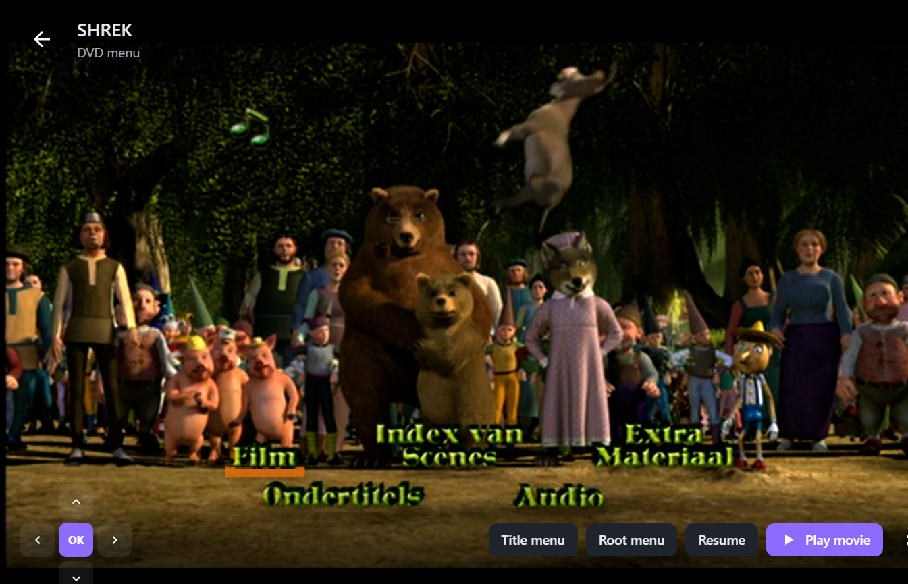
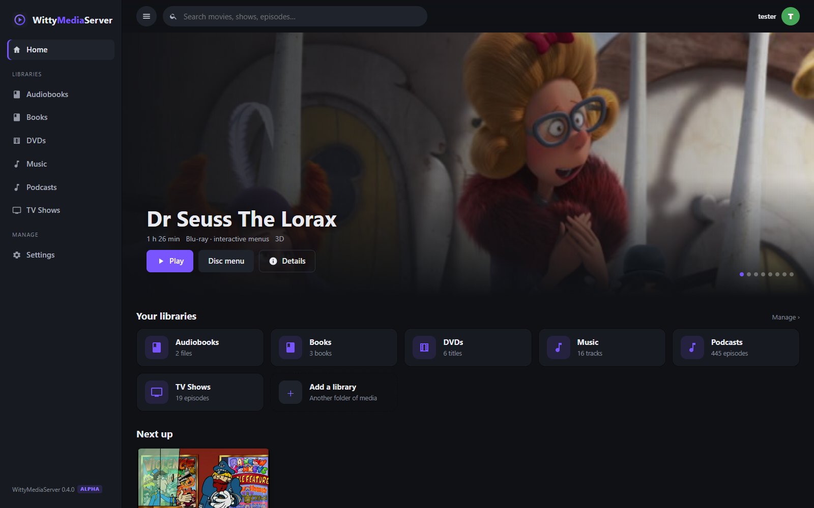
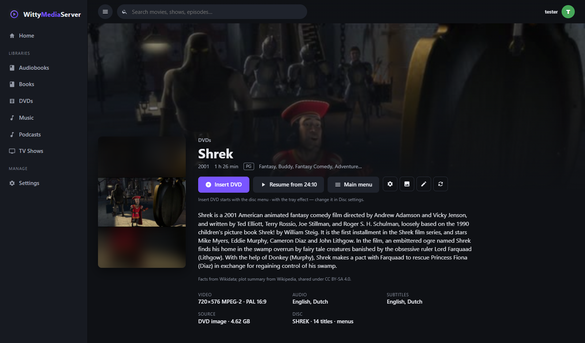
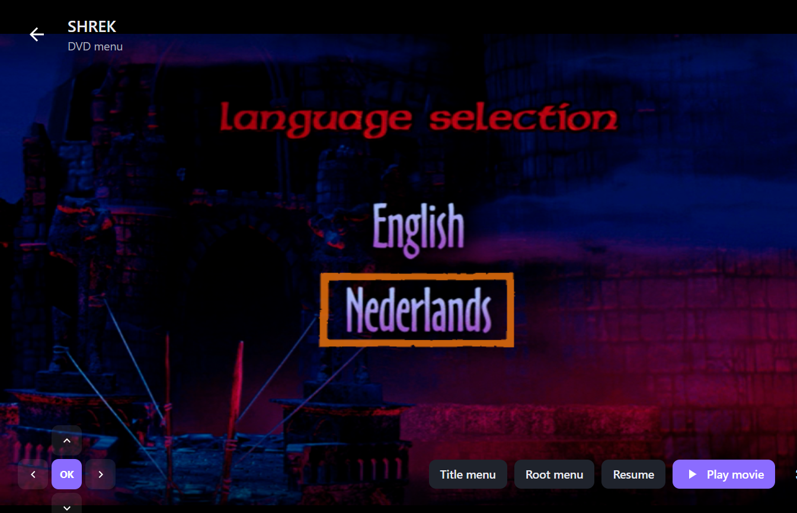

<p align="center">
  
</p>
<h1 align="center">WittyMediaServer</h1>
<p align="center">
  A self-hosted media server with <b>real, interactive DVD menus</b> in any browser, powered by the <b>WittyDVD</b> engine.<br>
  One self-contained package per platform — Windows, macOS, Linux, FreeBSD — plus Docker and Kubernetes.
</p>
<p align="center">
  <a href="LICENSE"></a>
  
  
  
</p>

> **Alpha software.** WittyMediaServer 0.2.0-alpha is usable every day but still changing quickly;
> back up your data folder before upgrading. Bug reports are very welcome.

**New here?** Start with **[Getting started](docs/GETTING_STARTED.md)** — download to watching in
ten minutes, no command line needed.

## Documentation

| Guide | What's inside |
|---|---|
| [Getting started](docs/GETTING_STARTED.md) | install, first account, folder layout, adding libraries, watching on other devices |
| [DVDs & WittyDVD](docs/DVD.md) | Insert DVD, menus, the remote, audio/subtitles, interactive extras, diagnosing discs |
| [TV shows](docs/TV.md) | folder layouts, TheTVDB, Skip intro / Watch next, networks & genres for future TV channels |
| [Metadata & artwork](docs/METADATA.md) | NFO files, the artwork picker, moving from another media server |
| [Config file, portable mode & logs](docs/CONFIG.md) | `wms.json`, running from a USB drive, where files go, what is logged |
| [Music, audiobooks & podcasts](docs/MUSIC.md) | folder layout, tags and covers, the player, formats, following podcasts |
| [Transcoding](docs/TRANSCODING.md) | direct play, hardware encoders, quality modes, GPU/CPU capability tables |
| [Themes](docs/THEMES.md) | built-in themes, the custom name, writing your own theme ZIP |
| [Contributing](CONTRIBUTING.md) | building from source, tests, code layout, sending changes |
| [Changelog](CHANGELOG.md) | what changed in each version |
| [Publishing to GitHub](docs/PUBLISHING.md) | committing, pushing and making a release, step by step |


<p align="center">
  
  <br><sub>A real DVD's animated menu, navigated with the on-screen remote. The highlight comes straight from the disc's sub-picture stream.</sub>
</p>

---

## Table of contents

- [Why WittyMediaServer?](#why-wittymediaserver)
- [Features](#features)
- [Screenshots](#screenshots)
- [Installation](#installation)
  - [Desktop (tray app)](#desktop-tray-app)
  - [Headless service](#headless-service)
  - [Docker](#docker)
  - [Kubernetes](#kubernetes)
  - [Reverse proxy](#reverse-proxy)
- [First run](#first-run)
- [Organising your media](#organising-your-media)
- [TV shows](#tv-shows)
- [Playback](#playback)
  - [DVD menus](#dvd-menus)
  - [The remote](#the-remote)
  - [Transcoding and hardware encoders](#transcoding-and-hardware-encoders)
- [Themes](#themes)
- [Clients](#clients)
- [Configuration reference](#configuration-reference)
- [Command-line tools](#command-line-tools)
- [HTTP API](#http-api)
- [Building from source](#building-from-source)
- [Architecture](#architecture)
- [Troubleshooting & FAQ](#troubleshooting--faq)
- [Roadmap](#roadmap)
- [Contributing](#contributing)
- [Licence, attribution & legal](#licence-attribution--legal)

---

## Why WittyMediaServer?

Every media server can play "the longest title" of a DVD rip. None of them give you the
disc *as it was authored*: the first-play warning, the studio intro, the animated main
menu, scene selection, language choice, bonus features and DVD games. WittyMediaServer does,
in a browser, because its **WittyDVD** engine implements the **DVD-Video navigation model
itself** — the same thing a hardware player does:

- reads ISO 9660 / UDF images and `VIDEO_TS` folders **directly**, no mounting
- parses the VMG/VTS IFO tables (program chains, cells, chapters, angles, audio/subtitle tables)
- runs the DVD **virtual machine** — 16 GPRM + 24 SPRM registers and the full command set (links, jumps, calls, compares, arithmetic, timers)
- follows **first-play → menus → titles** exactly as the disc's own programs dictate
- extracts **button geometry** from NAV packs and decodes the **sub-picture RLE** so highlights look exactly like on a real player — in menus *and* inside titles, so interactive extras and DVD games work
- renders the disc's own **subtitles** in the player (instant switching, forced subtitles, track purposes such as *Commentary* or *Captions*)
- streams the exact byte ranges of each cell through FFmpeg as HLS, so menus (even animated, looping ones) and features play in the browser without transcoding the whole disc first

Everything else you expect from a media server is there too: libraries, metadata,
artwork, resume points, users, search, transcoding with instant seeking, and a
clean dark UI in the style of the big commercial servers.

## Features

| Area | What you get |
|---|---|
| **DVD images & folders** | *Insert DVD* (with an optional tray animation and drive sound), first-play, root/title/chapter/audio/subtitle menus, animated and still menus, button highlights, **interactive features and games inside titles**, an on-screen DVD remote, per-title and per-chapter play, angle-aware cell walking, audio switching that keeps your place, disc subtitles rendered in the player, per-disc start mode (menu or main feature) |
| **TV shows** | Show → season → episode library from `Show/Season 01/Show - S01E01 - Title.mkv` (and `2x01`, `S01E01E02`, multi-episode files…), [TheTVDB](https://thetvdb.com) metadata (overview, network, genres, status, rating, posters, season posters, episode titles/stills), Next Up, Skip intro, Watch next, cards or compact playlist layout |
| **Video files** | MKV, MP4, AVI, TS/M2TS, WebM, MOV, WMV, … Direct play when the browser can handle it, otherwise H.264/AAC HLS |
| **Instant seeking** | Server-generated playlists with keyframes forced on segment boundaries; seeking anywhere restarts FFmpeg at that segment (≈0.5 s) — no waiting for a full transcode |
| **Metadata** | Sidecar `.metadata.json`, Kodi-style `.nfo` (read **and written**), local artwork, an artwork picker (local files, TMDB, TheTVDB), smart filename parsing, optional TMDB (movies) and TheTVDB (TV) enrichment, generated thumbnails. Saved in the standard NFO/artwork layout, so a library moves between servers |
| **Library UI** | Home with hero + hubs, Continue Watching, per-library grids with sort/genre filters, search, rich detail pages with disc title tables and chapter lists, inline metadata editing |
| **Users** | Admin + viewer accounts, per-user resume/watched state, 90-day sessions, bearer tokens for apps |
| **Deployment** | Single static binary per OS with FFmpeg bundled; tray launcher for desktops; systemd / launchd / rc.d / Scheduled-Task installers; Docker image (amd64 + arm64); Kubernetes kustomize |
| **Transcoding** | Direct play toggle; NVENC, Quick Sync, AMF, VideoToolbox, VAAPI each with its own checkbox (auto-detected); Easy / Advanced / Expert quality modes — see the [transcoding guide](docs/TRANSCODING.md) |
| **Low-power mode** | Cheaper deinterlacing and the fastest encoder preset for DVDs, cached menu scans, prefetching of the next menu clip — for a Raspberry Pi, a NAS or an old laptop |
| **Privacy** | No telemetry, no accounts, no cloud. Online lookups only happen if you add a TMDB or TheTVDB key |

## Screenshots

| Home | Detail page |
|---|---|
|  |  |

| DVD still menu with highlight | DVD animated menu |
|---|---|
|  |  |

## Installation

Download the archive for your platform from the **Releases** page. Every archive is
self-contained — nothing to install first:

```
wittymediaserver-<version>-<os>-<arch>/
├── WittyMediaServer(.exe)   tray / menu-bar launcher (desktop use)
├── wms(.exe)                the server (CLI, services, Docker)
├── bin/ffmpeg, bin/ffprobe  bundled FFmpeg
├── install.sh / install.ps1 service installers
└── README, LICENSE, NOTICE, THIRD_PARTY_LICENSES
```

| Platform | Archive | Notes |
|---|---|---|
| Windows 10/11 (x64, ARM64) | `…-windows-amd64.zip`, `…-windows-arm64.zip` | |
| macOS 11+ (Apple Silicon, Intel) | `…-darwin-arm64.tar.gz`, `…-darwin-amd64.tar.gz` | includes `WittyMediaServer.app` (menu-bar app) |
| Linux x64 / ARM64 (incl. Raspberry Pi 4/5 with 64-bit OS) | `…-linux-amd64.tar.gz`, `…-linux-arm64.tar.gz` | static, works on any distro |
| Linux ARMv7 (Raspberry Pi 2/3/4 with 32-bit Raspberry Pi OS) | `…-linux-armv7.tar.gz` | static |
| Linux x86 32-bit | `…-linux-386.tar.gz` | static, for old PCs |
| FreeBSD 14+ (x64) | `…-freebsd-amd64.tar.gz` | static FFmpeg built in CI |
| FreeBSD 14+ (ARM64) | `…-freebsd-arm64.tar.gz` | uses FreeBSD's FFmpeg: `pkg install ffmpeg` |
| Docker | `ghcr.io/wittywilla/wittymediaserver` | amd64, arm64, armv7 |

Each release also has a `…-SHA256SUMS.txt` file to verify downloads.

### Desktop (tray app)

Double-click **`WittyMediaServer`** (`WittyMediaServer.exe` on Windows, `WittyMediaServer.app` on
macOS). An icon appears in the system tray / menu bar:

- **● Running at http://localhost:9797** — live status
- **Open WittyMediaServer** — opens the web app
- **Stop / Start / Restart server**
- **Open data folder**, **View log**
- **Start at login** — registers the launcher with Windows Run / macOS LaunchAgents / XDG autostart
- **Quit** — stops the server and exits

The launcher runs `wms serve` as a child process, restarts it if it crashes (and stops
trying after three quick failures so a bad config doesn't loop), and shuts it down
cleanly — including any FFmpeg jobs — when you quit, even on Windows. The icon turns
grey while the server is stopped.

> macOS: the first launch of an unsigned app needs **right-click → Open**, or
> `xattr -dr com.apple.quarantine WittyMediaServer.app`.
> Linux: drop `wittymediaserver.desktop` into `~/.local/share/applications/` for an app-menu entry (the installer does this system-wide).

### Headless service

For servers, NAS boxes and always-on machines:

```bash
# Linux (systemd), macOS (launchd), FreeBSD (rc.d)
sudo ./install.sh                      # defaults: /opt/wittymediaserver, data in /var/lib/wittymediaserver, port 9797
sudo ./install.sh --prefix /srv/wms --data /tank/wms --port 8080 --user media
```

```powershell
# Windows: elevated PowerShell — registers a Scheduled Task that runs at boot + a firewall rule
Set-ExecutionPolicy -Scope Process Bypass
.\install.ps1 -Port 9797
.\uninstall.ps1 -KeepData     # remove the task but keep your library database
```

Don't run the service and the tray launcher at the same time on the same port — pick one.

### Docker

```bash
docker run -d --name wittymediaserver --restart unless-stopped \
  -p 9797:9797 \
  -v wms-config:/config \
  -v /path/to/movies:/media/movies:ro \
  -v /path/to/dvds:/media/dvds:ro \
  ghcr.io/wittywilla/wittymediaserver:latest
```

Or `docker compose up -d` with [`docker-compose.yml`](docker-compose.yml). Hardware
transcoding: pass `--device /dev/dri` (VAAPI) or use the NVIDIA container runtime, then
tick the encoder under *Settings → Transcoding*. The image runs as UID 1000; `chown` your
media or add `--user`.

### Kubernetes

```bash
kubectl apply -k deploy/k8s
```

Edit [`deploy/k8s/deployment.yaml`](deploy/k8s/deployment.yaml) for your media volume
(NFS / hostPath / CSI) and [`ingress.yaml`](deploy/k8s/ingress.yaml) for your hostname and
TLS. The deployment uses `Recreate` (SQLite has a single writer) and an in-memory
`emptyDir` for the transcode cache; the config PVC holds the database and artwork cache.

### Reverse proxy

WittyMediaServer serves plain HTTP; put it behind Caddy, nginx or Traefik for TLS.
HLS segments are a few MB each and long-lived requests are normal, so disable body-size
limits and raise read timeouts (the Kubernetes ingress has example annotations). Set
`WMS_PUBLIC_URL` if you generate links for external clients.

```caddyfile
media.example.com {
    reverse_proxy 127.0.0.1:9797
}
```

## First run

1. Open `http://<host>:9797/`.
2. Create the **administrator** account (the first account is always admin).
3. *Settings → Libraries → Add library*: give it a name, choose *Movies* (TMDB metadata),
   *TV shows* (TheTVDB metadata) or *Other videos* (no lookups), and pick one or more folders
   with the built-in browser.
   The scan starts immediately; items appear as they are found.
4. Optional: *Settings → Server* — paste a free [TMDB API key](https://www.themoviedb.org/settings/api)
   for movie posters, overviews, ratings and backdrops, and a [TheTVDB v4 API key](https://thetvdb.com/api-information)
   for TV shows; choose a maximum transcode height; enable hardware encoding or low-power mode;
   set preferred DVD menu/audio/subtitle languages, what *Insert DVD* starts with, and the
   default TV episode layout.
5. Add viewer accounts under *Settings → Users*.

Libraries re-scan every 6 hours and on demand (the ↻ button on a library page).

## Organising your media

Any folder layout works. The scanner picks up:

- video files (`.mkv .mp4 .m4v .mov .avi .wmv .ts .m2ts .webm .flv .mpg .vob …`; files under 5 MB and `sample*` are skipped)
- **DVD images** `.iso` / `.img` (ISO 9660, UDF and bridge discs)
- **`VIDEO_TS` folders** — a folder that contains `VIDEO_TS/VIDEO_TS.IFO` becomes one item

Metadata is resolved in this order (later sources only fill gaps):

| # | Source | Example |
|---|---|---|
| 1 | `<file>.metadata.json` next to the file | `{"title":"Shrek","year":2001,"overview":"…","genres":["Animation"],"poster":"https://…"}` |
| 2 | Kodi NFO | `Shrek (2001).nfo`, `movie.nfo` (`<movie>` with `title`, `year`, `plot`, `genre`, `rating`, `mpaa`, `uniqueid type="tmdb"`) |
| 3 | Local artwork | `poster.jpg`, `<name>-poster.jpg`, `folder.jpg`, `cover.jpg`, `fanart.jpg`, `<name>-backdrop.jpg` |
| 4 | File / folder name | `Shrek (2001).mkv`, `Shrek.2001.1080p.BluRay.x264.mkv`, `SHREK.ISO` (the disc label is used too) |
| 5 | TMDB (optional) | overview, tagline, genres, rating, certification, studio, poster, backdrop |
| 6 | Generated thumbnail | a frame 20 % into the feature, shown as a blurred-backdrop poster |

Edit anything afterwards with **Edit** on the detail page, pick a different poster or backdrop
with **Artwork**, or **Refresh** to re-pull from TMDB / TheTVDB.

Metadata and artwork are **saved next to your media** in the standard layout other media servers and
Kodi read (`.nfo`, `poster.jpg`, `fanart.jpg`, …). ➡ Details: **[docs/METADATA.md](docs/METADATA.md)**.

## TV shows

Add a library of type **TV shows** (and a free TheTVDB key under *Settings → Server* for posters,
plots, networks and genres). Episodes named like `Show/Season 01/Show - S01E01 - Title.mkv`,
`1x01` or `S01E01E02` are all understood. Show pages offer a **Cards** or compact **Playlist**
layout (per show, with a server-wide default), and the player adds **Skip intro**, **Watch
next** and recommendations when a season ends.

Every show stores its **network** and **genres**, readable through
`GET /api/shows/networks` and `GET /api/shows?network=&genre=` — the groundwork for TV channels.

➡ Full guide: **[docs/TV.md](docs/TV.md)** (folder layouts, networks & genres API, fixing matches).

## Playback

| Source | How it plays |
|---|---|
| MP4 / M4V / MOV / WebM with H.264, VP9 or AV1 + AAC/MP3/Opus | **direct play** with HTTP range requests |
| everything else (MKV, AVI, HEVC, interlaced, non-default audio/subtitle track…) | **HLS transcode**: H.264 (`veryfast`, CRF 21) + AAC 192 k stereo, 4-second segments, `bwdif` deinterlacing when the source is interlaced, text/bitmap subtitles burned in |
| DVD image / folder | **Insert DVD** → like putting the disc in a player: first-play, intros and the menus (or straight into the main feature, per disc or server-wide); **Play movie** → main feature with resume; **Main menu**; per-title / per-chapter play from the detail page |

Keyboard: `Space` play/pause · `←/→` ±10 s · `↑/↓` volume · `f` fullscreen · `m` mute · `r` remote · `Esc` back.
The player's controls hide after a few seconds without mouse movement, in a window or in fullscreen.
Progress is saved every 10 s and on exit; items past 92 % are marked watched.

### DVD menus

| Key / control | Action |
|---|---|
| `←↑→↓` or on-screen d-pad | move the highlight along the disc's own button links |
| `Enter` / OK / click a button | activate (runs the button's command in the DVD VM) |
| hover a button | selects it (highlight follows the mouse) |
| `m` / **Menu** | call the title set's root menu (saves a resume point at the exact frame) |
| `t` / **Title menu** | call the disc's title menu |
| **Resume** | `RSM` back to where the menu was called from, at the same frame |
| `0`–`9` | press menu button *n*, or jump to chapter *n* during the film |
| `n` / `p`, `PageDown` / `PageUp` | next / previous chapter |
| **Play movie** | jump straight to the main feature (also on discs that guard it) |
| **Skip** | end the current clip (intros / transitions) |

Audio and subtitle choices made in disc menus are honoured (SPRM 1/2); you can also change
them from the player. Audio goes through the disc's audio control table to the right physical
stream and the new stream starts exactly where you were. Subtitles are drawn by the player from
the disc's own sub-pictures (widescreen / letterbox variants included), so switching them is
instant, forced subtitles show even with subtitles off, and every track is labelled with its
purpose (*Commentary*, *Captions*, …). Interactive extras that put buttons inside a title
(Shrek 2's *Far Far Away Idol* voting, DVD games, quizzes) play cell by cell with their buttons. Still menus with "infinite" stills
wait for you; timed stills and looping animated menus behave like a real player. Button
highlight artwork, sub-picture overlays and timings all come from the disc.

### The remote

**Remote** (or `r`) shows an on-screen DVD remote — drag it anywhere, resize it from its corner
and make it see-through with ◐: *Eject*, *Top menu*, *Menu*, the d-pad with
*Enter*, *Return* (go up a menu level), *Angle*, *Audio* / *Subtitle* (cycle tracks), chapter
skip, rewind / fast-forward, play / pause / stop and the number keys. It is available for every
video; keys that only make sense on a disc are greyed out for regular files. It remembers
whether you had it open, separately for discs and other videos.

**CSS-scrambled images are refused.** WittyMediaServer never decrypts anything; create
decrypted images with a tool that is lawful where you live.

### Transcoding and hardware encoders

*Settings → Transcoding* controls how videos are converted when the browser cannot play the
original file:

- **Allow direct play** — send compatible files untouched (on by default).
- **Hardware encoders** — one checkbox per encoder (NVIDIA NVENC, Intel Quick Sync, Apple
  VideoToolbox, AMD AMF, VAAPI). Each is test-encoded when the server starts; encoders your
  machine does not have are greyed out. Nothing ticked = software x264.
- **Transcode quality** in three modes: **Easy** (Speed / Balanced / Quality profiles),
  **Advanced** (encoder speed, quality level, bitrate cap, audio bitrate) and **Expert**
  (Advanced plus raw FFmpeg encoder and output options).
- **Maximum resolution**, stream audio codec and **low-power mode for DVDs**.

Every setting has a tooltip. The **[transcoding guide](docs/TRANSCODING.md)** recommends profiles
per machine and lists which NVIDIA GPUs, AMD GPUs and Intel CPUs (Quick Sync generations) support
what.

## Themes

*Settings → Appearance* switches between 20 built-in themes (WittyMediaServer, Dark, OLED Black,
Light, and dark and light versions in red, blue, green, orange, pink, teal, purple and gold) —
for this device only, or as the server default. Administrators can rename the server (the name
in the top-left corner) and install their own themes: a theme is a ZIP with a `theme.json` and a
`theme.css`, dropped into the `themes` folder of the data directory.

➡ **[docs/THEMES.md](docs/THEMES.md)** documents every CSS variable and selector, with recipes.

## Clients

| Client | Where | Status |
|---|---|---|
| **Web app** | served by the server; installable as a PWA (Add to Home Screen) | complete |
| **Desktop** — Windows, macOS, Linux, FreeBSD | [`clients/desktop`](clients/desktop) — Electron shell: server picker, media keys, external links | scaffold, builds with `npm run package` |
| **iOS / Android** | [`clients/mobile`](clients/mobile) — Capacitor shell with native HLS playback | scaffold, `npm run add:ios / add:android` |

All logic lives in the server; the shells are thin, talk to `/api` with a bearer token and
never need updating for new features. The web client honours `window.WMS_SERVER` /
`localStorage['wms.server']` so a shell loading it from local files can point it at any server.

## Configuration reference

| Flag | Environment | Default | Purpose |
|---|---|---|---|
| `-data` | `WMS_DATA_DIR` | Windows `%LOCALAPPDATA%\WittyMediaServer`, macOS `~/Library/Application Support/WittyMediaServer`, Linux/BSD `~/.local/share/wittymediaserver`, containers `/config` | database, artwork cache, lists, transcode temp |
| `-listen` | `WMS_LISTEN` | `:9797` | bind address |
| `-ffmpeg`, `-ffprobe` | `WMS_FFMPEG`, `WMS_FFPROBE` | bundled `bin/` → next to the binary → `PATH` | FFmpeg binaries |
| `-max-transcodes` | `WMS_MAX_TRANSCODES` | `4` | concurrent FFmpeg jobs |
| `-log` | `WMS_LOG` | `info` | `debug` logs every FFmpeg command line |
| `-public-url` | `WMS_PUBLIC_URL` | — | external base URL |
| `-watch-stdin` | `WMS_WATCH_STDIN` | off | exit when stdin closes (used by the tray launcher) |
| `-dev` | `WMS_DEV=1` | off | serve `web/dist` from disk instead of the embedded copy |
| — | `WMS_TRANSCODE_DIR` | `<data>/transcode` | put this on tmpfs or an SSD |

Everything else — TMDB and TheTVDB keys, hardware encoding, low-power mode, max height, stream audio codec (AAC / MP3), metadata saving, DVD start mode and insert effect, TV episode layout,
preferred languages, users — lives in the UI and the SQLite database (`<data>/wms.db`).
Back up the data directory to keep libraries, users and watch state.

## Command-line tools

```
wms serve [flags]                 start the server (default when no subcommand is given)
wms disc ls   <image>             list files inside an ISO/UDF image
wms dvd info  <image>             titles, chapters, menus, languages, region, first-play program
wms dvd walk  <image> [button…]   simulate first play; press menu buttons by number
wms dvd crawl <image> [limit]     press every button of every reachable menu and report dead ends
wms dvd pgc   <image> <fp|vmgm|vtsm|vts> <vts> <pgcn>
                                  disassemble a program chain (pre/cell/post commands)
wms dvd render <image> <dir>      write menu highlight PNGs + a raw VOB sample for the first menu
wms version
```

These are invaluable when a disc misbehaves — `wms dvd walk` shows exactly which program
chain, cell and command the WittyDVD navigator is executing, and `wms dvd crawl` checks a whole
disc's menus in a few seconds.

## HTTP API

All endpoints live under `/api`, return JSON, and accept a bearer token
(`Authorization: Bearer …`, `X-WMS-Token`, the `wms_token` cookie or `?token=`).

Apps on other origins (the mobile app, your own tools) send the token in a header: the server
answers them with CORS, but never honours the cookie across origins, and it refuses
state-changing requests signed in by cookie that come from another site. Changing your own
password needs the current one (`{"password", "current"}`) and signs out your other devices.

| Method & path | Purpose |
|---|---|
| `GET /status` · `POST /setup` · `POST /login` · `POST /logout` · `GET /me` | bootstrap & auth |
| `GET /home` | hubs + featured items for the current user |
| `GET /libraries` · `POST /libraries` · `PUT/DELETE /libraries/{id}` · `POST/GET /libraries/{id}/scan` | library management |
| `GET /items?library=&search=&sort=&desc=&genre=&kind=&limit=&offset=` · `GET /items/{id}` · `PUT /items/{id}` | browsing and editing |
| `GET /items/{id}/poster` · `GET /items/{id}/backdrop` | artwork (local, cached remote, or generated) |
| `POST /items/{id}/progress` · `DELETE …` | resume points |
| `GET /items/{id}/play?audio=&subtitle=&maxHeight=&transcode=1` · `GET /items/{id}/file` | regular video playback |
| `POST /items/{id}/dvd` `{mode:"menu"|"title", ttn, chapter}` | open a DVD session → `{sessionId, presentation}` |
| `GET /dvd/{sid}` · `POST /dvd/{sid}/action` · `DELETE /dvd/{sid}` | DVD session control (`press`, `select`, `key` incl. `return`, `ended`, `title`, `menu`, `resume`, `chapter`, `audio`, `subtitle`, `tick`; `positionSec` keeps your place) |
| `GET /dvd/{sid}/subs?ttn=&stream=&from=&to=` · `GET /dvd/{sid}/sub/{name}` | disc subtitle events and images |
| `GET /shows` · `GET /shows/{id}` · `PUT /shows/{id}` · `PUT /shows/{id}/view` · `GET /shows/networks` · `GET /shows/genres` | TV shows (see [docs/TV.md](docs/TV.md#networks-and-genres-for-tv-channels)) |
| `GET /items/{id}/artwork?kind=poster|backdrop` · `GET /shows/{id}/artwork` | artwork candidates for the picker |
| `GET /items/{id}/recommend` · `GET /prefs` | what to watch next · viewer defaults |
| `GET /dvd/{sid}/menu/{serial}/overlay.png` · `…/highlight/{n}.png` · `GET /dvd/{sid}/still/{name}` | menu artwork |
| `GET /hls/{id}/playlist.m3u8` · `GET /hls/{id}/seg/{n}.ts` · `DELETE /hls/{id}` | HLS streams |
| `GET/PUT /settings` · `GET /system` · `GET/POST /users` · `DELETE /users/{id}` · `PUT /users/{id}/password` · `GET /fs?path=` | administration |

A DVD *presentation* tells a client exactly what to show: `kind` (`menu` / `title` / `stop`),
`media` (`hls` URL or a `still` PNG, loop flag, still time), `menu` (frame size, aspect, button
rectangles with up/down/left/right links, selected button, overlay/highlight URLs) and, for
titles, duration, start offset, chapters and track lists. That is all the native clients need.

## Building from source

Requirements: **Go 1.26+** and **Node 22+**. FFmpeg is only needed at runtime.

```bash
git clone https://github.com/wittywilla/WittyMediaServer && cd WittyMediaServer
(cd web && npm install && npm run build)        # web client → web/dist (embedded into the binary)
go build -o wms ./cmd/wms                        # server
go build -o WittyMediaServer ./cmd/wms-tray      # tray launcher (Windows: add -ldflags -H=windowsgui)
./wms serve -ffmpeg /path/to/ffmpeg -log debug
go test ./...                                    # WMS_TEST_ISO=/path/to/disc.iso enables the real-disc test
```

Release archives for every platform (binary + tray + bundled FFmpeg + installers):

```bash
scripts/build-release.sh 1.0.0                 # macOS/Linux/WSL
scripts\build-release.ps1 -Version 1.0.0       # Windows
```

Notes:

- The macOS tray launcher needs CGO (Cocoa) and is therefore built on a Mac; the release
  workflow does this on a `macos` runner and the script picks it up via `TRAY_DARWIN_DIR`.
  Everything else cross-compiles from any OS with `CGO_ENABLED=0`.
- FreeBSD has no public static FFmpeg builds; `scripts/build-ffmpeg-static.sh` compiles one
  (x264 + LAME + Opus) and the release workflow runs it inside a FreeBSD VM.
- `scripts/genicon` renders the app icon (PNG/ICO) from code — there are no binary assets in the repo.

## Architecture

```
cmd/wms                 server entry point + disc CLI
cmd/wms-tray            tray / menu-bar launcher (fyne.io/systray; pure Go except macOS)
internal/disc/isofs     ISO 9660 + UDF reader → byte extents (no mounting)
internal/wittydvd        WittyDVD: IFO parser · command VM · navigator · NAV-pack/PCI · SPU decoder · menu composer · subtitle extraction
internal/dvdsession     per-viewer DVD player: presentations, overlays, title/menu HLS, stream mapping
internal/hls            on-demand FFmpeg HLS: server-side playlists, forced keyframes, seek-restart, idle reaping
internal/ffmpeg         binary discovery, probing, ffconcat/subfile inputs, stills, encoder selection
internal/library        libraries, TV shows, scanner, metadata (JSON/NFO read+write, TMDB, TheTVDB, artwork), watch state (SQLite, pure Go)
internal/auth           users, bcrypt, tokens
internal/server         REST API, streaming endpoints, embedded SPA
internal/trayicon       procedurally drawn icon
web/                    React 19 + TypeScript + Vite + hls.js client, embedded via go:embed
deploy/k8s              Kustomize manifests · Dockerfile · docker-compose.yml
scripts/                release/packaging, installers, static FFmpeg build
clients/                desktop (Electron) and mobile (Capacitor) shells
```

How a DVD plays, end to end: the scanner opens the image with `isofs`, parses the IFOs and
caches a summary. When you press *Play with DVD menu*, `dvdsession` creates a navigator,
runs first-play and asks the navigator what to show. For a menu cell it scans the VOB's NAV
packs for the highlight PCI, grabs the matching sub-picture unit, decodes it with the PGC's
palette and the button colour schemes, and returns button rectangles plus PNG overlays. The
cell's byte range is written as an `ffconcat` list of `subfile:` URLs and handed to an HLS
session; short still cells become a single PNG instead. The client plays the stream, draws
the overlay, and sends key presses back; the navigator runs the button command in the VM and
the cycle repeats. Titles are flattened across their program chains into one HLS session so
seeking, chapters and resume work normally; when playback ends, the navigator runs the
remaining cell and post commands so the disc decides what comes next.

## Troubleshooting & FAQ

**The tray says "Stopped — address already in use".** Another instance (or the installed
service) owns port 9797. Stop it, or start the tray with `-listen :9798`.

**"ffmpeg not found".** Keep `bin/ffmpeg` next to the binary, install FFmpeg on `PATH`, or set
`WMS_FFMPEG`. The *About* page shows which binary is in use.

**Video stalls / no audio in a particular browser.** Some Chromium builds (e.g. Electron
without proprietary codecs, some Linux distro builds) lack AAC. Switch *Settings → Transcoding →
Stream audio codec* to MP3.

**"This disc is CSS-scrambled".** The image is still encrypted. WittyMediaServer cannot and
will not decrypt it; re-create the image with a tool that produces decrypted output.

**A DVD menu shows no buttons.** Run `wms dvd walk disc.iso` to see what the navigator does.
Some discs put buttons only in the widescreen/letterbox button group; the viewer is assumed
16:9. Open an issue with the walk output.

**Seeking in a DVD title lands a little early/late.** Seeking inside MPEG-PS is by estimated
bit-rate; FFmpeg then decodes forward to the exact point, so it is accurate but can take a
second on very high-bitrate discs.

**Where is my data?** See the `-data` row in the configuration table. The SQLite database is
`wms.db`; artwork is under `cache/images`; transcode segments under `transcode/` are
disposable.

**Can I use an LGPL-only FFmpeg?** Yes. Nothing in WittyMediaServer requires GPL components;
point `WMS_FFMPEG` at an LGPL build that has `libopenh264` or a hardware encoder.

## Roadmap

- Remux (`-c:v copy`) HLS for H.264 sources using a cached keyframe index
- Local TV station: channels built from show networks and genres (the metadata is collected today)
- Blu-ray folder/ISO playback (BDMV structure, no menus)
- Subtitle sidecars (`.srt`) and text subtitle rendering client-side
- Server picker UI inside the native shells
- Signed macOS and Windows builds

## Contributing

See **[CONTRIBUTING.md](CONTRIBUTING.md)** for building, testing and the code layout. In short:
issues and pull requests are welcome. Please:

- run `gofmt`, `go vet ./...` and `go test ./...` (and `npm run build` in `web/`) before opening a PR;
- attach `wms dvd info` / `wms dvd walk` output for disc problems (never upload disc images);
- keep the DVD engine free of third-party player code — it is written from the public
  structure of DVD-Video and must stay that way.

By contributing you agree that your contributions are licensed under the Apache License 2.0.

## Licence, attribution & legal

**WittyMediaServer is licensed under the [Apache License, Version 2.0](LICENSE).**
You may use, modify and redistribute it, commercially or not, provided that you keep the
licence text and — this is the part we care about — **preserve the attribution in
[`NOTICE`](NOTICE)** (“This product includes WittyMediaServer, developed by WittyWilla”) in
your distribution, documentation or About screen, as Section 4(d) of the licence requires.
Please also credit the project when you write about it or build on it.

**Your media, your responsibility.** WittyMediaServer is a tool for organising and streaming
media you already own and have the right to use. It does not supply, index, search for or
share any content, and it contacts no third-party service except TMDB and TheTVDB when *you* configure a
key. The operators and users of a server are solely responsible for the files they add to it
and for complying with the copyright, licensing and other laws that apply where they live and
where their viewers are. The authors and contributors accept no responsibility or liability for
any media stored on, played from, or shared through a server, nor for how a server is used.

**No circumvention.** WittyMediaServer does not decrypt or bypass copy protection of any
kind and refuses CSS-scrambled DVD images. Whether and how you may create unprotected copies
of discs you own is a matter of local law and your responsibility.

**Third-party software and services.** Transcoding is performed by **FFmpeg**, run as a
separate process; the bundled builds are licensed under the GPL and their sources are
linked from [`THIRD_PARTY_LICENSES.md`](THIRD_PARTY_LICENSES.md). This product uses the
**TMDB** API but is not endorsed or certified by TMDB; TMDB's terms apply to that data. TV
metadata is provided by **TheTVDB** (https://thetvdb.com); please consider adding missing
information or subscribing. TheTVDB's terms apply to that data. The WittyDVD engine (DVD
navigator, IFO parser, command VM and sub-picture decoder) is an original implementation
written from the publicly documented DVD-Video structure; no libdvdnav/libdvdread or
proprietary player code is included.

**No warranty.** The software is provided “as is”, without warranty of any kind. Use it at
your own risk. WittyMediaServer is not affiliated with any other media software project,
DreamWorks or any studio or rights holder; all trademarks belong to their respective owners.

---
<p align="center"><sub>WittyMediaServer 0.2.0-alpha · Apache-2.0 · <a href="https://github.com/wittywilla/WittyMediaServer">github.com/wittywilla/WittyMediaServer</a></sub></p>
