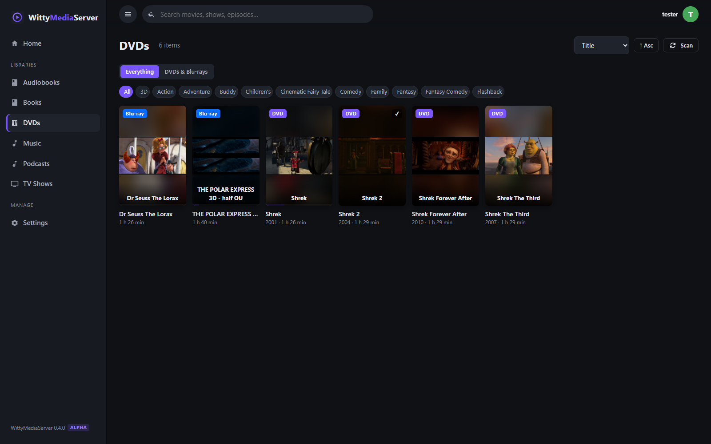
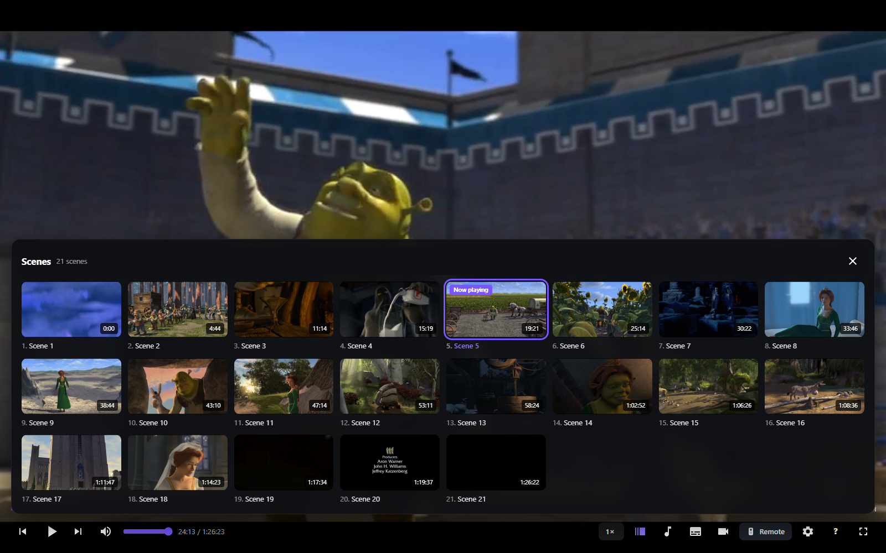
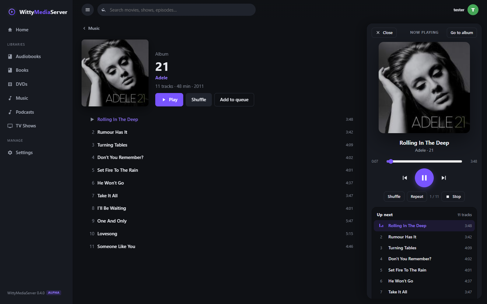
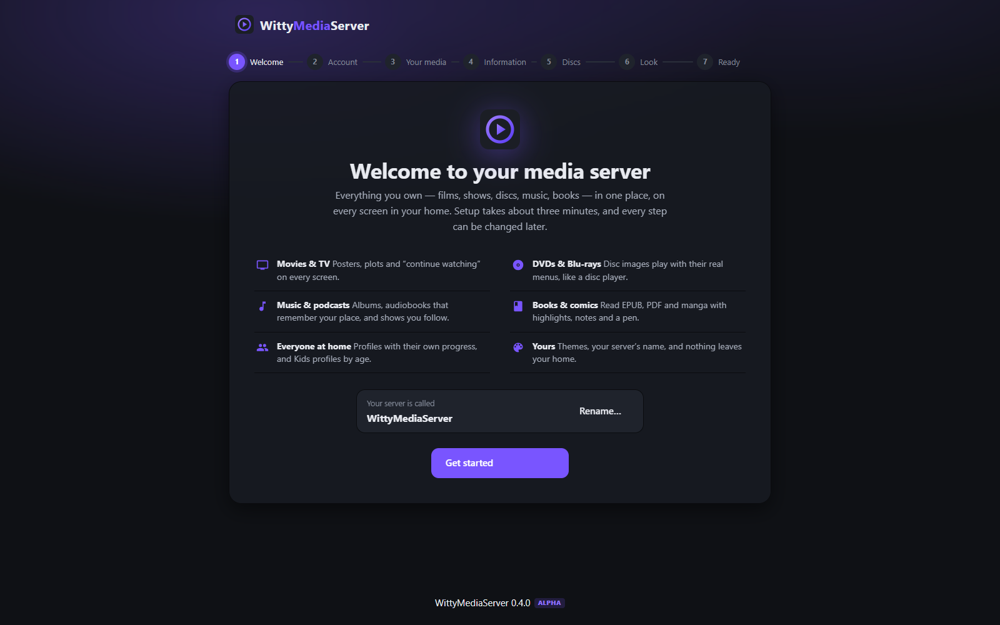
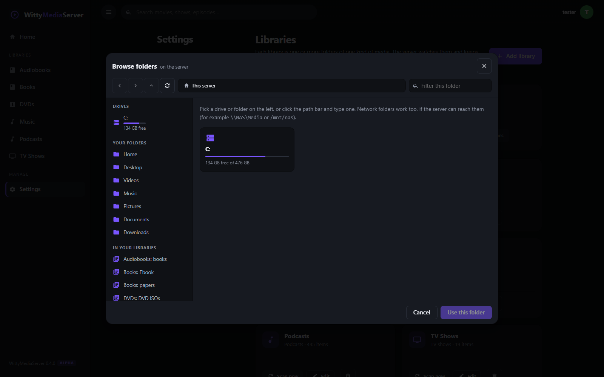
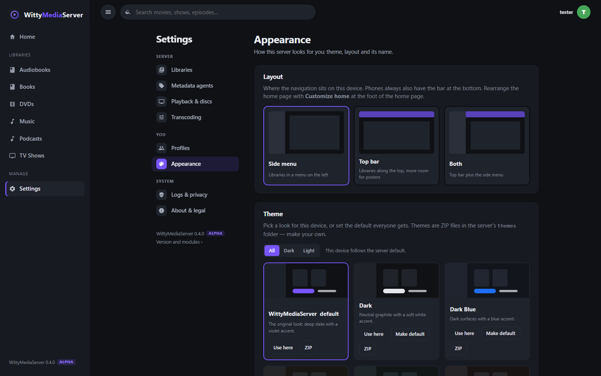
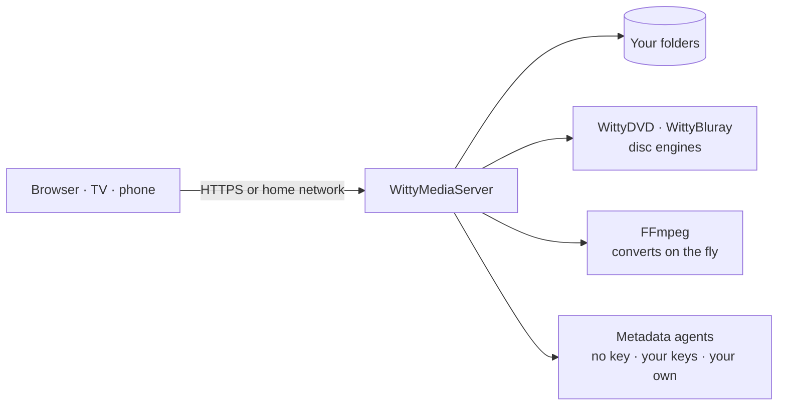

  

<h1 align="center">WittyMediaServer</h1>

  <b>Your films, shows, discs, music and books — on every screen in your home.</b> 
  A self-hosted media server that plays DVDs and Blu-rays <i>with their real menus</i>, in any browser.

  
  
  
  

  <a href="docs/GETTING_STARTED.md"><b>Get started</b></a> ·
  <a href="docs/INSTALL.md">Install</a> ·
  <a href="#guides">Guides</a> ·
  <a href="#the-witty-family">The Witty family</a> ·
  <a href="docs/REFERENCE.md">Reference</a>

  
   A real DVD's animated menu, played in the browser and driven with the on-screen remote.

> **Alpha.** Version 0.5.0-alpha is usable every day but still changing quickly. Back up your data
> folder before upgrading, and please report anything that goes wrong.

## Highlights

<table>
<tr>
<td width="33%" valign="top">

### 🎬 Films & TV
Posters, plots and ratings, *Continue watching*, *Next up*, skip intro, and instant seeking.
Information arrives with **no API key needed**; add free keys or your own agents for more.

</td>
<td width="33%" valign="top">

### 💿 DVDs & Blu-rays
Insert a disc image and it plays **like a disc player**: intros, animated menus, scene selection,
extras, pop-up menus, the disc's own subtitles. 4K and HDR are handled.

</td>
<td width="33%" valign="top">

### 🎵 Music & podcasts
Albums and artists, audiobooks that remember your place with a sleep timer, and podcasts you
follow. A player that stays with you as you browse.

</td>
</tr>
<tr>
<td valign="top">

### 📚 Books & comics
EPUB, PDF, comics and manga, with highlights in any colour, notes, a **pen with pressure**,
bookmarks, definitions and citations.

</td>
<td valign="top">

### 👨‍👩‍👧 Everyone at home
*Who's watching?* profiles with their own progress; **Kids** profiles that only show titles for
their age; guests without passwords.

</td>
<td valign="top">

### 🔒 Yours
Runs on your computer, in your home. No accounts, no telemetry, no cloud. Twenty themes, or make
your own.

</td>
</tr>
<tr>
<td valign="top">

### 📷 Photos
A timeline, albums, a **map that works offline**, slideshows, uploads and links to share, with
EXIF and RAW previews. Scanning reads only file headers, so large collections stay quick.

</td>
<td valign="top">

### 📱 Creator videos
Vertical videos with a **For You page worked out on your own server**, and creators' videos by
channel with subscriptions and comments, from files you already have.

</td>
<td valign="top">

### 🔀 Collections & more
**Smart playlists** across every library, music videos and concerts, internet radio, a year in
review, and playback speed on everything.

</td>
</tr>
<tr>
<td colspan="3" valign="top">

### 🎮 Games
Your own game files, by console, played in the browser with a gamepad, keyboard or touch controls you
can rearrange. Each game runs on the server in its own sandboxed process and streams with low latency. Consoles that
draw with a graphics card use the one in your server, and touch screens work with a mouse or a finger.
Saves follow your profile. [How it works](docs/GAMING.md).

</td>
</tr>
</table>

## Screenshots

| Home | A library |
|:---:|:---:|
|  |  |
| **A disc's page** | **Scenes, while watching** |
|  |  |
| **A DVD's still menu** | **A DVD's animated menu, with the remote** |
|  |  |
| **Music, docked beside the library** | **Setup** |
|  |  |
| **Choosing folders from any device** | **Themes and layout** |
|  |  |

## Get started

1. **Download** the archive for your computer from the [Releases](https://github.com/wittywilla/WittyMediaServer/releases) page and unzip it.
2. **Start** `WittyMediaServer`. Your browser opens the setup wizard.
3. **Follow the wizard**: create your account, point it at your folders, pick a look. About three minutes.

| Windows · macOS · Linux · FreeBSD | Docker | Always-on service |
|---|---|---|
| Double-click **WittyMediaServer**; it lives in the tray or menu bar. | `docker run -p 9797:9797 -v wms-config:/config -v /media:/media:ro ghcr.io/wittywilla/wittymediaserver` | `sudo ./install.sh` · Windows: `.\install.ps1` |

> **On your home network.** The server runs on your own computer, so it's available to every device
> on your home network (TV, phone, tablet, other computers) at the address the wizard shows. Away from
> home it works once you turn on **Remote Access** in Settings and follow its steps: see
> [Remote access](docs/REMOTE.md).

The full walkthrough, with no command line: **[Getting started](docs/GETTING_STARTED.md)**.

## Guides

| | Guide | What's inside |
|---|---|---|
| 🚀 | [Getting started](docs/GETTING_STARTED.md) | install, first account, folder layout, watching on other devices |
| 📦 | [Installing](docs/INSTALL.md) | downloads, tray app, services, Docker, Kubernetes, home and away |
| 🌍 | [Remote access](docs/REMOTE.md) | watching away from home: Tailscale, NetBird, port forwarding, HTTPS, keeping it safe |
| 💿 | [DVDs](docs/DVD.md) · [Blu-rays](docs/BLURAY.md) | inserting discs, menus, the remote, audio and subtitles, 3D, 4K and HDR |
| 📺 | [TV shows](docs/TV.md) | folder layouts, TheTVDB, skip intro, watch next |
| 📡 | [Channels and live TV](docs/CHANNELS.md) | channels from your library, the guide, tuners, IPTV, recording |
| 🏷️ | [Metadata](docs/METADATA.md) | metadata agents, custom agents, NFO files, artwork |
| 🎵 | [Music, audiobooks & podcasts](docs/MUSIC.md) | folders, tags and covers, the player, following podcasts |
| 📷 | [Photos](docs/PHOTOS.md) | formats, the timeline and map, uploads, sharing links |
| 📱 | [Vertical videos](docs/SHORTS.md) · [Creator videos & music videos](docs/CREATOR-VIDEOS.md) | folder layouts, sidecar files, For You, channels, concerts |
| 🔀 | [Collections, radio & Your year](docs/COLLECTIONS.md) | smart playlists, stations from a free directory or by address, what each profile's year looked like |
| ⚙️ | [Transcoding](docs/TRANSCODING.md) | direct play, hardware encoders, quality, GPU and CPU tables |
| 🎨 | [Themes](docs/THEMES.md) | the built-in themes and writing your own |
| 🗂️ | [Config file & logs](docs/CONFIG.md) | `wms.json`, portable mode, folders, what is logged |
| 🛠️ | [Reference](docs/REFERENCE.md) | flags, command-line tools, HTTP API, architecture, building |
| 📡 | [Client API](docs/CLIENT-API.md) · [OpenAPI](docs/openapi.json) | for apps and tools: TV sign-in, playback profiles, stream tokens, disc menus |
| ❓ | [Troubleshooting](docs/TROUBLESHOOTING.md) | the common problems and their fixes |
| 🧩 | [Modules & apps](docs/MODULES.md) · [Roadmap](docs/ROADMAP.md) · [Changelog](CHANGELOG.md) | how the pieces fit, and what's next |

## The Witty family

WittyMediaServer is built from engines and plugins that also stand on their own, each in its own
repository:

| Project | What it is |
|---|---|
| [**WittyDVD**](https://github.com/wittywilla/WittyDVD) | DVD-Video engine: the disc's virtual machine, menus, highlights and subtitles |
| [**WittyBluray**](https://github.com/wittywilla/WittyBluray) | Blu-ray engine: HDMV navigation, interactive menus, pop-ups, subtitles, 4K/HDR |
| [**WittyCD**](https://github.com/wittywilla/WittyCD) | Audio CD images played gaplessly as one continuous stream, with their tracks, indexes and CD-TEXT |
| [**WittyDisc**](https://github.com/wittywilla/WittyDisc) | Reads ISO 9660 and UDF disc images without mounting them |
| [**WittyTuner**](https://github.com/wittywilla/WittyTuner) | TV tuners and IPTV behind one interface; encrypted channels are refused |
| [**WittyInk**](https://github.com/wittywilla/WittyInk) | What the readers share: highlights, notes, pen with pressure, panels |
| [**WittyEbook**](https://github.com/wittywilla/WittyEbook) · [**WittyPDF**](https://github.com/wittywilla/WittyPDF) · [**WittyComics**](https://github.com/wittywilla/WittyComics) | The book, PDF and comic readers |
| [**WittyReader**](https://github.com/wittywilla/WittyReader) | A standalone reading app built from those readers, that keeps everything on your device |

Development happens here; the other repositories are published from this one.

## How it works

Everything runs in one program on your computer, with a SQLite database and FFmpeg bundled. Files
the browser can play are sent as they are; everything else is converted on the fly, with seeking that
starts in about half a second. Details: [Reference → Architecture](docs/REFERENCE.md#architecture).

## Privacy & security

- **Nothing leaves your home** except the titles of your media, and only for the metadata agents you
  keep switched on. Audio CDs are looked up by their table of contents alone: no names, no audio.
- **No telemetry, no accounts with anyone, no cloud.** Logs stay on your computer and never contain
  passwords or session tokens.
- **Hardened by default:** cross-site requests are refused, artwork and books can't run scripts, feeds
  and agents can't reach other devices on your network, and copy protection is never bypassed.

## Contributing

Issues and pull requests are welcome; see **[CONTRIBUTING.md](CONTRIBUTING.md)**. Before opening a
pull request, run `gofmt`, `go vet ./...`, `go test ./...` and `npm run build` in `web/`. For disc
problems, attach `wms dvd walk` or `wms bluray walk` output, never disc images. The disc engines are
written from the public disc formats and must stay free of other players' code.

## Licence & legal

**[Apache License 2.0](LICENSE).** Use, change and share WittyMediaServer, commercially or not, keeping
the licence and the attribution in **[NOTICE](NOTICE)**: *“This product includes WittyMediaServer,
developed by WittyWilla”*, in your distribution, documentation or About screen.

<b>Your media, third parties and warranty</b>

**Your media, your responsibility.** WittyMediaServer organises and streams media you already own
and have the right to use. It does not supply, index, search for or share any content. Server
operators and users are responsible for the files they add and for following the laws where they and
their viewers live. The authors and contributors accept no liability for media stored on, played
from or shared through a server, nor for how a server is used.

**No circumvention.** Copy protection is never decrypted or bypassed: CSS-scrambled DVDs and
AACS-encrypted Blu-rays are refused. Whether you may make unprotected copies of discs you own is a
matter of local law.

**Third parties.** Video is converted by **FFmpeg**, run as a separate program; the bundled builds
are GPL-licensed, with sources linked from [THIRD_PARTY_LICENSES.md](THIRD_PARTY_LICENSES.md). This
product uses the **TMDB** API but is not endorsed or certified by TMDB. TV information is provided by
**TheTVDB** and **TVmaze** (CC BY-SA 4.0); movie facts by **Wikidata** (CC0) and **Wikipedia**
(CC BY-SA 4.0); anime by **AniList**. Each service's terms apply to its data.

**No warranty.** Provided “as is”, without warranty of any kind. WittyMediaServer is not affiliated
with any other media software project, studio or rights holder; all trademarks belong to their
owners.

---

WittyMediaServer 0.5.0-alpha · Apache-2.0 · Made by <a href="https://github.com/wittywilla">WittyWilla</a>

