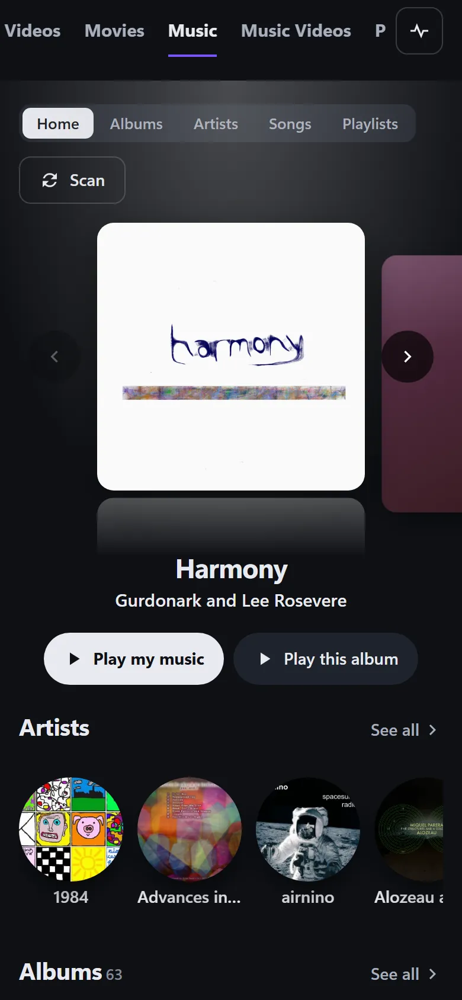
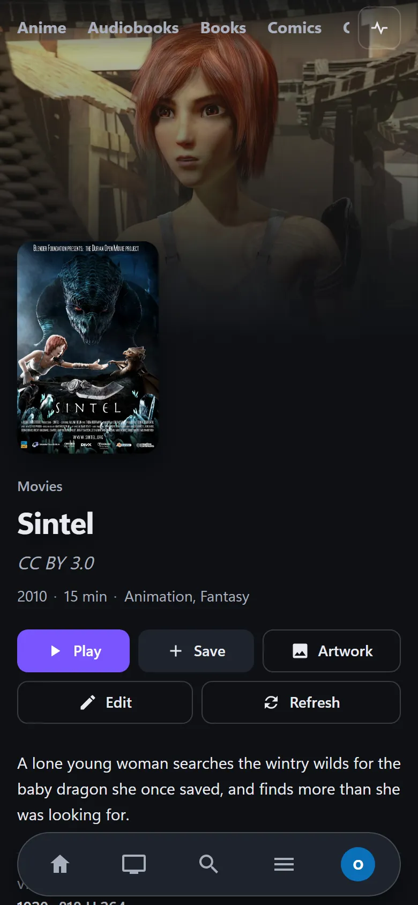
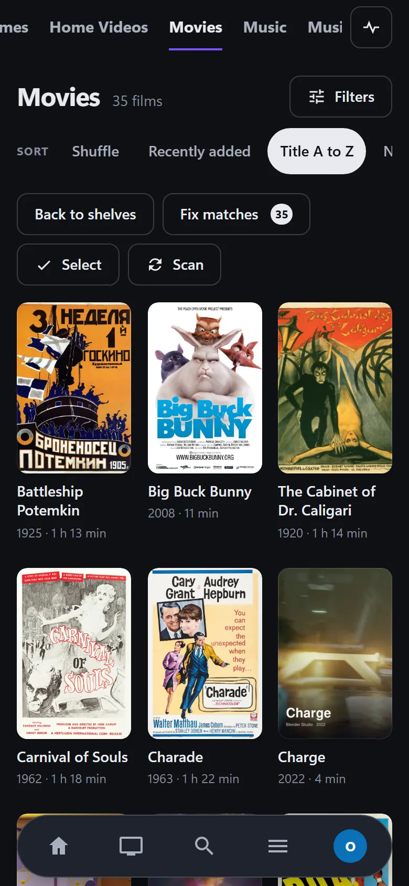
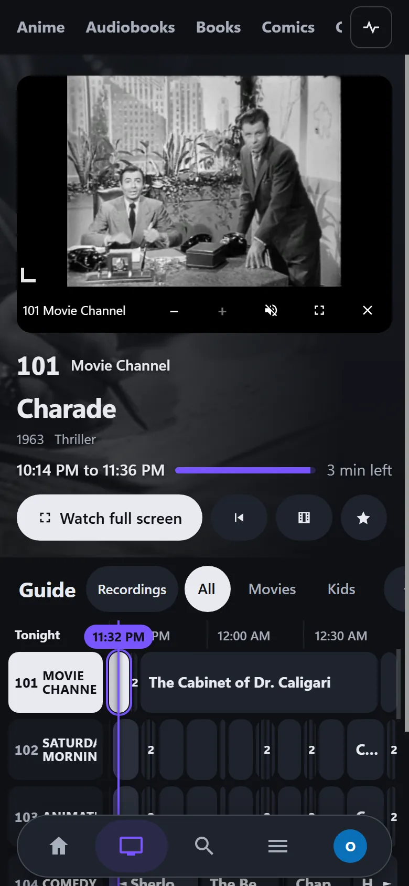
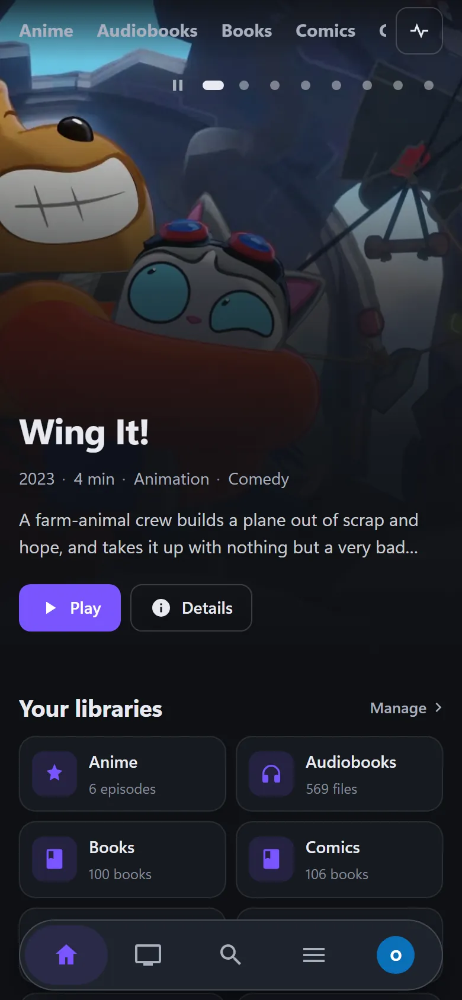
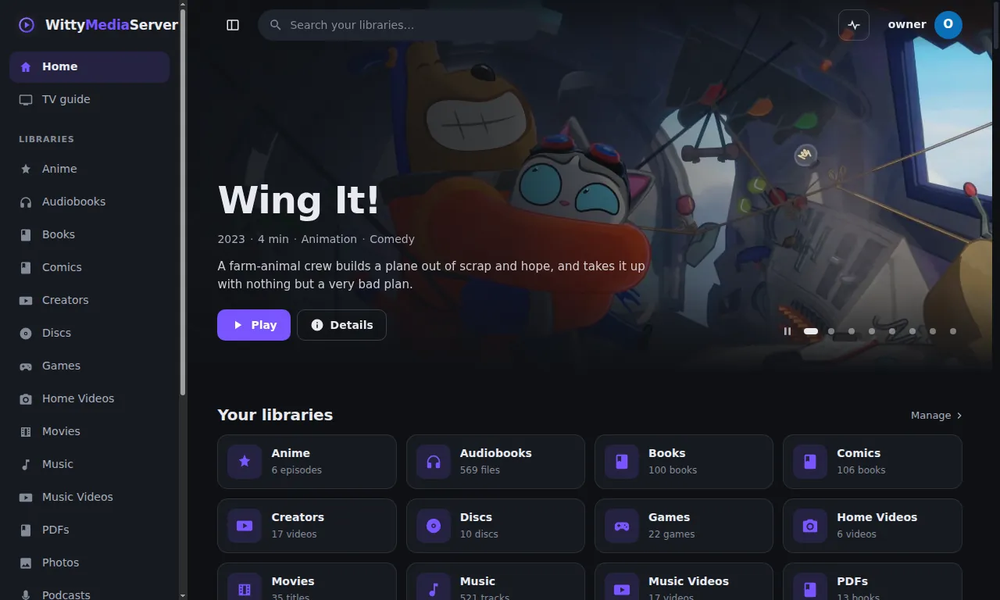
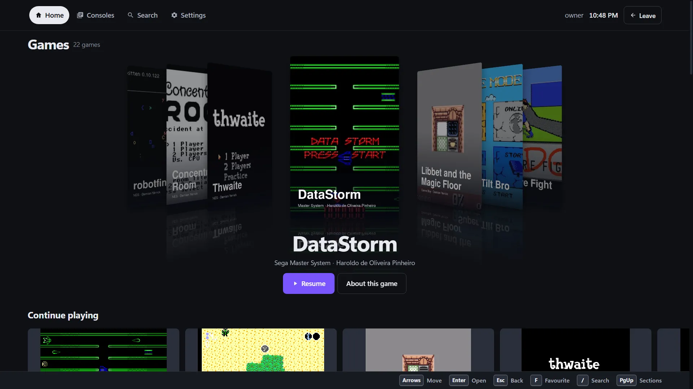

# Apps and devices

Use this guide to choose how to reach your server from each device, and to connect an app. It says plainly what has been run on each platform and what hasn't been built.

**A web browser is the only way that does everything today, on everything.** The apps are early, and most haven't been tried on real devices.

## What's been run, platform by platform

| Device | What you use | How far it's been run | Not built or not seen |
|---|---|---|---|
| Any computer, phone or TV with a browser | The server's own web app | Works today, and every test of the server uses it on desktop browsers | Safari, phone browsers, hardware HEVC and HDR screens haven't been checked |
| Windows 10 or later | WittyMediaClient desktop app | Run from source and as a packaged app. Its setup and uninstaller have run under Wine, not on real Windows | Real game controllers and remotes |
| Linux | WittyMediaClient desktop app | Installed and opened on virtual screens, in containers and a Fedora virtual machine | A real desktop |
| FreeBSD 15, amd64 | WittyMediaClient desktop app | Installed and played, with sound, in a virtual machine. It needs FreeBSD's own Electron | A real desktop. FreeBSD 14, aarch64 and i386 |
| Plasma Big Screen | WittyMediaClient desktop app, which opens as a TV app there | The real shell in a virtual machine, with real key presses, picture and sound | A real TV or remote |
| Mac | WittyMediaClient desktop app, and a native Mac app | Not run. Neither has been opened on a Mac yet | Everything |
| Android phone | WittyMediaClient for Android | Emulators only: all of it on Android 16, and connecting and playing on Android 6 | Real phones, sound, Android 7 to 15. See below |
| Android on ARM, 32-bit and 64-bit | The same app | Built into the same APK, and not run: every emulator here is x86 | Any ARM device, which means most real phones and TVs |
| Android on x86 | The same app | 64-bit ran on the emulators. 32-bit is built and not run | Real devices |
| Android tablet | The same app | Built and not run | Everything |
| Android TV | The same app | An Android 16 emulator at 1080p, with arrow keys and OK only | Real TVs and remotes. See below |
| Google TV, Fire TV | The same app | Built and not run. Fire TV needs Fire OS 6 or later | Everything |
| iPhone, iPad | WittyMediaClient for Apple | Not run. The code has never been compiled | Everything |
| Apple TV | WittyMediaClient for Apple | Not run. The code has never been compiled | Everything |

**Not built on the Android and Apple apps:**

- Music, audiobooks and podcasts. Android doesn't offer them yet, and the Apple app lists them with a note that they play in a browser for now.
- TV channels, live TV and the guide.
- Books and comics, disc menus, photos and consoles.
- Playing in the background, and picture in picture, on Android.
- A prompt for a two-factor code when signing in with a password. Those accounts can [sign in with a code](#sign-in-with-a-code) instead.

These apps say plainly when something can't play yet. For anything on this list, use a browser on that device.

**Games on someone's own PC:** the apps can open the Game PCs pages, and start the separately installed Moonlight app where it's there. No part of this has reached a real PC from an app yet. See [Game PCs](GAME-RIGS.md).

**Not started:** LG and Samsung TV apps, Roku, Windows 7 and games consoles.

## A web browser

Open the server's address, and you have everything: films, TV, music, books, photos, games, discs and live TV.


*Music at phone width. Credited in [the list](images/CREDITS.md).*


*At phone width. [Sintel](https://durian.blender.org/), Blender Foundation, [CC BY 3.0](https://creativecommons.org/licenses/by/3.0/).*


*At phone width. Openly licensed and public-domain media, credited in [the list](images/CREDITS.md).*


*WittyTV at phone width. Openly licensed and public-domain media, credited in [the list](images/CREDITS.md).*


*At phone width. Openly licensed and public-domain media, credited in [the list](images/CREDITS.md).*

1. Find the server's address. An administrator sees it at **Settings → About → This server**, under **Open it on other devices at home**. It looks like `http://192.168.1.20:9797`.
2. Type it into a browser on any device on your home network, and bookmark it.

A browser can't search your network for servers, so you need the address.

## WittyMediaClient

The app for putting your server on a device.


*WittyMediaClient on a desktop, connected to a test server. Openly licensed and public-domain media, credited in [the list](images/CREDITS.md).*

### On a computer

The desktop app is a window around the server's own web app, so every feature arrives with the server. It adds finding servers on your network, a [sign-in code](#sign-in-with-a-code), and a title bar that follows your theme.

Get it from the [WittyMediaClient releases page](https://github.com/wittywilla/WittyMediaClient/releases).

| You have | Download |
|---|---|
| Windows 10 or later | `wittymediaclient-<version>-windows-amd64-setup.exe` |
| A Mac with Apple silicon | `wittymediaclient-<version>-macos-arm64.dmg` |
| A Mac with an Intel chip | `wittymediaclient-<version>-macos-x64.dmg` |
| Debian, Ubuntu and relatives | `wittymediaclient-<version>-linux-amd64.deb` |
| Fedora and relatives | `wittymediaclient-<version>-linux-amd64.rpm` |
| Arch and relatives | `wittymediaclient-<version>-linux-amd64.pacman` |
| Any other Linux | `wittymediaclient-<version>-linux-amd64.AppImage` |
| FreeBSD, amd64 | `wittymediaclient-<version>-freebsd-amd64.pkg` |
| Plasma Big Screen | The `.deb`, `.rpm` or `.pacman` for its distribution |

The builds aren't code-signed yet, so Windows and macOS warn about them. On Windows, choose **More info**, then **Run anyway**. On a Mac, use **Open Anyway** in **System Settings → Privacy & Security**.

**Good to know:**

- **Keys:** Tab moves around the page. F6 moves between the page and the title bar.
- **Help** in the title bar has **Open logs folder** and **Copy diagnostic info**.
- **A weak computer:** the app uses a good deal of memory. A browser uses less.
- **Plasma Big Screen:** in a Bigscreen session it opens as a TV app by itself, across the whole screen, and works with arrows, Enter and Back. Use a package and not an AppImage, because an AppImage doesn't add itself to the launcher.

### On Android

One app, about 3 MB, covers phones, tablets and TVs on ARM and x86, from Android 6 up. It isn't in any store yet, and has to be installed by hand. It's on the same [releases page](https://github.com/wittywilla/WittyMediaClient/releases), signed with a test key, so it can't be updated to a store version later without uninstalling first.

**On a phone or tablet:** copy the `.apk` over and open it. Android asks you to allow installing from that app.

**On a TV:** in the TV's settings, turn on Developer options and network debugging. Then, from a computer with Android's `adb` tool, use your TV's address and the name of the file you downloaded:

```bash
adb connect 192.168.1.50
```

```bash
adb install app-sideload.apk
```

What it does, as seen on emulators: home, libraries, shows, search, video with resume, sound tracks and subtitles, skip intro and the next-episode countdown. Phones ask for two channels of sound. A metered connection asks for no more than 8 Mb/s.

Sound hasn't been listened to, because the emulators have none. Nobody has tried it on a cheap TV stick, so how smooth it is there isn't known.

### On Apple devices

The apps for iPhone, iPad, Apple TV and Mac are written, and have never been compiled. Nothing can be downloaded. Apple only allows building and installing from a Mac, and they aren't in the App Store.

On an Apple device today, use a browser. Apple TV has no browser, so there's no way to use the server on it yet.

## Other apps from this project

**WittyMediaPlayer** and **WittyReader** work on their own. **Neither connects to your server.** Use them for files on the computer in front of you.

**WittyMediaPlayer** plays video, audio, DVDs and Blu-rays on your own computer, with real disc menus, from a drive, an image or a folder. It can also make a disc image to add to a server library, and copy audio CDs. It needs no server and no account. It's for Windows 10 version 1809 or newer, and only Windows for now. Its installer has run under Wine, not on real Windows. Get it from the [WittyMediaPlayer releases page](https://github.com/wittywilla/WittyMediaPlayer/releases).

**WittyReader** reads and annotates books, PDFs and comics on your own device, using the same readers as the server, and nothing is uploaded. There are installers for Windows, Mac and Linux, and a copy on your own web server can be installed from a phone's browser. Its Windows installer has run under Wine, not on real Windows, and its Mac installer has not been run on a real Mac yet. Get it from the [WittyReader releases page](https://github.com/wittywilla/WittyReader/releases).

To read books that are on your server, open them in a browser: see [Books](BOOKS.md).

## Big screens

There are two different things here.


*The big-screen view. Openly licensed and public-domain media, credited in [the list](images/CREDITS.md).*

**Big screen mode** is for the whole web app on a TV across the room. It makes text larger and the outline around the selected item stronger. Turn it on at **Settings → Appearance → Motion and big screens**. It applies to that device only. On a TV browser with no easy way to reach Settings, add `?tv=1` to the server's address.

**Couch mode** is for games on a sofa. It shows only your game libraries, full screen and large, with nothing that needs a mouse. Open it with the **Couch mode** button on a games library, or go to `/big` on your server, such as `http://192.168.1.20:9797/big`. See [Games](GAMES.md).

For moving around with a remote or a controller, see [TV remotes and controllers](PLAYING.md#tv-remotes-and-controllers).

## How apps find your server

Apps search your home network, and the servers they find are listed under **On your network**. A TV has the first one already selected, so one press of OK chooses it.

- **What the server announces:** its name, a random ID, its version and how to connect. Nothing about accounts or folders. Being found opens nothing: connecting still takes a code or a password.
- **To turn this off:** **Settings → Profiles → Signing in → Let apps find this server**. Apps can still connect by typing the address.

**If your server isn't listed:**

- A firewall on the server may be blocking UDP ports 5353 and 9797.
- Your Wi-Fi may keep devices apart. Guest networks and "client isolation" do this.
- The server may be in a container without host networking.
- The server may only accept connections from its own computer.

In any of these cases, [type the address](#typing-the-address). Searching has found real servers through emulators' and virtual machines' networks, but a phone and a server on one real Wi-Fi hasn't been tried yet. An Android 6 emulator found none.

A server that has stopped stays on the list for up to 45 seconds. If it says it can't be reached, it may have gone.

## Typing the address

Choose **Enter an address** and type it. The server shows its address when it starts, and an administrator can find it at **Settings → About**. `192.168.1.20` is enough: the app adds `http://` and port 9797 by itself. If the port was changed in **Settings → Network**, add it: `192.168.1.20:8096`.

| You're connecting | Type |
|---|---|
| At home | `192.168.1.20` |
| On a different port | `192.168.1.20:8080` |
| Through a private network | `100.101.102.103` |
| Through HTTPS | `https://media.example.com` |

For an address on the internet the app insists on `https://`, because your password would otherwise travel unencrypted. To set up access away from home, see [Remote access](REMOTE.md).

## Signing in

### Sign in with a code

The easy way on a TV, with no typing of passwords. There are two ways round.

**The device asks for a code:**

1. On a phone or computer already signed in, open the menu under your name and choose **Sign in a TV**.
2. Under **Your TV asks for a code**, choose who to sign in as, if you're offered a choice, and press **Get a code**. An adult has to do this.
3. Type the 6 digits on the device. On a TV, arrows and OK work the number pad.

The code works once, for 5 minutes. Anyone who sees it could use it, so get it when you're ready.

**The device shows a code:**

1. On the device, choose **Show a code on this screen instead**. It shows a code and a QR code.
2. On a phone or computer already signed in, scan the QR code, or open **Sign in a TV** and type the code under **Your TV shows a code**.
3. Check the device it names, and press **Sign it in** or **Refuse**.

**Only approve a code if you're looking at it on your own device right now.** Someone can send you their code and ask you to approve it. Approving signs their device in as you. See [Remote access](REMOTE.md#letting-other-people-in).

### With a password

Choose **Use a password instead**, pick your profile or type your name, and enter your password. If your account uses two-factor sign-in, use a code instead on the native apps.

### If the app warns about the server

Apps remember each server's identity. If a different one answers at the same address, you see **This isn't the server you used before**, and nothing is sent to it.

It could be your server after a reinstall, or a look-alike. To check, compare the fingerprint with the one at the bottom of the **Sign in a TV** page on your server. Only choose **This is my server, trust it** if you know why it changed.

The first connection trusts whatever it's shown, so comparing the fingerprint is worth doing once. HTTPS protects against this too.

## Moving to another server

- **Desktop app:** **Change server** in the title bar. It signs out of the server you're leaving.
- **Android:** **Change server** on the sign-in screen and on your Profile. To come back, you need to sign in again.

**Sign out** on Android ends the sign-in on the server too.

## Removing an app

- **Windows:** **Settings → Apps → Installed apps**. It asks whether to delete your settings and sign-ins too.
- **Mac:** **Uninstall WittyMediaClient.command** on the disk image. This has not been run on a real Mac yet.
- **Linux:** your package manager. An AppImage is one file you delete.
- **FreeBSD:** run `wittymediaclient --uninstall`.
- **Android:** as for any other app.

Removing an app never touches your server or your media.

---

<sub>WittyMediaServer documentation</sub>
