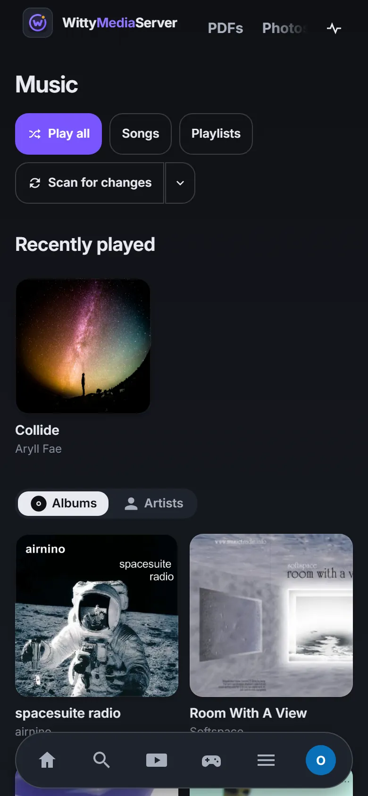
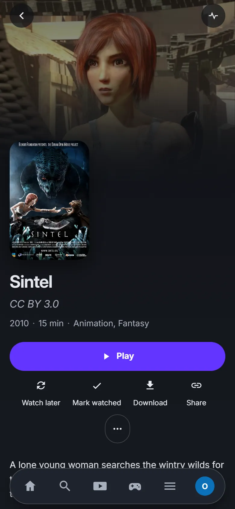
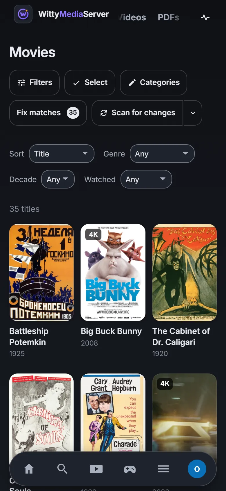
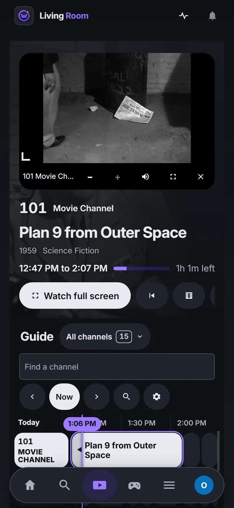
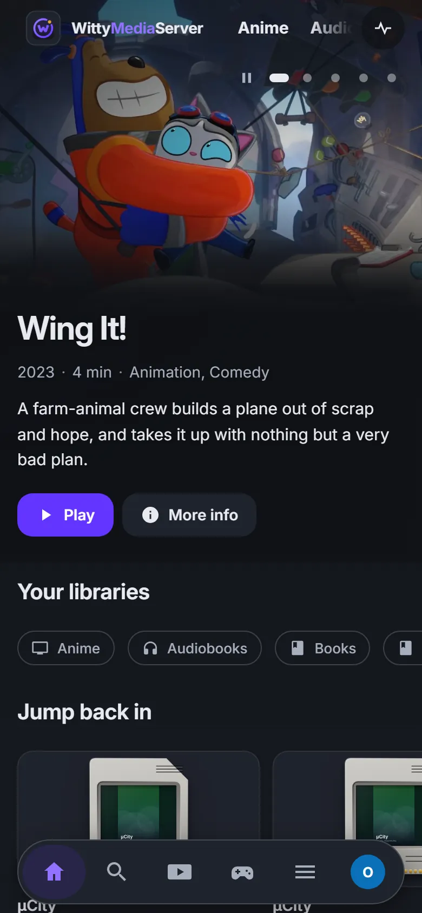
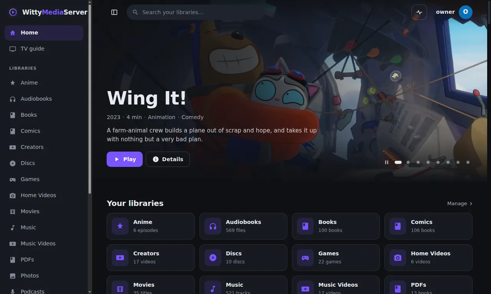
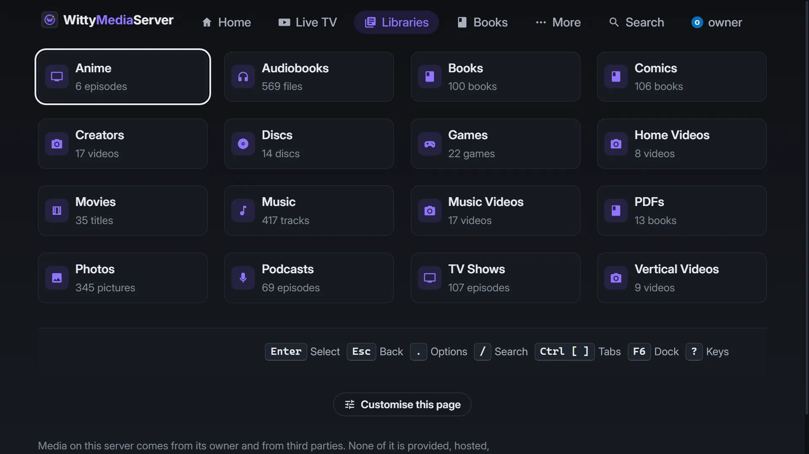
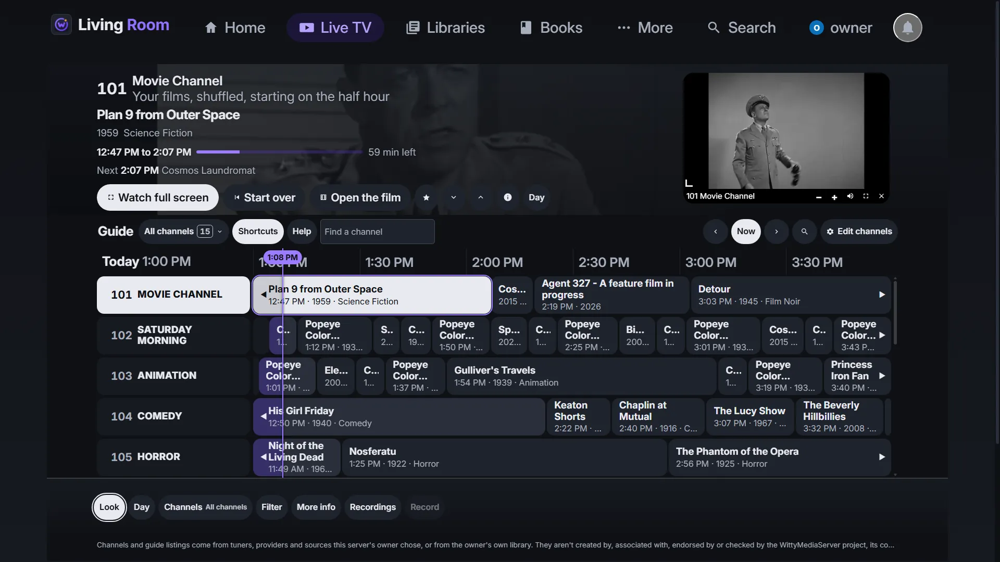
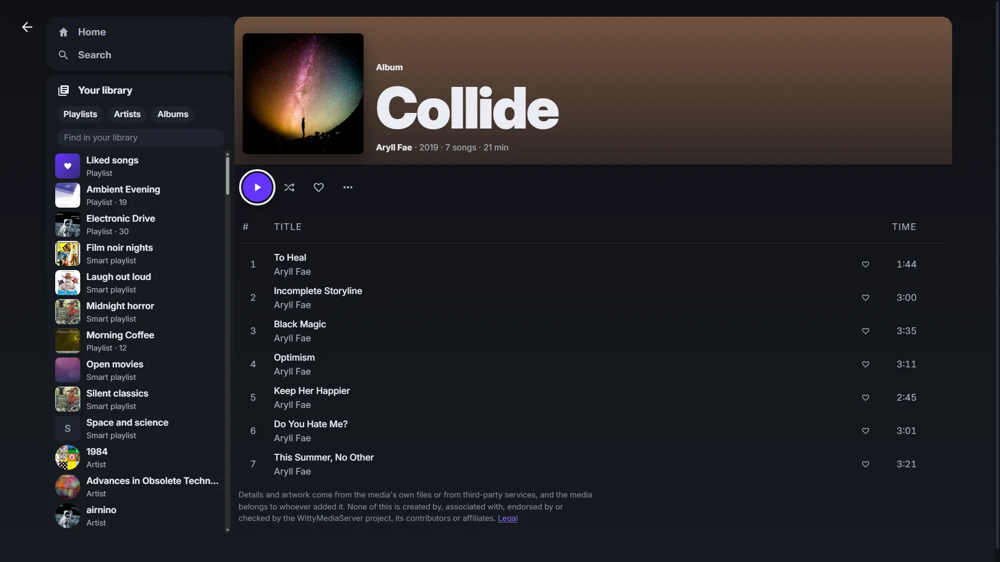

# Apps and devices

Every way to reach your server, and how to connect an app. It also says plainly how far each device has been run.

- [A web browser](#a-web-browser)
- [WittyMediaClient](#wittymediaclient)
- [What has been run where](#what-has-been-run-where)
- [How apps find your server](#how-apps-find-your-server)
- [Typing the address](#typing-the-address)
- [From away](#from-away)
- [Signing in](#signing-in)
- [Big screens](#big-screens)
- [Moving to another server](#moving-to-another-server)
- [Other apps from this project](#other-apps-from-this-project)
- [Removing an app](#removing-an-app)

## A web browser

Open the server's address in any browser and you have everything: films, TV, music, books, photos, games, discs and live TV. Nothing has to be installed.


*Music at phone width. Credited in [the list](images/CREDITS.md).*


*At phone width. [Sintel](https://durian.blender.org/), Blender Foundation, [CC BY 3.0](https://creativecommons.org/licenses/by/3.0/).*


*At phone width. Openly licensed and public-domain media, credited in [the list](images/CREDITS.md).*


*WittyTV at phone width. Openly licensed and public-domain media, credited in [the list](images/CREDITS.md).*


*At phone width. Openly licensed and public-domain media, credited in [the list](images/CREDITS.md).*

1. Find the server's address. An administrator sees it in **Settings → About**, under **Open it on other devices at home**. It looks like `http://192.168.1.20:9797`.
2. Type it into a browser on any device at home, and bookmark it.

A browser can't search your network for servers, so you need the address. A browser also can't connect [from away](#from-away) peer to peer: that needs the app.

## WittyMediaClient

The app for your server, on every platform: Windows, macOS, Linux, FreeBSD, Plasma Bigscreen, Android phones, tablets and TVs, iPhone, iPad and Apple TV. It finds your server at home by itself, signs in with a code, and connects from away with nothing set up on your router.


*WittyMediaClient on a desktop, connected to a test server. Openly licensed and public-domain media, credited in [the list](images/CREDITS.md).*

Every app draws the same pages, which the server describes. New pages and modules arrive with the server, with no app update. The desktop app is a window around the server's own web app, so it has everything a browser has. If the Android or Apple app can't play something yet, it says so: use a browser on that device for it.

Get it from the [WittyMediaClient releases page](https://github.com/wittywilla/WittyMediaClient/releases). Nothing is in an app store yet.

| You have | Download |
|---|---|
| Windows 10 or later | `wittymediaclient-<version>-windows-amd64-setup.exe` |
| A Mac with Apple silicon | `wittymediaclient-<version>-macos-arm64.dmg` |
| A Mac with an Intel chip | `wittymediaclient-<version>-macos-x64.dmg` |
| Debian, Ubuntu and relatives | `wittymediaclient-<version>-linux-amd64.deb` |
| Fedora and relatives | `wittymediaclient-<version>-linux-amd64.rpm` |
| Arch and relatives | `wittymediaclient-<version>-linux-amd64.pacman` |
| Linux with Flatpak or snap | `wittymediaclient-<version>-linux-amd64.flatpak`, `wittymediaclient-<version>-linux-amd64.snap` |
| Any other Linux | `wittymediaclient-<version>-linux-amd64.AppImage` |
| FreeBSD, amd64 | `wittymediaclient-<version>-freebsd-amd64.pkg`. It uses FreeBSD's own Electron, which `pkg` installs with it |
| Plasma Bigscreen | The `.deb`, `.rpm`, `.pacman` or `.flatpak` for its distribution |
| Android phone, tablet or TV | `wittymediaclient-<version>-android-universal.apk`, or the smaller one for its processor |
| iPhone or iPad | `wittymediaclient-<version>-ios.ipa`, installed with AltStore, SideStore or Sideloadly |
| Apple TV | `wittymediaclient-<version>-tvos.ipa`, installed with Sideloadly, or Xcode on a Mac |

**Not code-signed yet.** Windows and macOS warn about the desktop app. On Windows, choose **More info**, then **Run anyway**. On a Mac, use **Open Anyway** in **System Settings → Privacy & Security**.

**Android.** Copy the `.apk` to a phone or tablet and open it. Android asks you to allow installing from that app. On a TV, turn on Developer options and network debugging, then, from a computer with Android's `adb` tool:

```bash
adb connect 192.168.1.50
```

```bash
adb install wittymediaclient-<version>-android-universal.apk
```

The APKs are signed with a test key, so a store version can't update them later without uninstalling first.

**iPhone, iPad and Apple TV.** The `.ipa` files are unsigned. The tool that installs one signs it with your own Apple ID. With a free Apple ID, the app has to be refreshed every 7 days. AltStore and SideStore do that for you, but don't install to an Apple TV.

**On the desktop app:**

- Tab moves around the page. F6 moves between the page and the title bar.
- **Help** in the title bar has **Open logs folder** and **Copy diagnostic info**.
- On Plasma Bigscreen it opens as a TV app, across the whole screen, with arrows, Enter and Back. Elsewhere, `wittymediaclient --tv` does the same.

## What has been run where

This is an alpha. "Run" means someone used it on that device, against a real server.

| Device | How far it has been run |
|---|---|
| Any browser | Works today. Every test of the server uses desktop browsers. Safari, phone browsers and HDR screens haven't been checked closely |
| Mac | The desktop app, on Apple silicon, by the owner. Not on an Intel Mac |
| Windows | The desktop app from source and as a package. Its installer has run under Wine |
| Linux | Installed, opened, upgraded and removed in containers and a Fedora virtual machine. Not on a real desktop |
| FreeBSD 14 and 15, amd64 | In virtual machines, with picture and sound on 15 |
| Plasma Bigscreen | The real shell in a virtual machine. Never on a TV with a real remote |
| Android phone, tablet and TV | On real devices, with real media, for 0.8.0-alpha |
| Google TV, Fire TV | Built, not run. Fire TV needs Fire OS 6 or later |
| Apple TV | On a real Apple TV, for 0.8.0-alpha |
| iPhone | In Apple's simulator. Not yet on a real iPhone |
| iPad, Apple Vision Pro | Built, not run |

**Not started:** LG and Samsung TV apps, Roku, Windows 7 and games consoles.

**Games on someone's own PC:** the apps open the Game PCs pages, and start the separately installed Moonlight app where it's the way in. No app has reached a real PC yet. See [Game PCs](GAME-RIGS.md).

## How apps find your server

At home, apps search your network, and list the servers they find under **On your network**. A TV has the first one already selected, so one press of OK chooses it.

- **What the server announces:** its name, a random ID, its version and how to connect. Nothing about accounts or folders. Being found opens nothing: connecting still takes a code or a password.
- **To turn it off:** **Settings → Profiles**, under **Signing in**, turn off **Let apps find this server**. Setup asks this too, as **Find this server automatically**. Apps can still connect by typing the address.

**If your server isn't listed:**

- A firewall on the server may be blocking UDP ports 5353 and 9797.
- On a Mac, the server may not be allowed on the local network. Turn on **WittyMediaServer** in **System Settings → Privacy & Security → Local Network**. The server notices within a minute.
- Your Wi-Fi may keep devices apart. Guest networks and "client isolation" do this.
- The server may be in a container without host networking.

In any of these cases, [type the address](#typing-the-address). A server that has stopped stays on the list for up to 45 seconds.

## Typing the address

Choose **Enter an address** and type it. `192.168.1.20` is enough: the app adds `http://` and port 9797. If the port was changed in **Settings → Network**, add it: `192.168.1.20:8096`.

| You're connecting | Type |
|---|---|
| At home | `192.168.1.20` |
| On a different port | `192.168.1.20:8080` |
| Through a private network | `100.101.102.103` |
| Through HTTPS | `https://media.example.com` |

For an address on the internet, the app insists on `https://`, because your password would otherwise travel unencrypted.

## From away

Away from home, the app can reach your server **peer to peer**, with nothing set up on your router and no account with anyone. An administrator turns it on first, in **Settings → Remote Access → Peer-to-peer connections**. [Remote access](REMOTE.md#peer-to-peer-connections) says what that exposes, and how to test it.

### Connect a device

One way, the same everywhere. On the server, open **Settings → Remote Access** (or **Connect a device** under **You**) and press **Show a code**. It shows a short code like `K7QM-2XHD` and a QR code.

- **On your home network:** in the app, choose **Add a server**, then **Enter a code**, and type the code. The app asks the servers it finds on the network, and the one that made the code proves it before the app says anything more.
- **Away from home:** scan the QR code with the device's camera, or send the device the link under **More options** and choose **Add a server → Paste a link**. This needs peer to peer on; the page offers to turn it on.

The code and the link are one way in: they work once, for fifteen minutes, and whichever is used first ends the other. Signing a device in as an administrator asks for the administrator's password again.

A device that was signed in at home also adds itself to the server's list within a minute, and from then on connects from away by itself. The app's **From away** row, under **You**, says how it's doing.

A device connected this way counts as away from home: it gets the [limits for viewers away from home](REMOTE.md#limits-for-viewers-away-from-home).

## Signing in

### Sign in with a code

The easy way on a TV, with no password to type. There are two ways round.

**The device asks for a code:**

1. On a phone or computer already signed in, open your account menu and choose **Sign in a TV**.
2. Under **Your TV asks for a code**, choose who to sign in as, and press **Get a code**. An adult has to do this.
3. Type the 6 digits on the device. On a TV, arrows and OK work the number pad.

The code works once, for 5 minutes. Anyone who sees it could use it, so get it when you're ready.

**The device shows a code:**

1. On the device, choose **Show a code on this screen instead**. It shows a code and a QR code.
2. On a phone or computer already signed in, scan the QR code, or open **Sign in a TV** and type the code under **Your TV shows a code**.
3. Check the device it names, and press **Sign it in** or **Refuse**.

**Only approve a code you're looking at on your own device, right now.** Someone can send you their code and ask you to approve it. Approving signs their device in as you. See [Remote access](REMOTE.md#letting-other-people-in).

### With a password

Choose **Use a password instead**, pick your profile or type your name, and enter your password. If your account uses two-factor sign-in, the app then asks for the six digits from your authenticator app.

### If the app warns about the server

Apps remember each server's identity. If a different one answers at the same address, you see **This isn't the server you used before**, and nothing is sent to it.

It could be your server after a reinstall, or a look-alike. Compare the fingerprint with the one at the bottom of the **Sign in a TV** page on your server. Only choose **This is my server, trust it** if you know why it changed.

The first connection trusts what it's shown, so comparing the fingerprint once is worth it. HTTPS protects against this too.

## Big screens


*TV mode's Libraries.*

**TV mode** lays the web app out for a TV across the room. Everything is large, and a ring shows what's selected. It works with a TV remote, a game controller, a keyboard, a mouse or a touch screen.

- Turn it on with **TV mode** in your account menu, or in **Settings → Appearance**. It applies to that device only.
- On a TV browser with no easy way to Settings, add `?tv=1` to the server's address. `?tv=0` turns it off.
- To leave it, open **You** and choose **Leave TV mode**.
- The apps on Android TV, Apple TV and Plasma Bigscreen are laid out this way by themselves.

On a TV, keyboard keys aren't shown: a **Keys** button lists what the remote or controller does. The TV guide shows at least five whole channels, with its buttons behind **Shortcuts** beside the channel set (the remote's Menu opens it, Back closes it), and **Help** says what each key does. An album's page puts the cover beside its title, with **Play** and **Shuffle** under it and the songs below.


*TV mode's guide, with Shortcuts open. Openly licensed and public-domain media, credited in [the list](images/CREDITS.md).*


*An album in TV mode. [Collide](https://archive.org/details/SRS08807), Aryll Fae, [CC BY 4.0](https://creativecommons.org/licenses/by/4.0/).*

**Couch mode** is for games on a sofa. It shows only your game libraries, full screen, with nothing that needs a mouse. Open it with **Couch mode** on a games library, or go to `/big` on your server. See [Games](GAMES.md).

For moving around with a remote or a controller, see [TV remotes and controllers](PLAYING.md#tv-remotes-and-controllers).

## Moving to another server

- **Desktop app:** **Change server** in the title bar. It signs out of the server you're leaving.
- **Android and Apple:** **Change server** on the sign-in screen and under **You**. To come back, sign in again.

**Sign out** in an app ends that sign-in on the server too.

## Other apps from this project

**WittyMediaPlayer** and **WittyReader** work on their own. **Neither connects to your server.** Use them for files on the computer in front of you.

- **WittyMediaPlayer** plays video, audio, DVDs and Blu-rays on your own computer, with real disc menus, from a drive, an image or a folder. It can also make a disc image to add to a library. It's for Windows 10 version 1809 or newer for now. Get it from the [WittyMediaPlayer releases page](https://github.com/wittywilla/WittyMediaPlayer/releases).
- **WittyReader** reads and annotates books, PDFs and comics on your own device, with the same readers as the server. Nothing is uploaded. There are installers for Windows, Mac and Linux. Get it from the [WittyReader releases page](https://github.com/wittywilla/WittyReader/releases).

To read books that are on your server, open them in a browser or the app: see [Books](BOOKS.md).

## Removing an app

- **Windows:** **Settings → Apps → Installed apps**. It asks whether to delete your settings and sign-ins too.
- **Mac:** **Uninstall WittyMediaClient.command** on the disk image.
- **Linux:** your package manager. An AppImage is one file you delete.
- **FreeBSD:** run `wittymediaclient --uninstall`.
- **Android, iPhone, iPad and Apple TV:** as for any other app.

Removing an app never touches your server or your media. [Uninstalling](UNINSTALL.md#removing-the-apps) has every folder each app keeps.

---

<sub>WittyMediaServer documentation</sub>
