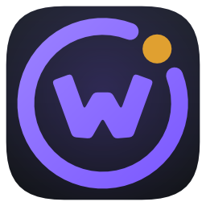
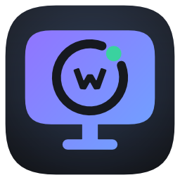
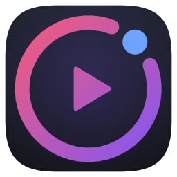
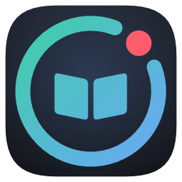

# The family's logo: orbitw

Every logo, icon and background of WittyMediaServer, WittyMediaClient, WittyMediaPlayer, WittyReader, the modules and
the website is drawn by one program, `scripts/genicon`, from the drawings in `internal/brandart`. Nothing is drawn by
hand and no picture is edited after it is made: change a drawing, then run `scripts/sync-brand.sh` in each repository.

The logo is called **orbitw**: the W in its orbit.

<p>
  
  
  
  
</p>

**Every form of every logo, rendered** (SVG, PNG at 16 to 1024 pixels, JPEG; colour, black and white on transparency;
icons and name lockups): [brand/orbitw/README.md](brand/orbitw/README.md).

Contents: [The idea](#the-idea) · [Construction](#construction) · [Colours](#colours) · [The name](#the-name) ·
[Every form](#every-form) · [Using it](#using-it) · [Small sizes and one colour](#small-sizes-and-one-colour) ·
[Generating it](#generating-it) · [What is written where](#what-is-written-where) · [How each format is made](#how-each-format-is-made) ·
[Other designs](#other-designs) · [Changing it](#changing-it)

## The idea

A home media server is the middle of a small system: the server, and the screens and apps around it. The mark is that
system drawn as simply as it can be: a ring (the home, the orbit everything moves in), a dot riding in a gap of the
ring (whatever is connected right now), and inside the ring the one thing that app is. The server holds the W, for
Witty. Every app keeps the ring and the dot, so they read as one family, and differs in what is inside and in the
colour of its dot.

| App | Inside the ring | Ring | Dot |
|---|---|---|---|
| WittyMediaServer | the W | lilac into violet | amber |
| WittyMediaClient | a screen on a stand, carrying a small ring with the W | violet into sky blue | mint |
| WittyMediaPlayer | a play button | coral into violet | sky blue |
| WittyReader | an open book | mint into sky blue | coral |

The server and the client are told apart at a glance: a round mark against a screen on a stand, and an amber dot
against a mint one. Module icons sit on the same tile with a mark in their catalogue category's colour and the
server's amber dot, since modules are part of the server.

## Construction

Every mark is designed on a 1024 square. Below, **R** is the ring's centre-line radius (300 on the design square);
every other measure is a fraction of it, so the mark keeps its proportions at any size.

**The ring.** A circle of radius R stroked 0.22 R wide with round ends, open over 48° centred on the top right (45°
from the top). **The dot** sits in that opening, centred on the ring's line at 45°, 0.19 R in radius, so it reads as
the ring's own piece pulled free. **The W** is one outline of four thick strokes 0.27 R wide through five points: the
two outer tops, the two bottoms at a quarter and three quarters of its width, and the middle peak lower, at 36% of its
height; the joints are mitred, bevelled where they would spike, and every corner is rounded. It is 1.07 R wide and
0.73 R high, a little below the ring's centre so it sits optically in the middle.

**The client** is a screen 1.93 R wide and 1.4 R high with corners of 0.31 R, a neck and a round-ended foot; on it a
small ring (0.5 R) with its own W and the mint dot. Its ring and W are cut out of the screen, so the screen's gradient
runs behind them. **The player** has a play triangle with rounded corners in the ring; **the reader** two pages
meeting at the spine.

**The tile.** App icons put the mark on a rounded square (corners 22% of the side, the curve run a little longer than
a circle's, like Apple's continuous corners) filled with the house theme's dark slate and a soft glow of the app's
second colour behind the mark. On macOS the tile follows Apple's grid (824 of 1024, with its shadow).

**Clear space and fit.** On every square the mark's farthest point is 0.325 of the square from its centre: inside the
72-of-108 circle every Android launcher mask shows, and clear of iOS's, tvOS's and visionOS's corners. Around a mark
on its own, keep clear at least the dot's diameter on every side.

## Colours

All colours come from the design tokens: the house theme ("Witty", `themes/default/theme.json`), the Light theme and
the Midnight theme, as `scripts/design-tokens.py` writes them from the CSS. Change those and the icons follow at the
next sync.

| Use | Token | Colour |
|---|---|---|
| Tile | `bg` mixed 45% toward `bg3` | `#16191f` |
| Tile, top of its gradient | the tile mixed with `bg4` | between `#16191f` and `#2a2f3a` |
| Server ring and W | `accentText` lightened 12% → `accent` | `#9e85ff` → `#7955ff` |
| Client | `accentText` → Midnight's `accentText` | `#9174ff` → `#6ea4ff` |
| Player | `danger` → `accent` | `#ff5c6c` → `#7955ff` |
| Reader | `ok` → Midnight's `accentText` | `#3ad29f` → `#6ea4ff` |
| Dots | `warn`, `ok`, Midnight's `accentText`, `danger` | amber `#e0a030` (server), mint `#3ad29f` (client), sky `#6ea4ff` (player), coral `#ff5c6c` (reader) |
| Name on dark | `fg`, with the accent part in `accentText` | `#e8eaf0`, `#9174ff` |
| Name on light | `bg`, with the accent part in `accent` | `#0f1115`, `#7955ff` |

## The name

The name is set as the website sets it: **Inter Bold (700)**, letter-spacing **-0.02em**, Inter's text optical size,
with "Media" (or "Reader") in the accent: Witty**Media**Server, Witty**Media**Client, Witty**Media**Player,
Witty**Reader**. Pictures draw it from the same font files the website and web client serve (`web/public/fonts`,
`internal/brandart/fonts`: Inter 4.1, SIL Open Font License), with Inter's own kerning read from its GPOS table, so a
generated name and the site's are letter for letter the same: checked by overlaying the two at 100 pixels, where their
widths agree to a tenth of a pixel. The site and the web client pin the name to Inter's text optical size
(`font-optical-sizing: none` on `.brand`) so this holds at every size. Other words in pictures (the line on the social
picture) are Inter Regular.

## Every form

[brand/orbitw/README.md](brand/orbitw/README.md) shows and links every file. For each app:

| Form | What it is for | Files |
|---|---|---|
| `icon` | The app icon, the mark on its tile. Wherever the app itself is meant | SVG; PNG 16–1024; JPEG on dark and light |
| `mark-colour` | The mark alone in colour on transparency. Reads on dark and light | SVG; PNG 16–1024; JPEG on dark and light |
| `mark-black` | The mark in black on transparency, cuts as holes: light backgrounds, print, one colour | SVG; PNG 16–1024; JPEG on light and white |
| `mark-white` | The mark in white on transparency: dark backgrounds, photographs | SVG; PNG 16–1024; JPEG on dark and black |
| `lockup-dark` | Mark and name for dark backgrounds, as the website's header | SVG; PNG 64–512 high; JPEG on dark and black |
| `lockup-light` | Mark and name for light backgrounds | SVG; PNG 64–512 high; JPEG on light and white |
| `lockup-black` | Mark and name in black on transparency | SVG; PNG 64–512 high; JPEG on light and white |
| `lockup-white` | Mark and name in white on transparency | SVG; PNG 64–512 high; JPEG on dark and black |

<p>
  
  
  
  
</p>

SVG is for anything that scales (print, the web, slides). PNG is for screens at a fixed size, with transparency. JPEG
has no transparency, so it always comes on a stated background; use it only where PNG isn't accepted.

## Using it

- Use the files as they are. Don't redraw, stretch, rotate, recolour (beyond the black and white forms), outline, add
  shadows or effects, or put the colour mark on a busy picture: use `mark-white` there.
- The colour mark goes on the house theme's dark or on white or the Light theme's paper; the gradients are made to
  hold their contrast on both.
- Don't separate the dot from the ring, close the ring's gap, or change the dot's colour between apps: the dot's colour
  is how the apps are told apart.
- The server's own logo (Settings → Appearance) replaces the mark inside a server's screens, never the app icons.

## Small sizes and one colour

At 16 to 32 pixels the mark is drawn again, not shrunk: its box fills more of the tile, the lines are 25% heavier, and
the client's screen drops the W inside its small ring (the ring and dot carry it). The one-colour form (the ring, the
W and the dot in one colour, cuts as holes) is what the macOS menu bar shows as a template image (macOS colours it for
a light or dark bar; faint while the server is stopped), Android's themed icon, iOS's tinted icon, and the black and
white forms above. The Windows tray shows the colour icon, grey while the server is stopped.

## Generating it

```bash
go run ./scripts/genicon -target kit -o .                         # every form of every logo, into docs/brand/orbitw
go run ./scripts/genicon -target client -o ../WittyMediaClient    # one repository's set
go run ./scripts/genicon -target client -o ../WittyMediaClient -check   # only check it is up to date
go run ./scripts/genicon -sheet sheet.png                         # every design side by side, at real sizes
```

Each repository has `scripts/sync-brand.sh`, which runs genicon with its own target, finding this repository beside it
(or at `WITTY_SERVER`); `--check` fails if anything is out of date. `internal/brandart`'s tests fail if the web
client's icons here aren't what the generator draws now.

## What is written where

| Target | Files |
|---|---|
| `server` | `web/public`: `icon.svg`, `favicon.ico` (16, 32, 48), `icon-192.png`, `icon-512.png`, `icon-maskable-512.png`, `apple-touch-icon.png` (180, opaque) |
| `server-package` | written by `scripts/build-release.sh` and `packaging/macos/build-pkg.sh` at build time: `icon.ico` (16–256), `icon.icns` (every macOS size, on Apple's grid), `wittymediaserver.png` and `.svg`, the `hicolor` tree (16–512 and scalable), Windows Installer's `banner.bmp` (493×58) and `welcome.bmp` (493×312), the macOS installer's background |
| `client` | Apple: `apple/Brand/iOS.xcassets` (the 1024 icon with dark and tinted versions; the Apple Vision Pro icon as three depth layers; the launch screen's mark at @1x–@3x), `apple/Brand/tvOS.xcassets` (the layered Apple TV icon, 400×240 @1x/@2x and 1280×768 for the App Store, each as back, middle and front layers that move apart when focused; Top Shelf 1920×720 and wide 2320×720 at @1x/@2x; the backdrop behind the TV's sign-in screens), `apple/App/BrandArt.swift`. Android: launcher icons for every density, round icons, the adaptive icon (background, foreground, monochrome), the TV banner (320×180 dp at xhdpi and xxxhdpi), the splash icon and launch background, the TV sign-in backdrop, `ui/BrandArt.kt`, the Play icon and feature graphic in `android/brand`. Desktop: `desktop/build` icons for macOS (`.icns`), Windows (`.ico`) and Linux (`icons/`), the disk image's background (@1x, @2x), and the Windows installer's sidebar and header |
| `player` | `resources/WittyMediaPlayer.ico`, `resources/icon.svg`, `resources/icon-256.png`, the Windows installer's `banner.bmp` and `welcome.bmp` |
| `reader` | the web app's icons in `public/` as for `server`, and `desktop/build` as for the client |
| `catalog` | `icons/<module>.png` (128) for every module in `catalog.json` |
| `website` | `images/brand`: the web icons, `social.png` (1200×630, the link preview), `hero-dark.svg` and `hero-light.svg`, each app's icon as SVG |
| `kit` | `docs/brand/<design>`: every form above, and its README |

Inside the apps' own screens the marks are drawn from generated code, sharp at any size: `BrandArt.swift`
(`BrandArt.server`, `BrandArt.client`, painted by `BrandMark`) and `BrandArt.kt` (`BrandArt.Server`, `BrandArt.Client`
ImageVectors). The web client and website show `icon.svg`; the tray draws the mark at run time (`internal/trayicon`).

## How each format is made

Everything starts as vector outlines (`internal/brandart/geom.go`): lines and cubic curves, built from circles,
rounded rectangles, thick arcs with round ends, rounded polygons and the W's single outline. A cut-out runs the other
way round from the shape around it, so one non-zero fill rule gives every hole, the same in every format.

| Format | How |
|---|---|
| **SVG** | Each layer becomes one `<path>` with its fill: a colour, or a `linearGradient`/`radialGradient` in the drawing's own units (`render.go`). |
| **Android vector drawable** | The same path data; gradients as `aapt:attr` fills, which need Android 7, so the layers with gradients (the adaptive icon, the Android 12 splash) live in `drawable-v26` and the older launch screen uses PNG marks. |
| **Kotlin** | `ImageVector.Builder` with `addPathNodes` and `Brush` gradients (`codegen.go`), in `ui/BrandArt.kt`. |
| **Swift** | A function per mark that fills SwiftUI `Path`s with `GraphicsContext` shadings, in `App/BrandArt.swift`. |
| **PNG** | Rasterised with exact-coverage anti-aliasing (`golang.org/x/image/vector`); gradients worked out per covered pixel. Opaque where a store demands it (App Store, Play, tvOS back layers). |
| **JPEG** | The PNG on a stated background, quality 90: the big backdrops and the kit's JPEGs. |
| **ICO** | PNG frames for Windows' sizes (16, 20, 24, 32, 40, 48, 64, 96, 128, 256), each drawn at its own size. |
| **ICNS** | PNG entries for every macOS size (16 to 1024, at @1x and @2x), on Apple's 824 grid with its shadow. |
| **BMP** | 24-bit, bottom-up, as Windows Installer and NSIS take for their wizard pictures. |
| **Asset catalogs** | The `Contents.json` for each icon set, image stack layer, Top Shelf and image set, written beside the pictures. |

Words are glyph outlines from Inter (see [The name](#the-name)). Module marks are distance functions on a 128 grid
(`modules.go`), each an original drawing, never a console's, disc format's, service's or studio's logo, so their icons
are PNG only.

Backgrounds start from one quiet scene (`compose.go`, `wide.go`), made to sit behind words without pulling the eye:
the house theme's night (or the Light theme's paper), one soft violet light right of centre, four thin, faint orbits
around it, each open at a gap like the logo's ring with a small dot in the apps' dot colours, and a sparse field of
tiny, dim stars. Nothing sparkles or moves. Stars and dots never fall where words or icons go, and the left side,
where screens put their text, stays the calmest. On full-screen backdrops the W in its ring sits faintly at the
orbits' centre. The Top Shelf, TV banners, the TV sign-in backdrop, the installers, the disk image, the macOS
installer and the website's hero and social picture are all that scene with the right mark or name on it.

## Other designs

The designs the owner saw are kept, complete, in `internal/brandart` (`marks.go`, `concepts2.go`), and any of them
draws every file above with one flag:

```bash
WITTY_BRAND_CONCEPT=monogram scripts/sync-brand.sh
```

| Design | What it is |
|---|---|
| `orbitw` | **in use**: the W in its orbit |
| `monogram` | a heavy rounded W on a rack unit; the client's W inside a screen |
| `orbit` | a core with an orbit and its moon. Close to the Ionic framework's logo: don't use it on its own |
| `nodes` | the W as five dots joined by short links, the last one lit |
| `wave` | the W as one smooth wave on a rack unit |
| `dial` | a knob with a gauge and a lit dot |
| `pills` | five rounded bars whose tops trace a W, like a sound meter |

`go run ./scripts/genicon -sheet sheet.png` draws all of them side by side at real pixel sizes on dark, light and TV
backgrounds.

## Changing it

- **A colour:** change the theme (the CSS, then `scripts/design-tokens.py`), or the mapping in `looks` in `marks.go`.
- **The design in use:** `DefaultConcept` in `marks.go`, then every repository's `scripts/sync-brand.sh` and
  `go run ./scripts/genicon -target kit -o .` here.
- **A new app:** a `Product` with its name, a `looks` entry with its own dot colour, its drawing in each design, and a
  target.
- **A new module:** its mark in `ModuleMarks` (`modules.go`), then WittyModuleCatalog's `scripts/sync-brand.sh`.
- **A new size or platform file:** the target's function in `targets.go`; the tests check every target's sizes.

`internal/brandart`'s tests check that every target builds in every design, that each picture is the size its
platform asks for, that store and home-screen icons are opaque and parallax layers are not, that every mark stays
inside the launcher's safe circle, that the server and client marks differ, that cuts show as holes in the
one-colour form, that ICO and ICNS files are well formed, that Inter's kerning is applied, and that the web client's
icons in the repository are what the generator draws now.
