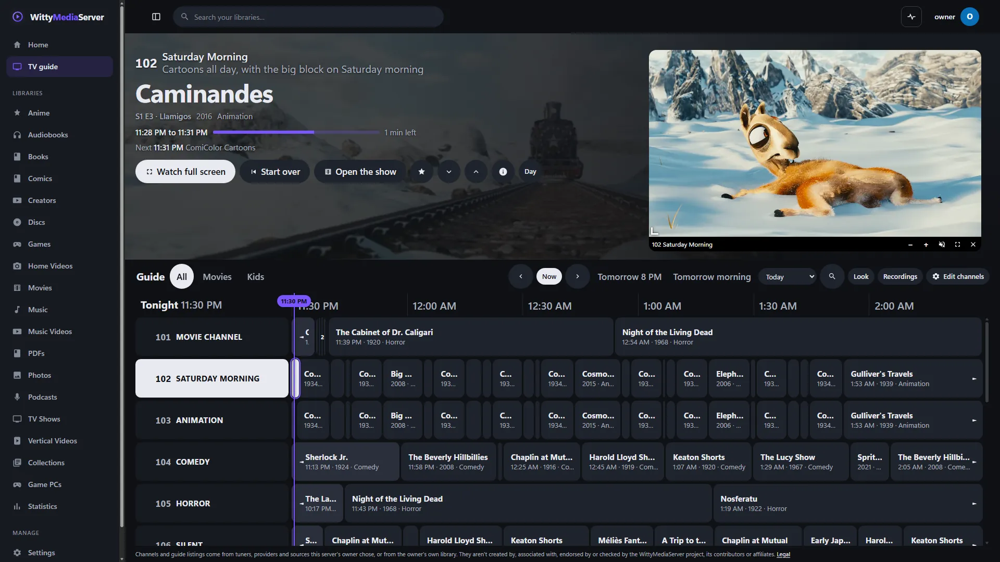
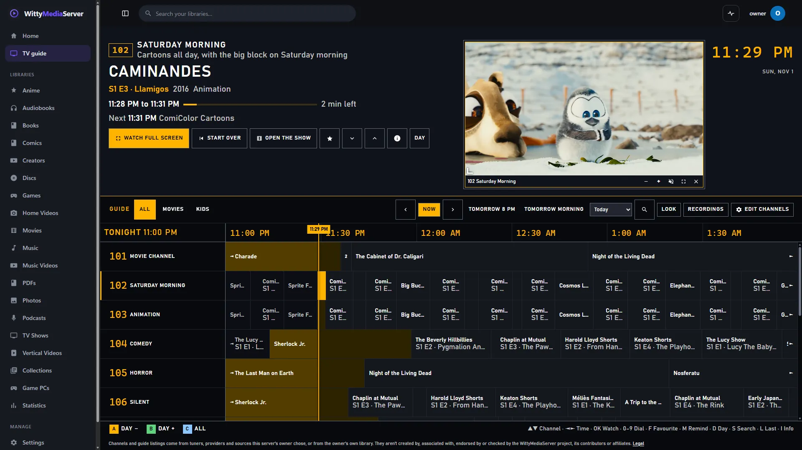
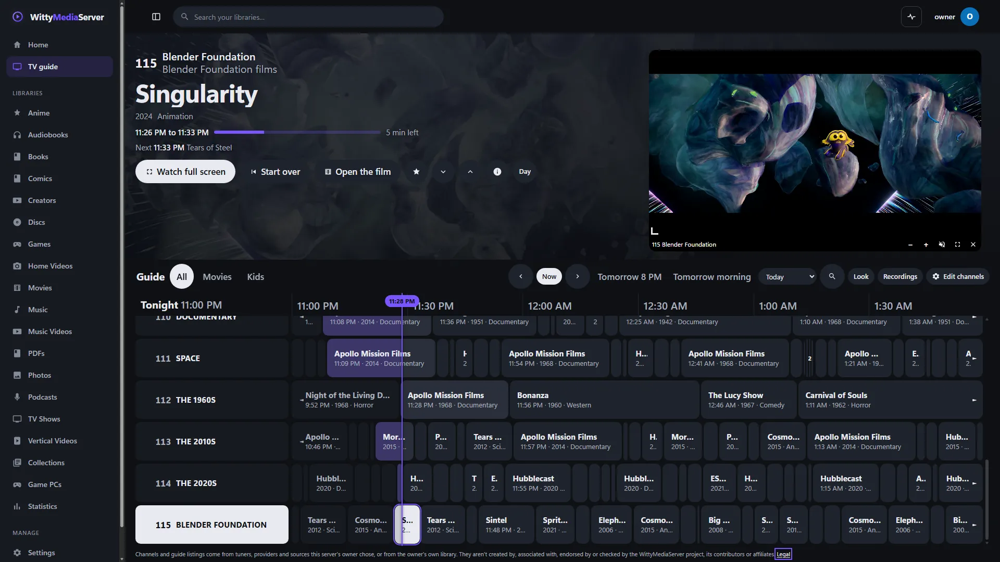
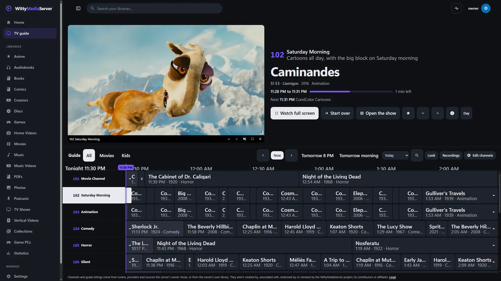
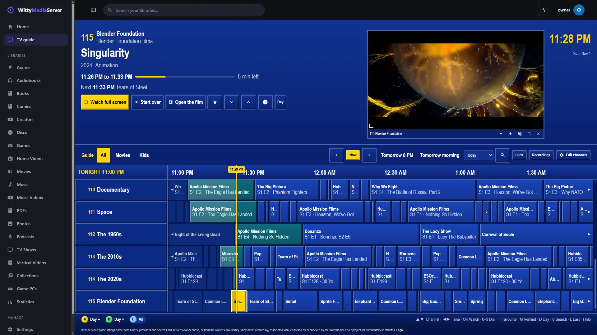
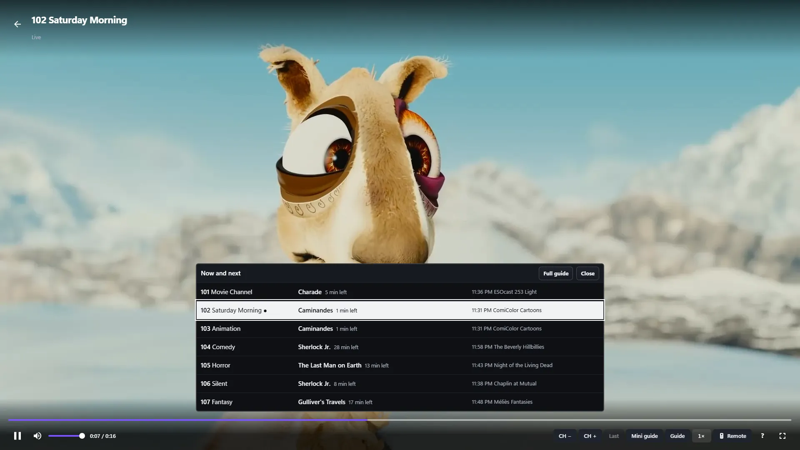
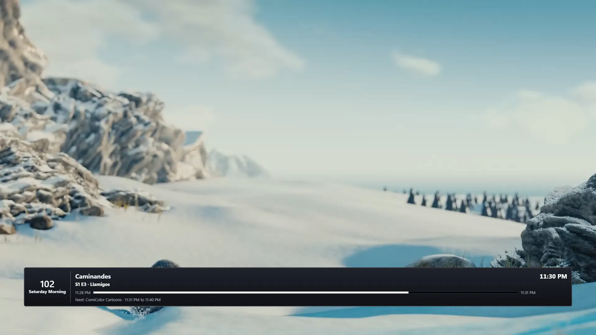
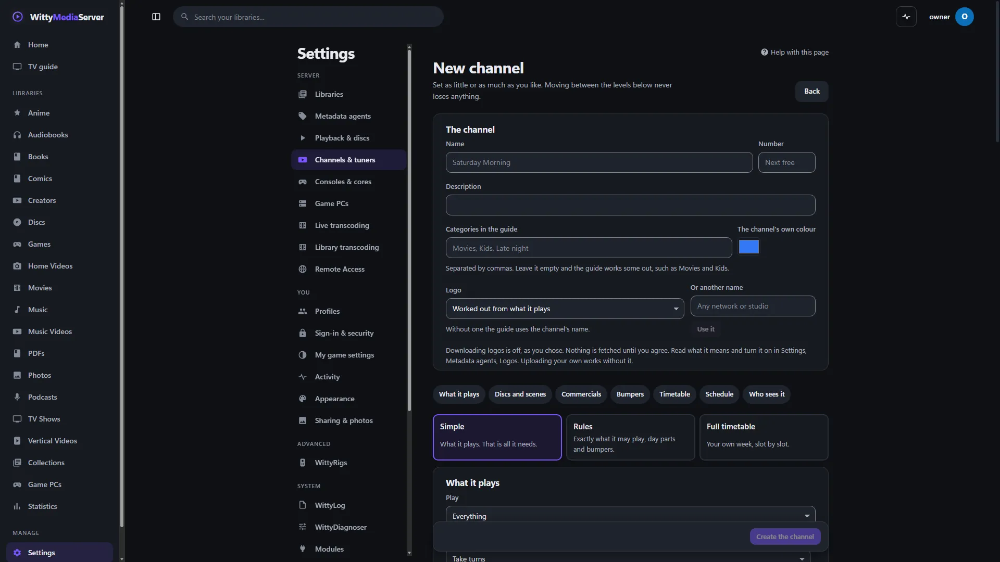
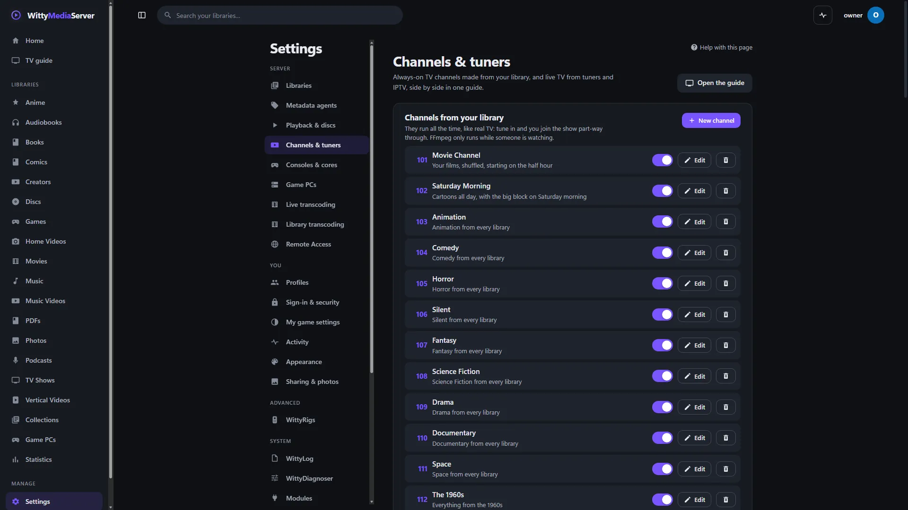
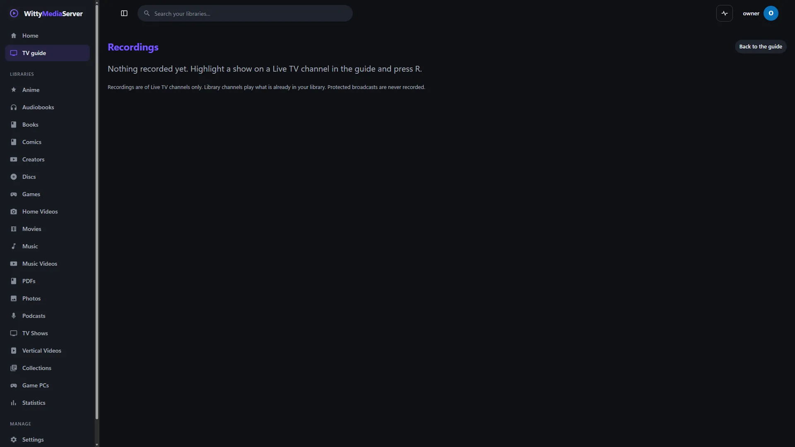

# Channels and live TV

Use this guide to make always-on TV channels from your own library, add live TV from tuners and IPTV, and find your way around the guide. This is WittyTV: everything shows side by side in one programme guide, in the theme you choose, from an early-2000s cable box to a modern one.

- [Your first channel](#your-first-channel)
- [The guide](#the-guide)
- [The look](#the-look)
- [The preview](#the-preview)
- [Watching a channel](#watching-a-channel)
- [Channels in one click](#channels-in-one-click)
- [Making your own channel](#making-your-own-channel)
- [Discs on a channel](#discs-on-a-channel)
- [Commercials](#commercials)
- [Bumpers](#bumpers)
- [Keeping to the timetable](#keeping-to-the-timetable)
- [Who sees a channel](#who-sees-a-channel)
- [Logos and title art](#logos-and-title-art)
- [Tuners and IPTV](#tuners-and-iptv)
- [Live TV playlists](#live-tv-playlists)
- [Guide data](#guide-data)
- [Recordings](#recordings)
- [Encrypted channels](#encrypted-channels)
- [ATSC 3.0](#atsc-30)
- [What costs what](#what-costs-what)
- [What hasn't been tested](#what-hasnt-been-tested)
- [For developers](#for-developers)

## Your first channel

1. Go to **Settings → Channels & tuners**.
2. Under **Add with one click**, press **Add** on anything suggested. It's on the air straight away.
3. Open **TV guide** in the menu. Move with the arrow keys or a remote, press Enter or OK to watch, and dial a channel with the number keys.

Channels from your library need no module and no extra hardware. Live TV from tuners and IPTV needs the **WittyTuner** module: see [Modules and the store](MODULE-STORE.md).

A channel runs all the time, like real TV: tune in and you join the show part-way through. FFmpeg only runs while someone is watching, and everyone on a channel shares one stream.

## The guide

The top of the guide says everything about the highlighted programme: channel, title, year and genre, start and end, how far in, and what's next. From there you can **Watch full screen**, **Start over** (the title from the beginning, on your own), open the film or show, make the channel a favourite, change channel, read more, and see the whole day.


*WittyTV, with channels made from a library in one press, and the preview playing [Caminandes: Llamigos](https://commons.wikimedia.org/wiki/File:Caminandes_3_-_Llamigos_-_Blender_Animated_Short.webm), Pablo Vazquez, Blender Foundation, [CC BY 3.0](https://creativecommons.org/licenses/by/3.0/). Other titles in the guide are in [the list](images/CREDITS.md).*

Above the grid:

- **Filters:** All, Favourites, and categories. A channel's categories are the ones you gave it, or else worked out, such as Movies and Kids. Tuner channels use their playlist's group. Library and Live TV appear when you have both.
- **Time:** earlier, **Now**, later, Tonight or Tomorrow 8 PM, Tomorrow morning, and any day of the next two weeks.
- **Search** covers every channel you can see, up to two weeks ahead.
- **Look** changes how the guide looks, and **Recordings** lists what you've recorded.

| Key | In the guide |
|---|---|
| Arrows, Page Up, Page Down | Move around |
| OK or Enter | Watch, or details for something later |
| 0 to 9 | Dial a channel |
| F | Make the channel a favourite |
| M | Remind me |
| R | Record, on a channel that can be recorded |
| D | The whole day on this channel |
| S or / | Search the schedule |
| L | The last channel |
| I | More about this programme |
| N or Home | Back to now |
| + and - | Fewer or more hours across the screen |
| A, B, C | A day back, a day on, or library and live TV |

**Favourites and reminders** belong to your account. A reminder appears on any page a minute before the programme starts, with a button to watch it. **Home** has an **On TV now** row, which can be moved or hidden like any other.

Up from the top row and Left from the first cell hand the arrows back, so a remote can reach everything above the grid. Every cell is read out to screen readers with its channel, title and times.

## The look

WittyTV has themes of its own, apart from the app's theme. Press **Look** on the guide, or open **Settings → Appearance** and find **WittyTV**. Each is drawn as a small picture of itself, and changes show straight away. A theme changes the guide, the player's banner and mini guide, recordings and the other TV pages, not only the grid.


*The Satellite look, playing [Caminandes: Llamigos](https://commons.wikimedia.org/wiki/File:Caminandes_3_-_Llamigos_-_Blender_Animated_Short.webm), Pablo Vazquez, Blender Foundation, [CC BY 3.0](https://creativecommons.org/licenses/by/3.0/).*


*The Modern look, playing [Singularity](https://commons.wikimedia.org/wiki/File:SINGULARITY_-_Blender_Open_Movie-full_movie.webm), Blender Studio, [CC BY 4.0](https://creativecommons.org/licenses/by/4.0/).*


*The Big picture look, playing [Caminandes: Llamigos](https://commons.wikimedia.org/wiki/File:Caminandes_3_-_Llamigos_-_Blender_Animated_Short.webm), Pablo Vazquez, Blender Foundation, [CC BY 3.0](https://creativecommons.org/licenses/by/3.0/).*


*The Classic look, playing [Singularity](https://commons.wikimedia.org/wiki/File:SINGULARITY_-_Blender_Open_Movie-full_movie.webm), Blender Studio, [CC BY 4.0](https://creativecommons.org/licenses/by/4.0/).*

| Theme | What it is like | Colours |
|---|---|---|
| **Modern** | Clean and calm, with a big preview and the programme's picture up top. A title with its own logo artwork shows that in place of its name, and screen readers still get the name | From your app theme |
| **Classic** | The chunky blue box of the early 2000s, bevelled and square, with raised cells, a clock, and coloured A, B and C keys. It's all type | Its own |
| **Satellite** | A receiver's display: flat black and amber, thin rules, capitals, and digits in boxes like an LED read-out | Its own |
| **Teletext** | Blocky letters and eight flat colours on black, with a page number and double-height headlines | Its own |
| **Newspaper** | The listings page: ink on paper, serif type and hairline rules, with no filled cells | Its own |
| **Big picture** | The preview comes first and takes about half the width, the words sit beside it, and the grid is short | From your app theme |
| **Outline** | Light and open: cells are drawn rather than filled, and only the highlight is solid | From your app theme |
| **Compact** | Small type and tight rows, with the top reduced to a strip, for seeing the most channels at once | From your app theme |
| **Custom** | Your own: choose the layout from any of the above, the type and the colours. It starts from what was on your screen, and it stays as you left it if you try another theme | Your choice |

**Which wins.** Your own choice comes first. Then what your [app theme](THEMES.md#tv-looks) suggests. Then the theme the server's owner chose for new viewers, under **Options** in **Settings → Channels & tuners**. **Look** always says which of these you're seeing. **Stop choosing, and use the default** goes back down that list, and **Back to how it started** undoes all your choices. Custom is each viewer's own, so an owner or an app theme can't set it. Looks saved before there were themes moved over as they were: anything that wasn't one of the themes became that theme's overrides, or Custom.

**Colours.** Under **Colours**, choose **Background**, **Programmes**, **On now**, **Highlight**, **Accent** or **Text**, and pick one of the swatches, any colour, or type its code. A colour you pick overrides that one for this theme only, and **Back to following the app theme** or **Back to its own colours** undoes them. Text is always worked out to be readable on what it's on, and a colour that can't be read is moved until it can, whatever you choose, and it says so when that happens.

**The programme's picture** and title art show in Modern and Outline, or in Custom with one of those layouts. **The programme's picture at the top** in **Look** turns them off.

The rest of **Look**:

- **Row size** and **Hours across the screen**.
- **Show:** a line at the current time down all channels, how far into each programme it is, episode names and details, and channel logos.

**Room at the top.** Every theme leaves the same room above the first line of a TV page. It grows with the window, and across the room, in **Big screen mode** or with a controller or remote, it and the sides clear TV overscan, which can crop up to about 5% off each edge.

Each channel can also have its own colour, in its editor, on its row, at the top of the guide and on its banner.

## The preview

**Look** has a live picture beside the highlighted programme, on the right or left, in every theme. It can show **The highlighted channel**, **The last channel I watched**, or be **Hidden**.

To resize it, do any of these:

- Drag its inner corner.
- Focus that corner, which is a slider. Left and Right make small steps, Page Up and Page Down go to the named sizes, and Home and End go to the smallest and largest.
- Use the - and + buttons under the picture, which work with a remote.
- Choose **Preview size** in **Look**.

**Automatic**, where it starts, suits the theme and the window: about 38% of the page's width in Modern, a third in Classic, half in Big picture and a fifth in Compact, so it reads the same on a laptop as across a room. On a phone it takes the whole width on a line of its own, as long as a third of the screen's height still leaves room for the guide; in Compact, about 60%. A size you set stays yours until you choose **Automatic** again.

It snaps to Small, Medium, Large, Extra large and Huge, and any size between works. It's part of the page's layout and not a layer over it, so at any size it moves what's beside it and covers nothing. Its largest size is worked out from the page, so the words and the guide always keep room. On a phone it has a line of its own above the words.

The buttons under it also turn its sound on, go full screen and hide it.

**One picture, not two.** The preview and the full-screen view are the same stream in two places. Going full screen from the preview, using F or the button, and coming back to the guide carry on from where the picture was: nothing tunes again, and nothing jumps back. On the way back the guide keeps the channel in the preview while it loads.

## Watching a channel

Tuning shows a banner with the channel number, name, times, a progress bar and what's next.


*The mini guide over a channel, playing [Caminandes: Llamigos](https://commons.wikimedia.org/wiki/File:Caminandes_3_-_Llamigos_-_Blender_Animated_Short.webm), Pablo Vazquez, Blender Foundation, [CC BY 3.0](https://creativecommons.org/licenses/by/3.0/).*


*A channel, full screen, playing [Caminandes: Llamigos](https://commons.wikimedia.org/wiki/File:Caminandes_3_-_Llamigos_-_Blender_Animated_Short.webm), Pablo Vazquez, Blender Foundation, [CC BY 3.0](https://creativecommons.org/licenses/by/3.0/).*

| Key | While watching |
|---|---|
| Up, Down, Page Up, Page Down | Change channel |
| 0 to 9 | Dial a channel |
| Space or K | Pause |
| Left, Right | Back or forward 10 seconds, in what's been kept |
| L | Back to live |
| Backspace | The channel before |
| G | The mini guide: a few channels with what's on now and next, over the picture |
| I or Enter | The banner |
| R | The on-screen remote |
| F | Full screen |
| A, S | The next sound track, the next subtitles (when the channel has them) |
| M, + and - | Mute and volume |
| Escape | Back to the guide |

**Sound and subtitles.** When what's on has more than one sound track, or subtitles or broadcast captions, the player's **Audio** and **Subtitles** buttons (and A and S, and the remote's buttons) choose between them, as in the library player. Everyone on a channel shares one stream, so a choice only changes what your player plays, and the language you choose is kept for the next programme and channel. Today a library channel's stream carries the programme's main sound track and no subtitles, so the buttons appear mostly for tuner channels with captions; other languages ([#238](https://github.com/wittywilla/WittyMediaServer/issues/238)) and subtitles ([#239](https://github.com/wittywilla/WittyMediaServer/issues/239)) in the shared stream are planned.

You can pause and rewind within what's kept: 5 minutes on library channels and 30 on tuner channels, unless you change **Pause buffer** under **Options**.

## Channels in one click

**Add with one click**, in **Settings → Channels & tuners**, offers what your library can fill: Classics such as Movies and Saturday morning, Genres, Studios, Your collections, Decades, TV networks and Marathons. **Add** puts one on the air, **Change first** opens it in the editor, and **Add all** does a whole group. A channel takes at least three titles, or it would be the same thing again and again.

A network channel can run the network's shows all day, be limited to a decade, follow day parts from the genres that suit them, or put each show in its original day and time. A style is only offered when your library's details support it. **Fill in missing facts**, under **Network facts**, asks your metadata services about the network and original air times of shows that don't have them, without touching any files.

## Making your own channel

Press **New channel**, or **Edit** on a channel. The editor has three levels, which are three views of the same channel. Moving between them never loses anything.


*Making a channel.*

| Level | What you set |
|---|---|
| **Simple** | What it plays: everything, one TV network, a genre, a decade, one show or movies. **How it plays** and **Shows start** |
| **Rules** | Exactly what it may play: libraries, kinds of title, networks, genres, shows, decades, collections, years, seasons, age rating, score, length, watched or not, and title words. Plus day parts |
| **Full timetable** | Your own week, slot by slot. Time no slot covers plays the channel's rules, or a "We'll be right back" card |

**How it plays:**

| Choice | What it does |
|---|---|
| **Take turns** | The next episode of each show in turn, like a station running reruns |
| **In order** | Every episode of one show, then the next show |
| **As first aired** | By original air date, across all shows |
| **Shuffle** | Nothing repeats until everything has played. **Keep each show's episodes in order** is an option |

**Shows start** on a grid: back to back, every 5 minutes, quarter hours, half hours or on the hour.

**Day parts** are different things at different times: Saturday morning cartoons, prime time drama. **Add the classic day parts** fills in a day, **Add a holiday block** gives a part first and last dates that win over anything that plays all year, and **Add a marathon** runs straight on, with no commercials or optional bumpers.

**If it doesn't fit**, for a programme that won't finish before its slot ends:

- **Finish on time: fill the gap** looks for one that fits, or fills the gap so the next slot starts on time.
- **Let the show finish** lets it run over.
- **Cut it at the end of the slot** stops it there.

A programme longer than the whole slot runs over.

**What it will look like** shows the whole day with every bumper and commercial, what was cut, and how many programmes started off the timetable, before you save.

**Saving.** A draft stays in your browser until you save, so a closed tab doesn't lose work. Each save keeps the version it replaced, and **Earlier versions** can go back to any of the last 20. A change applies right after whatever is on now, and **Make a new schedule** reshuffles from there. The same channel, library and day always give the same schedule, and the guide never changes under the viewer.

## Discs on a channel

A channel can play a DVD or Blu-ray's **main feature**, or any scenes from any of its titles. This needs the disc's module, [WittyDVD](DVD.md) or [WittyBluray](BLURAY.md).

Under **Discs and scenes** in the editor:

- **Main feature** adds the disc's main feature in one press.
- **Choose scenes** opens a picker, with a picture for each chapter. Press a chapter to start from it and another to end with it, nudge the times to the second, press **Try it**, and then **Add this scene**.
- **Add every chapter as a scene of its own** does the whole title at once.

Each is a programme of its own. With no other rules, these are all the channel plays. Otherwise they add to what the rules choose.

Discs play with no menus or remote features. An encrypted disc is listed with the normal refusal and can't be chosen, and a scene whose disc has since gone or become encrypted just doesn't play.

## Commercials

**Commercials** is a kind of library: your own adverts. You can have as many as you like, such as one for an era or one per channel. Its videos are never looked up online and never become a channel's programmes, and they stay out of Home and search unless you turn that on for the library.

To use them:

1. Go to **Settings → Libraries → Add library** and choose **Commercials**.
2. In a channel's editor, under **Commercials**, tick the library, and choose **All of them** or **Only these**.
3. Choose **After each show, play** 0 to 5 commercials, and optionally **During a programme, a break every** so many minutes, with 1 to 5 commercials.

They also fill gaps to the time grid, and never count as watched. No break comes so near the end that you'd just wait for the programme to finish. The guide shows one programme with its breaks inside it, and its times are when it really starts and ends.

Commercials come under a profile's limits like anything else: unrated ones hide a channel from a Kids profile, since viewers share one stream.

## Bumpers

A **bumper** is a short video around a programme: a station ident, or a sting before one particular film. **Bumpers** in a channel's editor has two parts.

**The bumper library** is shared by every channel. **Upload videos** takes a video of at most 30 minutes and 2 GB, and **Choose from my media** uses one you already have. Anything in a Commercials library is in it too. Uploads go into an ordinary commercials library in the data folder, called *WittyTV bumpers*, so ratings and thumbnails work as they do for any video.

**Rules for this channel** say when, which videos and for what:

| Part | Choices |
|---|---|
| **When** | Before each programme, after each programme, between commercials, or in a break every so many minutes |
| **Play** | One to five of the chosen videos, which take turns |
| **For** | Every programme, or particular films, shows, genres or collections |
| **Mandatory** | Never cut or left out to keep to the timetable |

A break every so many minutes splits the programme into stretches, with the bumper between them. The guide still shows one programme.

## Keeping to the timetable

When a programme runs long, something has to give, or everything after it starts late. Turn on **Cut commercials short to keep to the timetable** in the editor. The next start time then comes first: the first time on the grid that the programme and its mandatory bumpers can make. Everything else gets the room that's left, and gives way in this order:

| What | Choices |
|---|---|
| **Commercials**, the last one first: those after the programme, then the last break inside it and back | **Cut them short** (the default), **Leave out whole ones**, or **Always play them** |
| **Bumpers that aren't mandatory** | **Leave them out** (the default), **Cut them short**, or **Always play them** |
| **A programme can lose from its end** | **Never** (the default), or up to 5 minutes. Only used when a programme is just over its slot |

**A full-length film gets few commercials.** A film that all but fills its slots has little or no room for them, however many you asked for, and a break with nothing left in it doesn't interrupt the film at all. To have them all, choose **Always play them**. The next programme then starts at the next time on the grid after they finish, and that's what the guide shows.

Mandatory bumpers are never touched. A gap that's left is filled with commercials, the last cut to fit exactly, and then a card. It needs a grid to keep to: a channel playing back to back offers to start programmes on the half hour.

## Who sees a channel

A channel is shown to someone only when all of these hold:

- Their profile may use channels, under its **Live TV** limits.
- **Shown to**, under **Who sees it**, lets them in: **Everyone**, **Adults only** or **Chosen profiles**.
- Every title the channel could play is one they may see.

Everyone on a channel shares one stream, so a mixed channel can't show a Kids profile only its child-friendly half. It's hidden from that profile instead. **Count towards "watched" and Continue Watching** is off unless you turn it on, and bumpers and commercials never count.

## Logos and title art

A channel's picture is, in order: your own upload (**Upload your own logo**), the logo chosen in the editor, or the logo of the one network or studio it plays. Those two come from the logo service, an optional download you agree to under **Settings → Metadata agents**: see [Where details come from](METADATA.md). With no logo, a channel shows its name as a clean text mark. No logos come with the server.

**Tuner and playlist channels** wear, in order: what you chose for that channel, the logo its channel list names, or a match on its name. A match takes off what isn't part of the name, such as `HD`, `(US)` or `UK |`, and only a name that's exactly right takes a logo by itself. A name that could only ever match the wrong thing, such as a number or a word like `Movies`, isn't looked up, and the first 500 different names of a channel list are looked up by themselves, one a second, so a list of thousands stays gentle on everyone. All of this waits for the same one agreement, and nothing is looked up before it.

To put one right, open a tuner under **Tuners and IPTV**, and press **Change** beside a channel. Say what to look it up as, search and choose, upload your own, or choose **No logo for this channel**. It stays through a new reading of the channel list, and **Back to automatic** undoes it. See [Logos](FIXING-METADATA.md#logos).

**Title art** shows in the themes with the programme's picture, as [above](#the-look).

## Tuners and IPTV

These need the **WittyTuner** module. No channel lists or stream addresses come with the server, so bring your own. Scanning uses computed band plans, not lists of stations.


*Settings, Channels & tuners, on a server with no tuner attached.*

1. Go to **Settings → Channels & tuners → Tuners and IPTV**.
2. Press **Search for tuners**, or choose one under **Add a tuner** and fill it in.
3. Press **Channels** on the tuner. **Read the list** or **Scan for channels** fills it, and you choose which show in the guide, renumber them, or set a guide id.

**Streams at once** limits how many channels can be open on a tuner. Your changes stay when the list is read again.

| Add a tuner | Works on | How far it's been tried |
|---|---|---|
| **IPTV playlist (M3U)** | All | Tested with real FFmpeg against local streams |
| **IPTV single stream**: HTTP, HLS, RTSP, RTP or UDP | All | Tested with real FFmpeg against local streams |
| **Network tuner (HDHomeRun-style)** | All | Tried on stand-ins, not real hardware. The scan call isn't in the maker's guide |
| **SAT>IP** | All | Not tried on hardware |
| **Linux DVB**: DVB-T/T2/C/S/S2, ATSC, ISDB-T | Linux | Not tried on hardware. Dish switches (DiSEqC) aren't done |
| **Analogue and capture cards (V4L2)** | Linux | Not tried on hardware |
| **Windows capture card (DirectShow)** | Windows | Listing tested, not tried with a card |
| **macOS capture device (AVFoundation)** | macOS | Not tried. This has not been run on a real Mac yet |
| **External TV backend**: an HTTP M3U and XMLTV API, or SVDRP with an HTTP stream | All | Tried on stand-ins |
| **Custom command**: your own program writes MPEG-TS to standard output | All | Tested with a small test program |

The page labels each one **Tested**, **Tried on stand-ins**, **Not yet tried** or **Not built yet**. **Windows digital tuner (BDA)** is listed but not built: use a capture card through DirectShow, or an external backend.

The custom command runs a program on the server, so a web session alone can't set one up. It stays off until the server is started with `WMS_TUNER_COMMANDS=1`.

On FreeBSD and macOS, WittyTuner's helper program runs without a sandbox.

## Live TV playlists

A playlist comes from an `http://` or `https://` address, or a file on the server. Where it comes from decides what it may do.

**At home** means the address you typed is a file, a private or VPN address, or a name only a local network can resolve: one with no dots, such as `mediabox`, or ending in `.local`, `.lan`, `.home`, `.internal` or similar. A playlist at home can name any kind of stream, and devices on your network.

**From the internet** means anything else, and such a playlist:

- can only name `http://` and `https://` channels, because FFmpeg would make other connections itself. RTSP, RTMP, SRT, UDP, RTP and DASH channels are refused with a message. Add those as a single stream, or keep the playlist at home.
- can't lead back to your home network. Everything fetched for it, guide included, goes through a client that checks each connection as it's made.

**A name that resolves differently at home counts as the internet.** With split DNS, `http://tv.example.com/channels.m3u` counts as internet even if it points at your own network at home, so its channels on your network stop. Asking DNS would let a public name count as home. Use the private address, a `.local` or `.lan` name, or a file.

**Guides and files.** A guide named in a playlist has to be a web address. From another device, a playlist or guide named as a file has to be in a library folder or the server's data folder. On the server's own desktop, it can be anywhere.

**How a stream is read.** FFmpeg never reads an HTTP stream itself. It reads through a small gate on this machine's loopback address, for that one stream. The gate reads each playlist first and writes it out again naming only itself, so a key is refused before FFmpeg sees it, and a playlist can't lead FFmpeg anywhere else. A playlist naming anything but web addresses, a segment that's really a playlist, and scrambled segments are refused there too.

## Guide data

- **XMLTV:** from an address or a file, under **Guide data**, refreshed by itself, gzip included. Matched on guide id, then on the channel's name, and you can set the id for each channel. A playlist's own guide and a backend's are added for you.
- **Over the air:** DVB EIT and ATSC PSIP, read while a channel is being watched, recorded or scanned. It costs nothing when idle, and only channels recently tuned have this data. It reaches only the channel being watched, not others on its multiplex.
- **Library channels:** their own schedule.

ATSC huffman-compressed guide text isn't read, so those events are skipped.

## Recordings

Highlight a show on a tuner channel, and press **R** or **Record**. **Record every airing**, under more about a programme, follows a title on that channel.


*Recordings, on a server with none yet.*

- **Each person has their own.** You see and cancel your own recordings, and an administrator sees all of them. Up to 50 can be waiting and 20 series running per person, with no limit for an administrator. Only an administrator can delete a recording's file.
- **Profiles.** It needs the profile's **Live TV** limit to allow tuner channels.
- **Tuner channels only.** Library channels play what's already in your library, and encrypted channels are never recorded. **Can record** in a tuner's channel list marks a channel as not recordable, where a device's documents say so.
- **Where they go.** `recordings` in the data folder by default. Under **Options**, **Recordings folder** chooses another, and **Library to update after a recording** rescans a library, so a folder inside it shows up there.
- **Recordings come first.** When no tuner is free, a live viewer on that tuner is stopped, with a message. A viewer and a recording don't share one tuner yet.
- **Disk space.** A recording stops and says so when under 2 GB is left on its disk. Old recordings aren't cleaned up automatically.
- **Cost.** A raw stream is written straight to disk, using almost no processor. Other sources use FFmpeg copying the stream as it is.

## Encrypted channels

**Encrypted channels are refused, and never decrypted.** There's no setting, add-on or command option that changes this. A channel that says **Encrypted: can't be played here** stays listed, and can't be tuned or recorded. Nothing is wrong with your antenna, tuner or setup. **What can I do?** next to the label opens a page with what follows, on any device.

| Where | How it's detected |
|---|---|
| Network tuners | A `drm` tag in the lineup, which is the maker's documented marking, or `DRM: 1`, and error 811 when tuning |
| Licensed devices | A DTCP-IP stream type, or a DASH manifest with `ContentProtection` |
| DVB, SAT>IP | `free_CA_mode` in the SDT, and CA descriptors in the PMT |
| Backends | The channel's CA field |
| Any MPEG-TS | `transport_scrambling_control` in the packets, also mid-stream |
| IPTV | DRM licence lines in the playlist, and any `#EXT-X-KEY` in an HLS playlist or any of its variants, on opening and again while it plays or records, every 5 to 30 seconds. A key that appears stops the stream and marks the channel, and a recording keeps what was clear |

The check sits between every driver and the server, so a driver, a custom command or a downloaded version of WittyTuner can't leave it out. A helper saying a channel is clear means nothing: it can only ever refuse one. WittyTuner can't be replaced by a fork.

One limit: the check sees scrambling in MPEG-TS packets. Encryption inside the video itself, as on ATSC 3.0, shows only if the device reports it, as the maker's guide says it does. If a device didn't report it, FFmpeg would fail to decode the channel, and you'd see an error rather than the label.

**The label.** Each tuner channel is **Encrypted**, **Clear** or **Not checked yet**. Playlists mostly don't say, so a channel is checked when first tuned, and what a stream shows is remembered. A scan reports how many of each it found. **Check again** in the channel list forgets what a stream showed, for a station that has changed.

**A clear version of the station.** When a station is encrypted here and clear elsewhere, every screen offers to watch the clear one instead. Stations match by call sign or name, and by number over the air.

### What you can do

- **Watch a clear version of the station.** Many stations also air on ATSC 1.0 or another unencrypted source.
- **Use a licensed device or app** certified for encrypted channels.
- **Bring in what a licensed device itself offers** to home media servers, through an interface it documents. What arrives goes through the same checks: if it's still encrypted, it shows the same label.

| The device offers | Add it as |
|---|---|
| A network tuner protocol | **Network tuner** |
| An HTTP or HLS stream | **IPTV single stream**, or a playlist |
| A folder of exported files | A library folder |

**What to look for in a device:** an ATSC 3.0 tuner, if the station uses it; certification for encrypted channels, stated by the maker, which in the US is the A3SA scheme; for use with this server, a documented network stream or export that covers encrypted channels specifically; and any limits on recording. Any restriction a device reports is honoured.

**Devices, as their makers publish them, checked on 2026-10-30.** None of this is a recommendation, and support can change, so check with the maker before buying. **None of these documents a way to pass encrypted channels to other software.** No maker here endorses this software, and none has been paid or asked to appear.

| Device | What its maker publishes | Source |
|---|---|---|
| SiliconDust HDHomeRun FLEX 4K | 2 ATSC 3.0 and 4 ATSC 1.0 tuners. Some DRM-encrypted ATSC 3.0 channels will not work, and it uses the ATSC 1.0 version of such a channel. It documents an HTTP interface, and this server can use it as a network tuner for channels that aren't encrypted | [Product page](https://shop.silicondust.com/shop/product/hdfx-4k/) |
| ZapperBox | Tuner models work with encrypted channels and can record them, and encrypted recordings play only on the device that made them. APIs documented for finding a box and sending remote keys. Reaching other devices is planned through its own apps. Its zApp tool converts recordings to standard HLS, and clear ATSC 3.0 recordings then play without sound in players without Dolby AC-4 | [FAQ](https://zapperbox.com/pages/faqs) |
| ADTH NextGen TV USB tuner | Certified to the A3SA standard for playing encrypted channels online, on Android TV, Google TV and Fire TV devices, which do the decoding. No documented way for other software to receive channels | [Support](https://support.adth.com/en/support/solutions/articles/43000754091-how-to-play-encrypted-channels-on-adth-nextgen-tv-usb-) |
| ADTH NextGen TV Box | Supports encrypted channels, without internet from software 2.0.0, and records to a USB drive from 2.0.4. No documented way for other software to receive channels | [Support FAQ](https://support.adth.com/en/support/solutions/articles/43000703336-faq) |
| NextGen TV sets | A3SA said in April 2026 that nearly 40 models from Hisense, Panasonic, Samsung, Sony and TCL can decrypt protected content | [A3SA news](https://a3sa.com/news-updates/) |

## ATSC 3.0

Unencrypted ATSC 3.0 channels tune, play and record like any others, where the tuner offers them.

| Part | State |
|---|---|
| **Tuners** | Network tuners that present ATSC 3.0 as MPEG-TS over HTTP, as the FLEX 4K's maker documents. **Not tried on real hardware.** Linux DVB has no ATSC 3.0 delivery system, so DVB cards can't. SAT>IP and capture cards don't apply |
| **Picture** | HEVC decodes, and is converted to H.264 for players. This needs real processor work, and a 4K or 1080p HEVC channel may be too much for a small machine |
| **Sound** | FFmpeg has no AC-4 decoder, and most US ATSC 3.0 stations use AC-4. Such a channel plays **without sound**, says so, and offers the same station on ATSC 1.0 if there is one. MPEG-H sound has no decoder either |
| **Recording** | The raw stream is saved as it arrives, so the AC-4 sound is kept, but it plays silently here until FFmpeg can decode it |

A channel is treated as ATSC 3.0 when its source names HEVC or AC-4. The server asks FFmpeg what it can decode, so a build with an AC-4 decoder gets sound with no change here. The fallback when a source doesn't name the codec reads FFmpeg's error, and hasn't been tried with a real AC-4 stream.

## What costs what

- **An idle channel costs nothing.** A day's schedule is worked out the first time something needs that day, then kept. Days nobody watched are worked out as needed, so an unwatched channel still moves on as real TV would.
- **Watching.** Everyone on a channel shares one stream, and FFmpeg stops about 45 seconds after the last request, deleting what it kept and releasing any tuner. A player says when it leaves, so a channel only flicked past stops about two seconds later. The web app says so 3 seconds after the page showing it goes (the guide's preview giving way to full screen, or back), unless it's shown again first, and at once on moving the guide's highlight on, changing channel or closing the tab.
- **Pass H.264 through**, under **Options**, sends video the browser can already play as it is, which is much lighter on the machine. Turn it off only if channels stutter when shows change. Sound is always stereo AAC, so a stream stays playable across programmes.
- **The limit.** Live sessions that convert count against how many conversions may run at once, and a viewer is told plainly when the server is full. **Largest picture on channels** is lighter on small machines.
- **The preview.** It waits for the highlight to settle, then shares the channel's ordinary stream, so a channel someone else is watching costs nothing extra. It stops while the page is in the background, and dragging changes only its own width. **On a tuner, a preview uses up a tuner**, which is why it can be pointed at the last channel or hidden.
- **Pause buffers** are kept on disk in the transcode folder, only while someone is watching. An hour of HD can take a few gigabytes.

## What hasn't been tested

**Run end to end on a real server with real FFmpeg:** one-click network channels, rule channels, hand timetables, tuning in mid-show, the guide and its themes, the preview and its resizing, commercials, bumper rules, commercials cut short, DVD and Blu-ray main features and scenes on a channel, IPTV playlists and streams against a local server, a stand-in network tuner, refusal of encrypted channels, XMLTV guide data, recording from a stand-in tuner, and profile limits.

**Not tried:** every physical tuner, because none was available, real logo downloads, real phones and Safari.

**Not built:** Windows digital tuning (BDA), dish switches on Linux DVB, ATSC 3.0 sound, ATSC huffman-compressed guide text, a viewer and a recording sharing one tuner, automatic clean-up of old recordings, and live TV and the guide in the native apps. The web app works in any browser.

## For developers

Everything here lives on the server behind JSON, so apps can draw their own guide. The full route list is in [Client API](CLIENT-API.md).

**Playing.** `GET /api/tv/{key}/tune?viewer=<id>` gives `url`, standard live HLS. Add the same `viewer`, and `POST /api/tv/{key}/leave?viewer=<id>` on leaving, so the channel stops promptly. A token in the playlist's address carries on to its segments, for players that can't set headers. The stream is H.264 and stereo AAC in MPEG-TS, which every native player handles. Viewers share one stream, so the codec isn't chosen per client.

**The guide.** `GET /api/guide`, with `list=1` for numbers only, and `favourites=1`, `group=` or `channel=` to narrow it. It returns any window of any channels in one format, and the web page loads only the rows on screen, so a playlist of thousands stays quick. A TV app needs a grid that moves with a remote and D-pad focus: arrows, Page keys, 0 to 9 to dial and Enter to watch. `now` in the tune answer is the programme as the guide tells it, and `playing` is what's on the screen when that's a bumper inside it.

**The look.** An account's look is kept under `tvLook` in `GET /api/me/ui`, so an app can follow it: `theme`, with `custom` for its layout and type and `themeColours` for what's overridden, per theme, and `layout` and `colours` beside them, saying what it comes to in the two looks there were before. `GET /api/guide` gives the owner's choice for new viewers as `theme`, and the same two older values as `layout` and `skin`. An empty `theme` means the owner set those two and nothing else.

**Encrypted channels.** The guide, the tune answer and the tuner settings give each tuner channel `security: {state, label, detail, reason, helpUrl}`, where state is `encrypted`, `clear` or `unknown`, and `alternative` names a clear version. Show those, and the page from `GET /api/tv/encrypted-help`, rather than wording of your own. Keep the device notes here in step with `internal/livetv/help.go`.

**A channel's definition:**

```
Definition
  mode      simple | rules | timetable    how much of the editor the owner has opened
  rules     what may play by default      library, genre, network, decade, rating, show, season,
                                          watched state, length, kind, hand-picked items, clips
  order     how it plays                  rotate | sequential | aired | shuffle, keep episodes in order
  blocks[]  day parts and timetable slots days, start, end, own rules, own order, fit, season, marathon
  filler    between programmes            commercials libraries, how many between shows
  bumpers   around programmes             bumper rules, and what gives way to keep to the timetable
  alignMin  start times snap to a grid    0, 5, 15, 30 or 60 minutes
```

`GenerateDay` is a pure function of the definition, the seed, the day and the state left by the previous day, so the same input gives the same day. Each block's pool is an SQL query in a stable order. A cursor per pool remembers the last item by id, so a strip of weekday slots carries on from yesterday's episode, and a newly scanned episode slots in without disturbing it. Trimming is worked out at the same time, and each stretch records what it lost in `trimmed`.

**The shared stream** is in `internal/hls/live.go`: FFmpeg is paced to real time with a short start-up burst, and its segments make a rolling timeline with a discontinuity between runs. **Drivers** are in the WittyTuner project, and describe their own settings, so the web form is generated from them. Raw MPEG-TS passes through the server's `mpegts.Guard` on its way to FFmpeg, which reads the scrambling bits and collects guide data.

| Method and path | Who | What |
|---|---|---|
| `GET /api/guide?from&hours&offset&limit&kind&group&favourites&channel` | Signed in | Channels and programmes |
| `GET /api/guide/search?q&days&limit` | Signed in | Search what's coming up. 429 with `Retry-After` when several are running |
| `GET /api/tv/favourites`, `PUT` and `DELETE /api/tv/favourites/{key}` | Signed in | This account's favourite channels |
| `GET` and `POST /api/tv/reminders`, `DELETE /api/tv/reminders/{id}` | Signed in | This account's reminders |
| `GET` and `POST /api/channels/bumpers`, `POST .../upload`, `DELETE .../item/{id}` | Admin | The bumper library |
| `GET /api/channels/discs`, `POST /api/channels/clip-preview` | Admin | Discs for scenes, and trying one |
| `GET /api/tv/{key}/tune` | Signed in | What's on, and the stream |
| `GET /api/tv/{key}/live/playlist.m3u8`, `/seg/{name}` | Signed in | The shared stream |
| `POST /api/tv/{key}/leave?viewer=` | Signed in | A player has gone |
| `GET /api/tv/{key}/logo` | May watch the channel | A tuner channel's logo, through the server. Internet addresses only |
| `GET /api/tv/encrypted-help` | Signed in | The help page behind the encrypted label |
| `GET /api/channels` | Signed in | Library channels this account may see |
| `POST /api/channels`, `PUT` and `DELETE /api/channels/{id}` | Admin | Manage |
| `GET /api/channels/{id}`, `/history`, `POST /restore` | Admin | Definition and earlier versions |
| `POST /api/channels/preview` | Admin | Size and first day of a draft, without saving |
| `GET /api/channels/suggestions`, `/options` | Admin | One-click channels, and choices for the editor |
| `POST /api/channels/from-network` | Admin | A definition for one network |
| `POST /api/channels/{id}/rebuild` | Admin | Regenerate after what's on now |
| `POST /api/channels/networks/refresh` | Admin | Fill in missing network facts |
| `PUT` and `DELETE /api/channels/{id}/logo`, `GET` (signed in) | Admin | The owner's own logo |
| `GET /api/tuners/drivers`, `/discover` | Admin | What can be added, and what's on the network |
| `GET` and `POST /api/tuners`, `PUT` and `DELETE /api/tuners/{id}` | Admin | Manage |
| `POST /api/tuners/{id}/scan`, `GET` for progress | Admin | Find channels |
| `GET /api/tuners/{id}/channels`, `PUT /api/tuner-channels/{id}` | Admin | Turn on or off, renumber, map guide data |
| `GET` and `POST /api/epg/sources`, `DELETE`, `POST .../refresh` | Admin | XMLTV sources |
| `GET` and `POST /api/recordings`, `DELETE /api/recordings/{id}` | May use tuner channels | Recordings. Each person sees and cancels their own, an administrator all of them |
| `GET` and `POST /api/recording-rules`, `DELETE /api/recording-rules/{id}` | May use tuner channels | Every airing of a title |
| `GET` and `PUT /api/tv/settings` | Admin | Buffers, recordings folder, conversion limits |

---

<sub>WittyMediaServer documentation</sub>
