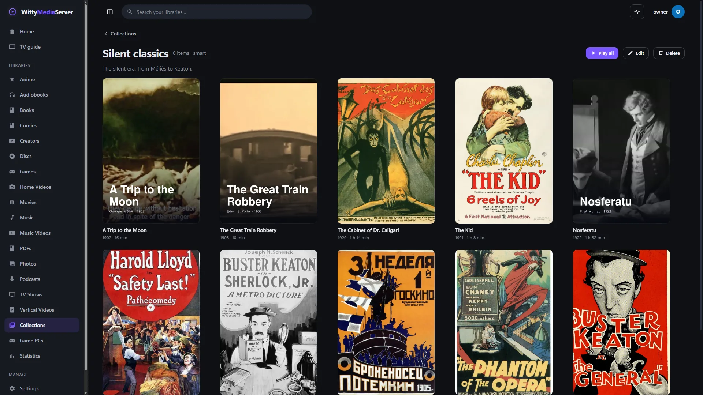
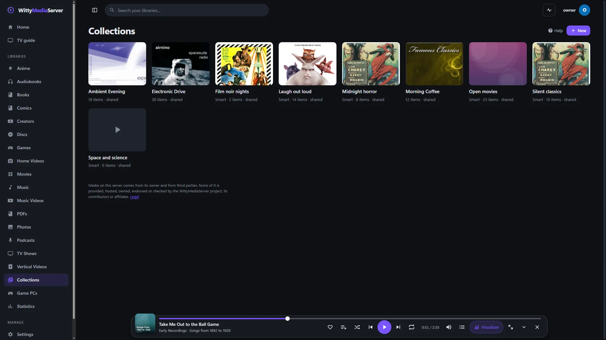

# Collections, radio and Your year

Gather things from any library into lists, listen to internet radio stations, and see what you watched and listened to this year. All of it is worked out on your server from what's on it.

- [Collections and smart playlists](#collections-and-smart-playlists)
- [Internet radio](#internet-radio)
- [Your year](#your-year)
- [Recommended for you](#recommended-for-you)
- [For developers](#for-developers)

## Collections and smart playlists



*A smart collection. Openly licensed and public-domain media, credited in [the list](images/CREDITS.md).*

*Collections. Openly licensed and public-domain media, credited in [the list](images/CREDITS.md).*
**Collections** in the main menu gathers things from any library. Film series, which a library shows by itself on its own page, are described in [Categories, studios and browsing](METADATA.md#categories-studios-and-browsing).

There are two kinds:

- **A list you fill.** Press **Save** on a film, show or video, and tick a list, or type a name for a new one. **Watch later** is one every profile has, made the first time it's used.
- **A smart playlist.** A saved rule, worked out each time it's opened, so it keeps itself up to date.

### Making a smart playlist

1. Open **Collections** and press **New**.
2. Give it a name, and choose **Smart playlist**.
3. Choose what it finds. The dialog shows the matches as you go.
4. Press **Make it**.

For example: unwatched comedies from the 90s rated 7 or more, most recently added first, at most 50.

| You can choose | |
|---|---|
| **Which libraries** | Kinds of library, such as Movies or Music. None means all |
| **Genres (any)** | Separated by commas |
| **Words in the title**, **Artist or creator** | |
| **From year**, **To year**, **Rating at least** | |
| **Added in the last (days)** | |
| **Watched** | **Either**, **Not watched**, **Started** or **Watched** |
| **Only what I liked**, **Include TV episodes** | |
| **Sort by** | Date added, title, year, rating, length, **Most played** or **Shuffle**, with an order |
| **At most** | Up to 500 |

### Playing and sharing

**Play all** goes through a list in order, with videos one after another, and a list of only songs plays in the music bar.

A list is yours unless you tick **Share with the other profiles**. A shared one is visible to every profile, and each sees only what its own limits allow, so a rule can't get round them.

**Edit** changes a list, and **Delete** removes it. What's in it stays in its library. Kids can use **Watch later**, and making collections is for adults.

## Internet radio

A library of the kind **Internet radio** needs no folder. To add one, go to **Settings → Libraries** and choose that kind. Then press **Add stations** on its page. Adding stations is for administrators:

- **Search:** by station name or genre, with logos and details, and add with one click. Popular stations show before you type.
- **Stream address:** type a station's address yourself. Its name and details are filled in the first time it plays, if it gives them. **Find details in the directory**, on the station's page, looks it up there.
- **Playlist:** an M3U or PLS file, or its text.

Stations play from the bar along the bottom, which keeps going while you browse. A stream that drops is tried again a few times by itself, and a sleep timer stops the music when you want. The library has your favourites and what you played lately at the top, and can be browsed by genre and country. A station's page has its logo, genres, country, language, quality and website, and what's playing now, shown on the lock screen and headphone controls too. Stations with no logo get art made from their name.

### What's on now

The song comes from the stream itself, in Icecast and Shoutcast metadata, and in HLS from the playlist or a tag at the start of each segment. It's known only while someone is listening through your server, and only if the station sends it. Others just say **Live**. Ogg and MPEG-TS streams carry theirs in a way that isn't read yet, so they say **Live** too.

### Stations that go quiet

A station is marked **Off the air** when it fails three times at least ten minutes apart, or when the directory's own checks can't reach it and it hasn't answered here for a week. One good answer clears it. **Try it now**, on its page, and **Check stations**, on the library's page, try again whenever you like. If nothing at all answers during a check, your own connection is probably down, so no station is blamed for it.

### What contacts what

| | When | What is sent |
|---|---|---|
| **The station** | While someone listens, and when you check it | A normal request for the stream, from your server |
| **The station, in the background** | Only with **Check radio stations in the background** on, which is off by default: each about once a week, one at a time | The same |
| **The directory** | When an administrator searches or adds | What you typed, and a count that this station was chosen |
| **The directory** | Once a day, in small batches, for stations added from it | Only those stations' IDs |
| **Logos** | The first time one is shown | Fetched by your server and kept, so a browser never contacts the station's site |

The directory is never told what anyone listens to. An address you typed goes to it only when you ask, and never if it could hold a private key. **Use Radio Browser**, under **Settings → Metadata agents**, turns the directory off. Searching then says so, and everything else keeps working.

### The directory

Stations come from [Radio Browser](https://www.radio-browser.info/), a free, community-run database. Its entries can be edited by anyone, so everything from it is treated as untrusted: addresses, text and logos are checked and cleaned before they're saved or shown.

### Safety

- **Relayed.** Listeners get the stream from your server, so `http` stations work on secure pages and a TV needs just one sign-in. That takes the station's bandwidth through your server. Pausing hangs up, so a paused station costs nothing.
- **Internet only.** The server refuses to reach addresses on your own network on a station's behalf, so a playlist, a redirect or a logo can't be used to poke at your other devices. A station on your own network can't be added, for the same reason.
- **Audio only.** An address that gives anything but audio is refused, and an HLS station's video variants are left out. Encrypted streams are refused with a clear message, and are never unlocked.
- **Addresses stay private.** Only administrators see a station's address, which may hold a key.

## Your year

**Your year**, in the account menu, adds up what this profile watched and listened to: total time, how many titles, how many days, the longest run of days in a row, your biggest day, month by month, what kinds of thing you spent it on, and your top shows, films, artists, creators and genres. A menu at the top goes back to earlier years that have any.

**It's private.** It comes from a small record kept on your server, per profile, per day: only how long something was played. This page only ever shows the profile looking at it, and nothing is sent anywhere. [Server statistics](STATS.md#who-may-see-it) can show an administrator what's most watched across everyone, but not this page.

**Clear my history**, at the top of the page, forgets it, along with the numbers For You learns from. Your places in videos and books stay. This can't be undone.

Time only counts from when the server started keeping this record, so earlier years may be empty.

## Recommended for you

A row on the home page suggests unwatched films and shows in the genres this profile spends its time on. It can be moved or hidden like the other rows. It reads only this profile's own record, and doesn't appear until there's something to go on.

## For developers

Everything here needs a signed-in account. Radio routes are in [Internet radio](CLIENT-API.md#internet-radio). Native apps play a station like anything else, with `POST /items/{id}/playback`, and the relay's HLS addresses are signed, so it fetches only what a station's own playlist named.

| Route | What it does |
|---|---|
| `GET`, `POST /api/collections` | List, make |
| `GET /api/collections/{id}?limit=&offset=` | One, with its `items` and `shows` |
| `PUT`, `DELETE /api/collections/{id}` | Change, delete (what's in it stays) |
| `POST`, `DELETE /api/collections/{id}/items` `{items, shows}` | Add, remove |
| `POST /api/collections/watch-later/items` `{items, shows}` | Add to Watch later |
| `POST /api/collections/preview` `{rule}` | What a rule would find |
| `GET /api/collections/holding?item=&show=` | Which of your lists hold something |
| `GET /api/items/{id}?collection=` | An item, with `nextId` being what follows in that list |
| `GET /api/me/review?year=` | Your year, as JSON |
| `DELETE /api/me/history` | Clears it |
| `GET /api/me/recommended` | The row on the home page |

A rule is JSON:

```json
{ "libraryTypes": ["movies"], "genres": ["Comedy"], "yearFrom": 1990, "yearTo": 1999, "ratingMin": 7,
  "watched": "no", "addedWithinDays": 0, "sort": "added", "desc": true, "limit": 50 }
```

A rule can also hold `search`, `artist`, `liked`, `episodes`, `runtimeMinSec` and `runtimeMaxSec`. The last two aren't offered on the page. `sort` is `added`, `title`, `year`, `rating`, `runtime`, `random` or `played`.

---

<sub>WittyMediaServer documentation</sub>
