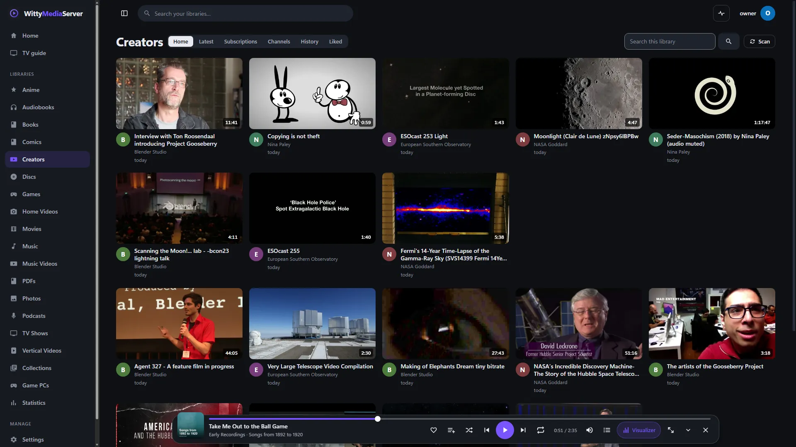
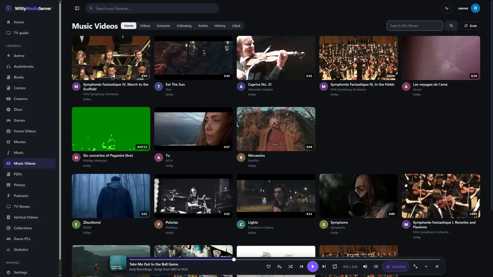

# Creator videos, music videos and concerts

Use this guide to lay out your archive of creators' videos the way people know from video sites, with subscriptions, a page per channel, comments and what's next. It also covers music video and concert libraries, which use the same screens.

These libraries, also called WittyChannels, show video collections you already have on disk. They don't download anything and never contact a video site.

The Android and Apple apps can't open these libraries yet, so use a browser or the desktop app.

## Setting it up

1. Go to **Settings → Libraries**, or use first-time setup, and choose **Creator videos**.
2. Choose its folder, with one folder per channel and subfolders as playlists:

```
Creator videos/
  Workshop Weekly/
    avatar.jpg
    banner.jpg
    channel.json
    Series One/
      episode 1 [xyz123].mp4
      episode 1 [xyz123].info.json
      episode 1 [xyz123].jpg
    a one-off.mp4
```

The same sidecar files as [vertical videos](SHORTS.md#adding-details-with-sidecar-files) apply, and the same `channel.json`:

```json
{ "name": "Workshop Weekly", "handle": "@workshop", "description": "A workshop channel", "platform": "Where it came from", "url": "https://example.com/workshop" }
```

- **Saved comments** in a sidecar are imported, at most 500 per video and the most liked first, marked *from the archive*. They can't be replied to.
- **A playlist** comes from a subfolder or a sidecar's `playlist_title`.
- **A thumbnail** comes from a picture with the video's name beside it.
- **Vertical videos** appear on a shelf of their own on **Home**, and on a channel's **Vertical** tab.

## The screens



*Channels of openly licensed videos, credited in [the list](images/CREDITS.md).*
| Tab | What it shows |
|---|---|
| **Home** | A feed from this profile's own record on this server. See [how it works](SHORTS.md#how-for-you-works) |
| **Latest** | The newest videos |
| **Subscriptions** | Videos from the channels you subscribe to |
| **Channels** | Every channel |
| **History** | What you've watched. Only you can see it |
| **Liked** | What you liked |

Search and topics sit at the top of the page. **Clear my history** on [Your year](COLLECTIONS.md#your-year) empties your history.

**A channel's page** has its banner and details, with **Videos**, **Vertical**, **Playlists** and **About** tabs. Videos sort by **Newest**, **Popular**, **Oldest** or **By title**.

**A video's page** has:

- The full player with speed, audio and subtitle tracks, and **Wide view**. A video picks up where you stopped.
- **Like**, and ✕ to see less like it.
- **Share**, for [links](PHOTOS.md#sharing), and **Save**, for [collections](COLLECTIONS.md#collections-and-smart-playlists).
- The description, tags, source and any fields of your own.
- **Chapters** you can press to jump to.
- Comments. Those made here come first, with replies. Each can be up to 2,000 characters.
- **Up next**, which goes on by itself unless you switch off **Autoplay**.

**Views** on a card add what the source said when archived to plays on this server, so an archive reads as it did.

**Editing:** admins can change a channel's details with **Edit** on its page, and a video's with **Edit** on its page. These stay in the database, and your files aren't touched.

## Profiles

Limits work as they do for [vertical videos](SHORTS.md#profiles). A channel with nothing a profile may see doesn't exist for that profile. Kids can like and subscribe, but not comment or share. A Guest can only watch.

## Music videos and concerts

A library of the kind **Music videos & concerts** uses the same screens, in its own words: an artist is a channel, and an album is a playlist.


*Music videos and concerts under open licences, credited in [the list](images/CREDITS.md).*

| Tab | What it shows |
|---|---|
| **Home** | A feed of what you might like |
| **Videos** | The newest videos |
| **Concerts** | Recordings of 20 minutes or more |
| **Following** | Videos from artists you subscribe to |
| **Artists** | Every artist |
| **History** and **Liked** | The same as in creator videos |

A recording of 20 minutes or more shows its chapters as a **Setlist** on its page.

**Naming:** name files `Artist - Title.mp4`, or keep a folder per artist.

**Details:** an `.nfo` beside a file is read for `title`, `artist`, `album`, `year`, `genre`, `tag` and `plot`. The sidecars above are read too, with `artist` and `album` fields.

## For developers

The routes are the same as for [vertical videos](SHORTS.md#for-developers). To list concerts only: `GET /api/videos?library=&length=long`.

---

<sub>WittyMediaServer documentation</sub>
