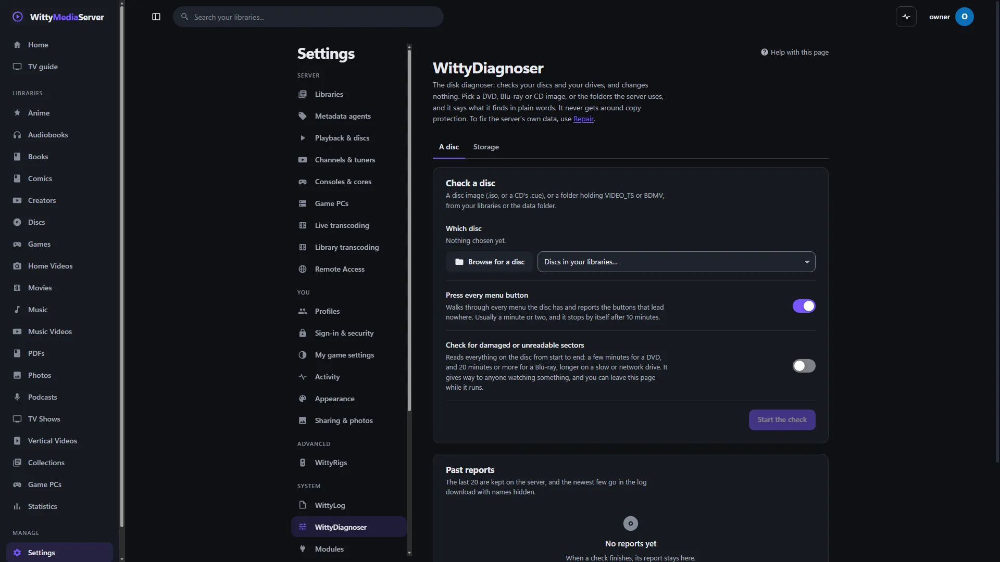

# WittyDiagnoser

Check a disc that won't play or a drive that misbehaves, and read in plain words what's wrong. It looks and tells you, and it changes nothing.

It's under **Settings → WittyDiagnoser**, for administrators. "Disk" can mean two things, so it has two tabs: **A disc** (a DVD, Blu-ray or audio CD, as an image or a folder) and **Storage** (the drives and folders the server uses).

Use it for what you've put on the server and what the server runs on. To fix the server's own database, metadata and modules, use [Repair](REPAIR.md).

- [Checking a disc](#checking-a-disc)
- [Checking storage](#checking-storage)
- [Reading the results](#reading-the-results)
- [Reports](#reports)
- [What it never does](#what-it-never-does)
- [What it does to the server while it runs](#what-it-does-to-the-server-while-it-runs)
- [For developers](#for-developers)

## Checking a disc

*Settings, WittyDiagnoser.*
1. On the **A disc** tab, press **Browse for a disc**, or choose from **Discs in your libraries**. The browser only shows your libraries and the data folder.
2. Choose how thorough to be, with the two switches below.
3. Press **Start the check**.

You can leave the page while it runs. **Cancel** stops it, and keeps what it found.

| It checks | What it looks at |
|---|---|
| **What it is** | Image or folder, DVD or Blu-ray, size. A file that's no disc at all, and why it might be |
| **Index files** | The files that say what's on the disc, and their backups |
| **Scrambling** | Whether the disc is copy protected, by reading a flag in the stream. Samples are taken across the disc, since some are scrambled only in part |
| **What's on it** | Titles or playlists with lengths, chapters, angles and tracks, the main title, region, first play and top menu, 3D, 4K and HDR |
| **Files it needs** | Video files the index names that aren't there, titles that run past the end, and clips shorter than they should be |
| **BD-J** | Blu-ray Java menus: what's there, what they need that the server's runtime lacks, and whether Java is found and BD-J is on |
| **Which title is the film** | How the disc module ranks every title or playlist: the pick, how sure it is (high, medium or low, with a percentage), the reasons for and against, decoys, other versions, episodes and a play-all split. With WittyDVD or WittyBluray 0.4.0 and later |
| **What was mended** | Index tables taken from the backup copy or mended from another table, where a Blu-ray's playlists, clip information and streams disagree, and sectors read as blank while ranking. When **Ask libbluray for a second opinion** is on in Settings, a Blu-ray is also compared with a libbluray installed on the server (never an encrypted one) |

Two switches take longer:

**Press every menu button** walks through every menu it can reach and reports each button that leads nowhere, with the path of buttons that got there. It's usually a minute or two, and it stops by itself after 10 minutes.

**Check for damaged or unreadable sectors** reads everything on the disc from start to end. That's a few minutes for a DVD and 20 minutes or more for a Blu-ray, longer on a slow or network drive. It counts exactly what can't be read, and says which file and title that falls in. It also finds:

- an image shorter than it says it should be, which means an incomplete copy;
- files running past the end of the image;
- long stretches of zeros in the video, which copying tools leave where they couldn't read the disc;
- parts of the video that don't look like video.

The first 50 places are listed, with totals for the rest. A few of these can be deliberate on a real disc, such as filler that never plays. The report says which title a place belongs to, so you can tell.

## Checking storage

1. On the **Storage** tab, tick some library folders and server folders, or press **Choose all**.
2. Choose what to try, with the switches.
3. Press **Start the check**.

| It checks | What it tells you |
|---|---|
| **Is it there** | Whether the folder exists, can be listed, and a few files can be opened |
| **What drive** | The file system, and whether it's fixed, removable, an SD card or a network drive |
| **Free space** | Warns under 5% free, and under 10 GB where video gets converted, with how many hours of 1080p that is |
| **Known trouble** | A database on a network drive, a transcode folder on a network drive or SD card, a mapped drive letter that services can't see, read-only mounts, FAT32's 4 GB limit, a folder inside a container |
| **Go through every file** | Up to 200,000 entries or 2 minutes a folder: files that can't be opened, empty files, paths over 260 characters on Windows, names that cause trouble, and for libraries, items that have gone from the disk |
| **Measure read speed** | Reads for up to 15 seconds from the largest files, and says how many streams it could keep up with. The system's cache can flatter this |
| **Try a small write** | A 32 MB temporary file, written, read back, compared and removed. Off unless you turn it on. Only in the server's own folders, never in or around a library |
| **Drive health** | What the system tells without administrator rights, on Windows, Linux and macOS. FreeBSD needs administrator rights to say, so there it's "not checked" |

## Reading the results

Each finding has a word as well as a colour, worst first:

| Word | Means |
|---|---|
| **Problem** | Something won't work, or data is at risk. It says what to do |
| **Warning** | It may cause trouble, or may be on purpose. Read why |
| **Note** | Worth knowing. Nothing is wrong |
| **Fine** | Checked, and good |

**Details** opens the numbers and file names behind a finding.

"The engine crashed on this disc" means a bug in the server, not a fault in your disc. The rest of the check carries on. It's a useful thing to report, because the same disc would probably cause trouble in the player too.

## Reports

The last 20 reports stay on the server, under **Past reports**. **Download report** gives plain text, and **As JSON** gives JSON.

Turn on **Hide disc name and file names** for a copy to send to someone: the disc's name, its label and every file name come out. The newest three also go in the [log download](LOGGING.md#downloading-logs-to-share), always with names hidden.

To report a disc problem, attach a report. Never attach the disc image.

## What it never does

- **It never repairs or changes anything.** Discs and media are opened to read. The only things it writes are its own reports, and the small temporary file of the write test if you turn that on.
- **It never gets around copy protection.** It detects protection and says so. It reads no keys, and doesn't name or suggest any tool.
- **It never runs a disc's code.** Java programs on a Blu-ray are read as files, and not run.
- **It never looks outside your library folders and the data folder.** Links that lead out of those places are refused.
- **It never asks for administrator rights.** What needs them is reported as not checked.
- **Its reports hold nothing from the disc:** no pictures, menu art, subtitle text or file contents, and no full paths. Only structure, counts, base names of files and the commands of menu buttons.
- **It sends nothing anywhere.** A report leaves the server only if you download it and pass it on.

## What it does to the server while it runs

- One check runs at a time, with up to 8 waiting.
- While someone is watching something, it rests after each read for as long as that read took, so it gives way to them. A file sent to a player as it is, with no conversion, isn't counted, because the server doesn't track those.
- It shows on the [activity button](TASKS.md), and its log lines are in the Discs and Storage areas of **Settings → WittyLog**.

This has not been run on a real Mac or on FreeBSD yet.

## For developers

The code is `internal/diagnose`, using the exported API of WittyDVD, WittyBluray and WittyDisc, and no changes to them. File systems and drives are in `internal/sysinfo`. The routes are `/api/diagnose/...` ([API](CLIENT-API.md)), and each check's log lines carry its ID as the session.

The disc tools for engine work, `wittydvd` and `wittybluray`, are in those modules' repositories: [DVD](DVD.md#diagnosing-a-disc), [Blu-ray](BLURAY.md#diagnosing-a-disc).

---

WittyMediaServer documentation
