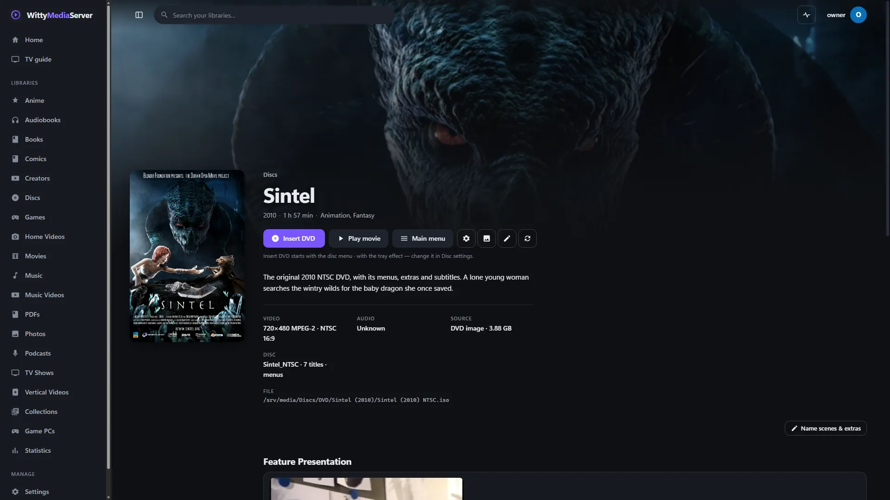
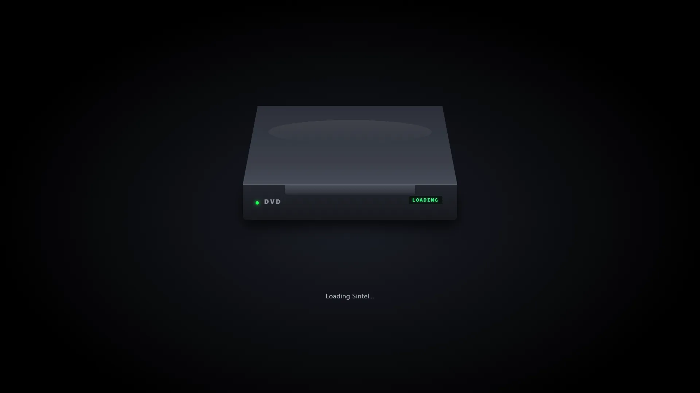
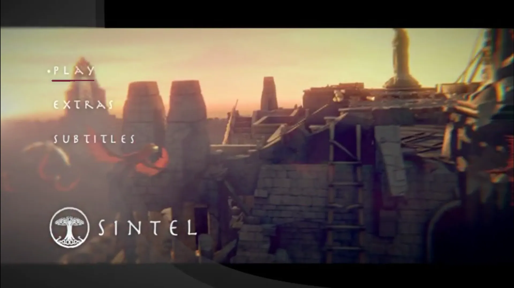
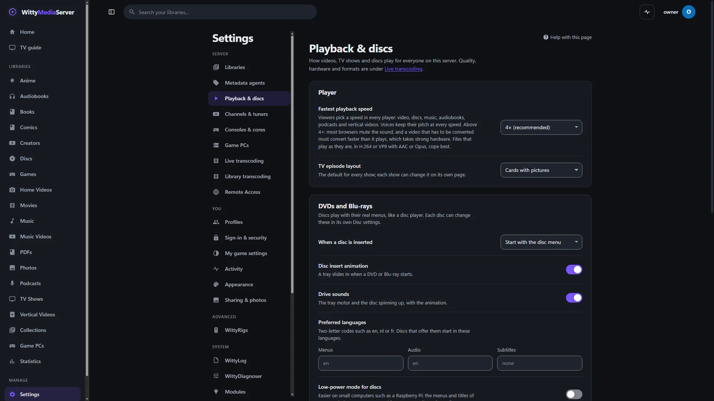

# DVDs

Use this guide to add DVD images and folders to your server and play them with their real menus, in a browser. The module that does this is **WittyDVD**, an original implementation of the logic a DVD player runs.

- [Adding DVDs](#adding-dvds)
- [Playing a disc](#playing-a-disc)
- [Disc settings](#disc-settings)
- [The remote](#the-remote)
- [Sound and subtitles](#sound-and-subtitles)
- [Interactive extras and games](#interactive-extras-and-games)
- [On a small machine](#on-a-small-machine)
- [Diagnosing a disc](#diagnosing-a-disc)
- [Limits](#limits)
- [For developers](#for-developers)

## Adding DVDs



*A disc's page. [Sintel](https://durian.blender.org/), Blender Foundation, [CC BY 3.0](https://creativecommons.org/licenses/by/3.0/).*
1. Go to **Settings → Modules** and add **WittyDVD**. WittyDisc, which reads disc images, comes inside it. See [Modules and the store](MODULE-STORE.md).
2. Go to **Settings → Libraries → Add library**, and choose **DVDs, Blu-rays & CDs**. Images of films can also go in a **Movies** library, and images of a series in a **TV shows** library.
3. Choose the folder that holds your discs, and press **Add library**.

It takes `.iso`, `.img`, `.udf` and other images, listed in [Supported formats](SUPPORTED-FORMATS.md), and folders that hold `VIDEO_TS`, however its name is capitalised. A library can also be the `VIDEO_TS` folder itself.

A disc is recognised by its structure, not its name. Without WittyDVD, a disc stays listed with nothing known about what's in it, and playing it offers to add the module. Adding it scans your disc libraries.

**Encrypted discs are refused.** A CSS-scrambled disc is listed with this message, and can't be played: "This disc is encrypted, so it can't be played: encrypted media isn't supported, and nothing here bypasses copy protection." An unencrypted disc just plays.

## Playing a disc

On a DVD's page:


*A disc in the tray. [Sintel](https://durian.blender.org/), Blender Foundation, [CC BY 3.0](https://creativecommons.org/licenses/by/3.0/).*


*The disc's own menu, in a browser. [Sintel](https://durian.blender.org/), Blender Foundation, [CC BY 3.0](https://creativecommons.org/licenses/by/3.0/), from its original DVD.*

| Button | What happens |
|---|---|
| **Insert DVD** | Starts the disc like a player: first-play, warnings, studio intros and trailers the disc plays, then the menu. Optionally with a tray animation and drive sound. Click the animation to skip it |
| **Play movie**, or **Play from the start** on a series | Straight into the main feature |
| **Resume from** | Back to where you stopped |
| **Main menu** | The disc's menu, skipping the intros |

Below those, **Feature Presentation** has **Play feature** and its **Scenes**, and **Bonus Features** has the disc's other titles. **Disc Menus** opens a menu directly, and a table lists every title with its length, chapters, sound and subtitles.

**Play movie** also works on discs that guard their feature, as many refuse a direct jump unless their own Play button was used. WittyDVD enters the film anyway, and picks the sound and subtitles from your preferred languages.

To find the film, **Play movie** ranks every title rather than taking the longest. Titles that repeat or shuffle another's scenes, point at video that isn't there, or are made of tiny fragments count as decoys, and the title the disc itself starts gains ground. A disc of several episodes of similar length plays them in order. CSS-scrambled discs are still refused: the ranking reads only what is never encrypted. [DVD quirks](DVD-QUIRKS.md#finding-the-film-among-decoys) has the details, and the diagnose report shows why each title scored as it did.

## Disc settings

The **Disc settings** button on a DVD's page, for administrators, has:


*Settings, Playback & discs.*

- **What's on this disc:** a movie or episodes of a TV series, or work it out from the name.
- **When this disc is inserted:** start with the disc menu, or skip menus and play the main feature.
- **Insert DVD effect:** the tray animation and sound, on or off for this disc.

The defaults for all of these, and DVD region and parental limits, are under **Settings → Playback & discs**.

## The remote

Press **Remote**, or **R**, for an on-screen remote. A **Remote** button is in the player's controls and in the mini player, at every screen size. The remote stays hidden until you ask for it. You can also hover and click on a menu's buttons with the mouse.

Every DVD and Blu-ray copy gets the same remote, named after the module it comes from. What its keys can do depends on what the copy still holds:

| What's playing | Remote | Keys that work |
|---|---|---|
| A DVD image or `VIDEO_TS` folder | WittyDVD | Every key but the colour keys, which DVDs don't have |
| A Blu-ray image or `BDMV` folder | WittyBluray | Every key. The colour keys work while a [Java menu](BLURAY.md#bd-j-java-menus) shows |
| A disc with no menus, such as a BDAV recording | WittyDVD or WittyBluray | Everything but **Top menu**, and **Menu** unless the film has a pop-up menu, with the line "This disc has no menus" |
| A loose `.vob`, `.evo` or `.vro` file, or a film copied from a DVD | WittyDVD | Play, pause, stop and seeking, previous and next chapter, a chapter by its number, sound and subtitles |
| A `.m2ts`, `.mts` or `.m2t` file, or a film copied from a Blu-ray | WittyBluray | The same as a copy of a DVD |
| Any other video | WittyMedia | The same, without chapters by number |

**Why.** A disc's menus, buttons and camera angles are in its own program, which only an image or a whole folder carries. A copy of the film alone has none of it, so on a copy the menu keys stay on the remote but greyed out, with the line "This copy has no disc menus". Everything a film itself carries works: its chapters, sound tracks and subtitles.

**A copy counts as from a disc** when its file type is one only discs use, when its name or its folder's name says so (`DVD`, `DVDRip`, `BluRay`, `BDRip`, `BRRip`, `BDRemux` and the like), or when it's named the way MakeMKV names a disc's titles (`title_t00.mkv`). Those count as a DVD when the video is MPEG-2 at DVD size, and as a Blu-ray otherwise. `.evo` files come from HD DVDs, which have no remote of their own yet.

**On a phone,** and on any screen too short for the floating remote, the remote opens as a sheet along the bottom, upright or on its side. Its first page has the menu keys, arrows, sound, subtitles and playback. Its second has the digits and colour keys. **Top menu** is always on the first page.

| Remote | Key | What it does |
|---|---|---|
| **Eject** | | Leaves the player |
| **Top menu** | T | The disc's title menu. On a Blu-ray, its top menu |
| **Menu** | M | The current title set's menu, which remembers your exact position. On a Blu-ray during the film, its pop-up menu |
| Arrows | Arrow keys | Move the highlight along the disc's own button links |
| **OK** | Enter | Presses the highlighted button |
| **Return** | | Up one menu level, or back to the film |
| **Audio** | A | Choose a sound track |
| **Subtitle** | S | Choose subtitles |
| **Angle** | | Choose a camera angle, where the title has them |
| Previous, next | P, N | Previous or next chapter |
| Back, forward | | Back 10 seconds, or forward 30 seconds |
| Play, pause, stop | Space | Play and pause |
| 0 to 9 | 0 to 9 | Press menu button *n*, or during the film, jump to chapter *n* |
| Red, green, yellow, blue | F1 to F4 | Blu-ray Java menus only |

A picture the disc holds until you act, with nothing to press, shows **Continue**. A warning or clip with no buttons shows **Skip**.

The floating remote can be moved by its top bar, resized by its corner, and made see-through. It remembers all three, and fades while you're not moving the mouse. **Remote style** in the player's viewing settings puts it in the control bar instead.

## Sound and subtitles

- **Sound tracks** are labelled with their purpose from the disc, such as *English, Commentary, AC3 2ch*. Changing one restarts the stream at the same moment of the film.
- **Camera angles.** Titles filmed from several angles, often the same scene with on-screen text in another language, offer **Angle**. Switching continues at the same moment.
- **Subtitles** are drawn by the player from the disc's own subtitle pictures, so switching is instant and they look as they do on a DVD player. **Forced captions**, for signs and alien speech, show even with subtitles off, and can be turned off in the viewing settings.
- **Karaoke discs.** A karaoke track is offered twice: with its vocals, and as a sing-along of the front channels only. No karaoke disc has been available to test this on.
- **Choices made in the disc's own menus** are honoured.
- **Languages for discs that don't choose:** **Settings → Playback & discs → Preferred languages**.

## Interactive extras and games

Many discs put buttons inside titles: games, quizzes, "vote for your favourite", branching featurettes. WittyDVD detects these and plays them cell by cell with their buttons, timers and stills, as authored. The top bar shows **Interactive feature** while one is running.

## On a small machine

- **Settings → Playback & discs → Low-power mode for discs** converts menus and titles faster, at a small cost in quality.
- A hardware encoder helps most: see [Live transcoding](TRANSCODING.md#hardware-encoders).
- Menu scans, button artwork and subtitle pictures are kept for each disc, so going back to a menu or moving the highlight never reads the disc again. The next menu clip is prepared while the current one plays.

## Diagnosing a disc

**Settings → WittyDiagnoser** checks a disc and makes a report to attach, with nothing copyrighted in it: see [WittyDiagnoser](DIAGNOSER.md).

When reporting a problem, attach that report, and never the disc image.

## Limits

- CSS-scrambled discs are refused. Encrypted media isn't supported.
- Bans on skipping that a disc sets inside individual video units aren't enforced, so **Skip** works on warning screens a player wouldn't let you skip. Bans set on a whole program are obeyed unless you turn off **Disc restrictions** in the viewing settings.
- There's no parental PIN. The parental level and country choose which version of a scene plays, and profiles limit what people can open.
- On FreeBSD and macOS, the module's helper program runs without a sandbox.
- Blu-rays have their own module and guide: see [Blu-rays](BLURAY.md).
- Later: HD DVDs, Video CDs and Super Video CDs, and raw-sector images of video discs (`.bin` files with 2,352-byte sectors). Until then, a loose `.evo` file plays as a copy, with no menus.

## For developers

WittyDVD is a project of its own. What odd discs do, and what it does about each, is in [DVD disc quirks](DVD-QUIRKS.md).

**Looking inside a disc.** The server's old `dvd` command has gone. The tool now comes from the WittyDVD project, and needs Go 1.26 or newer:

```bash
go install github.com/wittywilla/wittydvd/cmd/wittydvd@latest
```

```bash
wittydvd info    MY_DISC.ISO             # titles, menus, languages, first-play program
wittydvd walk    MY_DISC.ISO 1           # simulate inserting the disc and press button 1
wittydvd crawl   MY_DISC.ISO             # press every button of every menu, and report dead ends
wittydvd pgc     MY_DISC.ISO vtsm 12 26  # the commands of one program chain
wittydvd render  MY_DISC.ISO out/        # save the first menu's highlight images
wittydvd disc ls MY_DISC.ISO             # the files inside the image
```

`walk` and `crawl` give the same output every run, because the disc's random numbers come from a fixed seed, so two versions can be compared line by line. Their output holds no video or artwork, so it's safe to attach to a bug report.

**How it works:**

1. WittyDisc reads the image directly, with no mounting.
2. The IFO files, the disc's program, are parsed: titles, program chains, cells, menus, and sound and subtitle tables (`ifo.go`).
3. A virtual machine runs the disc's commands, with 16 general and 24 system registers (`vm.go`).
4. A navigator follows first-play, menus and titles as the commands dictate, including resume points, still frames and looping menus (`nav.go`).
5. For each menu or interactive cell, it reads the NAV packs for button positions and links, and decodes the sub-picture for the highlight artwork (`navpack.go`, `menu.go`, `spu.go`).
6. On the server, `internal/dvdsession` converts each cell's video to HLS with FFmpeg, and the player puts the button and subtitle layers on top. A title is read in runs (`runs.go`): cells that follow each other on the disc are one recording and are read as one, so nothing happens at their chapters. `internal/seamcheck` measures this.

Everything is written from the public DVD-Video structure. The engine runs as a helper program, one for each open disc, so it can update without a new server. Refusing encrypted discs stays with the server, on purpose, so a different helper can't change it.

---

<sub>WittyMediaServer documentation</sub>
