# First-time setup, step by step

First-time setup happens **in a web browser only**. Until it's finished, apps can't use the server: they say "This server isn't set up yet", with the address to finish at and a QR code of it ([First run](CLIENT-API.md#first-run) says what an app is sent).

This guide walks through every page, so you know what's coming and what each answer does. It takes a few minutes. Only the account is required: everything else can be skipped, and each page says where to change it later in **Settings**. Your answers are saved as you go, so you can go back, or stop and carry on another day.

There are fourteen pages. Some only appear when your server can use what they ask about, so yours may have fewer:

| | Page | When it appears |
|---|---|---|
| 1 | [Welcome](#1-welcome) | Always |
| 2 | [Your account](#2-your-account) | Always |
| 3 | [Look](#3-look) | Always |
| 4 | [Theme](#4-theme) | Always |
| 5 | [Modules](#5-modules) | When the server can reach the module list |
| 6 | [Your media](#6-your-media) | Always |
| 7 | [Games](#7-games) | With WittyPlay |
| 8 | [Discs](#8-discs) | With WittyDVD or WittyBluray |
| 9 | [Posters and details](#9-posters-and-details) | Always |
| 10 | [Logos](#10-logos) | Always |
| 11 | [Lyrics](#11-lyrics) | When the server can make a music library |
| 12 | [Streaming lists](#12-streaming-lists) | When it can make a films or TV library |
| 13 | [Live TV](#13-live-tv) | With WittyTuner |
| 14 | [Ready](#14-ready) | Always |

Three more things the server keeps track of during setup aren't pages of their own: your server's **name** is on the Welcome page, **people** (a Kids profile) and its **network address** are on the Ready page, and **remote access** is in **Settings → Remote Access** whenever you want it.

The pictures show what each page holds. They were taken before the current looks, so the colours and shapes on your screen will differ.

- [Before you start](#before-you-start)
- [With a remote, a controller or the keyboard](#with-a-remote-a-controller-or-the-keyboard)

## Before you start

Install the server first: [Getting started](GETTING_STARTED.md#install-it-and-start-it) says how for each system. Setup opens in your browser by itself on Windows and on a Mac. Elsewhere, open `http://<this computer>:9797/`.

**If it asks for a setup code,** you're on another device. That's so nobody else on your network can claim the server first. The code is on the server's console when it starts, or in `setup-code.txt` in its data folder. See [Setting up from another device](ACCOUNTS.md#setting-up-from-another-device).

## 1. Welcome

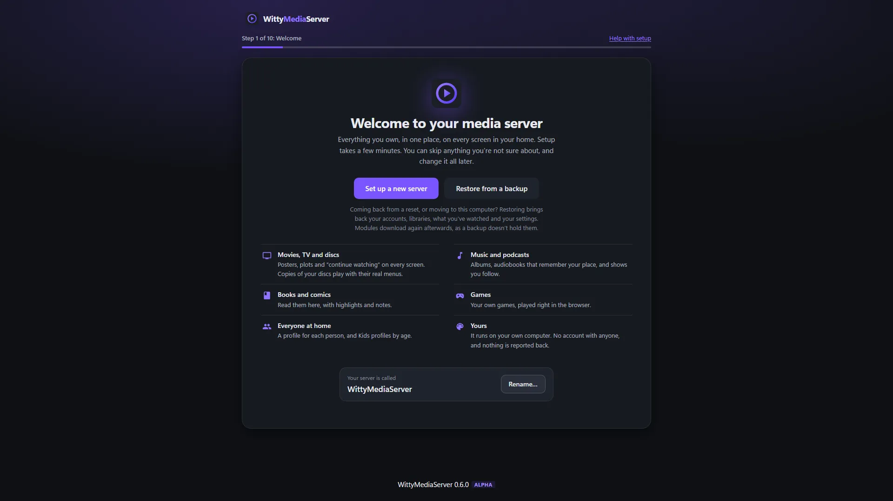
*The first page.*

- **Set up a new server** carries on to the next page.
- **Restore from a backup** is for moving from another computer or coming back from a reset. It brings back your accounts, libraries, what you've watched and your settings, and you won't see the rest of this guide. See [Backup and restore](BACKUP.md).
- **Rename…** gives your server a name of its own, with the parts in colour you choose and a logo. You can do it later in **Settings → Appearance**.

## 2. Your account

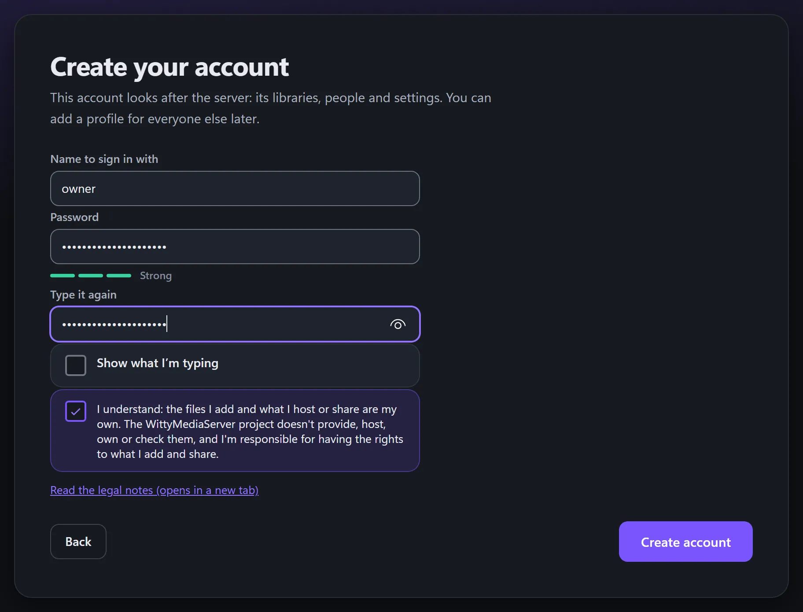
*This account looks after the server: its libraries, people and settings.*

Choose a **name to sign in with**, and a **password** of at least 8 characters, typed twice. **Show what I'm typing** helps on a TV. Tick the box to say that the files you add are your own responsibility, then press **Create account**. On another device, the setup code goes here too.

Keep the password somewhere safe: [forgetting it is hard to undo](ACCOUNTS.md#if-you-forget-your-password).

## 3. Look

A look is the layout, shapes, finish and type: how pages are arranged and how they feel. Fourteen come with the server, each tried on this very page as you pick it:

| Look | In a word | Wears, unless you choose |
|---|---|---|
| Lumen | Quiet cinema | Witty |
| Rail | Library first | Cinema |
| Stage | Streaming | Midnight |
| Aero | Glossy glass | Aero Day |
| Classic | Sidebar | Witty |
| Classic Cable | Blue guide | Cable blue |
| Classic Satellite | Silver bars | Satellite |
| Compact | Dense lists | True black |
| Paper | Editorial | Paper |
| Crossbar | Console style | Evergreen |
| Marquee | Poster carousel | Cinema |
| Big picture | Easy to see | High contrast |
| Dashboard | Widgets | Midnight |
| Retro | Teletext | Teletext |

What you pick is where everyone starts, on every kind of device. People can pick their own later, unless you require one (see [Ready](#14-ready)). Each look works on TVs, phones, tablets and computers. See [Themes](THEMES.md#a-look-is-an-experience-and-a-theme).

**TV mode** lays this device out like the Apple TV and Android TV apps, for a screen across the room, driven by a remote or a controller. It's for this device only.

## 4. Theme

The colours. Any theme goes with any look, and the page changes as you choose. Fifteen come with the server, among them Witty, Midnight, Cinema, Evergreen, True black, Light, Paper, High contrast, the four Aero themes, Cable blue, Satellite and Teletext.

**Import a theme…** installs one from a ZIP file, and you can make your own later in **Settings → Appearance**. See [Themes](THEMES.md).

## 5. Modules

Movies, TV shows and music work straight away. Modules add the rest: discs, games, photos, books, live TV and more. Each is a separate program that downloads now, signed, from the official list, so this page needs an internet connection. What you don't tick isn't downloaded.

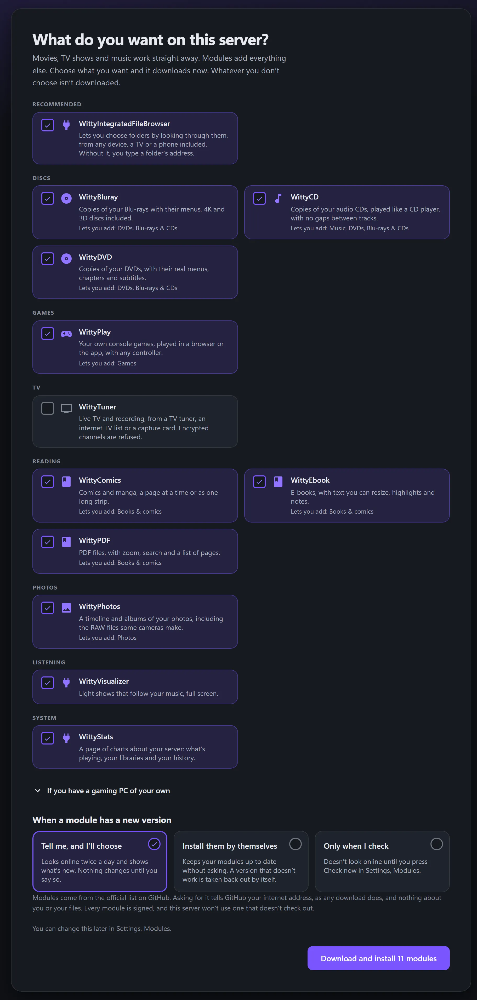
*Tick what you want. The folder browser is ticked for you, as it's how you choose a folder from a TV or a phone.*

Under the list, choose what happens when a module has a new version: tell you and let you choose, install it by itself, or look only when you ask. Then press **Download and install**.

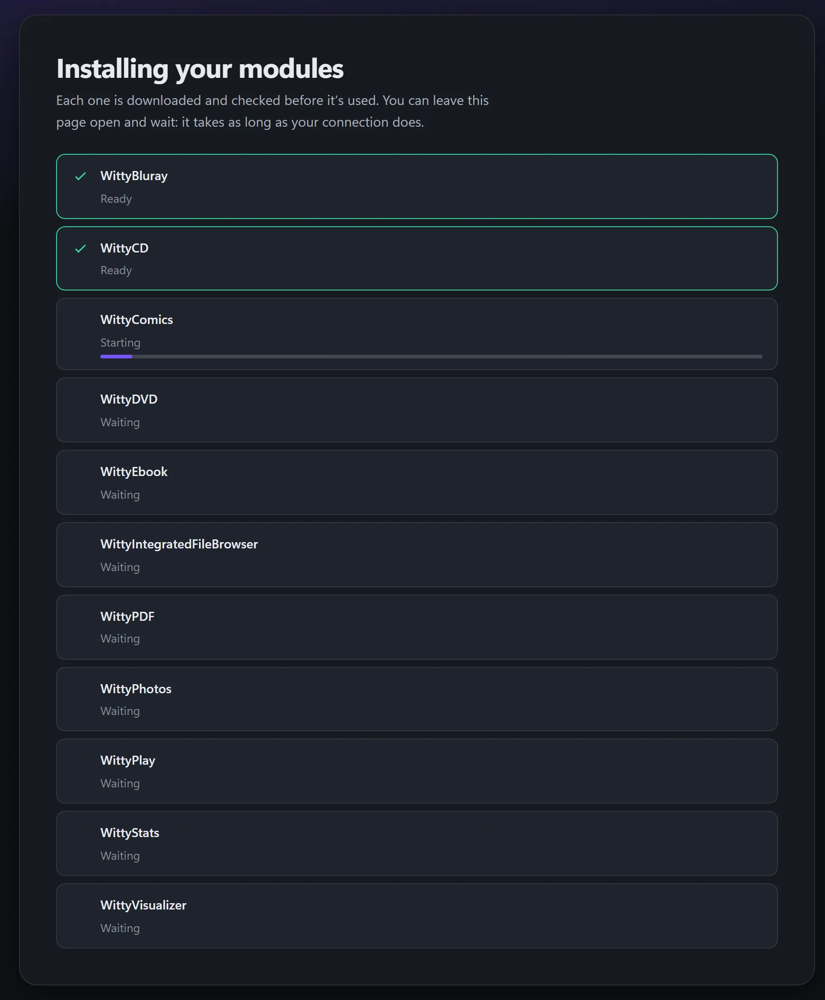
*Each module downloads, and its signature is checked before it goes in.*

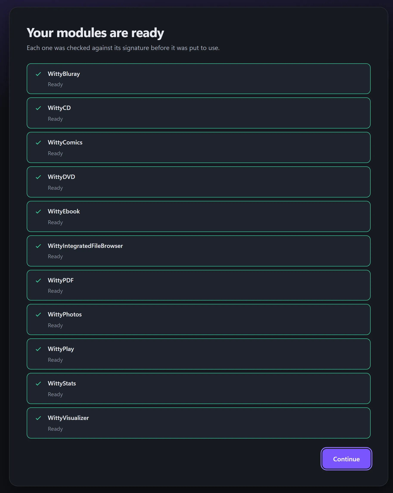
*If one fails, you can try again or carry on without it. No internet? Carry on, and add them later from Settings, Modules.*

See [Modules and the store](MODULE-STORE.md).

## 6. Your media

Pick a kind of media, then the folder it's in. Each one becomes a library you can browse. Your files stay where they are, and nothing is copied.

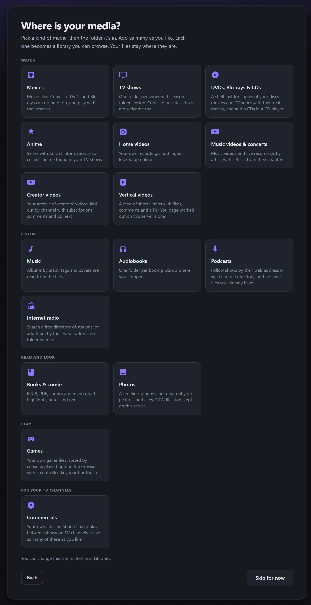
*Choose a kind. A kind you didn't add the module for isn't offered.*

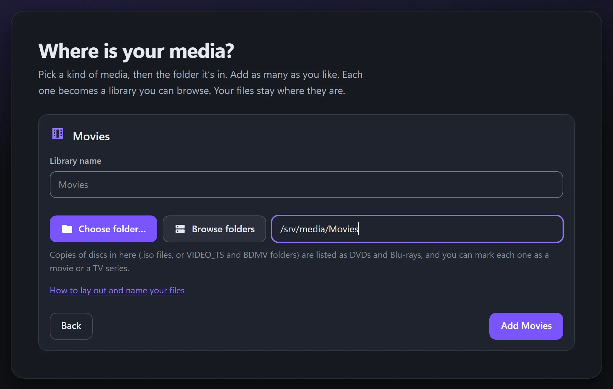
*Three ways to give the folder.*

- **Choose folder…**, on the computer running the server, opens your computer's own folder window.
- **Browse folders** shows the server's drives in the page, from any device. Open the folder you want and press **Use this folder**.
- Or type the folder's full path.

Press the button that adds it, such as **Add Movies**, and it starts scanning in the background. Add as many as you like.

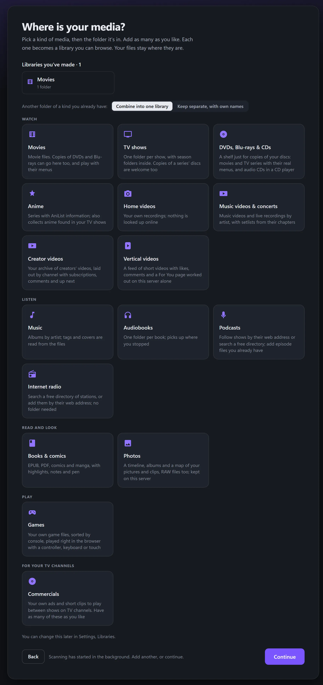
*Add another kind, or press Continue.*

How to name your files is in [Libraries](LIBRARIES.md#how-to-lay-out-and-name-your-files). A folder on another computer has [its own steps](LIBRARIES.md#network-shares), which this page lays out if you choose one from another device.

## 7. Games

This page appears if you added WittyPlay.

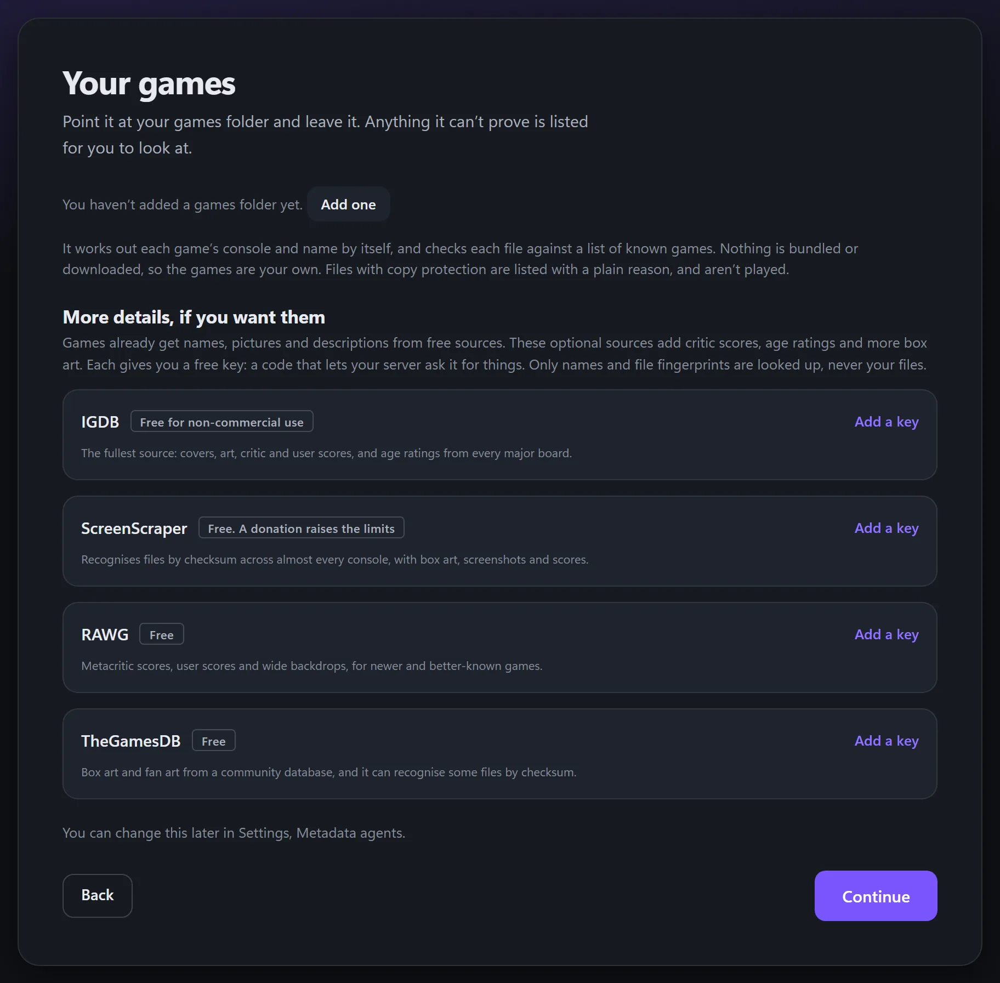
*Point it at your games folder and leave it.*

It works out each game's console and name by itself, and lists anything it can't prove for you to look at. No games come with the server, and nothing is downloaded for you. The sources here are optional, and each needs a free key. See [Games](GAMES.md).

## 8. Discs

This page appears if you added a disc module.

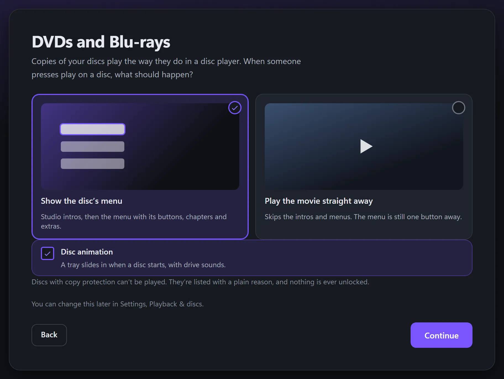
*The menu is still one button away if you choose to play straight away.*

Discs with copy protection can't be played. They're listed with a plain reason, and nothing is ever unlocked. See [DVDs](DVD.md) and [Blu-rays](BLURAY.md).

## 9. Posters and details

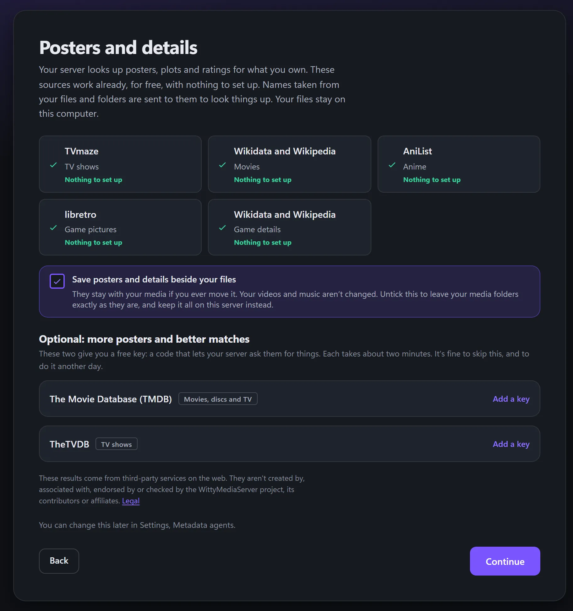
*TVmaze, Wikidata, Wikipedia, AniList and libretro work with no key.*

Names taken from your files and folders are sent to these services to look things up. Your files stay on your computer.

- **Save posters and details beside your files** keeps them with your media if you ever move it. Your videos and music aren't changed. Untick it to leave your media folders exactly as they are.
- **Add a key**, for TMDB and TheTVDB, is optional, and each takes about two minutes. It's fine to do this another day.

See [Where details come from](METADATA.md).

## 10. Logos

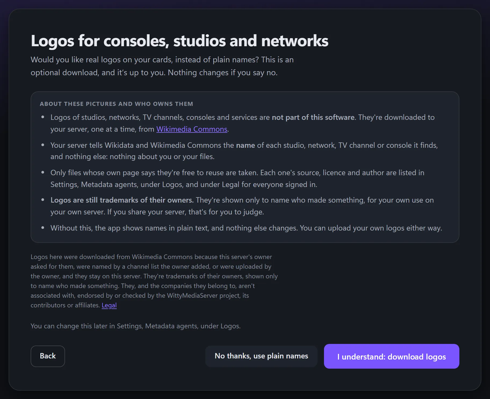
*Off unless you say yes. Nothing else changes if you say no.*

Real logos for consoles, studios and networks aren't part of this software. They download from Wikimedia Commons one at a time, only if you agree, and they're still trademarks of their owners. Choosing **No thanks, use plain names** shows names in plain text.

## 11. Lyrics

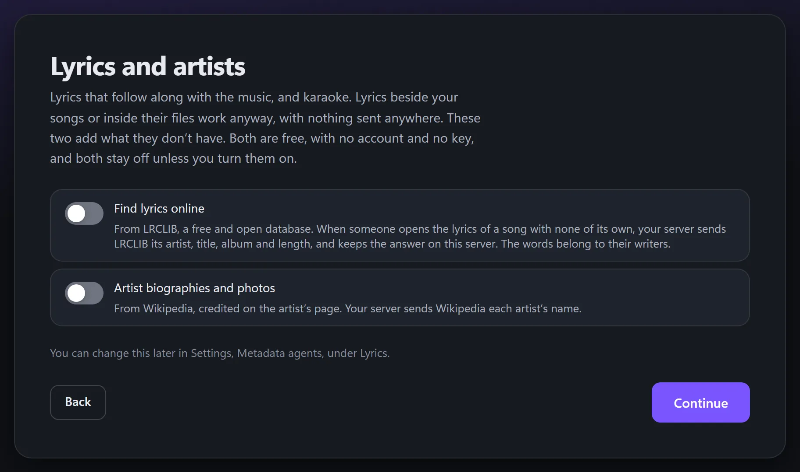
*Both are free, with no account and no key, and both stay off unless you turn them on.*

Lyrics beside your songs or inside their files work anyway, with nothing sent anywhere. These two add what they don't have, and the page says what's sent to each. See [Lyrics and karaoke](LYRICS-KARAOKE.md).

## 12. Streaming lists

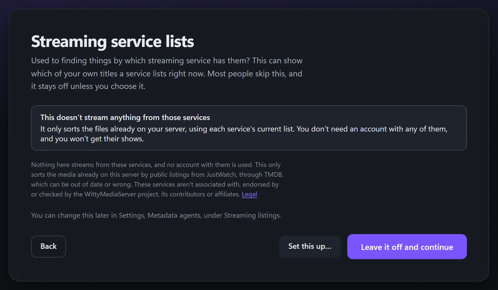
*Off unless you choose it.*

This sorts your own titles by which streaming service lists them right now. Nothing streams from those services, and you don't need an account with any of them. To turn it on, you accept four statements and add a free TMDB key. **Leave it off and continue** is the usual choice.

## 13. Live TV

This page appears if you added WittyTuner.

**Add live TV** walks you through adding a TV tuner on your network, a provider's playlist or a single stream. It finds what it can by itself and takes the rest by hand. Each one you add is listed with how many channels it has, and their channels sit in the guide beside the ones made from your library. **Add another** adds more; **Skip for now** leaves it for later in **Settings → Channels & tuners**.

No channel lists or stream addresses come with the server: you bring your own. Encrypted channels are shown as encrypted and never decrypted. See [Channels and live TV](CHANNELS.md).

## 14. Ready

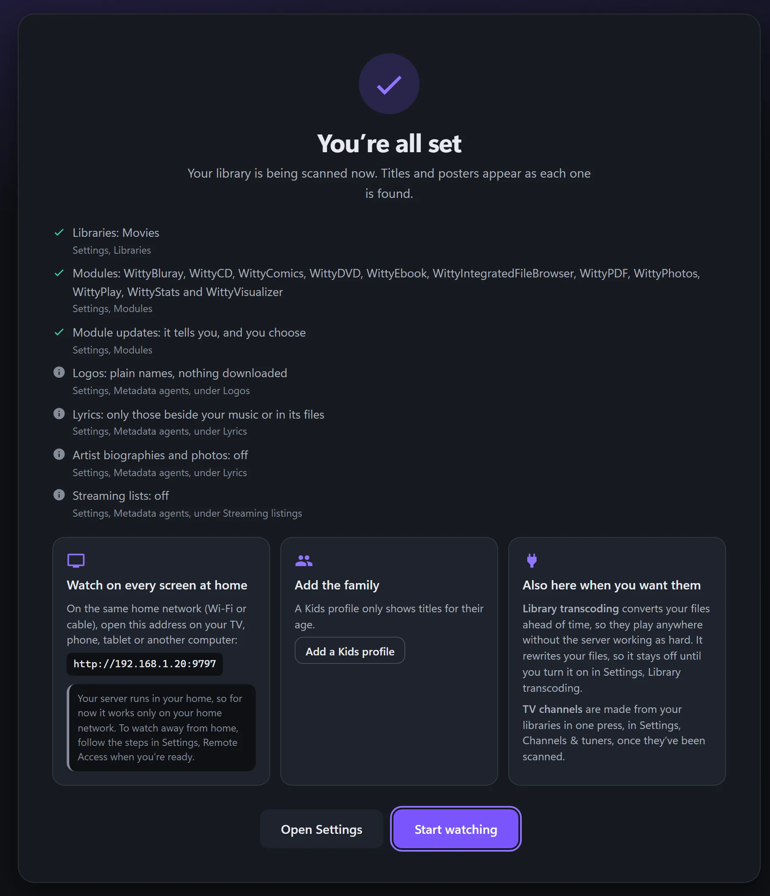
*The last page says what you chose, as the server has it now.*

- **What you chose**, each with where to change it later. Your libraries keep scanning in the background, and titles and posters appear as each one is found.
- **Watch on every screen at home:** the address other devices on your home network open, and the port it's on, with **Change the port**. If the server only answers on this computer, it says what to change. Your server works only at home until you choose a way in from away, in **Settings → Remote Access** ([Remote access](REMOTE.md)).
- **Add the family:** **Add a Kids profile** makes one that only shows titles for their age. Add more people in **Settings → Profiles**.
- **Also here when you want them:** library transcoding, TV channels made from your libraries, and live TV.

Press **Start watching** and you're in, or **Open Settings** to carry on there. To require a look, a theme or both of everyone, of kids or of one profile, use **Required looks** in **Settings → Pages & menu → Looks**: a required look is shown locked, with your name.

[Where next](GETTING_STARTED.md#where-next) has what to read after this.

## With a remote, a controller or the keyboard

The arrow keys, a TV remote's arrows and a controller's stick or pad reach everything, and OK (or the controller's main button) presses it. Back goes back a page. On a list of choices, the arrows only move: press OK on the one you want.

---

WittyMediaServer documentation
