# First-time setup, step by step

First-time setup happens **in a web browser only**. Until it's finished, apps can't use the server: they say "This server isn't set up yet", with the address to finish at and a QR code of it ([First run](CLIENT-API.md#first-run) says what an app is sent).

Setup has **six steps**, listed beside the page. Each asks one thing, with the usual answer already chosen, so you can press the big button on every page and be watching in a few minutes. Your answers are saved as you go: you can go back, or stop and carry on another day. Everything can be changed later in **Settings**.

There are two ways through:

- **Quick setup** (**Get started**) asks only what's needed to start watching. Each step's other choices wait behind its **Customize** button, already answered. You never have to open one.
- **Advanced setup** goes through every choice, a page at a time, next to the step it belongs with. The step list shows the same six steps, and a step with several pages says so ("Step 4 of 6 · Your media · part 3 of 8: Discs").

| | Step | Quick setup | Advanced setup adds a page for |
|---|---|---|---|
| 1 | [Welcome](#1-welcome) | Language | Time zone, disc menus and sound tracks |
| 2 | [Your account](#2-your-account) | Name, password, the server's name | The server's colours and logo, people at home |
| 3 | [Modules](#3-modules) | What else the server does | When a module has a new version |
| 4 | [Your media](#4-your-media) | Your folders, and Live TV or Games if you added them | Discs, posters and details, logos, lyrics, karaoke, streaming lists |
| 5 | [Look](#5-look) | The layout | Colours, the TV guide |
| 6 | [Finish](#6-finish) | Other devices, the family, this screen | Home network, away from home |

Why the steps are in this order is in [The setup flow](SETUP-FLOW.md). The pictures show quick setup unless they say otherwise; the page itself wears the look you're trying, so its colours may differ.

- [Before you start](#before-you-start)
- [Advanced setup, page by page](#advanced-setup-page-by-page)
- [On a TV](#on-a-tv)
- [With a remote, a controller or the keyboard](#with-a-remote-a-controller-or-the-keyboard)

## Before you start

Install the server first: [Getting started](GETTING_STARTED.md#install-it-and-start-it) says how for each system. Setup opens in your browser by itself on Windows and on a Mac. Elsewhere, open `http://<this computer>:9797/`.

**If it asks for a setup code,** you're on another device. That's so nobody else on your network can claim the server first. The code is on the server's console when it starts, or in `setup-code.txt` in its data folder. See [Setting up from another device](ACCOUNTS.md#setting-up-from-another-device).

## 1. Welcome

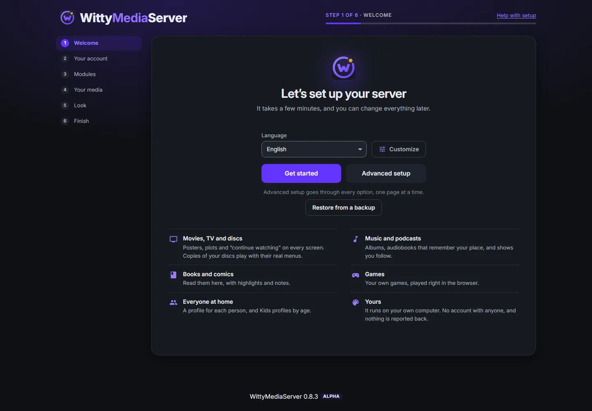
*The first page: the language, then quick or advanced setup.*

Pick your **language**: the page changes as you pick it. Then:

- **Get started** for quick setup.
- **Advanced setup** to go through every choice.
- **Restore from a backup** to move from another computer or come back from a reset. It brings back your accounts, libraries, what you've watched and your settings. See [Backup and restore](BACKUP.md).

**Customize** holds the **time zone** (the computer's own to begin with; the TV guide, recordings and logs follow it) and the language for **disc menus and sound tracks** (follows the language unless you pick another).

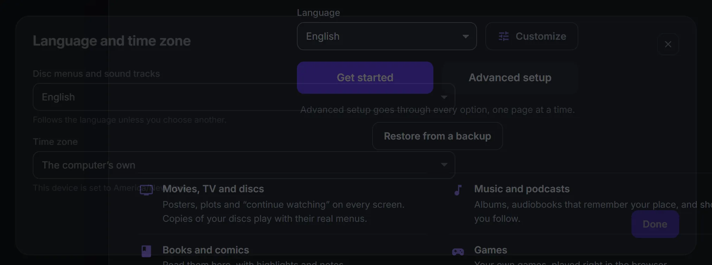
*Welcome's Customize: disc menus and sound tracks, and the time zone.*

## 2. Your account

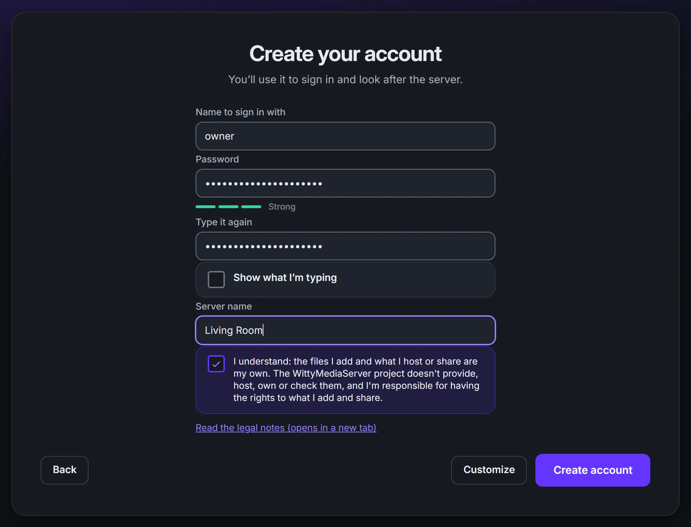
*The account and the server's name, on one page.*

A **name to sign in with**, a **password** of at least 8 characters typed twice, and optionally the **server's name**, which every app shows. Tick the box to say the files you add are your own responsibility, then press **Create account**. Keep the password safe: [forgetting it is hard to undo](ACCOUNTS.md#if-you-forget-your-password).

**Customize** holds the **name people see** (instead of the sign-in name) and **two-step sign-in**, which asks for a code from an app on your phone. If you tick it, you set it up on the next page.

**Where data is kept.** On a computer you use (the Windows tray app, the Mac app, a Linux desktop), the next page asks where the server keeps its settings and data. **Documents** is chosen to begin with; **Keep it here** carries on. A server, Docker or a service whose folder is already set doesn't ask. See [The data folder](DATA-FOLDER.md).

*Documents is chosen to begin with. The line under the choices says how much room there is.*

## 3. Modules

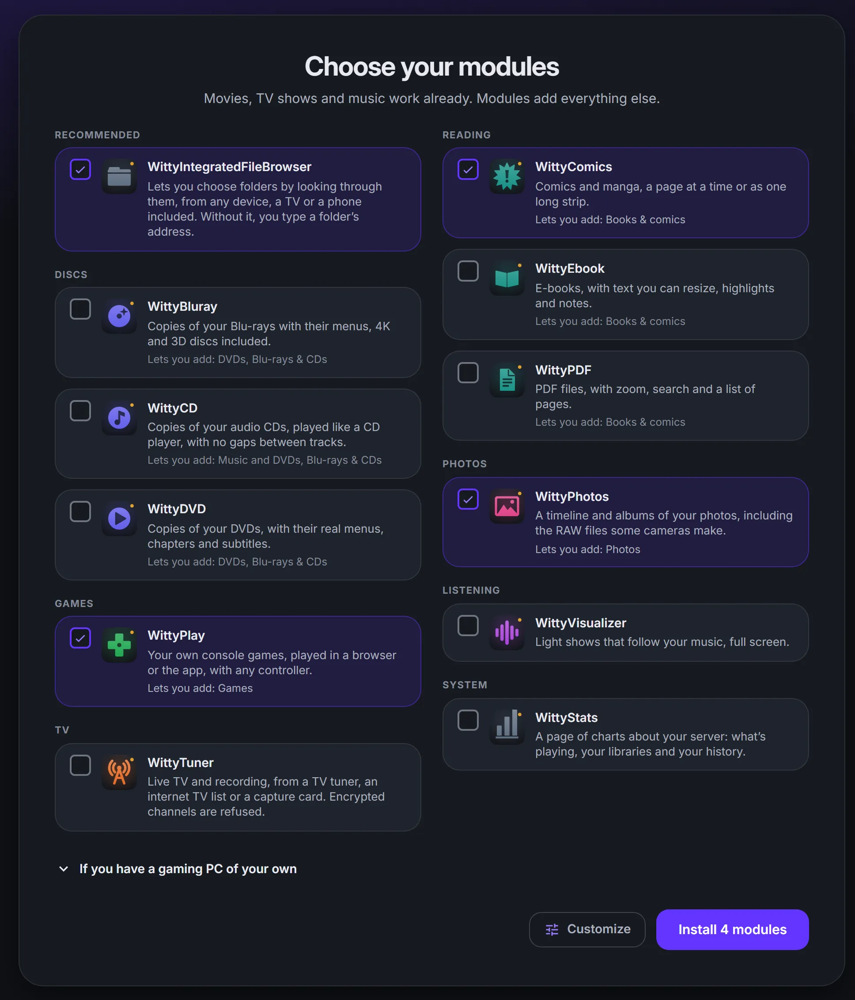
*Tick what you want. The folder browser is ticked for you.*

Movies, TV shows and music work already. Modules add the rest: discs, games, live TV, books, comics, photos and more. Tick what you want and press **Install**: each one downloads, signed, from the official list, and is checked before it's used. **WittyIntegratedFileBrowser** is ticked to begin with: it lets you pick folders by looking through them, from any device. Nothing is downloaded until you press the button.

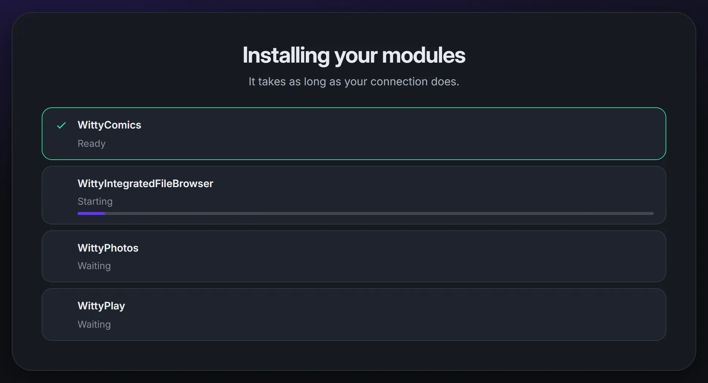
*Each module downloads, and is checked before it's used.*

**Customize** holds **when a module has a new version**: tell me and I'll choose (to begin with), install them by themselves, or only when I check. You can add modules any time in **Settings → Module store**, and **Your media** offers the module a kind of library needs, right where you'd want it.

## 4. Your media

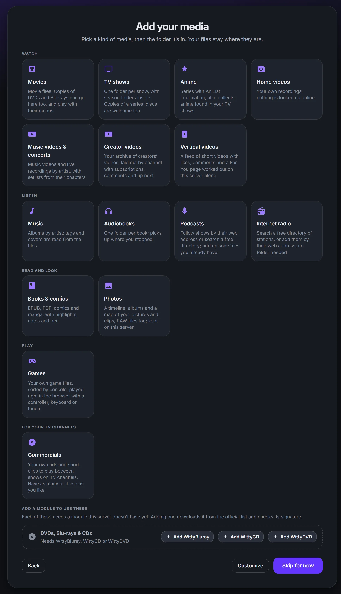
*Choose a kind, then its folder. A kind that needs a module offers it right there.*

Pick a kind of media, then the folder it's in, as many times as you like. Each becomes a library. Your files stay where they are, and the scan starts at once.

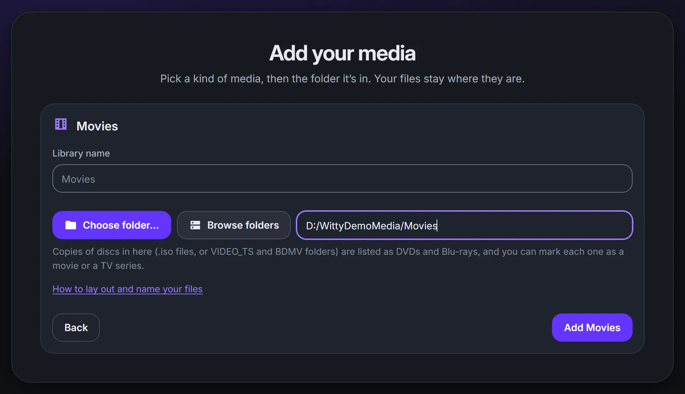
*The folder for a Movies library. Openly licensed demo media.*

*Add another kind, or press Continue.*

**Customize** holds two choices:

- **Posters and details:** saved beside your files (to begin with), so they move with your media, or kept on this server only. Your videos and music are never changed.
- **More than one folder of a kind:** one library, or separate libraries with their own names.

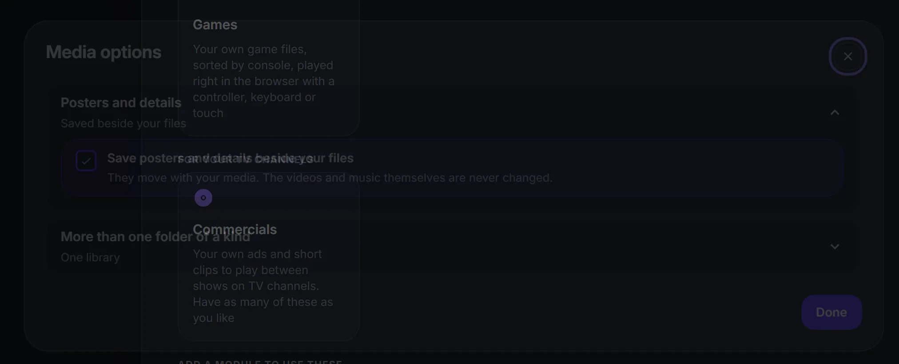
*Your media's Customize: details beside your files, and one or separate libraries.*

**Live TV and Games.** If you added WittyTuner or WittyPlay, their own page comes next. Live TV finds tuners on your network and offers a **demo tuner** to try the guide with nothing to buy; no channel lists come with the server, and encrypted channels are never decrypted ([Channels and live TV](CHANNELS.md)). Games: point it at your games folder and leave it ([Games](GAMES.md)).

*Point it at your games folder and leave it.*

## 5. Look

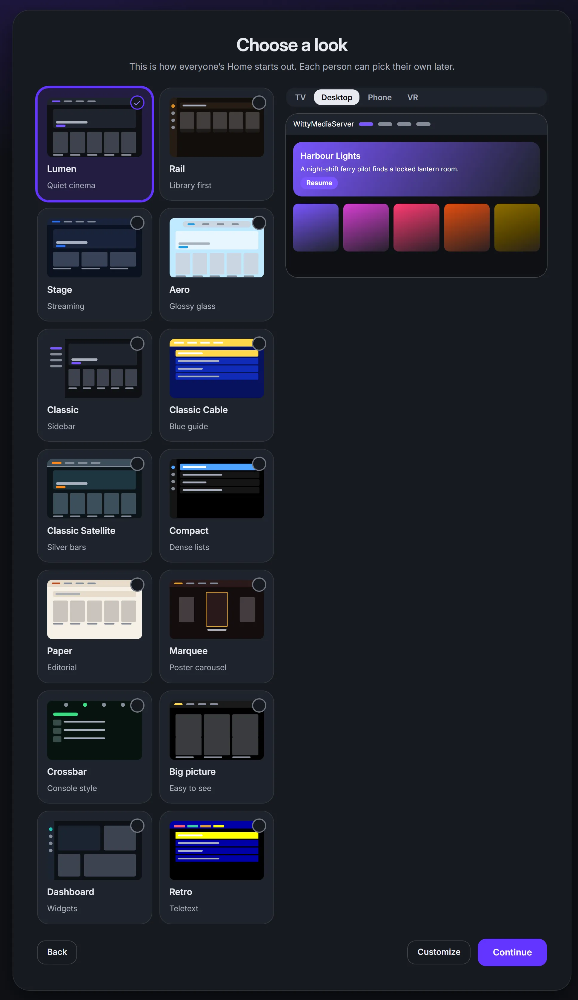
*The layouts, tried as you choose.*

Pick how everyone's Home starts out. The preview shows it on a TV, a computer, a phone or in VR, and the page tries it as you choose. Each person can pick their own later.

**Customize** holds **Colours** (each look brings its own until you pick one theme for all of them, or import a theme) and, with WittyTuner, the **TV guide**'s own look.

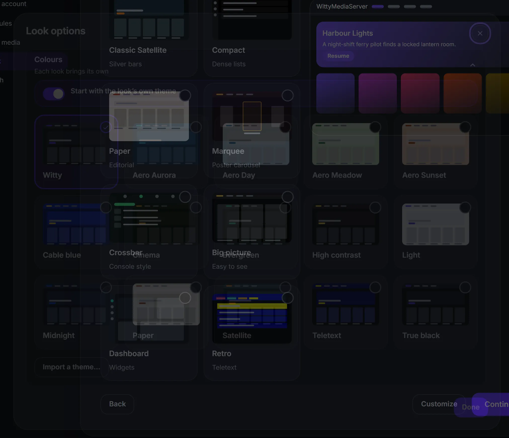
*Look's Customize: one theme for all looks, or each look's own.*

## 6. Finish

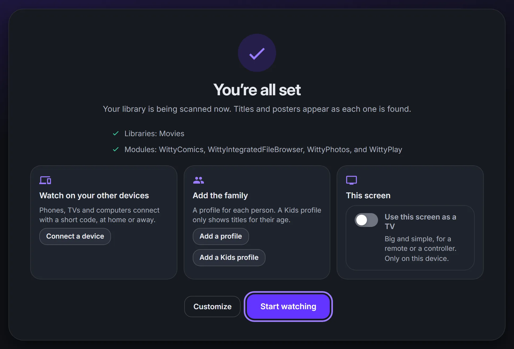
*The last page: connect a device, add the family, use this screen as a TV.*

Your libraries are being scanned. From here:

- **Connect a device:** a short code and a QR code for a phone, TV or computer, at home or away. The same screen as **Settings → Remote Access**. See [Remote access](REMOTE.md).
- **Add a profile** or **Add a Kids profile.** A Kids profile only shows titles for their age.
- **Use this screen as a TV:** laid out for a remote or a controller, on this device only. See [TV mode](TV-MODE.md).

**Customize** holds everything optional, each off or as it comes until you change it: the **home network** (whether apps find the server by themselves, and its port), **posters and details** (free sources work already; two more take a free key; details already beside your media can be converted), **logos** for studios, networks and consoles, **lyrics and artists** from the web, **karaoke voices** (a cleaner way to take the singer out, a large download) and **streaming lists**.

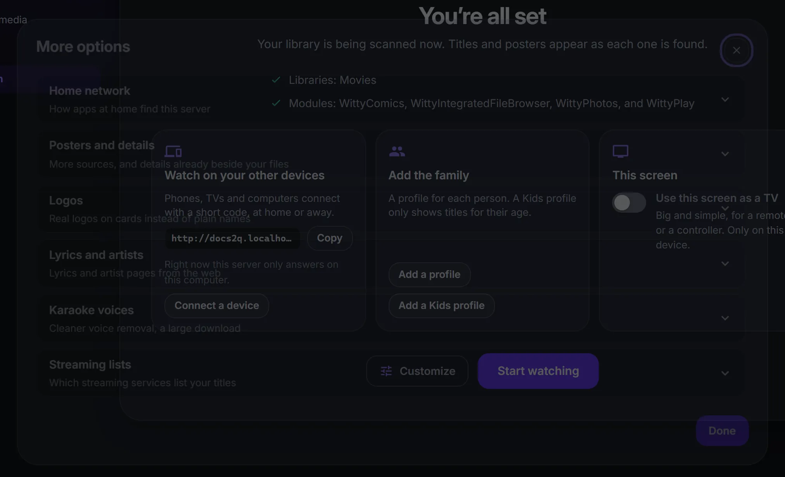
*Finish's Customize: everything optional, each already answered.*

Press **Start watching**.

## Advanced setup, page by page

Advanced setup asks everything quick setup leaves in **Customize**, on pages of their own, plus a few things quick setup leaves to **Settings**. Each page has one sentence about it and **Continue**; what you change is saved as you change it.

| Step | Page | What it asks | Later in |
|---|---|---|---|
| Welcome | Language and time zone | The language, disc menus and sound tracks, the time zone | Settings → Appearance |
| Your account | Your account | As in quick setup, with the name people see and two-step sign-in on the page | Settings → Security |
| | Your server's name | The name, its colours and the mark for small spaces | Settings → Appearance → Name and logo |
| | Who else watches? | Profiles, and a look or theme to lock for everyone, for Kids profiles or for one person | Settings → Profiles |
| Modules | Choose your modules | As in quick setup, with when a module has a new version on the page | Settings → Module store |
| Your media | Add your media | As in quick setup, with both media choices on the page | Settings → Libraries |
| | DVDs and Blu-rays | With WittyDVD or WittyBluray: show the menu or play the movie, and the disc animation | Settings → DVDs and Blu-rays |
| | Posters and details | The free sources, two optional keys, and details already beside your media | Settings → Metadata agents |
| | Logos | Real logos instead of plain names, downloaded from Wikimedia Commons | Settings → Metadata agents → Logos |
| | Lyrics and artists | Lyrics and artist pages from the web | Settings → Metadata agents → Lyrics |
| | Karaoke voices | Demucs, to take the singer out more cleanly | Settings → Metadata agents → Lyrics |
| | Streaming lists | Sort your titles by which streaming service lists them | Settings → Metadata agents → Streaming listings |
| Look | Look, Colours, TV guide | The layout, a theme for all looks, and with WittyTuner the TV guide's look | Settings → Appearance |
| Finish | Home network | Found automatically, its address, and its port | Settings → Network |
| | Away from home | Connect a device, and whether it works away from home | Settings → Remote Access |

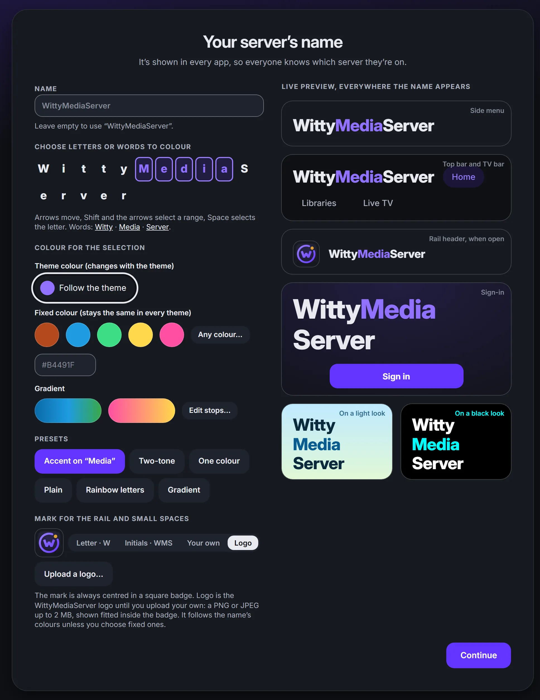
*Advanced setup: the server's name, colours and mark.*

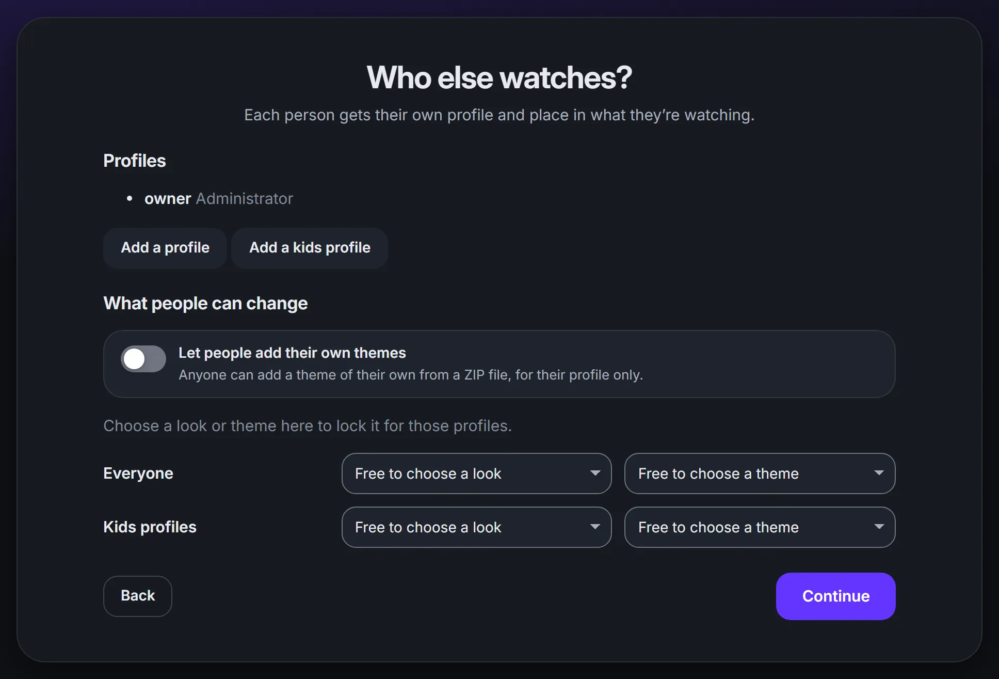
*Advanced setup: profiles, and what people can change.*

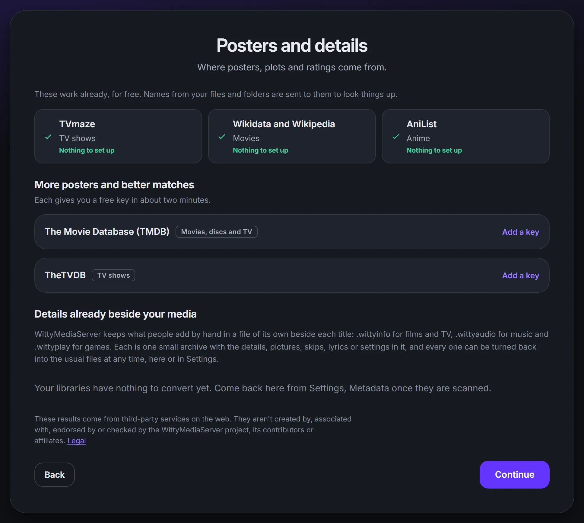
*Advanced setup: posters and details.*

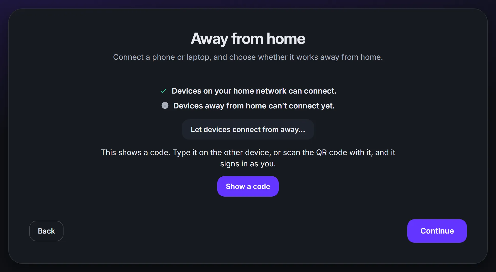
*Advanced setup: connect a device, at home or away.*

## On a TV

Setup works with a remote, but a few things are much easier on a computer: colouring the server's name, importing a theme from a file, and pasting keys. On a TV those parts say so, in the same words as the rest of the app: **Leave TV mode to change this** on a computer in TV mode, or **use the WittyMediaClient app on a Windows or Mac computer, or a web browser** on a TV. Quick setup never needs them. See [TV mode](TV-MODE.md).

## With a remote, a controller or the keyboard

The arrows reach everything, and OK presses it. Back goes back a page. On a list of choices, the arrows only move: press OK on the one you want. A **Customize** dialog works the same way, and Back closes it.

---

WittyMediaServer documentation
