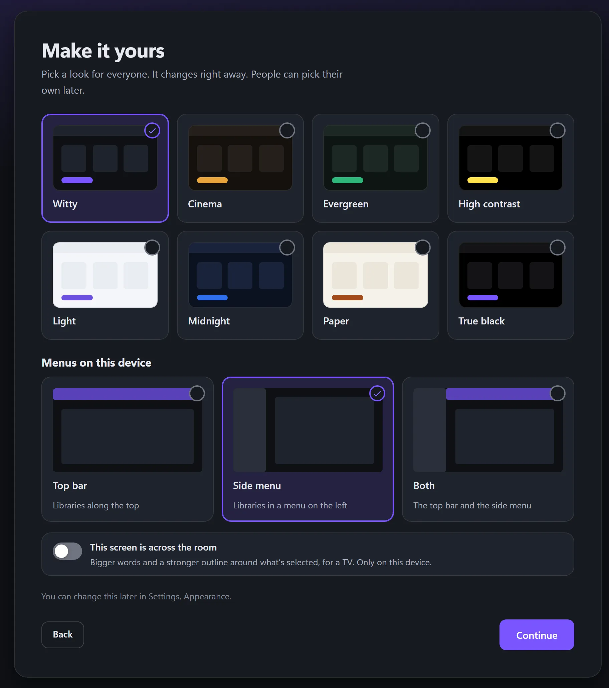

# First-time setup, step by step

First-time setup happens **in a web browser only**. Until it is finished the server is not reachable by apps: they answer "This server isn't set up yet" with the address to finish at and a QR code of it ([First run](CLIENT-API.md#first-run) says what an app is sent). There are fourteen steps: Welcome, Account, Name and address, Look, Theme, Modules, Libraries, Details and artwork, Live TV, Games, Discs, People and rules, Remote access and apps, and Ready. **Look** offers every experience as a live preview and the setup becomes the one you try; **Theme** offers the themes, **Import a theme** and Make your own, and an experience wears its own theme unless you choose one. In **People and rules** an administrator can require a look, a theme or both of everyone, of kids or of one profile.

This guide walks through every page of first-time setup, with a picture of each, so you know what's coming and what each answer does. It takes a few minutes. Only the account is required: everything else can be skipped and changed later, and each page says where in **Settings**.

Your answers are saved as you go, so you can go back, or stop and carry on another day. A page only appears if your server can use what it asks about, so yours may have fewer pages than this.

- [Before you start](#before-you-start)
- [1. Welcome](#1-welcome)
- [2. Your account](#2-your-account)
- [3. Modules](#3-modules)
- [4. Where your media is](#4-where-your-media-is)
- [5. Your games](#5-your-games)
- [6. DVDs and Blu-rays](#6-dvds-and-blu-rays)
- [7. Posters and details](#7-posters-and-details)
- [8. Logos](#8-logos)
- [9. Lyrics and artists](#9-lyrics-and-artists)
- [10. Streaming lists](#10-streaming-lists)
- [11. How it looks](#11-how-it-looks)
- [12. You're all set](#12-youre-all-set)
- [With a remote or the keyboard](#with-a-remote-or-the-keyboard)

## Before you start

Install the server first: [Getting started](GETTING_STARTED.md#install-it-and-start-it) says how for each system. Setup opens in your browser by itself on Windows and on a Mac. Elsewhere, open `http://<this computer>:9797/`.

**If it asks for a setup code,** you're on another device. That's so nobody else on your network can claim the server first. The code is on the server's console when it starts, or in `setup-code.txt` in its data folder. See [Setting up from another device](ACCOUNTS.md#setting-up-from-another-device).

## 1. Welcome

*The first page. Your server can have a name of its own here, and a logo.*

- **Set up a new server** carries on to the next page.
- **Restore from a backup** is for moving from another computer or coming back from a reset. It brings back your accounts, libraries, what you've watched and your settings, and you won't see the rest of this guide. See [Backup and restore](BACKUP.md).
- **Rename…** gives your server its own name. You can do it later in **Settings → Appearance**.

## 2. Your account

*This account looks after the server. Everyone else gets a profile later.*

Choose a name to sign in with, and a password of at least 8 characters, typed twice. Tick the box to say that the files you add are your own responsibility, then press **Create account**.

Keep the password somewhere safe: [forgetting it is hard to undo](ACCOUNTS.md#if-you-forget-your-password).

## 3. Modules

Movies, TV shows and music work straight away. Modules add the rest: discs, games, photos, books and more. Each is a separate program that downloads now, signed, from the official list, so this page needs an internet connection. What you don't tick isn't downloaded.

*Tick what you want. The folder browser is ticked for you, as it's how you choose a folder from a TV or a phone.*

Under the list, choose what happens when a module has a new version: tell you and let you choose, install it by itself, or look only when you ask. Then press **Download and install**.

*Each module downloads, and its signature is checked before it goes in.*

*If one fails, you can try again or carry on without it. No internet? Carry on, and add them later from Settings, Modules.*

See [Modules and the store](MODULE-STORE.md).

## 4. Where your media is

Pick a kind of media, then the folder it's in. Each one becomes a library you can browse. Your files stay where they are, and nothing is copied.

*Choose a kind. A kind you didn't add the module for isn't offered.*

*Three ways to give the folder.*

- **Choose folder…**, on the computer running the server, opens your computer's own folder window.
- **Browse folders** shows the server's drives in the page, from any device. Open the folder you want and press **Use this folder**.
- Or type the folder's full path.

Press the button that adds it, such as **Add Movies**, and it starts scanning in the background. Add as many as you like.

*Add another kind, or press Continue.*

How to name your files is in [Libraries](LIBRARIES.md#how-to-lay-out-and-name-your-files). A folder on another computer has [its own steps](LIBRARIES.md#network-shares), which this page lays out if you choose one from another device.

## 5. Your games

This page appears if you added WittyPlay.

*Point it at your games folder and leave it.*

It works out each game's console and name by itself, and lists anything it can't prove for you to look at. No games come with the server, and nothing is downloaded for you. The sources here are optional, and each needs a free key. See [Games](GAMES.md).

## 6. DVDs and Blu-rays

This page appears if you added a disc module.

*The menu is still one button away if you choose to play straight away.*

Discs with copy protection can't be played. They're listed with a plain reason, and nothing is ever unlocked. See [DVDs](DVD.md) and [Blu-rays](BLURAY.md).

## 7. Posters and details

*TVmaze, Wikidata, Wikipedia, AniList and libretro work with no key.*

Names taken from your files and folders are sent to these services to look things up. Your files stay on your computer.

- **Save posters and details beside your files** keeps them with your media if you ever move it. Your videos and music aren't changed. Untick it to leave your media folders exactly as they are.
- **Add a key**, for TMDB and TheTVDB, is optional, and each takes about two minutes. It's fine to do this another day.

See [Where details come from](METADATA.md).

## 8. Logos

*Off unless you say yes. Nothing else changes if you say no.*

Real logos for consoles, studios and networks aren't part of this software. They download from Wikimedia Commons one at a time, only if you agree, and they're still trademarks of their owners. Choosing **No thanks, use plain names** shows names in plain text.

## 9. Lyrics and artists

*Both are free, with no account and no key, and both stay off unless you turn them on.*

Lyrics beside your songs or inside their files work anyway, with nothing sent anywhere. These two add what they don't have, and the page says what's sent to each. See [Lyrics and karaoke](LYRICS-KARAOKE.md).

## 10. Streaming lists

*Off unless you choose it.*

This sorts your own titles by which streaming service lists them right now. Nothing streams from those services, and you don't need an account with any of them. To turn it on, you accept four statements and add a free TMDB key. **Leave it off and continue** is the usual choice.

## 11. How it looks

*It changes right away, and each person can pick their own later.*

- **A theme** for everyone: Witty, Cinema, Evergreen, High contrast, Light, Midnight, Paper or True black. See [Themes](THEMES.md).
- **Menus on this device:** along the top, down the side, or both.
- **This screen is across the room** makes the words bigger and the outline around what's selected stronger, for a TV.

## 12. You're all set

*The last page says what you chose, as the server has it now.*

It shows the address other devices can use on your home network, and offers to add a Kids profile. Press **Start watching** and you're in. Your library keeps scanning in the background, and the activity button at the top of the screen shows how it's going.

[Where next](GETTING_STARTED.md#where-next) has what to read after this.

## With a remote or the keyboard

The arrow keys reach everything and OK presses it. Back goes back a page. On a list of choices, the arrows only move: press OK on the one you want.

---

WittyMediaServer documentation
