# First-time setup, step by step

First-time setup happens **in a web browser only**. Until it's finished, apps can't use the server: they say "This server isn't set up yet", with the address to finish at and a QR code of it ([First run](CLIENT-API.md#first-run) says what an app is sent).

This guide walks through every page, so you know what's coming and what each answer does. It takes a few minutes. Only the account is required: every other page can be skipped, and says once where to change it later in **Settings**. Your answers are saved as you go, so you can go back, or stop and carry on another day.

There are always twelve steps, and a list of them sits beside the page: a tick for those you've done, the one you're on highlighted, and the ones coming. A step can have several pages ("Step 4 of 12 · This server · part 2 of 3"). A step with nothing to do on this server stays in the list, dimmed, and says why: **Set up your modules** says **After you choose modules** until you've chosen them, then **Nothing to set up** if none of yours needs it. "Step 8 of 12" never changes its total. Why the steps are in this order is in [The setup flow](SETUP-FLOW.md).

| | Step | When it asks |
|---|---|---|
| 1 | [Language](#1-language) | Always |
| 2 | [Welcome](#2-welcome) | Always |
| 3 | [Your account](#3-your-account) | Always |
| 4 | [This server](#4-this-server) | Always; where data is kept only on a computer you use |
| 5 | [Modules](#5-modules) | When the server can reach the module list |
| 6 | [Libraries](#6-libraries) | Always |
| 7 | [Set up your modules](#7-set-up-your-modules) | With WittyTuner, WittyPlay, WittyDVD or WittyBluray |
| 8 | [Looks](#8-looks) | Always; the WittyTV page only with WittyTuner |
| 9 | [People](#9-people) | Always |
| 10 | [Away from home](#10-away-from-home) | Always |
| 11 | [Extras](#11-extras) | Always; some pages only where the server can use them |
| 12 | [Ready](#12-ready) | Always |

The pictures show what each page holds. The page itself wears the look and theme you're trying, as you choose them, so its colours and shapes may differ from these.

- [Before you start](#before-you-start)
- [On a TV](#on-a-tv)
- [With a remote, a controller or the keyboard](#with-a-remote-a-controller-or-the-keyboard)

## Before you start

Install the server first: [Getting started](GETTING_STARTED.md#install-it-and-start-it) says how for each system. Setup opens in your browser by itself on Windows and on a Mac. Elsewhere, open `http://<this computer>:9797/`.

**If it asks for a setup code,** you're on another device. That's so nobody else on your network can claim the server first. The code is on the server's console when it starts, or in `setup-code.txt` in its data folder. See [Setting up from another device](ACCOUNTS.md#setting-up-from-another-device).

## 1. Language

The very first page asks, once:

- **Language:** the language of these pages, for everyone who uses this server. The page changes as you pick it.
- **Disc menus and sound tracks:** follows the language above until you choose another. It sets the language of disc menus, and the sound track a film or show starts with when it has one in that language (**The original language** keeps each title's own). Subtitles stay off until someone turns them on.
- **Time zone:** the computer's own, or any other. The TV guide's days, schedules, recordings and the logs follow it. A zone other than the one the server is running in takes effect when setup is finished: the server restarts once, by itself.

They're saved as soon as the account is made. To change them later, use **Settings → Appearance → Language and time zone**.

## 2. Welcome

*The welcome page. Back, at the foot, goes back to the language.*

- **Set up a new server** carries on to the next page.
- **Restore from a backup** is for moving from another computer or coming back from a reset. It brings back your accounts, libraries, what you've watched and your settings, and you won't see the rest of this guide. See [Backup and restore](BACKUP.md).

## 3. Your account

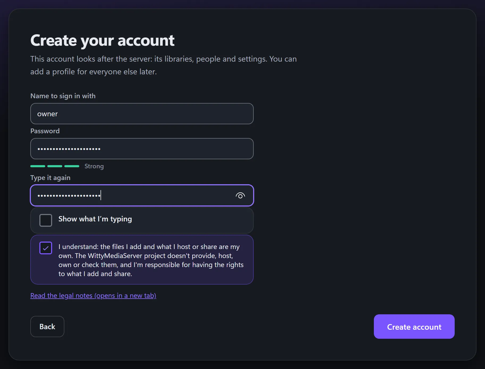
*This account looks after the server: its libraries, people and settings.*

Choose a **name to sign in with**, and optionally the **name people see** (what this profile is called around the app), and a **password** of at least 8 characters, typed twice. **Show what I'm typing** helps on a TV. Tick the box to say that the files you add are your own responsibility, then press **Create account**. On another device, the setup code goes here too.

**Two-step sign-in (recommended)** is a tick under the password. If you tick it, the next page shows a QR code for an authenticator app (or a key to type), asks for the six digits it shows, then shows eight recovery codes, **once**: save them. Each works once in place of a code if you lose your phone. **Skip for now** leaves it off; it can be turned on later in **Settings → Sign-in & security**. See [Accounts](ACCOUNTS.md).

Keep the password somewhere safe: [forgetting it is hard to undo](ACCOUNTS.md#if-you-forget-your-password).

## 4. This server

### Where data is kept

On a computer you use (the Windows tray app, the Mac app, a Linux desktop), the first page after the account asks **where WittyMediaServer should keep its settings and data**: its database, settings, artwork, modules and logs. Your media stays where it is.

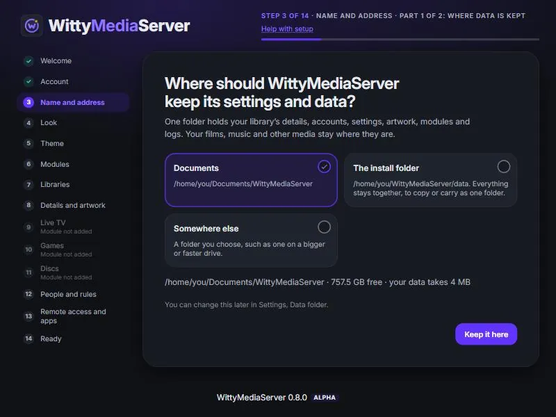
*Documents is chosen to begin with. The line under the choices says how much room there is.*

- **Documents** is chosen to begin with: `Documents\WittyMediaServer`, or `~/Documents/WittyMediaServer`.
- **The install folder** keeps everything beside the program, to copy or carry as one folder. It's offered only where the server can write; Program Files and a Mac app can't, and the page says why.
- **Somewhere else** takes a folder you type, or find with **Browse folders**.

The page checks the place as you choose: free space, whether the server can write there, and whether a sync program such as OneDrive or iCloud Drive keeps it in the cloud. A synced folder gets a warning and a **Use a local folder** button: a database that's open while it's synced can be damaged. **Keep it here** moves what the server has made so far, while it restarts, and setup carries on. A server, Docker or a service whose folder is already set doesn't ask. To move it later, use **Settings → Data folder**. See [The data folder](DATA-FOLDER.md).

### Name your server

The name appears in every app, so everyone at home knows which server they're on. The editor is the same one as **Settings → Appearance → Name and logo**, and the page's corner shows your name as you change it.

- **Name:** type one, or leave it empty for “WittyMediaServer”.
- **Letters or words to colour:** the letters are a row of buttons. Use the arrows to move, **Shift** and the arrows to select a range, **Space** to select a letter, or press one of the words listed under it.
- **Colour for the selection:** a colour that **follows the theme** (text, accent, success, warning, danger), a **fixed colour** that stays the same in every theme (a swatch, **Any colour…** or a `#rrggbb`), or a **gradient** (two ready-made, or **Edit stops…** for two to four colours and a direction). Giving each letter its own colour is allowed.
- **Presets:** accent on every other word, two-tone, one colour, plain, rainbow letters and gradient.
- **Mark for the rail and small spaces:** the first letter, the initials, one or two characters of your own, or a PNG or JPEG logo up to 2 MB, always centred in a square badge. A logo that can't load falls back to the letter.
- A **Check** appears if a colour is under 4.5 to 1 against the side menu or the top bar, with the words affected. The **live preview** shows the name in the side menu, top bar, rail header, sign-in page, and on a light and a black look.

When the server checks the name's fixed colours against the theme and finds words under 4.5 to 1, it saves them and says **Check:** with the words and ratios; press **Continue** again to keep them, or change the colours.

### Finding this server at home

- **Find this server automatically** lets apps on your home network find it by name, with no address to type.
- **Its address:** what other devices at home open, in full, such as `http://192.168.1.20:9797`. The number at the end is its **port**, which you can change here if another program already uses it. Later, it's in **Settings → Network**.

## 5. Modules

Movies, TV shows and music work straight away. Modules add the rest: discs, games, photos, books, live TV and more. Each is a separate program that downloads now, signed, from the official list, so this page needs an internet connection. What you don't tick isn't downloaded.

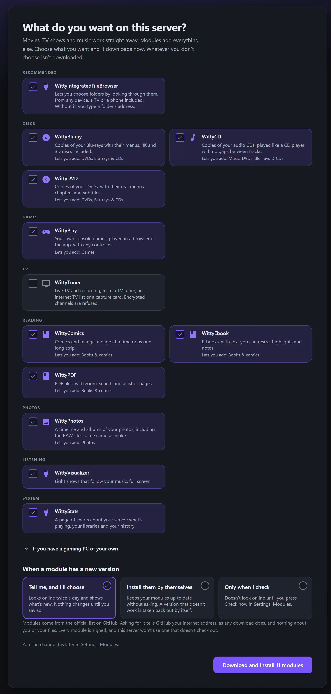
*Tick what you want. The folder browser is ticked for you, as it's how you choose a folder from a TV or a phone.*

Under the list, choose what happens when a module has a new version: tell you and let you choose, install it by itself, or look only when you ask. Then press **Download and install**.

*Each module downloads, and its signature is checked before it goes in.*

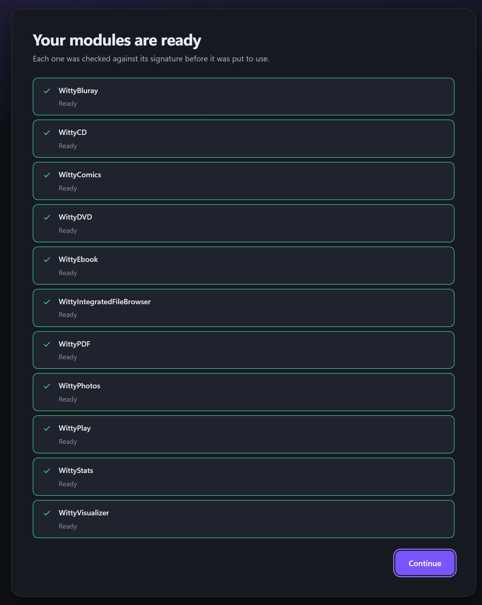
*If one fails, you can try again or carry on without it. No internet? Carry on, and add them later from Settings, Module store.*

See [Modules and the store](MODULE-STORE.md).

## 6. Libraries

Pick a kind of media, then the folder it's in. Each one becomes a library you can browse. Your files stay where they are, and nothing is copied.

Above the kinds is one question, asked before anything is scanned: **Save posters and details beside your files**. On, they stay with your media if you ever move it; your videos and music themselves are never changed. Off, your media folders are left exactly as they are, and it's all kept on this server. It's saved as you tick it, and can be changed later in **Settings → Metadata agents**.

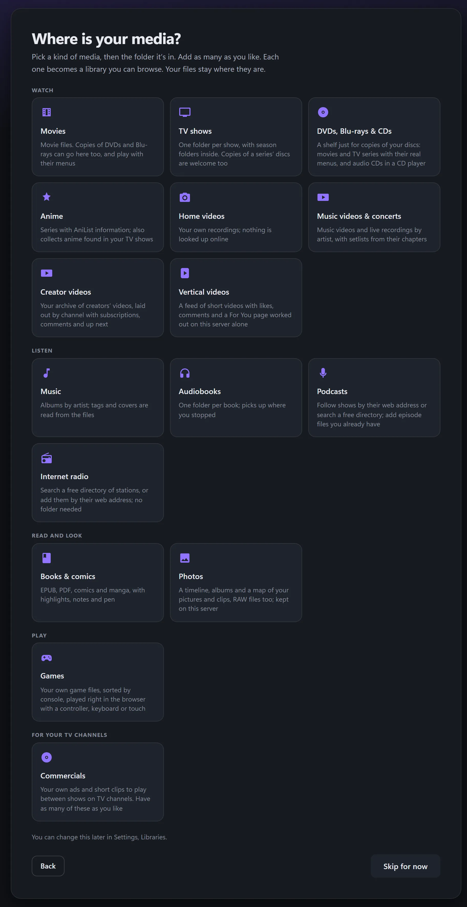
*Choose a kind. A kind you didn't add the module for isn't offered.*

*Three ways to give the folder.*

- **Choose folder…**, on the computer running the server, opens your computer's own folder window.
- **Browse folders** shows the server's drives in the page, from any device. Open the folder you want and press **Use this folder**.
- Or type the folder's full path.

Press the button that adds it, such as **Add Movies**, and it starts scanning in the background. Add as many as you like.

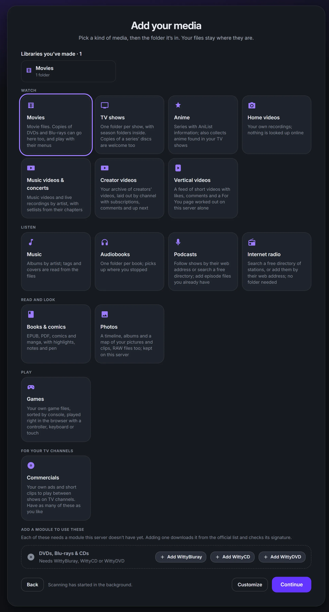
*Add another kind, or press Continue.*

How to name your files is in [Libraries](LIBRARIES.md#how-to-lay-out-and-name-your-files). A folder on another computer has [its own steps](LIBRARIES.md#network-shares), which this page lays out if you choose one from another device.

## 7. Set up your modules

One page for each module you added that has something to set up, in turn. Going on (or skipping) is remembered, so Home doesn't ask about it again afterwards.

### Live TV

With WittyTuner, this page is WittyTuner's own. On a TV or phone app, the server's "Finish setting up WittyTuner" notice on Home opens the same step.

It finds TV tuners on your network, each added with a press, and walks you through a provider's playlist or a single stream. **No tuner or playlist yet?** Add the **demo tuner**: a few channels the server makes itself, to try the guide, recording and the player with nothing to buy. Each tuner you add is listed with how many channels it has. Later, it's all in **Settings → Live TV & tuners**.

No channel lists or stream addresses come with the server: you bring your own. Encrypted channels are shown as encrypted and never decrypted. See [Channels and live TV](CHANNELS.md).

### Games

With WittyPlay.

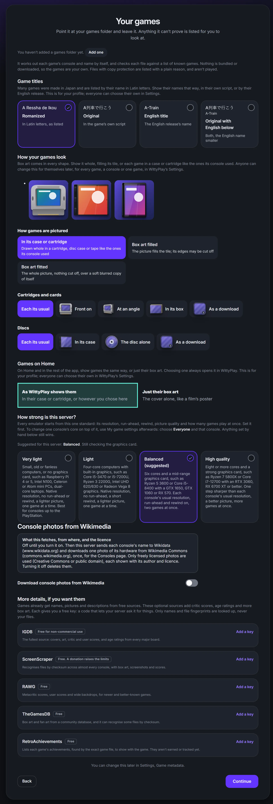
*Point it at your games folder and leave it.*

It works out each game's console and name by itself, and lists anything it can't prove for you to look at. No games come with the server, and nothing is downloaded for you. The sources here are optional, and each needs a free key. See [Games](GAMES.md).

### Discs

With WittyDVD or WittyBluray.

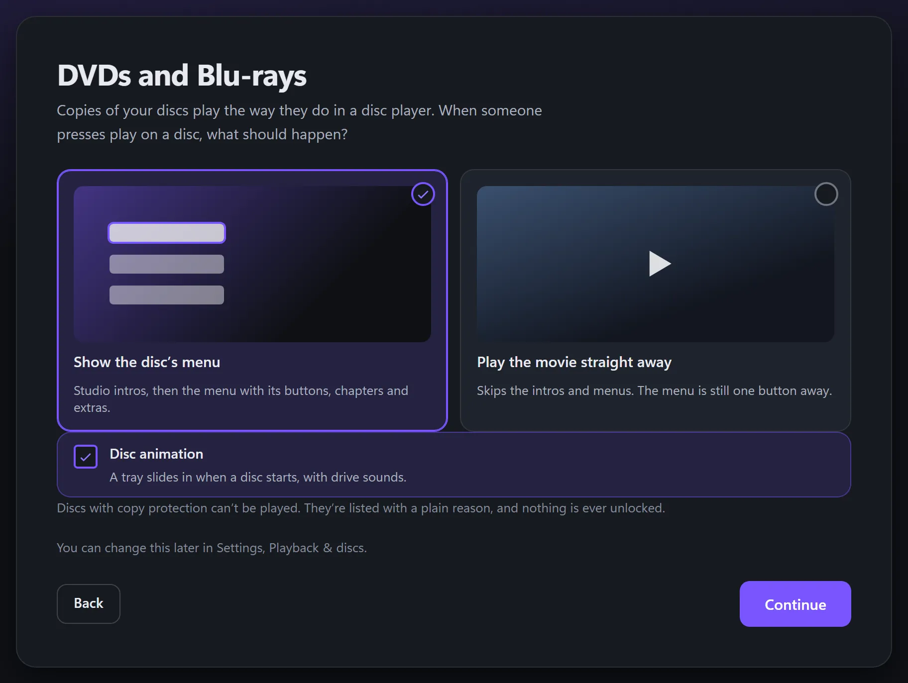
*The menu is still one button away if you choose to play straight away.*

Discs with copy protection can't be played. They're listed with a plain reason, and nothing is ever unlocked. See [DVDs](DVD.md) and [Blu-rays](BLURAY.md).

## 8. Looks

After the modules, so the choices are about what's on your server.

### Layout

A look is the layout, shapes, finish and type: how pages are arranged and how they feel. Fourteen come with the server, each tried on this very page as you pick it:

| Look | In a word | Wears, unless you choose |
|---|---|---|
| Lumen | Quiet cinema | Witty |
| Rail | Library first | Cinema |
| Stage | Streaming | Midnight |
| Aero | Glossy glass | Aero Day |
| Classic | Sidebar | Witty |
| Classic Cable | Blue guide | Cable blue |
| Classic Satellite | Silver bars | Satellite |
| Compact | Dense lists | True black |
| Paper | Editorial | Paper |
| Crossbar | Console style | Evergreen |
| Marquee | Poster carousel | Cinema |
| Big picture | Easy to see | High contrast |
| Dashboard | Widgets | Midnight |
| Retro | Teletext | Teletext |

What you pick is where everyone starts, on every kind of device. People can pick their own later, unless you require one (see [People](#9-people)). Beside the choices (above them on a phone), a picture of the look shows how its menu and Home sit on a **TV**, **Desktop**, **Phone** and **VR**, starting with the kind of device you're on. See [Themes](THEMES.md#a-look-is-a-layout-and-a-theme).

### Colours

Any theme goes with any look, and the page changes as you choose. **Start with the look's own theme** is on until you choose a theme, which then stays for everyone. Fifteen come with the server, among them Witty, Midnight, Cinema, Evergreen, True black, Light, Paper, High contrast, the four Aero themes, Cable blue, Satellite and Teletext. **Import a theme…** installs one from a ZIP file, and you can make your own later in **Settings → Appearance**. See [Themes](THEMES.md).

### WittyTV

Only if you added WittyTuner. WittyTV, the live TV guide, has a look of its own: how channels and programmes are laid out, and their colours. **Follow the look** uses what the look you chose brings; any other is used for everyone instead. People can still choose their own in the guide. Later, it's in **Settings → Appearance → WittyTV**.

Without WittyTuner, WittyTV's look and colours aren't offered here or in **Settings → Appearance**. Whenever WittyTuner is installed fresh (not updated), during setup or later, the server asks once: in setup it's this page; afterwards, **Settings → Modules** asks as soon as it's installed, and Home shows "Finish setting up WittyTuner" in every app until you choose or dismiss it. Removing WittyTuner forgets the answer, so installing it again asks again.

## 9. People

Add profiles (an adult's, or a **Kids** profile that only shows titles for their age), listed with what each is. Then the **Rules**:

- **Let people add their own themes:** anyone can add a theme of their own from a ZIP file, for their profile only.
- A look, a theme or both **required** of **Everyone**, of **Kids profiles**, or of one profile. A required choice is shown locked, "Required by" your name, and that person can't change it; leave a row on "Free to choose" to let them pick. The most specific requirement wins: a profile's over the kids' over everyone's.

You can change all of this in **Settings → Profiles**, and under **Settings → Pages & menu → Looks**.

## 10. Away from home

At home everything works already. This page is for using your server on a phone or laptop somewhere else.

- **Peer-to-peer connections**: your device connects straight to this server, with nothing to change on your router; if a direct connection can't be made, a relay passes it along, encrypted. It's off until you turn it on, and before you do, the page lists every outside computer it would contact and what each one sees. Once on, **Test my connection** says in a sentence whether it works from away, and what to do if not.
- **Encrypted connections** says whether HTTPS is on. A certificate needs a domain name, so it's set up in **Settings → Remote Access** if you want it.
- **Add an app**: WittyMediaClient on a phone, tablet or TV at home finds the server by itself. When it shows a code, approve it at the address shown, on a device that's signed in, or scan its QR code with your phone.

Later, it's all in **Settings → Remote Access**. See [Remote access](REMOTE.md).

## 11. Extras

A few extras, all optional. Each page has **Skip for now**, and the first has **Skip the extras**, which goes straight to Ready.

### Posters and details

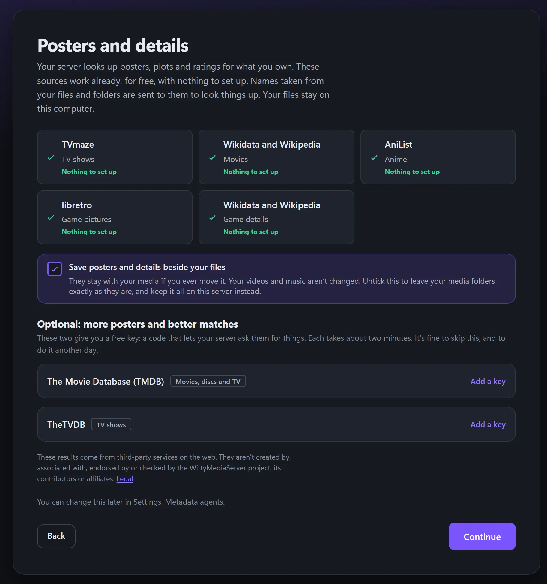
*TVmaze, Wikidata, Wikipedia, AniList and libretro work with no key.*

Names taken from your files and folders are sent to these services to look things up. Your files stay on your computer. **Add a key**, for TMDB and TheTVDB, is optional: a key is a free code that lets your server ask them for things, and each takes about two minutes. See [Where details come from](METADATA.md).

**What your libraries already have:** setup looks at what is already beside your media: NFO files, posters and skip files for films and TV, `.lrc` lyrics, covers and `album.nfo` for music, and game lists and box art for games. WittyMediaServer keeps what people add by hand in a file of its own beside each title (`.wittyinfo` for films and TV, `.wittyaudio` for music, `.wittyplay` for games), and each kind can be gathered into those, written back out from them, or left as it is. Press **Convert now**: each kind shows its own progress bar, and **Continue** waits until it is done. Any of it can be turned back into the usual files later, in **Settings → Metadata → Convert a library**.

### Logos

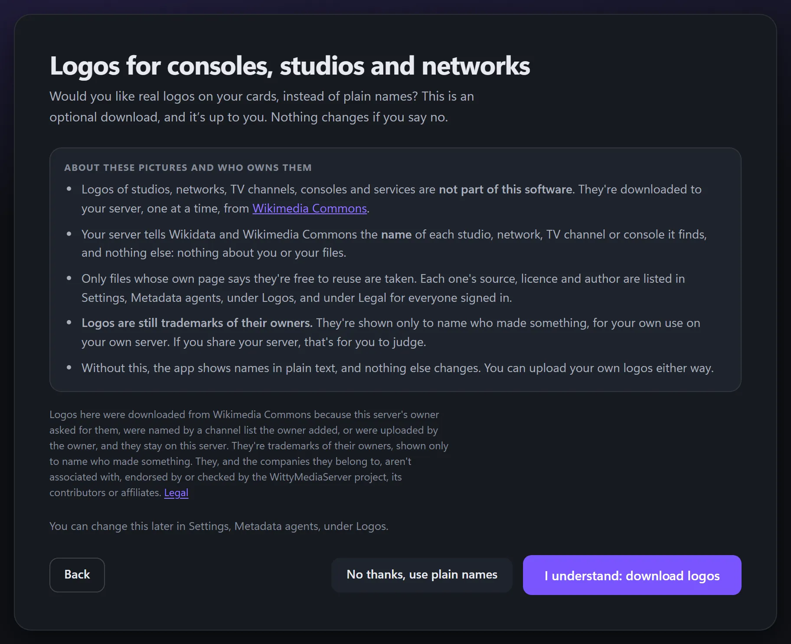
*Off unless you say yes. Nothing else changes if you say no.*

Real logos for consoles, studios and networks aren't part of this software. They download from Wikimedia Commons one at a time, only if you agree, and they're still trademarks of their owners. Choosing **No thanks, use plain names** shows names in plain text.

### Lyrics and artists

Where music can be added.

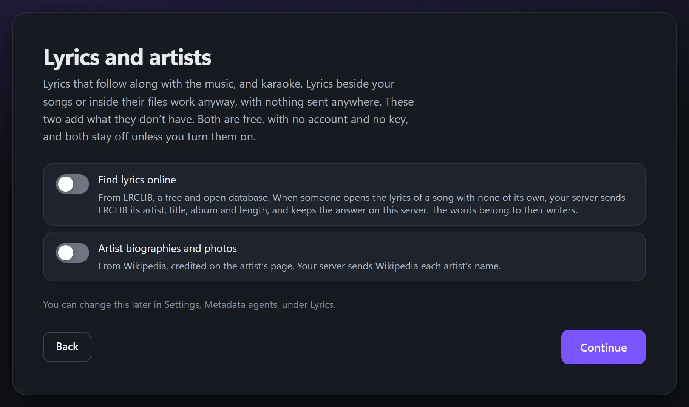
*Both are free, with no account and no key, and both stay off unless you turn them on.*

Lyrics beside your songs or inside their files work anyway, with nothing sent anywhere. These two add what they don't have, and the page says what's sent to each. See [Lyrics and karaoke](LYRICS-KARAOKE.md).

### Karaoke voices

Where music can be added. Karaoke works already: the quick version turns the singer down. **Install Demucs…** installs a free program that takes the voice out properly. The page says how much it downloads, from where, and under which licences before anything starts, and uses the graphics card when it can. It installs in the background while you carry on. Later, it's in **Settings → Metadata agents**, under Lyrics.

### Streaming lists

Where movies or shows can be added.

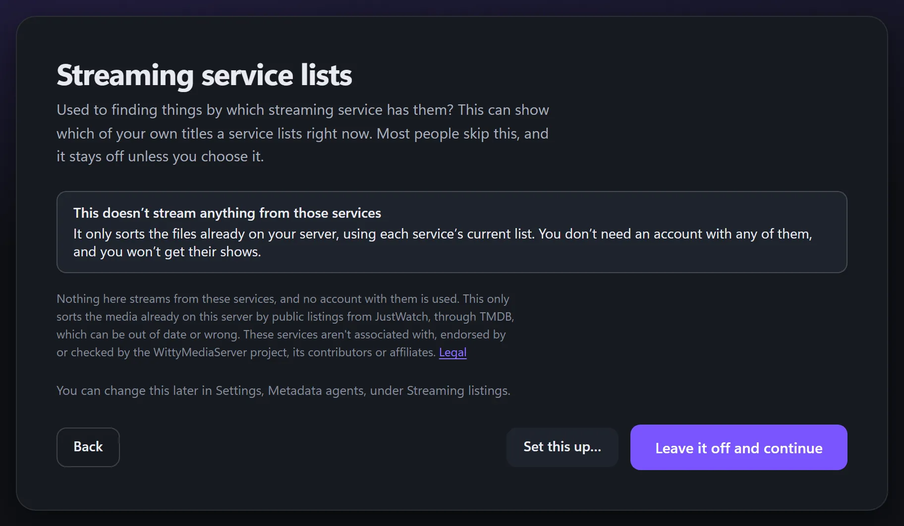
*Off unless you choose it.*

This sorts your own titles by which streaming service lists them right now. Nothing streams from those services, and you don't need an account with any of them. To turn it on, you accept four statements and add a free TMDB key. **Leave it off and continue** is the usual choice.

## 12. Ready

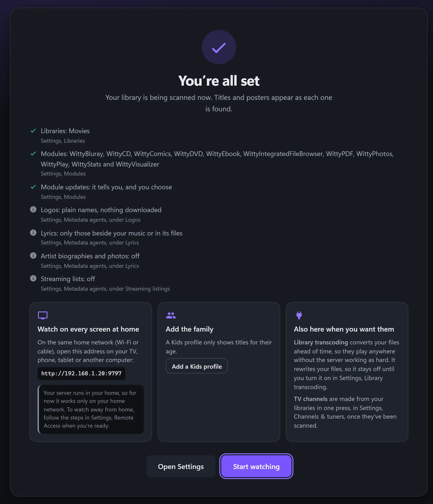
*The last page says what you chose, as the server has it now.*

- **What you chose**, each with where to change it later, including whether the server can be reached away from home. Your libraries keep scanning in the background, and titles and posters appear as each one is found.
- **Watch on every screen at home:** the address other devices on your home network open. If the server only answers on this computer, it says what to change. **Use this screen as a TV** turns on TV mode for this device only: laid out like the TV apps, driven by a remote or a controller.
- **Add the family**, only if you didn't add a Kids profile on the People step.
- **Also here when you want them:** library transcoding, TV channels made from your libraries, and, without WittyTuner, how to add live TV.

Press **Start watching** and you're in, or **Open Settings** to carry on there.

[Where next](GETTING_STARTED.md#where-next) has what to read after this.

## On a TV

Setup works with a remote, but a few things are much easier on a computer: colouring the server's name, importing a theme from a file, pasting keys, and peer-to-peer connections. On a TV those parts say so, in the same words as the rest of the app: **Leave TV mode to change this** on a computer in TV mode, or **use the WittyMediaClient app on a Windows or Mac computer, or a web browser** on a TV. Everything else can be done from the sofa, and nothing stops you: each of those parts can be skipped and done later. See [TV mode](TV-MODE.md).

## With a remote, a controller or the keyboard

The arrow keys, a TV remote's arrows and a controller's stick or pad reach everything, and OK (or the controller's main button) presses it. Back goes back a page. On a list of choices, the arrows only move: press OK on the one you want.

---

WittyMediaServer documentation
