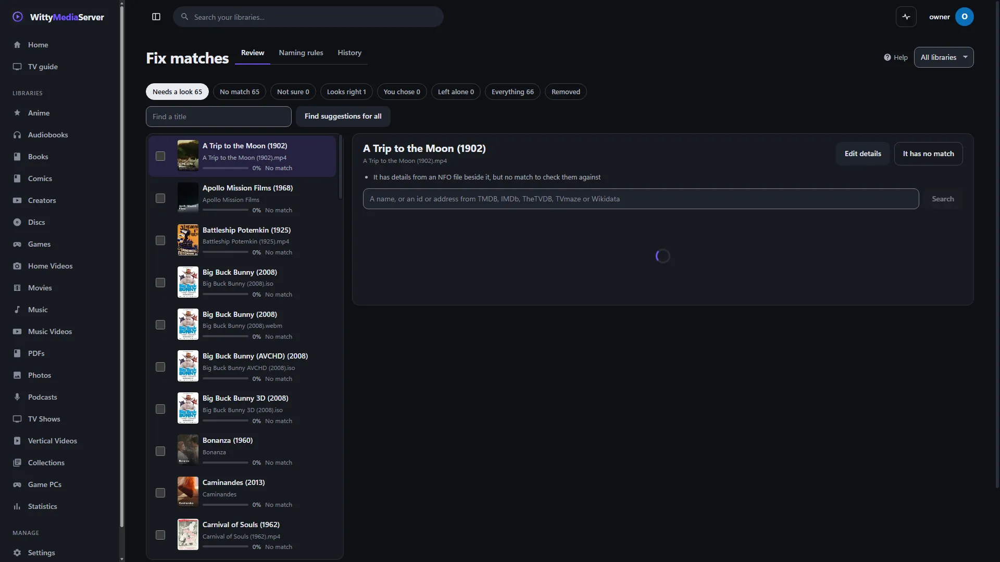

# Fixing wrong details

Put right a wrong match, title, poster or episode number, on one title or hundreds. Whatever you fix stays fixed, and every change can be undone.

All of this is for administrators. To see where details come from in the first place, read [Where details come from](METADATA.md).

- [Which tool to use](#which-tool-to-use)
- [The Edit dialog](#the-edit-dialog)
- [Choosing the right match](#choosing-the-right-match)
- [Locks, sources and Revert](#locks-sources-and-revert)
- [Artwork](#artwork)
- [Skip intro](#skip-intro)
- [Bonus features, versions and moving](#bonus-features-versions-and-moving)
- [Logos](#logos)
- [Refreshing a title](#refreshing-a-title)
- [The Fix matches page](#the-fix-matches-page)
- [Fixing episode numbers](#fixing-episode-numbers)
- [Editing several titles together](#editing-several-titles-together)
- [Naming rules](#naming-rules)
- [History and undo](#history-and-undo)
- [From the command line](#from-the-command-line)

## Which tool to use

| You want to | Use |
|---|---|
| Fix one title: its name, poster, plot or rating | [**Edit**](#the-edit-dialog) on its page |
| Say it's really a different film or show | [**Edit**, then Search and match](#choosing-the-right-match) |
| Go through everything that looks wrong | [**Fix matches**](#the-fix-matches-page) |
| Fix a show whose episodes have the wrong numbers | [**Renumber episodes**](#fixing-episode-numbers) |
| Change a genre or tag on many titles at once | [**Edit together**](#editing-several-titles-together) |
| Teach the server how a folder is named | [**Naming rules**](#naming-rules) |
| Make lots of small fixes in a text editor, or work with the server stopped | [The metadata folder](METADATA-FOLDER.md) |
| Fix a game | **Fix match** on its page: see [Video games](METADATA.md#video-games) |

## The Edit dialog

Press **Edit** on a film, episode or show. One dialog holds everything about it, in sections you can jump between: **Match**, **Details**, **Artwork**, **Skip intro**, **Organise** and **Logos**. **Delete**, **Cancel** and **Save** stay in view however long it runs.

*Ctrl+S* saves, and *Escape* closes, asking first if something isn't saved.

**Details** has the title, sort name, year, director (or who created a show), season and episode, edition, collection, tagline, overview, genres, tags, content rating, score, network, status and studios. Only what fits that kind of title is shown. Typing waits for **Save**. Choosing a match, uploading a picture or moving a title happens at once, and a bar offers **Undo**.

**Delete** takes a title out of its library and leaves its files on disk. It won't come back on a scan, and can be brought back from **Fix matches**, under **Removed**. Nothing here ever deletes a file.

## Choosing the right match

In the **Match** section:

1. Type a name, or paste an id or address from TMDB, IMDb, TheTVDB, TVmaze, AniList or Wikidata, and press **Search**. For example: `tt0000123`, `tmdb:12`, `https://www.tvmaze.com/shows/56/a-show`.
2. Every source that's on is asked at once, films and shows alike, so a disc of a series can be matched to the series. Each result says how likely it is out of 100, and **Why?** says why in plain words.
3. Choose a result. Nothing changes yet. It shows what would change, field by field, with what's there now beside what's coming.
4. Untick anything you want to keep. Text you typed, a hand-written NFO and pictures beside the file are shown but not ticked, and locked fields can't be ticked. For a show, it also says how many of your episodes the source knows.
5. Press **Use this match**.

A match you choose **stays**: no scan or refresh changes it, even if the file is replaced by a better copy.

**Remove this match** takes away what the source gave and keeps what you typed. The title is named after its file again, and nothing is looked up for it until you choose one.

**Check for changes** shows what looking it up again would change, and keeps the match it has.

## Locks, sources and Revert

Each field says where its value came from:

| It says | Means |
|---|---|
| **You typed this** | You changed it here, or in the [metadata folder](METADATA-FOLDER.md) |
| **From TMDB**, or another source | That source gave it |
| **From an NFO file** | From an NFO beside the file that a person wrote |
| **Saved earlier** | From an NFO this server wrote |
| **From beside the file** | A picture or other file next to the media |
| **From the file name** | Worked out from the name |
| **A frame from the video** | A picture taken from the video itself |

| Control | What it does |
|---|---|
| **Lock** | A locked field stays as it is. No scan, refresh, new match, NFO or file beside it can change it, whether the title is matched or not. Anything you type locks itself |
| **Lock all**, **Unlock all** | Every field at once |
| **Revert** | Goes back to what the source said before you typed over it, and unlocks the field |

## Artwork

Press **Artwork** on a title's page, or go to that section. Poster, backdrop, banner and title logo each have:

- **Browse images:** a grid from every source, with a tick on the chosen one. You can also paste a picture's web address and press **Use it**.
- **Upload your own:** JPEG, PNG, WebP or GIF, up to 20 MB. It's checked to be a real picture.
- **Remove**, and **Revert** where there's something to go back to.

Pictures from sources are fetched by your server, so no browser or app contacts them. Without a TMDB key, films have only what's in their folder, because Wikidata has no posters. TV shows get theirs from TVmaze.

With **Save information and artwork next to your media** on, the chosen poster and backdrop are also copied to the standard names beside the file, and the NFO is rewritten. A hand-written one is kept as `.nfo.bak`.

## Skip intro

Under **Where the intro ends**, type a time such as `1:05`, or press **Pick in player**, play to the moment, and press the button there. Blank means work it out from the file's chapters. On a show, it covers every episode with no intro of its own. Discs have their own menus, so this isn't offered for them.

Save or undo your changes first, because picking a time leaves the dialog.

## Bonus features, versions and moving

The **Organise** section:

- **It's a bonus feature** takes a trailer, featurette, deleted scene, interview or short out of the lists, and puts it on the page of the film or show it belongs to. **Make it a title of its own** undoes that.
- **This is another version of…** does the same for a second copy of a film, such as a DVD and a 4K file. Its page then offers a choice of version. **Split it off** undoes that.
- **Move to**, under **In the wrong library?**, puts a title in another library that holds the same kind of thing. Its files don't move: the library it was found in leaves it alone from then on, and the new one looks after it. Where it can't move, it says why.

## Logos

Anywhere a logo is needed, **Change** opens the same place. Search by name, and choose among what's found, with its source and licence beside it and a link to its page. Or use **Upload your own**, which a search won't replace unless you choose one, or **No logo: just the name**. A change applies everywhere that name appears on your server.

| To change the logo of | Go to |
|---|---|
| A studio or network on a title | **Edit**, then **Logos**, or **Change logo** on its own page |
| A channel from your library | Its editor, under **Logo**. You can also give it another name to go by |
| A tuner or playlist channel | **Settings → Channels & tuners**, the tuner, then **Change** beside the channel. See [Logos and title art](CHANNELS.md#logos-and-title-art) |
| A console or a game studio | A game's page, under **Logos** |
| Any of these, or a streaming service | **Settings → Metadata agents**, under **Logos**, then **Find or set a logo**. A name nothing has yet can be started from there |

Downloading logos needs your agreement first, and these places explain that and link to it. Uploading and choosing none work without it. See [The logo service](METADATA.md#the-logo-service).

## Refreshing a title

**Refresh** on a title's page shows what looking it up again would change, and you choose what to take. **Update it** applies that, and **Undo** is offered straight after. The title keeps its match, and locked fields stay as they are.

If nothing would change, you can press **Look again anyway**.

## The Fix matches page

Open **Fix matches** from a library's page, where a count shows how many need a look, or from **Settings → Metadata agents**. It covers film, disc, TV and anime libraries, worst first. It has three tabs: **Review**, **Naming rules** and **History**. Choose a library at the top to narrow it down.


*The Fix matches page. Openly licensed and public-domain media, credited in [the list](images/CREDITS.md).*

Opening it asks nobody anything: how sure each match is comes from what's stored, comparing the file's name and year with what it's matched to.

| Under Review | What's there |
|---|---|
| **Needs a look** | No match, or one under 70% |
| **No match**, **Not sure**, **Looks right** | Those on their own |
| **You chose**, **Left alone** | What you've decided, which nothing changes |
| **Everything** | The whole list |
| **Removed** | Titles taken out of a library. **Bring it back** returns one |

**To fix one:**

1. Choose a title. It finds suggestions, one request per source. If a file's whole name finds nothing, its first words are dropped and it's tried again.
2. Press **Accept** on the right one, or choose a suggestion to see what would change first. **Search** takes a name, an id or an address.
3. If nothing fits, press **It has no match**. If it's right but scored low, press **It's right: stop asking**. **Edit details** opens the Edit dialog.

**To go faster:**

- **Find suggestions for all** does the whole list in the background, gently. **Stop** ends it.
- **Choose the 4 that are 90% sure** ticks those at once, and **Accept their best suggestions** accepts them. The number is however many there are.

A year you typed, or one kept from before, counts when scoring, so an exact name and year comes to 100%. The words beside a score are **Very likely** (90 or more), **Likely** (70 or more), **Not sure** (40 or more) and **Unlikely**.

| Key | |
|---|---|
| `J`, `K` | Next and last |
| `A` | Accept the first suggestion |
| `1` to `6` | Accept that suggestion |
| `N` | It has no match |
| `E` | Edit details |
| `X` | Choose it, for doing several at once |
| `/` | Search |
| `U` | Undo |

The arrow keys and a remote reach everything too. Moving down the list follows along in the panel beside it, and OK on a title goes to its first suggestion.

## Fixing episode numbers

When a show's episodes have the wrong numbers:

1. On the Fix matches page, choose the show, and press **Renumber episodes**.
2. Each file is shown beside what the source calls that number. **Not listed** means the source doesn't have that number.
3. Change the numbers by hand, or choose a **Season** and use **Move episodes by** with **Move them** or **Move seasons instead**. **Number them in order** counts through them from 1.
4. Press **Save**.

Numbers you change are locked, so a scan keeps them.

## Editing several titles together

On the Fix matches page, tick some titles, and press **Edit together**. You can add or take away genres and tags, set a year or a content rating, and lock or unlock. Press **Change**, which says how many, and **Undo all of it** is offered straight after.

## Naming rules

**An id in a file or folder's name** always wins over a search, and doesn't appear in the title. The usual forms all work:

```
My Film (2001) [tmdbid-123].mkv
My Film (2001) {imdb-tt0000123}.mkv
A Show [tvdb-456]
A Show [tvmaze-78]
A Show [anilist-90]
```

**A folder with a naming of its own** can have rules, under **Fix matches → Naming rules**. Choose a library, and press **Add a rule**. The first rule that fits a file decides.

| Field | What it does |
|---|---|
| **How the path reads** | Uses `{title}`, `{year}`, `{edition}`, `{tmdb}`, `{imdb}`, `{tvdb}`, `{any}`, and `*` for anything within a folder's name. For example, `Harbour Studio/{year} - {title}` |
| **Where to look** | **Look everywhere**, one source only, or **Don't look it up** |
| **Add tags** | Tags for what it fits, separated by commas |
| **These are bonus features** | Marks what it fits as a trailer, featurette and so on |
| **On** | Turns the rule off without removing it |

**Try them** shows what each file would become, without changing anything. Press **Save** to keep them. Rules apply to new and changed files when the library is next scanned.

## History and undo

Every match, edit and renumbering can be undone, right after it, or later under **Fix matches → History**. Press **Undo** beside an entry. Changes made together, such as one apply from the metadata folder, are one entry and go back together.

The last 5,000 changes are kept, and the page shows the newest 100.

## From the command line

Nothing on this page needs a terminal. When the server won't start, or you'd rather not use the page, these do related work:

| Command | What it does |
|---|---|
| `wittymediaserver metadata check` | Says what's wrong with the metadata folder's files. See [On the command line](METADATA-FOLDER.md#on-the-command-line) |
| `wittymediaserver metadata apply --apply` | Applies your edits from that folder |
| `wittymediaserver metadata undo <batch>` | Takes one apply back |
| `wittymediaserver doctor --only metadata` | Looks for broken matches, missing artwork, duplicates and unreadable NFO files. See [Repair](REPAIR.md#what-it-checks-and-fixes) |
| `wittymediaserver doctor remap --from <old> --to <new>` | Tells the server a library's folder moved. See [Moved a drive?](REPAIR.md#moved-a-drive) |

---

<sub>WittyMediaServer documentation</sub>
