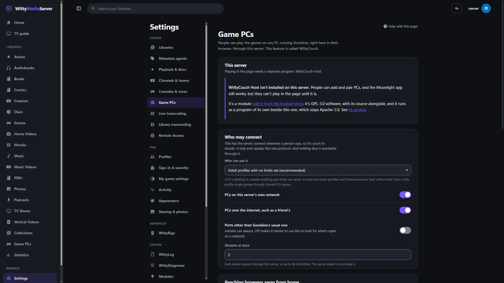
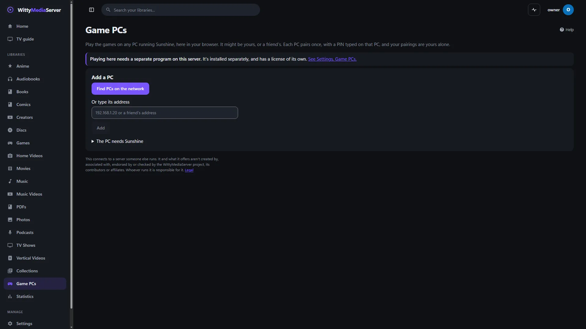
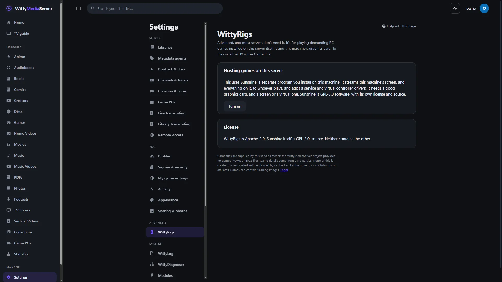

# Game PCs

Play the games on any PC running Sunshine, in your browser or the app, through this server. This guide covers setting up a PC, pairing it, playing, sharing it with other people, and reaching it away from home.

**How much of this has run.** A real stream from a real Sunshine has reached a real browser, with controller, keyboard and mouse input reaching Sunshine. It hasn't been exercised against a real gaming PC: Sunshine ran in a Linux container, with no real game and no real graphics card. See [What has been tested](#what-has-been-tested).

Two modules do this, and they do different things:

| | What it does | Who it's for | On by default |
|---|---|---|---|
| **WittyCouch** | Plays the games on any PC running Sunshine, yours or a friend's. The page is **Game PCs** | Adult profiles with no limits set, and admins | Yes |
| **WittyRigs** | Hosts demanding PC games on this server's own hardware. It isn't a way to reach other PCs | An admin whose server has a good graphics card | No |

To play console games on the server itself, see [Games](GAMES.md).

## Before you start

- **The PC needs Sunshine,** a free program from LizardByte that shares a PC's games. Whoever owns the PC installs it. Sunshine isn't part of this server.
- **This server needs WittyCouch Host** to play in the page. It's a separate program under the AGPL-3.0-or-later, with Moonlight-derived parts under the GPL-3.0, offered as a module of its own: see [Modules and the store](MODULE-STORE.md). **Settings → Game PCs** says whether it's working. Without it you can still add and pair PCs. An admin can also put `wittycouch-host` in the `wittycouch/bin` folder in the data folder. There's no FreeBSD build of it.

### Install Sunshine on the PC

1. Download Sunshine from [its releases page](https://github.com/LizardByte/Sunshine/releases/latest). On Windows, choose `Sunshine-Windows-AMD64-installer.msi`. Linux and Mac versions are there too.
2. Install it. Windows asks for permission, as it sets itself up as a service and adds a virtual controller driver.
3. On that PC, open `https://localhost:47990`. Your browser warns about the certificate, which is normal here. Choose a user name and password for Sunshine, and keep them somewhere safe.

## Add and pair a PC



*Settings, Game PCs, on a server with none added yet.*
1. Open **Game PCs** in the menu.
2. Press **Find PCs on the network**, then **Add** beside the PC. If it doesn't appear, type its address under **Or type its address**, such as `192.168.1.20` or a friend's address, and press **Add**.
3. Open the PC from the list and press **Pair this PC**. A PIN appears.
4. On that PC, open Sunshine at `https://localhost:47990`, go to **PIN**, and type it. The page sees it by itself, and the PC's games appear.

Pair on a network you trust: someone listening could work out the PIN. Each PC pairs once, and your pairings are yours alone. One account's pairing can't be used by another.

**Remove** takes a PC off your list. To finish, remove this device from the paired devices in Sunshine on that PC.

## Play



*Game PCs, on a server with none added yet.*
1. On the PC's page, press a game.
2. Choose **Picture**, **Frames a second** and **Quality**, then press **Play**. Your choices are remembered on this device.

The picture size is fixed for a stream, so changing it means starting again.

Click the picture for keyboard and mouse. `Esc` gives them back. Controllers work once a button has been pressed. Most browsers only show controllers to secure pages, so on plain `http://` use https, or `localhost` on the same computer. See [Remote access](REMOTE.md).

Press **Menu** for **Back to the game**, **Show the on-screen controller**, **Leave it running on the PC** and **Close the game**. A game you left running says **Running now: pick up where it is** on its tile. **Close what's running** on the PC's page ends it.

Sunshine's desktop app hands over the whole computer, so it's set apart behind **Show the PC's desktop too**. Keyboard and mouse can often get out of a game to the desktop as well, and Sunshine has no way to limit that.

**Wake it up** appears when a PC is asleep. Wake-on-LAN has to be on in that PC's BIOS and network adapter, it usually needs a wired connection, and Sunshine has to start with the PC. It's never offered for a PC over the internet.

## What each device gets

"In the page" means WittyCouch's own client, with nothing more to install. The Moonlight app, from the Moonlight project, is the fallback where a page can't play.

| Device | What Play does | Needs | How far it was checked |
|---|---|---|---|
| **Computer or Chromebook, in a browser** | Plays in the page | Pairing the PC once | **Edge on Windows, all the way, against a real Sunshine.** Firefox, Chrome and Safari not tried |
| **WittyMediaClient on a computer** | Plays in the page. Starting Moonlight is the fallback | Nothing more | Unit tested. Not run with a stream |
| **Android phone or tablet, in the app** | Plays in a web view, with **Open in Moonlight instead** as a second choice | Nothing more | Opened on an emulator as far as the Game PCs page. Not run with a stream |
| **Android phone or tablet, in a browser** | Plays in the page, with an on-screen controller | Nothing more | Not tried |
| **iPhone or iPad, in the app** | Plays in a web view | Nothing more | Written. Never built on a Mac or run |
| **iPhone or iPad, in Safari** | Plays in the page | Nothing more | Not tried |
| **Android TV, Google TV, Fire TV, in the app** | Moonlight first, then **Play in this app instead** | Moonlight, paired once | Compiled. Never run |
| **Apple TV, in the app** | **Start on** the PC, then open Moonlight and press Resume. tvOS has no web view | Moonlight, paired once | Written. Never built on a Mac or run |
| **Older TV browsers, LG webOS, Samsung Tizen** | Not expected to work in a page | Moonlight has community versions, opened by hand | Not tried |
| **Xbox, PlayStation, Switch, Roku** | Doesn't work from this server | Moonlight has community versions for some | Not tried |

### Using the Moonlight app instead

When a game's page can't play here, it lists what works on your device: **Open in Moonlight**, **Copy the Moonlight command**, or the steps to open it yourself. Moonlight is a free, separate app with its own license and source. The page links to where to get it. It pairs once with the PC: Moonlight shows a PIN, and it goes into Sunshine.

**A paired Moonlight app can reach everything on that PC, including things hidden from your library,** and this server can't limit it. Only pair devices you'd hand the PC's keyboard to.

## Share a PC with everyone

An admin can pair a PC once for everyone. Its games become a library, and every access rule applies to them. That's how to give a child one game without giving them the PC.

1. Open **Settings → Game PCs**, and go to **Share a PC with this server's people**.
2. Press **Find PCs on my network**, or type its address and press **Add this PC**.
3. Press **Pair this PC**, and type the PIN into Sunshine on that PC.
4. Under **What shows in your library**, tick what to **Show**. Desktop apps start hidden.

Anyone who can see the library can play what's shown. Kids and Guest profiles see nothing until you give them a game in **Profiles**. **Read its games again** picks up changes in Sunshine.

Access is checked when a stream starts: if you take a game away from someone, a stream that has already begun carries on until it ends.

**Pair a Moonlight app from here** types a device's PIN without walking to the PC. It takes Sunshine's user name and password, which go straight to that PC for this one request and aren't saved. **Address away from home** is for Moonlight apps on a private network.

## Who may connect

This feature makes your server connect wherever a person says, so it's yours to decide. It only ever speaks this one protocol. Open **Settings → Game PCs**:

| Setting | Default | Why |
|---|---|---|
| **Who can use it** | **Adult profiles with no limits set**, and admins | A PC's desktop is outside anything age limits can reach. The other choices are **Everyone, Kids and Guest profiles too** and **Admins only** |
| **PCs on this server's own network** | On | Your own PC at home |
| **PCs over the internet, such as a friend's** | On | Turn it off if this server shouldn't make outside connections for people |
| **Ports other than Sunshine's usual one** | Off | Off makes it harder to use this to look for what's open on a network. Admins can always |
| **Streams at once** | 2 | Each stream passes through this server at up to its full bitrate |

This machine's own address is only for admins. Link-local and multicast addresses aren't reachable by anyone.

Connecting to a stranger's PC has a risk of its own: WittyCouch Host reads what that PC sends. It runs with tight limits, but keep **over the internet** to people you trust.

## Away from home

Only this server is reached, and it reaches the PC, so a PC at home doesn't need to be opened to the internet.

| You are | The PC is | What it takes |
|---|---|---|
| Away | At home with the server | [Remote access](REMOTE.md), and under **Reaching browsers away from home**, a **UDP port** forwarded to the server and **This server's public address**. Without those, a **STUN server** can often find a way |
| Anywhere | Elsewhere, such as a friend's | That PC's owner has to make it reachable from this server. A private network such as Tailscale or ZeroTier is much safer than forwarding |
| Using the Moonlight app, away | At home | A private network on both ends. Put the PC's private address in **Address away from home** |

**Don't forward Sunshine's own ports:** that puts the PC on the internet for anyone who finds it. **Never forward port 47990,** its web interface, which can run commands on that PC.

Streams need UDP. If a network blocks it, there's no WebSocket fallback yet, and the page says it couldn't connect.

## Host games on this server: WittyRigs

Most servers don't need this. It's for playing demanding PC games installed on this server itself, using this machine's graphics card. To play on other PCs, use **Game PCs**.


*Settings, WittyRigs.*

It streams this machine's screen, and everything on it, to whoever plays, and adds a service and virtual controller drivers. It needs a good graphics card, and a screen or a virtual one. Anyone you give a game from it can often get from that game to this machine's desktop.

1. Install Sunshine on this machine, as above.
2. Open **Settings → WittyRigs**, under Advanced. Press **Turn on**, read what it says, and press **Turn it on**.
3. Pair it and choose what shows, as for a shared PC.

**Turn off and remove its library** undoes it.

## Limits

- No WebSocket fallback when UDP is blocked, and the bitrate doesn't adapt as the network changes.
- H.264 only, and stereo sound only.
- A person's streams go through this server, so its network speed is the limit. It doesn't decode anything, so a small server can carry a large stream.
- Removing a PC here leaves this account on the PC's paired list. Sunshine has to remove it, on the PC.
- On macOS, WittyCouch Host runs with no sandbox from the server. There's no FreeBSD build.

## For developers

The rest of this guide is the design, and what has been tested.

### How a stream travels

```
 PC running Sunshine           wittycouch-host        wittycouch-module         Browser or app
+----------------+  GameStream +----------------+ pipes +----------------+ WebRTC +--------------+
| the game       |------------>| moonlight-     |------>| relay: never   |------->| <video>      |
| its encoder    |  encrypted  | common-c       |       | decodes, and   |  H.264 | gamepad,     |
| virtual pads   |<------------| whole frames   |<------| checks input   |<-------| keys, mouse, |
+----------------+    input    +----------------+ input +----------------+  Opus  | touch        |
      GPL-3.0                   AGPL-3.0-or-later       AGPL-3.0-or-later         +--------------+
                              Moonlight parts: GPL-3.0                            AGPL-3.0-or-later
```

- **The server talks to the PC's client API** through `gamestream` in WittyCouch: identifying it, pairing, its games and art, and asking it to start one. The stubs in `internal/couch` call the module's service, and the routes are in `internal/server/api_couch.go`, `api_rigs.go` and `api_wittyrigs.go`.
- **The stream itself** goes through Moonlight's real streaming core, in a program of its own (WittyCouchHost, with its protocol in `PROTOCOL.md` there). That covers RTSP, ENet control and encrypted video with error correction.
- **The relay is thin.** It reads whole frames and Opus packets from a pipe and writes them to a WebRTC track. Frames are never decoded or re-encoded.
- **The pages:** `web/src/pages/Couch.tsx` (your own PCs), `Rigs.tsx` (a shared PC's games), `settings/Couch.tsx`, `settings/GameRigs.tsx` and `settings/WittyRigs.tsx`. The player is `web/` in WittyCouch. `plan.go` there works out what each device can do.

### Design decisions

- **Moonlight's real code, in a program of its own.** This protocol has years of quirks in it, and Sunshine changes. The boundary is a documented protocol over pipes, as with WittyPlay's runner and FFmpeg.
- **Our own relay rather than an existing web bridge.** It's about 700 lines, reuses this server's accounts and remote access on the same port, and asks for encrypted video. Roles in the bridge looked at couldn't limit anyone to a PC or a game, and its video from PC to server wasn't encrypted.
- **The same origin.** The player is an ordinary part of the app, on the same port as everything else.
- **Each person's own PCs.** A person's list, certificate and pairings are theirs (`wittycouch_hosts`, one key file per account).
- **A shared PC is a library** (`type: games`, `console: rig`). Its games are ordinary items, so every access rule applies with no new code. `POST /games/{id}/play` on one answers 409 with `"rig": true`, and a client calls `POST /rigs/games/{id}/play` instead: see [the client API](CLIENT-API.md#shared-pcs-and-wittyrigs).
- **WittyRigs is the same thing, for this machine:** that kind of library, for a Sunshine at `127.0.0.1`.
- **Sunshine's sign-in is never stored.** It can run any command on that PC. Typing a PIN for someone's Moonlight app takes it once, sent only to the certificate pinned at pairing.
- **H.264 only, for now.** It's what every browser can decode in WebRTC.

### Security review

Reviewed as an attacker would, with an account on the server and a PC of their own.

| Attack | What stops it | Tested |
|---|---|---|
| Using the server as a network probe | It only speaks GameStream, on its port family, to fixed paths with no user-chosen parts. Answers become a few parsed fields. What refused and what timed out read the same to non-admins. 20 attempts per person per 10 minutes, and 32 PCs per account | Yes |
| Reaching this machine's other services | Loopback is refused for non-admins, when an address is typed and again at connect time | Yes |
| A PC telling the stream to go somewhere else | The server resolves and checks the address, and rebuilds the stream address from the PC's scheme and port alone | Yes |
| Seeing or using someone else's PC | Every route looks a PC up by owner as well, and says "not found" | Yes |
| Using someone else's pairing | A certificate per account, in its own file, never in an answer or the database | Yes |
| Someone else's stream | Streams belong to their owner, and say "not found" to anyone else | Yes |
| Someone on the network posing as the PC | The certificate is pinned at pairing and compared byte for byte on every connection | Yes |
| Someone in the middle of pairing | The PC's secret must be signed by the certificate it offered | Yes |
| A listener saving the pairing messages, and trying all 10,000 PINs | **Not stopped.** It's the protocol's limit, shared by every Moonlight client. The page says to pair on a network you trust | Not applicable |
| **A hostile PC attacking the host program** | **The biggest remaining risk.** It parses a stranger's data in C, so it's a separate process that gets no address or key on its command line and an empty environment. Linux: no new privileges, no core files, no files at all (Landlock). Windows: low integrity. A crash ends one stream. **It can still use the network, and read what its account can on Windows.** On other systems it has none of these limits | Linux and Windows, as far as starting and streaming: no attack was tried |
| A hostile host program attacking the server | Everything it says has a size limit, and only known messages are read | Yes |
| A hostile browser | Input messages have exact sizes, and only input types pass. Picture size, rate and bitrate are clamped | Yes, fuzzed |
| Hostile titles, names and pictures | Clipped, shown as text. Art must be PNG or JPEG, and is served as a picture only, with its own strict policy | Yes |
| Waking other machines | Only a PC its owner registered, its own MAC, never a group address, at most every ten seconds, and never for a PC over the internet | Yes |
| Someone ending another's game on a shared PC | Only admins and whoever started it | Yes |
| A shared PC's game after access is removed | Refused the next time. A stream that has already begun carries on until it ends | Yes |

**Logging:** who added or paired a PC, whether it's on a private network or the internet, and when a stream starts and ends, at info level. Never PINs, keys or Sunshine's password. Addresses aren't logged at info level.

### Sunshine's ports

Read from Sunshine at v2026.914.233613, and run against that version. They move with its base port.

| Port | Protocol | What for |
|---|---|---|
| 47989 (base) | TCP, HTTP | `/serverinfo` and `/pair`, unencrypted. Recognising a PC, and pairing |
| 47984 (base − 5) | TCP, HTTPS with a client certificate | `/serverinfo`, `/applist`, `/appasset`, `/launch`, `/resume`, `/cancel` |
| 47990 (base + 1) | TCP, HTTPS, password | Its web interface. It can run commands. Only on the local network by default |
| 48010 | TCP | RTSP, while streaming |
| 47998, 47999, 48000 | UDP | Video, control and audio, while streaming |
| 5353 | UDP | mDNS: it announces `_nvstream._tcp` |

### Licenses

| What | Where | License |
|---|---|---|
| **WittyCouch Host** | WittyCouchHost | **AGPL-3.0-or-later**, with its Moonlight-derived parts under **GPL-3.0**: it links moonlight-common-c |
| moonlight-common-c | Fetched at a pinned commit, into that program | GPL-3.0 |
| ENet, nanors | Inside moonlight-common-c | MIT |
| Mbed TLS | Linked into that program | Apache-2.0 |
| **WittyCouch**: relay, client protocol, player | WittyCouch (`relay/`, `gamestream/`, `web/`, `plan.go`) | **AGPL-3.0-or-later**. Written from the protocol and browser APIs, with no Moonlight code. It exchanges only the messages in `PROTOCOL.md` with a separate program |
| The API and pages in the server | `internal/server/api_couch.go`, `web/src/pages/Couch.tsx` | AGPL-3.0-or-later, with the server |
| **WittyRigs** | WittyRigs | AGPL-3.0-or-later: it only looks for a program and talks to it over the network |
| Sunshine | On someone's PC, or this server if an admin installs it | GPL-3.0, installed separately by whoever owns that computer |
| Moonlight's own apps | On someone's device | GPL-3.0, installed separately, and only started where a device allows |

Each binary release of the host program has the matching complete source beside it, including its dependencies at their pinned commits. Its release workflow does this, in its own repository. **Settings → Game PCs** and **Settings → About** show each piece's license and source. Nothing of Moonlight's or the host program's goes inside the iOS or tvOS apps: they use the web client in a web view, or hand off to Moonlight's own app.

**The names.** WittyCouch, WittyCouch Host and WittyRigs aren't official releases of Sunshine or Moonlight, and each README says so. The words Moonlight and Sunshine appear only where the real projects are meant.

### What has been tested

**Ran for real, end to end:** Sunshine v2026.914.233613 in Docker under WSL, with a virtual screen and software x264; this server beside it, on Linux; the real host program built on moonlight-common-c; and real Microsoft Edge on Windows, with no window, driven by a test script:

- From a clean install: adding the PC by address, its PIN shown and typed into the real Sunshine, its games and art appearing, with desktop apps set apart.
- Pressing Play: the first picture in about a second, 30 frames a second with none or almost none dropped, on the encrypted channel, with test colour bars recognisable pixel by pixel and moving.
- Sound: silence while the test PC played nothing, then, with a 440 Hz tone, the browser's own count of audio energy rose from 0, with no samples concealed.
- A controller, keyboard and mouse: Sunshine's own log shows each kind of packet arriving. Whether a game responds isn't shown, as this Sunshine has no virtual input device.
- Leaving a game running and resuming it, and closing it.
- A shared PC: paired by an admin, its games in a library, and one played from its item page. A Kids profile was refused the API and shown none of those games.
- The protocol client against the same Sunshine (`gamestream/real_test.go`, `relay/real_test.go`): certificates, a stranger refused, a wrong PIN refused, a second launch refused.
- The Windows host program, started at low integrity as the server starts it, took 181 frames and 611 audio packets in six seconds from that Sunshine, without a browser. The whole server hasn't been run on Windows with it.

**Only against stand-ins, in the automated tests:** who may use it, addresses, rate limits, separate pairings, failures, and the relay's WebRTC with a stand-in host program.

**Never run:**

- A real game on a real gaming PC with a real graphics card.
- Real controllers. The pad in the test is a pretend one, as a browser would report it. Rumble hasn't been felt.
- Firefox, Chrome, Safari, phones and tablets in a browser, and the player inside any of the apps.
- Discovery on a real network (only the parsing), and Wake-on-LAN on a real PC (only the packet).
- Reaching this over Remote Access, or through a real router.
- The host program's release workflow, its macOS builds, and static arm64. Its arm64 build has only printed its version, under an emulator.

### A checklist for the first real test

1. On the gaming PC, install Sunshine and set its password.
2. Install WittyCouch Host on the server, or put a build in `wittycouch/bin` in the data folder (`sh scripts/build.sh` in WittyCouchHost builds it).
3. In **Game PCs**, press **Find PCs on the network**. Does it appear? If not, does typing its address work?
4. Press **Pair this PC**, and type the PIN into Sunshine's PIN page. Do its games appear, with their pictures?
5. Press a real game, then **Play**, with a real controller. Is it smooth? Does the controller work? Does sound come through? Does rumble?
6. On a phone: does it play, in Safari or Chrome? Does the on-screen controller work?
7. Sign in as a Kids profile: is there no Game PCs at all? In **Settings → Game PCs**, share the PC, then give that profile one game in **Profiles**. Can they play only that?
8. Put the PC to sleep. Does the page say so, and does **Wake it up** work?
9. Away from home, on a phone's data: does it connect?

---

<sub>WittyMediaServer documentation</sub>
