# Games

Play your own console games in a browser or the app, with whatever controller you have. This guide takes you from a folder of games to playing, and covers saves, controllers, streaming and what to do when a game won't start.

Games run on your server and stream to the device you're holding, so that device needs no emulator and no copy of the game. Saves stay on the server and follow your account. Games never run on the device itself: every one is played on the server.

No games, BIOS files or cores come with WittyMediaServer. Games are yours to bring. This part of the app is the **WittyPlay** module. If it isn't on your server, the add-library screen offers to add it: see [Modules](MODULE-STORE.md).

To play games installed on a PC rather than on this server, see [Game PCs](GAME-RIGS.md).

## Add your games

You need an administrator account for this.

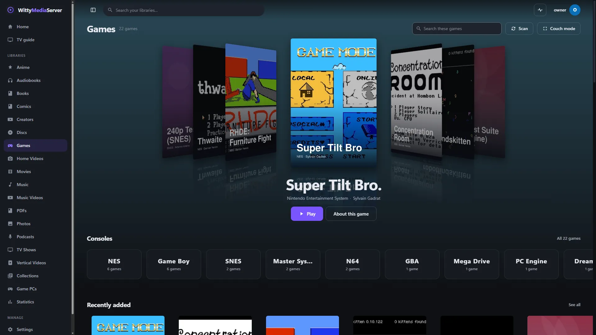
*WittyPlay, with open-licence homebrew. Each is credited in [the list](images/CREDITS.md).*

1. Open **Settings → Libraries** and press **Add library**.
2. Choose **Games**.
3. Under **Console**, pick one console, or leave it on **Many consoles in one folder (sorted by folder and file type)**.
4. Press **Choose folder…** and pick your games folder, or type its path.
5. Check the **Library name**, then add it.

Point it at your games folder and leave it. It works in the background and carries on after a restart. A line at the top of the library says how far it has got: checking files, adding games, then finding details and pictures.

A folder can be laid out however you like. A folder per console helps, but it isn't needed, as the file itself usually says:

```
Games/
  SNES/
    A Made-Up Quest (USA).sfc
    Another Game.zip
  PS2/
    Some Game.iso
    BIOS/
      scph39001.bin
```

You can have several libraries for one console, or one library for everything.

**Archives work.** `.zip`, `.7z`, `.rar` and `.tar` count as the game inside them, and so do files compressed with gzip, bzip2, xz or Zstandard, and split sets such as `.part1.rar` or `.7z.001`. A game in an archive is unpacked the first time it's played, into a cache you can size with **Space for unpacked games** under **Settings → Consoles & cores → How games play → Advanced**. The original is left alone.

**Discs work.** A `.cue`, `.gdi`, `.ccd` or `.m3u` keeps its files together. Discs of one game named `Disc 2`, `(CD2)` or `disc2of3`, or kept in a folder called `Disc 2`, come together as one game. Change disc from the game menu: **More → Change disc**.

**Your own pictures and details come first.** Put `Some Game.png`, `Some Game-cover.jpg`, `Some Game-fanart.jpg` or `Some Game.nfo` beside a game. Everything else comes from the sources in [Metadata](METADATA.md#video-games).

## Needs a look

A scan only lists what it can prove is a game. Anything else is set aside for you, with the reason, rather than guessed at.

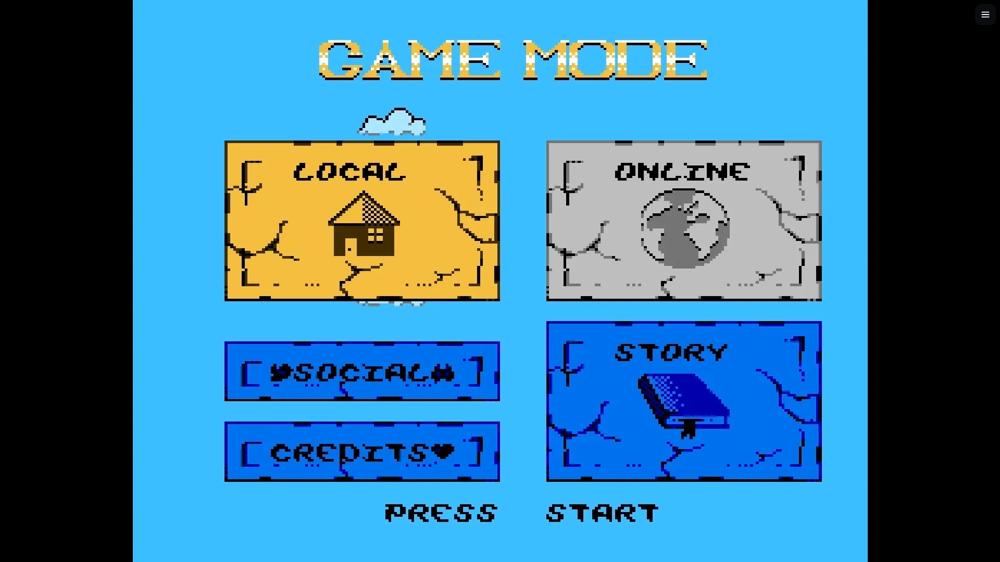
*[Super Tilt Bro](https://github.com/sgadrat/super-tilt-bro), Sylvain Gadrat, WTFPL.*

When there's something to see, a banner appears at the top of the library page, for administrators. Press **Take a look**. The window has four tabs:

| Tab | What's in it |
|---|---|
| **Needs a look** | Files that might be games: no header where every game has one, a disc with nothing to say which console, or a game for another console in a library set to one |
| **Can't play** | Games that are listed but can't play as they are, such as encrypted files. **Open the game** shows why |
| **Left out** | What's been shown not to be a game: BIOS files, updates, extra content, utilities, music, and second copies. You can overrule these |
| **You said no** | Files you marked as not games. **Take it back** undoes that |

On each file you can press:

- **It's a SNES game**, or whichever console it suggests.
- **Another console**, to choose from the list.
- **Not a game**, so it isn't asked about again.
- **Add all 12 as SNES**, when several files in the list point to one console. This appears above the list.

Files are never moved or changed. Your answers are kept beside the library, and later scans go by them.

## How titles and consoles are worked out

### Which console

A file's name is only where the question starts. `.bin` and `.iso` mean many consoles, and `.md` is usually a readme. So the scan looks at each file and goes by the strongest evidence it has:

1. **The file's own bytes.** Most cartridges and discs have a header that says what they are. This wins over everything else, so a PS2 game in a folder named for the PlayStation is a PS2 game.
2. **An extension only one console uses**, such as `.sfc`.
3. **The folder or the library**, when the file can't say. A folder named `SNES`, `Super Nintendo` or `Mega Drive` counts.
4. **You.** Whatever you choose stays.

To see why a game was sorted the way it was, open it and expand **Fix this game, files and advanced**. **Wrong console** moves it, and **It isn't a game** takes it off the list.

### Files with no header

Some consoles' cartridges have no header at all: Atari 2600 and 7800, PC Engine, Virtual Boy and WonderSwan. These go by their folder or library, and by whether the file is a size a cartridge could be.

A NES dump with no header is listed if its size fits a cartridge, and its page says so. Most NES cores can't play one. Mesen can, by working out the game from its checksum, but Mesen is an optional install. Install it under **Settings → Consoles & cores**, on the NES card, under **Cores and BIOS files**.

Other consoles rely on their header: Game Boy, Game Boy Advance, Nintendo 64, DS, 3DS, PlayStation, PS2 and PSP. A file for one of them with no header goes on **Needs a look**, because a core wouldn't be able to start it.

### Which title

A game takes its name from its file, with tags such as `(USA)` and `[!]` set aside. Then, in the background:

- A file whose checksum matches a known game gets that game's exact name.
- A close match by name brings details, but the file keeps its own name, as it may be a variant.
- A hack that keeps the original game's header isn't named after that game.

A title you type stays, whatever a later scan or source says. **Fix match** and **Lock** are on the game's page, and [Fixing metadata](FIXING-METADATA.md) explains them.

### Versions of one game

Regions and revisions of one name on one console share a tile, led by a released version in your preferred region. Each version is still its own game, with its own saves. To play another, open the game and pick it under **Other versions of this game**. An administrator can press **Make it a game of its own** to split one out.

An archive holding many versions plays the verified one in your first region. Administrators can pick another under **Which version in this archive to play**.

Set your regions in **Settings → Consoles & cores → Which version comes first**. A game someone has played, or given a title, keeps the version it has, as their saves belong to it.

## Cores

A core is the free program that plays one console's games. Each one is someone else's work, and stays a separate program. It only runs when you play, boxed in by a sandbox.

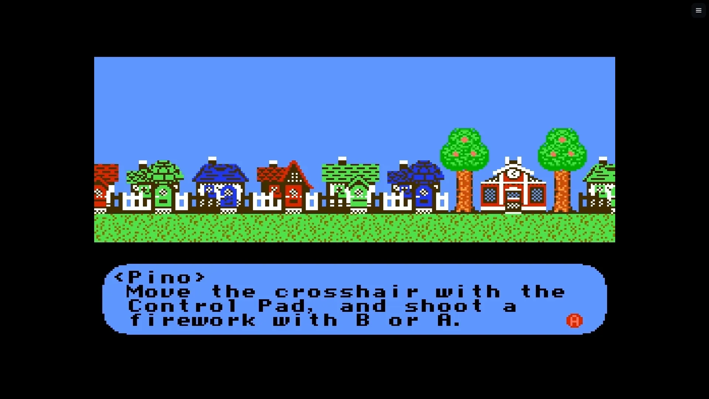
*[Thwaite](https://github.com/pinobatch/thwaite-nes), Damian Yerrick, GPL-3.0-or-later.*

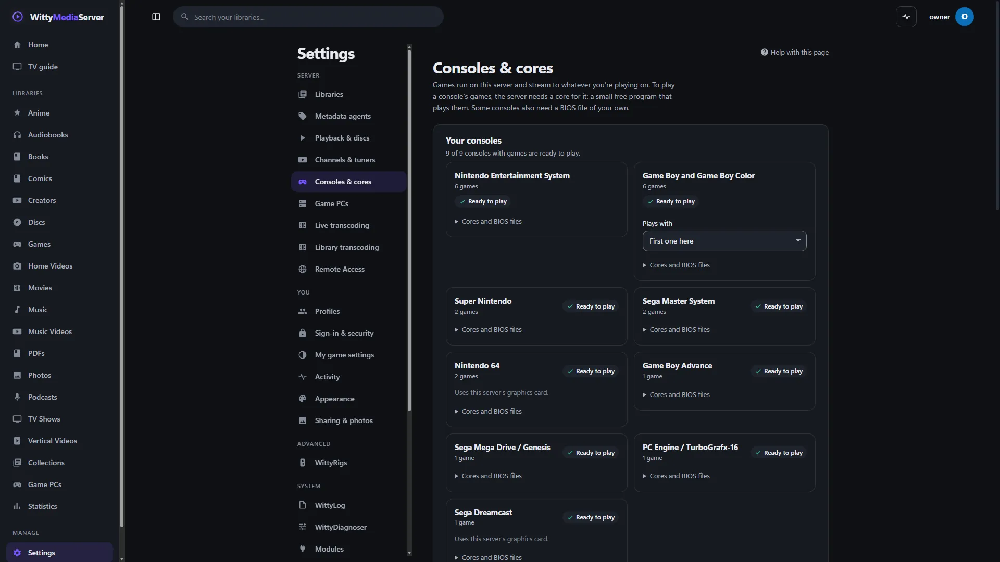
*Settings, Consoles & cores.*

1. Open **Settings → Consoles & cores**. The consoles you have games for are at the top, each saying whether it's ready.
2. Press the button on a card, such as **Install FCEUmm**. When several consoles need one, **Install all 3 recommended cores** at the top does them together.
3. Read the license and press **Install**.

The core downloads from buildbot.libretro.com, the libretro project's build server. Downloads are there for Windows and Linux on 64-bit Intel or AMD, Linux on ARM, and macOS. Other systems, such as FreeBSD, have no prebuilt cores: install them with your system's packages, or put them in the cores folder, which the page names.

Cores on this list that are already in a RetroArch folder on the same machine are found and used.

If a game won't load on the chosen core, the other installed cores for that console are tried.

**Choosing another core.** Press **Change core** on a console's card, or beside the core on a game's page to change it for that game alone. Each core says what it's good at (accuracy, speed or a balance of the two), how it draws on your server and where else it runs, whether it needs a BIOS file of your own, and whether it's installed. Choose one that isn't, read its license, and press **Install and use**: it downloads, with its progress, and plays from the next start. On a game's page the picker also shows how each core has gone on that game. Your in-game saves stay whichever core plays a game, but a save state only loads in the core that made it, so states from another core wait until you switch back.

| Console | First choice | Needs a graphics card | BIOS file |
|---|---|---|---|
| NES, Famicom | FCEUmm | No | Only for disk games |
| Super Nintendo | Beetle Supafaust | No | Only for `.bs` files |
| Game Boy, Color | Gambatte | No | No |
| Game Boy Advance | mGBA | No | Optional |
| Mega Drive, Genesis | BlastEm | No | No |
| Master System, Game Gear | Gearsystem | No | No |
| PlayStation | PCSX ReARMed | No | Optional for most games |
| PC Engine | Beetle PCE Fast | No | For CD games |
| Atari 2600 | Stella 2014 | No | No |
| Atari 7800 | ProSystem | No | Optional |
| Lynx | Handy | No | Most games want one |
| WonderSwan | Beetle WonderSwan | No | No |
| Neo Geo Pocket | Beetle NeoPop | No | No |
| Virtual Boy | Beetle VB | No | No |
| Nintendo DS | melonDS | No | Optional |
| Nintendo 64 | Mupen64Plus-Next | Yes | No |
| PlayStation 2 | LRPS2 | Yes | Required |
| PSP | PPSSPP | Yes | No |
| Dreamcast | Flycast | Yes | Optional |
| Nintendo 3DS | Azahar | Yes | No |

Each card lists the other cores offered, with their licenses:

| Console | Other cores |
|---|---|
| NES, Famicom | Nestopia UE, Mesen, QuickNES |
| Super Nintendo | bsnes 2014 Performance, Mesen-S, bsnes |
| Game Boy, Color | SameBoy, mGBA, Gearboy |
| Game Boy Advance | VBA Next, VBA-M, gpSP |
| Mega Drive, Genesis | ClownMDEmu |
| Master System, Game Gear | SMS Plus GX |
| PlayStation | Beetle PSX, SwanStation, Beetle PSX HW (the last three need a BIOS file) |
| PC Engine | Beetle PCE, Beetle SuperGrafx |
| Atari 2600 | Stella |
| Lynx | Beetle Lynx (needs `lynxboot.img`) |
| Neo Geo Pocket | RACE |
| Nintendo DS | DeSmuME |
| Nintendo 64 | ParaLLEl N64 |
| PlayStation 2 | Play! |
| Nintendo 3DS | Panda3DS |

Non-commercial cores, such as Snes9x, Genesis Plus GX and PicoDrive, are never offered.

Each core also says which server platforms it runs on, and how it draws on yours: on a graphics card, by the processor, or not at all. A core that isn't published for your server's platform isn't offered to install: Beetle Supafaust, for example, has no build for macOS, so a Mac server suggests bsnes 2014 Performance for Super Nintendo instead. Every device plays whatever your server can run, since the server runs the game and streams it.

### Consoles that need a graphics card

Those consoles are drawn on the server's graphics card, and they run on Windows, Linux and macOS servers. Older consoles need no graphics card anywhere.

**On a Mac, FreeBSD, or any server without a card games can use:**

- **Nintendo 64, PSP and PlayStation 2 still play.** The server's processor draws them instead, at the console's own resolution. A game's page says so before you press Play: they can run slower than with a card, and keep several of the server's processor cores busy. On an Apple M3 Pro, Nintendo 64 games ran at full speed on about one core, a demanding PSP game ran at full speed most of the time, with dips, on three to five, and a PlayStation 2 game ran mostly at full speed, slower in places. PlayStation 2 still needs your own BIOS, below.
- **Dreamcast and 3DS can't.** Their games stay listed, and their pages, the library and Settings say **Not on this server**, with the reason, instead of offering Play.
- **PlayStation** plays on PCSX ReARMed, which needs no card. A server that would otherwise choose one of the faster PlayStation cores uses it instead.

- **Settings → Consoles & cores → How games play → Advanced** names the card in use, or says why there isn't one. A card simulated on the CPU doesn't count, as it's far too slow.
- **Running as a Windows service:** a service has no desktop, and consumer graphics drivers often refuse to draw there. Run the server in a signed-in session to play these consoles.
- **In a container:** pass the card in, with `--device /dev/dri` for Intel and AMD, or `--gpus all` for NVIDIA.
- **Laptops with two cards:** the fast NVIDIA card is chosen by itself. With an AMD card and integrated graphics, Windows may pick the slow one. To fix that, open Windows Settings, System, Display, Graphics, add `wittyplay-game-runner.exe`, choose Options, then High performance.

## BIOS files

A BIOS is firmware copied from a console. Some consoles need one, and some games play better with one. The app never downloads one or says where to find one: it has to be your own, from a console you own.

1. Make a folder named `BIOS` inside a console's games folder, such as `PS2/BIOS`. Any capitalisation works, and folders inside it are fine. It's never listed as games.
2. Put your files in it, named however you like: `PSX BIOS (USA).bin` is found as `scph5501.bin`. The server recognises each one by its checksum (from libretro's list of known firmware), so a file with the right name and the wrong contents is never used.
3. That's all. After a library scan, or when you press Play, the server copies what a core needs to its own BIOS folder and leaves yours alone. **Settings → Consoles & cores**, under **Cores and BIOS files** on each card, lists what it found, its region, which folder it came from, and which one is in use.

**Regions:** a PlayStation 2 game starts on a BIOS from its own region when you have one, going by its disc's serial or its file name, and otherwise on the one shown as in use: a late first-generation US model when you have a whole set. Other consoles' cores pick by name.

You can also put files straight in the BIOS folder named on that page. A PlayStation 2 BIOS goes in `pcsx2/bios` inside it.

| Console | File names | Used for |
|---|---|---|
| PlayStation 2 | `scph39001.bin`, or any other model's BIOS image | LRPS2 needs one, and any region will do. With a whole set, a game starts on one from its own region, or a late first-generation US model |
| PlayStation | `scph5501.bin`, `scph5500.bin`, `scph5502.bin` | US, Japanese and European consoles. PCSX ReARMed runs most games without one; Beetle PSX and SwanStation need one |
| NES | `disksys.rom` | Famicom Disk System games |
| Super Nintendo | `BS-X.bin` | Satellaview games in `.bs` files, on Mesen-S |
| Game Boy Advance | `gba_bios.bin` | Better accuracy |
| PC Engine | `syscard3.pce` | CD games |
| Atari 7800 | `7800 BIOS (U).rom` | The start-up screen |
| Lynx | `lynxboot.img` | Most games on Handy; Beetle Lynx needs it |
| Nintendo DS | `bios7.bin`, `bios9.bin`, `firmware.bin` | Accuracy, and the start-up menu, on melonDS |
| Dreamcast | `dc/dc_boot.bin`, `dc/dc_flash.bin` | Better compatibility, and the console's settings |

PlayStation 2 games fall back to the Play! core when LRPS2 has no BIOS, if Play! is installed. It needs none, and runs fewer games.

## Saves, memory cards and save states

All of these belong to your account, so everyone on the server has their own. They follow you to every device.

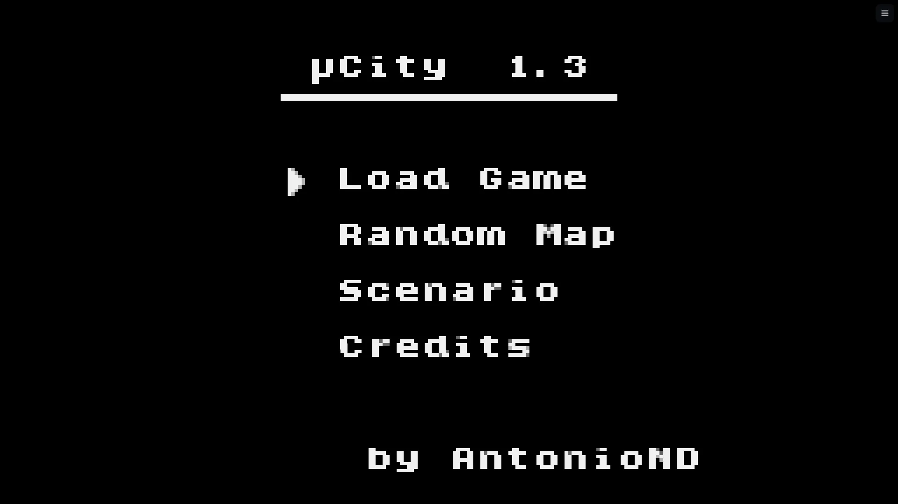
*[µCity](https://github.com/AntonioND/ucity), Antonio Niño Díaz, GPL-3.0 and CC BY-SA 4.0, running on the server and streamed to a browser.*

- **Battery saves** are what a game saves by itself, written within 5 seconds of changing.
- **Memory cards:** the PlayStation 2 has its own cards for each game and each account. A new card is unformatted, as a new card was on a real console, and the game offers to format it the first time it saves. These have been seen working on Windows. A real PS2 save hasn't been tried under the Linux sandbox yet.
- **Save states** are a snapshot of the whole game, in slots 1 to 99, each with a picture. Open the game menu and press **Save** or **Load**, or use **Quick save** and **Quick load**.
- **The automatic save** is written when you leave. **Resume** and **Pick up where you left off** go back to it. **Start over** begins again and keeps the old automatic save, listed as **Before starting over**.

A state that won't load leaves the game as it was and says so. **More → Undo load** puts back what you were playing before the last load.

Under **Settings** in the game menu, **Saves** sets what happens when a game opens: **Offer to resume**, **Always resume** or **Start from the beginning**.

**Moving saves.** On a game's page, each state has a download button, and **Fix this game, files and advanced** (or **Files and advanced**) has **Download battery save** and **Import a battery save…**. The old battery save is kept beside the new one. A battery save usually works in any version of a core. A save state is only sure to work in the core and version that made it.

One account can keep 4 GB for one game, and imports and patches can bring an account's total up to 10 GB. [Backups](BACKUP.md) include saves.

## Controllers, touch and keyboard

Plug in a controller and press any button on it: browsers only show a controller once it has been pressed. Connecting one gives it the player it had last time on this device, or the next free one. Up to four players can share one device.

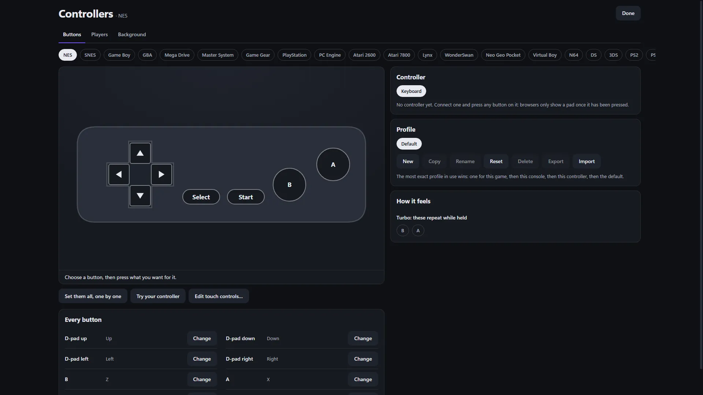
*Setting up controllers.*

**On plain `http://`, most browsers hide controllers.** Open the server over https, or at `localhost` on the same computer. See [Remote access](REMOTE.md). Until then, the keyboard and touch controls work.

### Changing the buttons

Open **Set up controllers** on a game's page, or **Controllers** in the game menu. The address `/controllers` opens the same screen.

- **Buttons:** choose a button, then press what you want for it. Each change makes a profile named for the controller. A profile can be limited to one console or one game, and the most exact one wins. **Copy**, **Reset**, **Export** and **Import** are there.
- **Players:** which controller, keyboard or touch screen is which player, and what's plugged into each port, such as a DualShock on PlayStation.
- **Background:** a picture of your own behind this screen.

The same screen has the stick dead zone, **Calibrate sticks**, **Rumble** and **Try the rumble**, and **Turbo**. Profiles follow your account to every device.

Rumble needs a browser that has the feature, and a controller that can.

### Keyboard

| Key | Button | Key | Button |
|---|---|---|---|
| Arrows | D-pad | `Q`, `W` | L, R |
| `Z` | B | `E`, `R` | L2, R2 |
| `X` | A | `Enter` | Start |
| `A` | Y | Right `Shift` | Select |
| `S` | X | `I`, `J`, `K`, `L` | Stick, on consoles with one |

`Esc` opens the game menu. Shortcuts, which you can change under **Settings → Shortcuts** in the game menu:

| Key | What it does | Key | What it does |
|---|---|---|---|
| `Space` | Fast-forward | `B` | Slow motion |
| `Backspace` | Rewind | `P` | Pause |
| `F2` | Quick save | `N` | Next frame |
| `F4` | Quick load | `F8` | Screenshot |
| `M` | Mute | `O` | Show numbers |

### Controller shortcuts

Press **Start** and **Select** together, or **Guide**, to open the game menu. Hold **Select** and press another button for a shortcut:

| Button | What it does | Button | What it does |
|---|---|---|---|
| R | Fast-forward | X | Slow motion |
| L | Rewind | Y | Pause |
| R2 | Quick save | Right | Next frame |
| L2 | Quick load | A | Screenshot |
| B | Menu | | |

### Touch controls

Touch controls show by themselves on a touch screen, and step aside when a controller connects. **Show touch** and **Hide touch** are in the game menu.

To move them, press **More → Arrange touch controls**. You can move, resize and fade each control, and choose which show. A layout belongs to that device and that way up, so portrait and landscape are separate.

On the DS and 3DS, a press on the picture is the stylus, with a finger or a mouse. On the Nintendo 64, the on-screen D-pad is the stick.

### TV remote

The D-pad moves, OK is A, Play/Pause is B, and Back opens the game menu. A remote can't reach every button, so **More** in the game menu has **Press Start** and **Press Select**. Games that need more want a controller.

## The game menu and game settings

Press `Esc`, Start and Select together, or the button in the corner. The game pauses behind it.

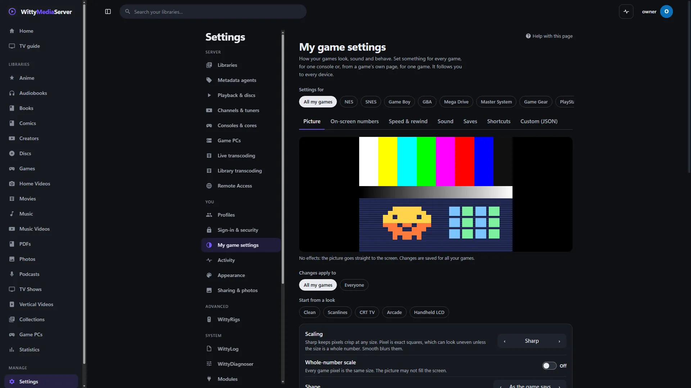
*Settings, My game settings.*

The tiles include **Save**, **Load**, **Rewind**, **Fast forward**, **Screenshot**, **Controllers**, **Settings**, **More** and **Save and quit**. **Rewind** is on by default for the 8-bit, 16-bit and older handheld consoles, whose games take little memory to rewind, and off for the others until you turn it on, as it costs the server memory all the time. An administrator can turn it off for everyone under **Everyone**. Fast-forward and slow motion have no sound.

Games can contain flashing images, and fast-forward can make them flash quickly. **Tube flicker**, under **Picture**, makes the picture flicker. It's off by default, and stays off when your device asks for reduced motion.

**Settings** holds **Picture**, **Sound**, **Speed and rewind**, **Saves**, **Cheats**, **Shortcuts**, **On-screen numbers**, **Core options**, **Patches** and **Settings file**.

You can set anything for every game, for one console, or for one game. **Settings → My game settings** is for all your games. On a game's page, the **More** menu has **Settings for this game**. An administrator can choose **Everyone** to set the starting point for the whole server, and limits under **Settings → Consoles & cores → How games play → Advanced**: **Fastest fast-forward**, **Memory for rewind, per game** and **Run-ahead**.

If a setting breaks a game, **Start with default settings** in the same **More** menu starts it with no settings of yours, no cheats and no patches.

**Cheats** go by the core. Some cores have none, and a code that does nothing can't be told from a wrong one. A game can hold 500 codes.

## Couch mode

Couch mode is the games library alone, full screen and large, made for a TV and a controller. Press **Couch mode** on a games library, or Start on a controller, or open `/big`.

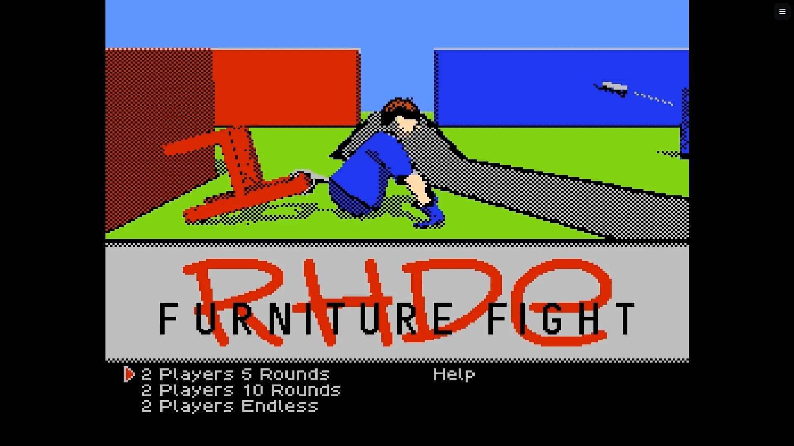
*[RHDE: Furniture Fight](https://github.com/pinobatch/rhde-nes), Damian Yerrick, under a GNU All-Permissive style licence.*

Along the top are your libraries or **Home**, **Consoles**, **Search** and **Settings**. Search has letters on the screen, so it needs no keyboard. The bar along the bottom shows the buttons for the controller you're using. In a library:

| Button | What it does |
|---|---|
| Top face button | Favourite |
| Left face button | Search |
| Select or View | Change the sort order |
| Shoulder buttons | Move between sections |
| Triggers | Jump along the alphabet, when sorted by title |

Press **Leave** at the top, or Back at the top level, to return to the normal app. Couch mode stays on for that tab when you go into a game and back.

Couch mode has nothing to do with WittyCouch, which plays games on PCs: see [Game PCs](GAME-RIGS.md).

## Streaming and delay

The player finds the best way to reach your device by itself. Change it in the game menu under **More → Connection**:

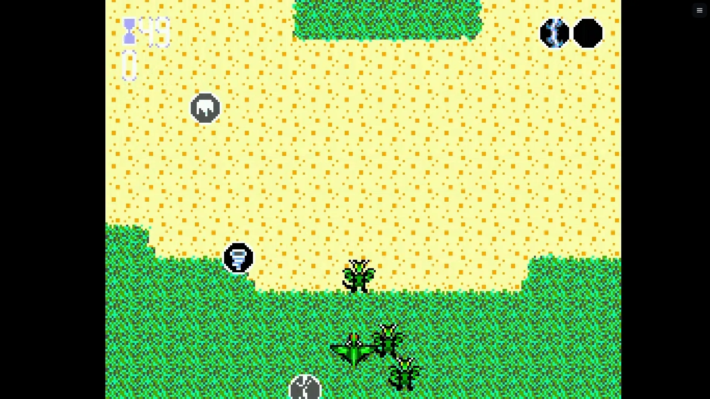
*[Dragon Blaster](https://github.com/haroldo-ok/dragon-blaster), Haroldo de Oliveira Pinheiro, MIT, with open art from OpenGameArt.*

| Choice | When you'd want it |
|---|---|
| **Automatic (recommended)** | Almost always. It tries each of the others in turn, and moves on if a way doesn't work |
| **WebRTC (lowest latency)** | The usual way |
| **WebRTC, drawn directly** | Direct mode: a press may show up a whole screen refresh sooner on some screens, and the picture can tear |
| **WebSocket with H.264** | UDP is blocked, or only a reverse proxy can be reached |
| **WebSocket with JPEG (most compatible)** | Nothing else works, or the server has no video encoder |

Changing connection never restarts the game.

### Speed or steadiness

Under **Settings → Speed and rewind** in the game menu:

- **Automatic**, the default, is Fastest until frames start arriving unevenly, then Balanced until they settle.
- **Fastest** shows every frame the moment it arrives.
- **Balanced** lets your browser hold a frame back in a bad moment.
- **Steadiest** leaves it to your browser, which smooths out a poor connection and adds delay.

### What affects delay

- **The network.** A cable beats Wi-Fi, and home beats away. Bitrate follows your connection by itself.
- **The console.** A PlayStation 2 game takes most of a frame to run, so a press waits for the one in progress. It's the slowest here, at about 49 ms from a press to the screen. The other consoles measured 11 to 31 ms.
- **The server.** Other work on the machine, and how many games are running. Two at once is the default, set by **Games at once**.
- **Picture size.** **Internal resolution** under **How games play → Advanced** sets how sharply graphics-card consoles draw. Automatic is twice native on Nintendo 64, PlayStation, PSP and Dreamcast, and native on PS2 and 3DS. Upscaling a PS2 game can show bands of the wrong colour in some games, which is why it's native.
- **The core's own reaction.** Games take a frame or two to react to a button, as they did on the real console. **Automatic run-ahead** takes a frame off that on older consoles, on servers with four CPU threads or more. A rare game may show a small glitch, which is what to turn off if one does.
- **Your display.** A real screen adds delay of its own, which nothing here can measure or change.
- **Sound** runs about 35 to 80 ms behind the picture. **Sound buffer** under **Sound** trades delay for less crackling.

To see where the time goes, turn on **Settings → On-screen numbers** in the game menu, or press `O`.

**How far to trust those figures.** The delay figures in this guide come from one machine: an RTX 3070 laptop, with the server and a browser with no window on the same computer. They stop at when the browser expects a frame to reach the screen, so a real display adds its own delay on top. Direct mode hasn't been measured on a real screen, which is why it isn't the default.

**Picture quality** under **How games play** is **Automatic**, **Data saver** or **High**.

### Playing away from home

Most homes need nothing. To reach games from outside your network, or from a container, WebRTC needs UDP: set a **UDP port for WebRTC** and **Public IP addresses** under **How games play → Advanced**, and forward that port. Without it, the WebSocket choices work anywhere the app does, with more delay. See [Remote access](REMOTE.md).

## Patches and uploads

A patch is a small file that changes a game, such as a translation or a fix.

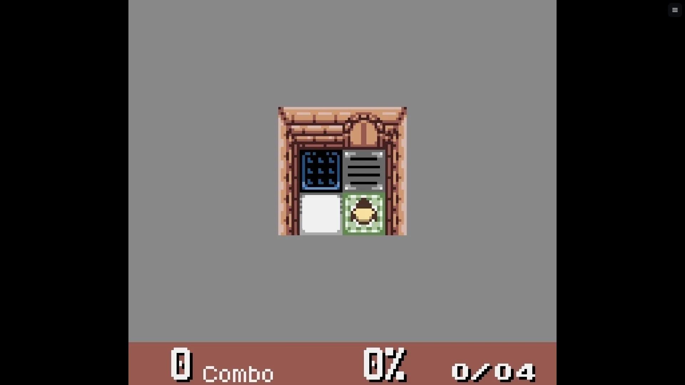
*[Libbet and the Magic Floor](https://github.com/pinobatch/libbet), Damian Yerrick, zlib.*

1. Start the game and open the game menu.
2. Press **Settings → Patches → Add a patch…**, and choose an IPS or BPS file.
3. It takes effect when the game next starts.

A patch is applied to a copy each time the game starts, so your file is never changed. Patches are yours alone. Each game can hold 16, of up to 64 MB. They work on games that are a single file, not on discs. A patch that doesn't fit leaves the game unpatched and playable, with a notice.

**Patches are for adult profiles.** Kids and Guest profiles can't add them.

**Nobody uploads a game through the app.** A game gets here by being in a library's folder. A Guest profile can't upload anything to do with games: no saves, patches or pictures. A Kids profile can bring its own saves and pictures, but not patches.

## Encrypted games

Encrypted game files are detected and refused with a clear message. Nothing here decrypts a file, goes looking for keys or tries a password. The file stays listed, with the reason on its page and on the **Can't play** tab.

**3DS files.** Most 3DS copies are encrypted, and the cores can't read those. An encrypted `.cia` won't work, and only an unencrypted dump will. The server reads the plain headers of `.3ds`, `.cci`, `.cxi`, `.app` and `.cia` files to tell which is which, and it goes by the program's bytes: `NCCH` has to be readable where it belongs, and the program's NoCrypto flag has to be set. A title that shows its name and icon may still be encrypted, because a package keeps those in the open, and a package with a ticket may not be, because tools that take off a package's encryption often leave the ticket in. Neither counts.

A `.cia` that really is unencrypted has its main program copied out, the first time it's played, and the copy stays until another package is played. Updates and extra content inside a package aren't applied, and a package that's only an update or extra content isn't listed as a game.

No retail 3DS game has been played here: the only one tried is encrypted, so it was refused. A plain test program, in a `.cia` made for the purpose, has played from end to end, with and without the marks a decrypted package usually keeps. To see what a file of yours says, run `wittyplay-probe cia-info -hash yourgame.cia`.

**Password-protected archives** are never opened. A `.7z` that keeps its names readable and locks only its contents can't be told from its headers, so it shows in the library and says so when you press Play.

## Your own core

A custom core is for a console or a version this server doesn't offer. It's a program, and it runs on your server whenever someone plays with it, so only add one you trust. It always runs boxed in, in a process of its own. This project hasn't checked anything you add, and doesn't offer or support it. Where to get one is your call: go to the people who make it.

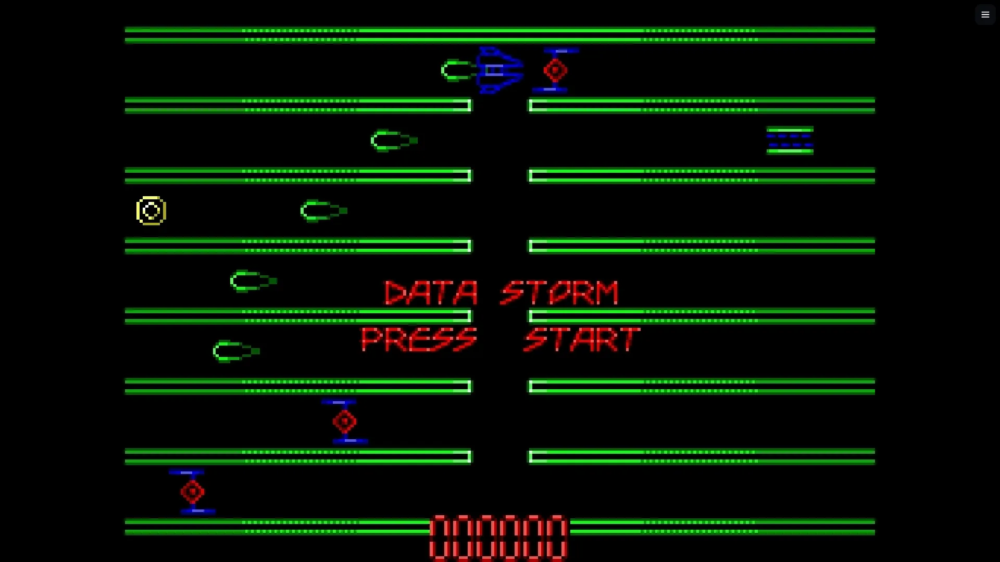
*[DataStorm](https://github.com/haroldo-ok/datastorm), Haroldo de Oliveira Pinheiro, Apache-2.0.*

Custom cores are off on every server. Only an administrator with an adult account can reach them, and they need two switches.

1. **Allow them on the machine.** Start the server with `WMS_GAMING_CUSTOM_CORES=1`, or `-gaming-custom-cores`, or put `"gamingCustomCores": true` in its [config file](CONFIG.md). A web session alone can't do this.
2. **Turn them on.** Open **Settings → Consoles & cores → Custom cores**, turn on **Allow custom cores**, and enter your password.
3. **Add one.** Press **Add a core**, and pick **Upload a file**, **Web address** (`https` on the public internet only) or **In the cores folder**. If its makers publish a SHA-256, paste it in. Enter your password and press **Test this core**.
4. **Read what it reports:** its name, version, file types, license and what it needs. That's what the core claims about itself. Passing shows it's a libretro core, not that it's safe.
5. **Say which consoles it's for.** Tick **Use by default** to make it what a console plays with. Tick the box that says you understand, and press **Add this core**.

The core file has to suit your server: `.dll` on Windows, `.so` on Linux, `.dylib` on a Mac. A `.zip` can hold it too, with the core at the top, an optional `.info` file, and `assets/` and `system/` folders.

To keep them off whatever else is set, start the server with `WMS_GAMING_NO_CUSTOM_CORES=1`. On a machine that can't box a core in, such as FreeBSD, or a Mac without `sandbox-exec`, they can't be turned on at all.

**If it fails**, it says why and keeps nothing:

| It says | What that means |
|---|---|
| Built for something else | You have the Windows build and a Linux server, say |
| Isn't a program library | It's a text file, a saved web page, or an archive that needs unpacking |
| Isn't a libretro core | It's a real library, but a different kind of program |
| Needs another library | It depends on something this server doesn't have |
| Crashed, or didn't finish loading | The core is broken, or doesn't suit this server. Your server is fine |

**Later:** each core's card has **Replace**, **Add files**, **Consoles and notes** and **Remove**. Versions you've replaced are listed under **What it reports**, with **Go back to this**. A core never updates by itself. If its file stops matching the checksum you approved, it won't run, and its card shows **Test and approve again**: unless you changed the file yourself, remove it and add a copy you trust. Nobody's saves are touched by any of this.

**A console this server doesn't have:** press **Add a console** under **Custom consoles**, and give it a name, a short name and its file extensions.

## Standalone emulators

A core is the usual way to play, and the only one most servers need. Some consoles have no core (Xbox, PlayStation 3, Wii U), and for others a whole emulator may play better (PlayStation 2, say), so an administrator can also install a **standalone emulator**: the same program you'd run on a desktop, such as PCSX2, Dolphin, RPCS3, xemu or Cemu. The server runs it boxed in, one per game, on its own desktop (a Mac or a Windows PC), in a sandbox of its own (Linux) or in a container, and streams it to you like any other game. This is off until an administrator turns it on.

| Console | Plays on | Notes |
|---|---|---|
| GameCube, Wii | Dolphin, or the Dolphin core | Disc images, Dolphin's compressed images (RVZ, WIA, GCZ, CISO, WBFS) and homebrew. On a Mac the core stalls after its first frame for now: play them in Dolphin |
| Wii U | Cemu | `.wud` and `.wux` images need your games' disc keys in the BIOS folder |
| PlayStation 3 | RPCS3 | Disc images and folder dumps; RPCS3 installs the system software (`PS3UPDAT.PUP`) from the BIOS folder |
| Xbox | xemu | Needs the boot ROM, BIOS and hard disk image of an Xbox you own |
| Switch | Ryujinx or Lichii, which you install yourself | Never downloaded by this server; see [The Switch and the Switch 2](#the-switch-and-the-switch-2) |
| Switch 2 | Lichii, which you install yourself | Its games are known by their folder (`Switch 2`) or a Switch 2 library, as their files look like Switch games' |

When a console has no core, its games' **Play** starts the emulator that's set up for it. **Settings → What this server plays** lists every console, whether it plays here, and how.

**For everyone.** When one is set up for a game's console, the game's page shows **Play with PCSX2** (or whichever) under Play. If it's greyed out, the sentence beside it says why: firmware is missing, or this server is too small for it. **Emulator settings** beside it holds your own choices (resolution scale, widescreen, the most bitrate), for all your games or just this one. What's different from a core's game:

- There are no save states, rewind, cheats or game menu. Save inside the game, the way the console did. Its memory cards and settings are kept on the server, yours alone.
- Your controller's buttons are passed on as keys, so sticks work as four directions, not by degrees, and there's no rumble. Each player's keys are written into the emulator's own controller settings before it starts, so up to four players' pads work with nothing to set up (as many as the emulator allows: four for PCSX2, Dolphin and Flycast, two for RPCS3, one for the rest).
- **Pause** freezes the emulator; **Stop** ends it. Leaving the page without stopping leaves it running for two minutes, so a reload carries on where you were. One game at a time for each person.
- A few emulators are shown as their own desktop inside the page rather than as a stream: click inside it to use the keyboard and mouse.
- The game belongs to the profile, on the device, that started it. Signing out, or switching to another profile on that device, ends it. For a profile with [limits](PROFILES.md), the time it runs counts as screen time, and it's ended when the time is up or when games are turned off for the profile.

**For administrators: Settings, Standalone emulators.**

1. Choose **Where they run**. On a Mac or a Windows PC that's the server's own desktop by default: a Mac needs you to give the server **Screen & System Audio Recording** and **Accessibility** in System Settings, Privacy & Security, and a Windows server must run signed in, not as a service. With Docker, read the warning beside the switch: a Docker daemon that runs as root can do anything on the machine, so a rootless Docker, Podman, or "this machine's own sandbox" (Linux) is the safer choice. **Where emulators run** on that page says what it found, line by line.
2. Turn it on, and install an emulator from the list. Each is someone else's program under its own licence, which is shown before anything is downloaded; the download comes from the emulator's own project and is checked before it's used. Nothing else comes with it: no games, and no BIOS.
3. With Docker, an emulator also needs a container image, which this project hasn't published yet: the list says so beside each one, and WittyPlay's own guide says how to build it.
4. Firmware goes where a core's does: see [BIOS files](#bios-files). The list shows which files each emulator looks for and whether they're there.
5. **Settings** on an installed emulator sets it up for everyone: every one of its own settings, in its sections, with a search, plus the stream's size and which key each controller button presses. **Running now** lists games in emulators, with Stop.
6. **Your own emulator programs** adds an emulator you installed yourself, by its path: how a FreeBSD server uses its packages, and the only way to play the Switch.

A small server is told plainly what it can't run: on a Raspberry Pi 3 every emulator says it needs more memory than there is, and nothing is started. Cores are the way to play there.

This is new: no game has yet been played in a standalone emulator on a real Docker host, a Windows PC or a Mac with those permissions given. See [What hasn't been tried](#what-hasnt-been-tried).

### The Switch and the Switch 2

Two emulators play them, **Ryujinx** (Switch) and **Lichii** (Switch 2, and Switch), and this server never downloads either, nor any keys or firmware. You install them yourself, from their own projects only:

- **Ryujinx:** <https://ryujinx.app> (the Ryubing project). It plays Switch games, and no Switch 2 games.
- **Lichii:** <https://github.com/zortos293/Lichii/releases>, and nowhere else (its own README warns that lichii.org isn't its authors'). It plays Switch 2 and Switch games; its authors call it very experimental, with rendering errors and crashes to expect. Windows, Linux and Apple silicon Macs on macOS 15 or later.

Then, in **Settings → Standalone emulators**, press **Add it** on the emulator. The server shows what it found where it's usually installed, or takes the program's full path, checks it really is that emulator, and says its version. On a server with no screen, or in Docker, put its **Linux** build (the AppImage, or its unpacked folder) in the folder that page names, on the server's `/config` volume, or name it in the `manual.json` file the page names; the [Standalone emulators guide](https://github.com/wittywilla/WittyPlay/blob/master/docs/STANDALONE-EMULATORS.md#the-switch-and-the-switch-2) has every detail, with what a server in Docker also needs.

Keys and firmware come from your own console, into the same [BIOS folder](#bios-files) as other consoles' files:

| File or folder | What it is |
|---|---|
| `prod.keys` | Your console's keys. Required |
| `title.keys` | Your games' title keys. Some games need them |
| `switch-firmware/` | Your console's firmware, as the emulator installs it (the contents of its `registered` folder). You can also install it from the emulator's own menu |

The server copies them to where each emulator looks, and the emulator's card and each game's page say which are found. **You're responsible for having the right to the keys, firmware and games you use**: use only what you dumped from a console you own and games you own. Getting round a console's protection may be illegal where you live, and Nintendo has taken action against Switch emulator projects. Neither project is associated with this one or with Nintendo.

## Console icons

Consoles show their short names as text, such as `SNES` and `PS2`. Icons are an optional download, and nothing comes with the app.

To turn them on, open **Settings → Metadata agents → Logos**, read what it says, and press **I understand: download logos**. It's one agreement, covering consoles, studios and networks.

- Your server tells Wikidata and Wikimedia Commons the name of each console, and nothing else.
- Only files whose own page says they're free to reuse are taken. **Where each logo came from** lists each one's source, license and author.
- Logos are still trademarks of their owners, and are shown only to name who made something.

Some consoles have no logo under a free license, and those stay as text. You can upload your own either way. **Remove them** turns downloads off and deletes the pictures.

WittyPlay has a narrower switch of its own: **WittyPlay Settings → Game pictures → Brand logos**. It's off until an administrator turns it on and confirms a warning (logos are trademarks of their owners, shown for personal, non-commercial display on this server only, with no endorsement or affiliation). It covers console logos, which it downloads by itself, and game studio logos you choose from a game's **Logos**. Each logo's source and licence is listed under it, and **Remove downloaded logos** deletes them and turns it off.

## Game pictures in WittyPlay

Box art comes in every shape: tall, wide and square. **WittyPlay Settings → Game pictures** chooses how it's shown:

- **Box art fitted** (the default): the whole picture, nothing cut off, over a soft, blurred copy of itself.
- **Box art filled**: the picture fills its tile and its edges may be cut off.
- **In its case or cartridge**: the game drawn in a cartridge, disc case, tape or arcade marquee like the ones its console used, with the box art, the game's logo or its title on the label. The drawings are WittyPlay's own and carry no maker's name or logo.

Choose for every game, for each console, or for one game (**Picture style** in a game's panel in WittyPlay). Your choices follow you to every device. An administrator can also choose for everyone on the server; your own choice wins.

Choices can be exported and imported as a `.wittyplay` file, an open format anyone may use: see [the .wittyplay file format](specs/wittyplay-file.md). A `.wittyplay` file beside a game, with the game's name (`Made Up Quest (USA).wittyplay`), is read when the library is scanned. Nothing is ever written into your games folders.

## If a game won't start

| What it says | What to do |
|---|---|
| **Nothing to play NES games with yet**, or **This server can't play NES games yet** | Install a core: see [Cores](#cores). If you aren't an administrator, ask whoever runs the server |
| **PS2 games need a BIOS file** | See [BIOS files](#bios-files) |
| **This game file is encrypted** | See [Encrypted games](#encrypted-games) |
| **This game needs a graphics card** | See [Consoles that need a graphics card](#consoles-that-need-a-graphics-card) |
| **This game's file has gone** | It was moved or deleted. Put it back, or scan the library again |
| **The server is busy** | Wait for another game to finish, or raise **Games at once** |
| **The game started, but its picture can't reach this device** | Usually a firewall or a network blocking the connection. Press **Try again**, or choose a WebSocket way under **Connection** |
| **This game keeps stopping** | Press **Start with default settings**. If it still stops, try another core for that console |
| The game starts, but the picture stays one colour | A few games don't work on a core and give no error. An administrator can choose another core on the game's page |

A game also stops by itself after 30 minutes with no controller changes, and 60 seconds with nobody connected, and it saves first. A dropped connection comes back by itself within that minute, and a game that has gone from the server starts again from its last save.

For anything else, the server's log has the core's own words: see [Logging](LOGGING.md).

## What hasn't been tried

- **Standalone emulators** haven't yet played a game on a real Docker host, and their container image hasn't been built. The checks on who may play what, on what a container is given, on downloads and on settings are all tested; the picture, the sound and the keys reaching a real emulator are not. WittyPlay's guide lists it all.
- **Browsers and devices:** Firefox, Safari, phones and TVs haven't been run with game streaming, and neither has a real controller or TV remote.
- **Networks:** no real network has been run. Every delay figure is from one machine, as above.
- **3DS:** no retail game, as above.
- **macOS and FreeBSD:** games haven't been run on a real Mac or on FreeBSD. On FreeBSD, a running core has limits rather than a sandbox: it can't start programs, and with no graphics card can't open a network connection.

## For developers

How this is built is in [Games: design](GAMING.md). The routes a client uses are in [Games: the API for clients](GAMING-API.md).

---

<sub>WittyMediaServer documentation</sub>
