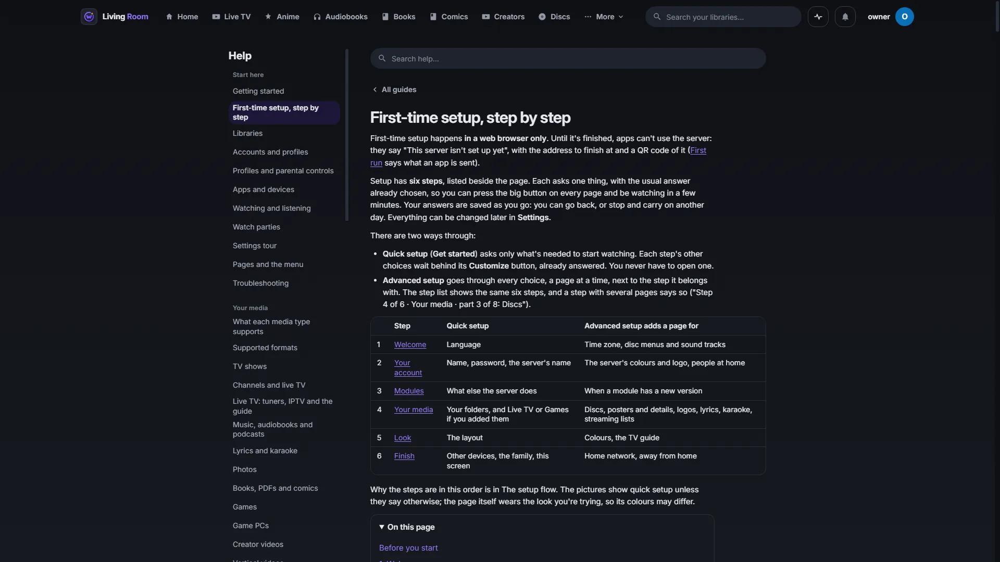
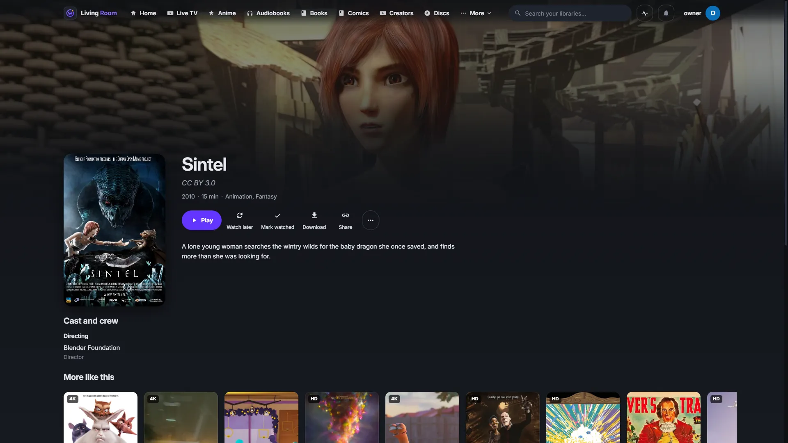

# Getting started

This guide takes you from nothing to a film playing on your screen. On Windows and on a Mac you won't need the command line.

- [What you need](#what-you-need)
- [Install it and start it](#install-it-and-start-it)
- [What first-time setup asks](#what-first-time-setup-asks)
- [Finding your way around](#finding-your-way-around)
- [Put your files in order](#put-your-files-in-order)
- [Add your first library](#add-your-first-library)
- [Play your first film](#play-your-first-film)
- [Posters and descriptions](#posters-and-descriptions)
- [Watch on other devices](#watch-on-other-devices)
- [Add the family](#add-the-family)
- [Words you'll see](#words-youll-see)
- [Where next](#where-next)

## What you need

- **A computer that stays on while you watch.** Windows 10 or 11, macOS 11 or newer, Linux, FreeBSD 14 or newer, or a NAS that runs Docker.
- **Your media.** Films and TV in nearly any format, music, books, or images of DVDs and Blu-rays you own. [Supported formats](SUPPORTED-FORMATS.md) has the full list. Encrypted discs are refused, with a plain message.
- **A web browser** on whatever you watch on, or the WittyMediaClient app.

FFmpeg, the program that converts video, comes with the download. So does the database. There's nothing else to install.

## Install it and start it

Download the installer for your computer from the [Releases page](https://github.com/wittywilla/WittyMediaServer/releases).

| Your computer | File | What to do |
|---|---|---|
| Windows | `.msi` | Open it. If SmartScreen warns you, choose **More info**, then **Run anyway**. Choose **Just me** unless it should always be on |
| Mac | `.pkg` | Right-click it, choose **Open**, then **Open** again |
| Debian, Ubuntu | `.deb` | `sudo apt install ./wittymediaserver-….deb` |
| Fedora, RHEL | `.rpm` | `sudo dnf install ./wittymediaserver-….rpm` |
| FreeBSD | `.pkg` | `pkg add wittymediaserver-….pkg`, then `sysrc wittymediaserver_enable=YES` and `service wittymediaserver start` |

**On Windows and a Mac,** open **WittyMediaServer** from the Start menu or Applications. An icon appears by the clock or in the menu bar, and setup opens in your browser. To get back later, click the icon and choose **Open WittyMediaServer**, or go to `http://localhost:9797`.

**On Linux and FreeBSD,** the server runs as a service. Open `http://<this computer>:9797/` in a browser.

**With Docker:**

```bash
docker run -d --name wittymediaserver --restart unless-stopped \
  -p 9797:9797 \
  -v wms-config:/config \
  -v /path/to/movies:/media/movies:ro \
  ghcr.io/wittywilla/wittymediaserver:alpha
```

This is an alpha. [What has been tested](INSTALL.md#what-has-been-tested) says how far each installer has been run. [Installing](INSTALL.md) has every download, services, Docker and a NAS.

## What first-time setup asks

Setup happens in a browser, in six steps listed beside the page. Each asks one thing with the usual answer already chosen, so you can press the big button on every page. Answers are saved as you go, so you can stop and carry on another day. [First-time setup, step by step](FIRST-TIME-SETUP.md) has a picture of every page.

1. **Welcome.** The language. Then **Get started**, **Advanced setup**, or restore from a [backup](BACKUP.md).
2. **Your account.** A name, a password of at least 8 characters, and the server's name. Keep the password safe: [forgetting it is hard to undo](ACCOUNTS.md#if-you-forget-your-password).
3. **Modules.** Movies, TV and music work already. Tick what else you want: discs, games, live TV, books, photos.
4. **Your media.** A kind of media and its folder, as many times as you like. Live TV and Games follow, if you added them.
5. **Look.** How everyone's Home starts out.
6. **Finish.** Connect a device, add the family, and **Start watching**.

Everything else (time zone, two-step sign-in, module updates, posters and keys, logos, lyrics, colours, the home network and more) is behind each step's **Customize** button, already answered. **Advanced setup** asks all of it, a page at a time.

**With a remote or the keyboard.** The arrows reach everything, and OK presses it. Back goes back a page.

### If it asks for a setup code

On the computer running the server, setup doesn't ask for one. From any other device it does, so nobody else on your network can claim the server first. The code is on the server's console when it starts (`docker logs wittymediaserver`, or `journalctl -u wittymediaserver` on Linux), and in `setup-code.txt` in the data folder. See [Setting up from another device](ACCOUNTS.md#setting-up-from-another-device).

## Finding your way around

What you see depends on the look you chose. Some looks have a bar along the top, some a menu down the side, and some both. Each look works on a TV, a phone, a tablet and a computer.

- **The menu** holds Home, your libraries, Search and the modules' pages. An administrator chooses what's in it under **Settings → Pages & menu**. See [Pages and the menu](PAGES.md).
- **Your picture** at the top right opens your account menu: **Settings**, **Help**, **Sign in a TV**, **TV mode**, **Switch profile** and **Sign out**. On a TV or a phone, the same things are under **You**.
- **The activity button** at the top shows scans, conversions and other work in progress. See [Background tasks](TASKS.md).

To change the look or theme for yourself, open **Settings → Appearance**. An administrator can require one for everyone. See [Themes](THEMES.md).

## Put your files in order

The server finds videos in any folder layout, but a tidy one gets the right titles and posters. Keep films and TV in separate folders. Put the year after a film's title. Number episodes like `S02E01`:

```
Movies/
  The Long Harbour (2001)/The Long Harbour (2001).mkv
  Paper Lanterns (2014).mp4
TV Shows/
  Night Ferry/
    Season 02/
      Night Ferry - S02E01 - The Crossing.mkv
```

[Libraries](LIBRARIES.md#how-to-lay-out-and-name-your-files) covers every kind of media.

## Add your first library

A library is one or more folders of one kind of media. Setup offers this. Later, use **Settings → Libraries → Add library**.

1. Choose the kind of media, such as **Movies**.
2. Change its name if you like.
3. Choose the folder:
   - On the computer running the server, **Choose folder…** opens the computer's own folder window.
   - **Browse folders** shows the server's drives in the page, from any device. Open the folder and press **Use this folder**. This needs the folder browser module, which setup ticks for you.
   - Or type the folder's full path.
4. Press the button that adds it, such as **Add Movies**.

Scanning starts in the background. Titles appear as they're found, and posters and plots follow. The activity button shows how it's going.

## Play your first film


*This guide, and every other, is in the app under Help.*


*A film's page. [Sintel](https://durian.blender.org/), Blender Foundation, [CC BY 3.0](https://creativecommons.org/licenses/by/3.0/).*

1. Open **Home**, or your library from the menu, and choose a poster.
2. Press **Play**. If you've watched some of it, you'll see **Resume from** and the time, with **Play from start** beside it.

For a disc image, **Play** starts it like a disc player, with its real menu. See [DVDs](DVD.md) and [Blu-rays](BLURAY.md).

| Key | What it does |
|---|---|
| `Space` | Pause and play |
| `←` `→` | Back or forward 10 seconds |
| `↑` `↓` | Volume |
| `f` | Full screen |
| `m` | Mute |

A TV remote or a game controller works too. [Watching and listening](PLAYING.md) has everything the player does. If it doesn't play, see [Troubleshooting](TROUBLESHOOTING.md).

## Posters and descriptions

Films and shows get details with no key. For better matches and more artwork, add a free TMDB or TheTVDB key under **Settings → Metadata agents**, then press **Refresh** on a title. If a title is wrong, press **Edit** on its page, or use **Fix matches**. See [Where details come from](METADATA.md).

## Watch on other devices

**At home.** Any phone, tablet, computer or TV browser on your home network can open the server.

1. Find the address. It's on the last page of setup, and in **Settings → About**. It looks like `http://192.168.1.20:9797`.
2. Type it into the browser on the other device.
3. If it doesn't load, the server's firewall may be in the way. See [Troubleshooting](TROUBLESHOOTING.md#connecting).

**The app.** WittyMediaClient is for Windows, macOS, Linux, FreeBSD, Android, Android TV, iPhone, iPad and Apple TV. It finds your server at home by itself. Sign it in with a code from **Sign in a TV** in your account menu. See [Apps and devices](APPS.md).

**From away.** Your server answers only at home until you choose a way in. The easiest is **From away**: turn it on in **Settings → Remote Access**, and a device joins with a code, with nothing to set up on your router. See [Remote access](REMOTE.md).

## Add the family

Under **Settings → Profiles**, add an **Adult**, **Kids** or **Guest** profile for each person. Everyone keeps their own progress. A Kids profile only shows titles up to the age you choose. See [Accounts and profiles](ACCOUNTS.md) and [Profiles and parental controls](PROFILES.md).

## Words you'll see

| Word | What it means |
|---|---|
| **Library** | One or more folders of one kind of media |
| **Scan** | The server looking through a library's folders for new or changed files |
| **Look** | The layout: where the menu sits and how pages are arranged |
| **Theme** | The colours |
| **Module** | A part you can add or remove, such as disc menus or games. Each is its own project, with its own updates |
| **Direct play** | The file is sent as it is, with nothing converted |
| **Transcoding** | Converting a video as it plays, so a device can play it |
| **Disc image** | One file holding a whole disc, usually an `.iso` |
| **NFO** | A small text file beside a video, with its title, plot and year |

## Where next

- [Libraries](LIBRARIES.md): every kind of library, and how to name your files
- [Accounts and profiles](ACCOUNTS.md): people, passwords and limits
- [Themes](THEMES.md): looks, themes and making your own
- [Modules and the store](MODULE-STORE.md): adding discs, games, photos and more
- [Remote access](REMOTE.md): using your server away from home
- [Backup and restore](BACKUP.md): keeping your server safe
- [Troubleshooting](TROUBLESHOOTING.md): when something goes wrong

All of these are in the app too: open your account menu and choose **Help**.

---

<sub>WittyMediaServer documentation</sub>
