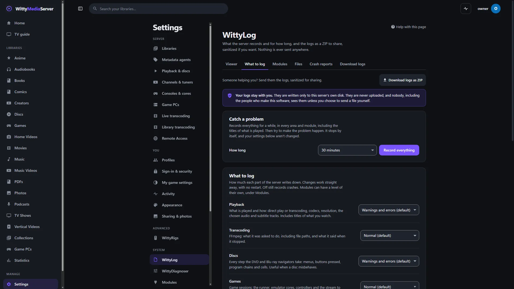

# Logs

Find out what the server was doing when something went wrong, and make a sanitized ZIP you can safely pass to someone helping you. Logs stay on your server: nothing is uploaded, and nobody sees them unless you send a file yourself.

The logs are under **Settings → WittyLog**, for administrators. WittyLog is the name of the server's logging.

- [Where the logs are](#where-the-logs-are)
- [Reading them](#reading-them)
- [Choosing how much is recorded](#choosing-how-much-is-recorded)
- [Catching a problem](#catching-a-problem)
- [Crash reports](#crash-reports)
- [Downloading logs to share](#downloading-logs-to-share)
- [What sanitizing leaves in](#what-sanitizing-leaves-in)
- [From the command line](#from-the-command-line)
- [For developers](#for-developers)

## Where the logs are

Logs are plain text files named `wms-<date>.log`, in the `logs` folder inside the [data folder](CONFIG.md#folders-the-server-uses). The **Files** tab shows where yours are, lists each file with **Download**, and lets you choose another folder. New lines go to the folder you choose, and files already written stay where they are.

So they can't fill your disk:

- A new file starts after 20 MB.
- They're kept for 14 days and 200 MB in all, and the oldest go first.
- With under 100 MB free on the disk, only warnings and errors are written, and old logs are removed.

If the folder can't be written, lines are kept in memory and on the console, the page says so, and the server tries again every 30 seconds.

Passwords, sign-in tokens, stream tokens, API keys, cookies and setup codes are taken out of every line as it's written.

## Reading them

The **Viewer** tab shows lines as they're written. **Pause** holds them still.

- **Show** chooses how serious a line must be: **Everything**, **Normal and above**, **Warnings and errors** or **Errors only**.
- **Module** and **Areas** narrow it to one part of the server.
- **Search** finds words anywhere in a line.
- **Session** takes a session or request ID.
- **Load older** goes back through older files.

Open a line to read its details. Common failures have an explanation in plain words, with what to do. **Show everything from this session** follows one playback, scan or game from start to finish, including what the player said in the browser.

## Choosing how much is recorded

The **What to log** tab sets each part of the server to **Off**, **Errors only**, **Warnings and errors**, **Normal** or **Everything**. Changes work straight away, with no restart. **Off** still records crashes.


*Settings, WittyLog.*

Playback, Discs, Sign-ins, App errors and Web requests start at **Warnings and errors**, because they name what you watch or who signs in. Everything else starts at **Normal**.

The **Modules** tab does the same for each module. A module follows the level of its area unless you choose otherwise. **Advanced** turns on extra kinds of detail, for modules that have them, and **Show what this module logged** filters the viewer to it.

## Catching a problem

When you need to see everything for a short while:

1. On the **What to log** tab, under **Catch a problem**, choose **How long**: from 10 minutes to 2 hours.
2. Press **Record everything**. This includes the titles of what is played.
3. Make the problem happen.
4. It stops by itself, or press **Stop now**. Your usual settings aren't changed.
5. [Download the logs](#downloading-logs-to-share).

## Crash reports

If the server stopped unexpectedly, or part of it crashed and it carried on, a banner at the top of WittyLog says so, and the **Crash reports** tab has each report to read, download or delete. They're kept in the `crash` folder inside the data folder.

## Downloading logs to share

1. Press **Download logs as ZIP**, on any tab of **Settings → WittyLog**. That opens the **Download logs** tab.
2. Leave **Sanitize for sharing** on.
3. Under **How far back**, choose 1, 3, 7 or 14 days.
4. Look through **What will be in it**. It counts what will be replaced, and **Compare some lines, before and after** shows examples. The "before" stays on this page and isn't in the ZIP.
5. Press **Download logs as ZIP**.

The ZIP holds recent logs, crash reports, a summary of this server, a short README, and the newest three [WittyDiagnoser](DIAGNOSER.md#reports) reports with names hidden. It's made on your server when you ask, and nothing is ever uploaded.

**Sanitized** replaces these with placeholders such as `[path-3]`:

| Placeholder | Stands for |
|---|---|
| `[ip-1]` | IP addresses |
| `[host-1]` | Computer and web names |
| `[mac-1]` | Network card addresses |
| `[email-1]` | Email addresses |
| `[user-1]` | Account names |
| `[path-1]`, `[folder-1]` | File paths and folders |
| `[title-1]`, `[library-1]` | Titles of what you own, and library names |
| `[device-1]` | Device names |
| `[name-1]` | Encoded text, which may be something you typed |
| `[hidden]` | Passwords, tokens, keys and logins in web addresses |

The same thing keeps the same number throughout the file, so what happened to it can still be followed. The list of what each number stood for is never saved.

**With sanitizing off,** the file holds your folder and file names, what's in your libraries, account names and network addresses. Keep it for yourself, or read through it before you pass it on. Passwords, tokens and API keys are still taken out.

## What sanitizing leaves in

These stay in a sanitized file, because they're what makes it useful:

- what went wrong and when: messages, levels, areas and times;
- versions, codecs, status codes and timings;
- the server's own routes and source lines;
- file types, such as `.mkv`.

And a few things you might not expect, on purpose:

- **Loopback addresses** such as `127.0.0.1`, and "any address" such as `0.0.0.0`. They identify nobody, and often explain a problem.
- **Session IDs.** They're random, and they're how a story is followed.
- **A name that's an everyday word in the log's own text.** A title called *Error* or a library called *Movies* isn't hidden, because it says nothing about anyone and hiding it would blot out the diagnosis.
- **A one-word title inside a fixed message.** Titles are looked for where the log names them, and message text is the program's own.

Anything that looks like a name, address or path is replaced even if the server doesn't know it, but no check is perfect. Glance through the file if it matters to you.

## From the command line

If the server won't start, you can still get the same file. Neither command needs a running server, and neither changes anything.

```
wittymediaserver logs zip
wittymediaserver logs zip -days 7 -o server-logs.zip
wittymediaserver logs zip --raw
wittymediaserver logs sanitize -o clean.txt wms-2026-11-01.log
```

| Command | What it does |
|---|---|
| `logs zip` | Writes the logs as a ZIP in the current folder, sanitized for sharing. `-days` is 1 to 14, and the default is 3. `-o` names the file, and it won't write over one that exists |
| `logs zip --raw` | The same, not sanitized |
| `logs sanitize <file>` | A sanitized copy of any text log, to `-o <file>` or the screen, with a count of what was replaced |

Both also take `-data <folder>`. They read the database for the names to hide. If it's too broken to read they say so and carry on, replacing everything that looks like a name, address or path, and any name the logs themselves label as one.

## For developers

For anyone adding code to the server or a client. The aim: **if something goes wrong for someone, the log shows it, tied to what they were doing, without showing their secrets, and without costing anything when all is well.**

### The short version

```go
log := s.Log.With("cat", "transcode", "session", streamID) // once, when the work starts

log.Info("transcode started", "height", 1080)              // the message never changes...
log.Warn("hardware encoder failed", "encoder", enc, "err", err) // ...the details are attributes

// In a request handler: pass the context, so the record carries the request's ID.
s.Log.ErrorContext(r.Context(), "could not save progress", "cat", "playback", "item", id, "err", err)

logging.Go("epg refresh", func() { ... }, "cat", "tv") // not a bare `go func()`

var stderr logging.Tail                                // not bytes.Buffer
cmd.Stderr = &stderr
err := cmd.Run()
logging.ChildExit(log, "ffmpeg", err, stopped, &stderr, started)
```

### Categories and levels

Every message belongs to a category. Pass `"cat", id` as an attribute, or `.With("cat", id)` when the work starts. No category means `server`.

| Category | For |
|---|---|
| `playback` | What is played and how: direct play, codecs, tracks, sessions opening and closing. Names titles |
| `transcode` | FFmpeg: command lines, its stderr, how it ended, hardware encoders |
| `discs` | The DVD and Blu-ray engines: navigation, menus, BD-J, and WittyDiagnoser on discs |
| `games` | Runners, cores, controllers, the game stream |
| `tv` | Tuners, channels, the guide, recordings |
| `library` | Scans, metadata lookups, matching, photos and books |
| `modules` | Helpers starting and stopping, module updates and installs |
| `update` | Server updates |
| `remote` | HTTPS, port mapping, discovery, reachability |
| `auth` | Sign-ins, lock-outs, sessions, pairing, two-factor |
| `clients` | What clients report. Only `POST /api/logs/client` writes this |
| `http` | Web requests. Only the `s.logging` middleware writes this |
| `storage` | Folders and disks: free space, permissions, and WittyDiagnoser on storage |
| `server` | Starting, stopping, the database, settings, anything else |

Choose the level by what the message is:

| Level | Means | Example |
|---|---|---|
| Error | It failed and someone will notice, or data is at risk | A transcode that won't start. The database can't be written |
| Warn | It failed, but the server coped, or it will fail soon | A hardware encoder fell back to software. A disk is nearly full |
| Info | A milestone: something started or finished. **A few per action, no file names in `library`** | Scan finished, 3 errors. Game session started |
| Debug | Each step, for chasing a problem | Every file a scan looked at. Every cell the disc navigator played |

A loop that runs per file, per segment, per frame or per button logs at Debug. **Call `log.Debug` freely:** when the category is quiet it returns before formatting anything.

Messages are fixed text with details in attributes, so they group in the viewer and the flood limit can count them: `log.Warn("could not read file", "file", p, "err", err)`, not `fmt.Sprintf`. Use `err` as the key for an error, `stderr` for what a process said, and `stack` for a stack: the viewer and the explanations look for these.

### Sessions: tying things together

A session ID is what lets someone jump from an error to everything about that playback: the request that started it, FFmpeg's output, and what the player said in the browser.

| Work | Session ID | Set where |
|---|---|---|
| A web request | `r-…`, automatic | `s.logging` middleware. Log with `…Context(r.Context(), …)` to carry it |
| HLS playback | The stream ID | `hls.Session.log` |
| A disc | The `sid` from `POST /items/{id}/dvd` | `dvdsession`, `bdsession`. Their HLS streams use `Spec.LogSession` |
| A game | The game session ID | `stream.Session.log` |
| TV | `tv-…` for a stream, `rec-…` for a recording | `livetv` |
| A scan | `scan-…` | `library.Scanner` |
| A module install or update | `mod-…`, `update-…` | `modules`, `update` |
| A WittyDiagnoser job | The job's ID | `diagnose` |

Add it with `.With("session", id)` when the work starts, or put it in a context with `logging.WithSession`. New long-running work gets its own: `id := logging.NewID("scan")`. The IDs are not secrets, as every route using one also needs a sign-in. Never use a token as a session ID.

Requests are tied to the media session automatically when the address has it in it (`sessionFromPath` in `internal/server/server.go`). Add new media routes there.

**Tell the client its session.** Whatever a playback route returns, the ID in it is what the client reports its errors under. See [Clients](#clients).

### Errors that vanish

`_ = thing()` is fine when failure truly doesn't matter, and nothing is worse off: closing something you only read from, removing a temp file, or a write to a client who has gone (`writeJSON`).

It is not fine for saving anything, starting anything, a child process exit, a scan step, a network call something depends on, or any `SetSetting`. Log those. Add a short comment when the reason to ignore isn't obvious.

Don't log what you return: whoever receives the error decides whether it's a problem. Log at the point where the error stops travelling. A handler that answers 5xx is logged by the middleware with the body of `writeErr`, so just answering is enough, unless the detail you have (a path, a stderr) isn't in the response.

Database errors are logged by the driver wrapper in `internal/db`, with the statement and never its values, so nothing needs adding at call sites. Context cancellations and "no rows" are left out.

### Goroutines and panics

A panic in a goroutine takes the whole server with it. So:

```go
logging.Go("name", fn, "cat", "tv")             // recovers, logs with a stack, writes a report; fn ends
logging.Loop("hls sweep", m.sweep, "cat", "transcode") // the same, and starts fn again after a while
defer logging.Recover("runner reader", "session", id)  // for a goroutine you start yourself
```

Use `Loop` for anything that must keep running. Don't recover where carrying on would be unsafe: a transaction half done, or a lock held across the panic (use `defer` for locks). HTTP handlers are already covered by the middleware.

### Child processes

Every process the server starts leaves a record of how it ended, tied to its session:

- **`logging.Tail`** as `cmd.Stderr` keeps the first 2 KB and the last 14 KB, whatever the process prints. Never use `bytes.Buffer` (a file can make FFmpeg print without end), and never let stderr go nowhere.
- **`logging.ChildExit(log, "ffmpeg", err, intended, &tail, started)`** goes after `Wait`. `intended` is true when the server stopped it on purpose: that's a Debug line, and anything else is a Warn with the reason in words (`logging.ExitReason`).
- Log the command line at Debug with `"args", strings.Join(args, " ")`. Addresses and headers in it are redacted.

### Secrets, titles and paths

**Everything is redacted centrally** (`internal/logging/redact.go`), so a mistake at a call site is caught: attribute names like `token`, `password`, `*key`, `cookie` and `setupCode`; patterns in free text like `?token=`, `st=`, `Bearer …`, `Authorization: …`, `"password":"…"`, `user:pass@`, share links and long hex; and the exact values of secrets the server holds (`logging.AddSecret`).

Still, **never log** passwords, tokens, API keys, cookies, recovery or setup codes, or **file contents**. If a secret has a new shape, add a pattern and a case to `TestRedactPlantedSecrets`. Anything printed for a person on purpose (the setup code) goes to the console directly, not the logger.

Attacker-controlled text (file names, request paths, what a client reports, what a program prints) is safe to log as an attribute: values are quoted and escaped, so it can't start a new line or pass for a field, and control characters and text-direction tricks are shown as escapes. The viewer shows it as text only.

**Titles and paths are fine in local logs**, where they're needed. They come out of a sanitized download. So put them in attributes with a name that says what they are: `title`, `game`, `show`, `user`, `host`, `file`, `path`, `dir`, `url`. Never put a title in the message text.

#### Sanitized logs

`internal/logging/sanitize.go` works on a finished log, and writing a log doesn't touch it, so it costs nothing until someone asks for a download. One `Sanitizer` serves one bundle, so one value keeps one number across the logs, crash reports, summary and diagnoser reports. The numbers are handed out as values turn up, and the list is dropped with the `Sanitizer`.

| Placeholder | How it's found |
|---|---|
| `[ip-1]` | IPv4 and IPv6 in any form, in any text. Loopback and "any address" stay |
| `[host-1]` | Attributes like `host`, the host of any address, names ending as network names do, `lookup <name>`, this computer's name |
| `[mac-1]`, `[email-1]` | By their shape, percent-encoded too |
| `[path-1].mkv`, `[folder-1]` | Windows, UNC and Unix paths, and attributes like `file`. A file's type stays. A path in a known folder reads `[folder-1]/[path-2].mkv` |
| `[user-1]` | Attributes like `user` and `by`, and the name of every account wherever it appears |
| `[title-1]`, `[library-1]`, `[device-1]` | Attributes like `title`, FFmpeg's metadata lines and `-metadata`, and what the database calls every title and library |
| `[name-1]` | Percent-encoded words, which are someone's text and not the program's |
| `[hidden]` | Secrets, as in every log, and the login in any address |

Exact names are looked up word by word (`KnownFromDB`), so a hundred thousand titles cost a map, not a regular expression. A first read of the logs adds whatever an attribute says outright is an account or a title, which matters most when the database can't be read. A last pass goes over each finished line (`Final`). The limits in [What sanitizing leaves in](#what-sanitizing-leaves-in) are on purpose (`commonWords`).

Queries come off `/api/...` routes, and anything in a route that isn't a plain lower-case word is hidden.

A new kind of value that identifies someone: add its attribute name to the maps at the top of `sanitize.go`, or a pattern, and plant it in `planted` in `sanitize_test.go`, which searches a real ZIP for every value.

### Modules: their own Go modules

Modules live in their own repositories and can't import `internal/logging`. They take a `*slog.Logger` (or a callback) from the host, and the same conventions work through it: `"cat"` and `"session"` are ordinary attributes.

```go
cfg.Log = log.With("cat", "games")                 // the host
s.log = cfg.Log.With("session", id, "game", title) // the module
```

In a module, use `defer func() { if p := recover(); p != nil { log.Error(..., "stack", string(debug.Stack())) } }()` for goroutines that might meet bad input.

### Module logging: levels and options per module

Every module has its own controls under **Settings → WittyLog**: a level (or *Same as its area*) and advanced options called **topics**, each a kind of detail that can be turned on by itself. Nothing needs registering. The server compares the modules it has with the ones it has seen, every 30 seconds and whenever someone opens the page. A new one gets a line in the log, a **New** badge and its controls. A changed version and a module that went away are logged too.

To be judged by a module's settings, a line carries the attributes `module` and, for optional detail, `topic`:

```go
log := cfg.Log.With("cat", "discs", "module", "wittydvd")
log.Debug("cell played", "topic", "nav", "pgc", n) // shown if the nav option is on, or the module is at Debug
log.Warn("menu unreadable", "err", err)            // judged by the module's level, or else the area's
```

A topic that's on lets its lines through whatever the level, and turning a module to `off` silences everything but crashes. When no module has settings of its own, this costs nothing more than an ordinary quiet line.

Where the list of topics comes from:

- **Any helper module** gets `calls`, `output` and `lifecycle`, done by the server around the helper.
- **The built-in engines** are listed in `engineTopics` in `internal/server/api_logmodules.go`.
- **Any other module** declares its own in its manifest, under `capabilities.logTopics`, each as `"id|Label|What it adds"`. See [Making a module](MODULES.md). A helper is told what's on through the environment, as `WITTYMODULE_LOG` and `WITTYMODULE_LOG_TOPICS`, the next time it starts, and prints what it likes to stderr.

### Clients

Clients report to `POST /api/logs/client` ([Client API](CLIENT-API.md)), signed in, and only that. It's limited by size (64 KB) and by rate (60 events a minute per account, 600 overall). Past that it answers 429. Batch, and group repeats with `count`.

| Field | |
|---|---|
| `app`, `version`, `device` | What is reporting |
| `events[].level` | `error`, `warn`, `info` |
| `events[].kind` | `js`, `request`, `player`, `game`, `crash`, `network` |
| `events[].message`, `stack`, `page` | What happened. No tokens, no file contents |
| `events[].session` | **The stream, disc or game session in play** |
| `events[].request` | The `X-Request-Id` of a failed request |

- **The web app:** `reportClient(...)` and `setLogSession(id)` in `web/src/errorReport.ts`. Failed API requests, uncaught errors and React errors are already captured. A player calls `setLogSession` when a stream starts and reports its fatal errors.
- **WittyMediaClient, desktop:** `desktop/clientlog.js` in its repository, which also keeps a local log file. It reports only what its main process sees, and the server's page reports its own errors.
- **WittyMediaClient, Android and Apple:** `ClientLog` in the app (`diag/ClientLog.kt`, `WittyKit/ClientLog.swift`), also with a local file. Set its `session` when a stream starts and clear it when the stream stops.
- What each client's log must hide is tested from one list: `shared/data/redaction-cases.json` in that repository.

A client must never let reporting cause more errors: no retries in a loop, and a report that fails is dropped.

### Crash reports and the startup summary

These are handled in one place, with nothing to add at call sites:

- **`logging.StartCrashGuard`** (in `cmdServe`): a fatal Go error is written by the runtime to a file, and the next start turns it into a report. A start that finds the last run left without saying so writes an "unclean" report. Recovered panics write one too. They're in `<data>/crash/`, listed in the settings page and the bundle.
- **`Server.LogStartup`** writes version, modules, system, GPU and encoders, disk space and settings at each start. Settings appear only if listed in `summarySettings`, so a new secret can't slip in. Add any setting that changes how the server behaves to that list.

### What logging promises

- **It never blocks a caller.** Records go in a ring in memory and a bounded queue, and one goroutine writes the file. When the disk is slow, the queue drops with a count, and the log says how many.
- **It can't take the server down.** A full disk or an unwritable folder means the log stays in memory and on the console, says so on the settings page, and tries again every 30 seconds.
- **It can't fill the disk.** See [Where the logs are](#where-the-logs-are).
- **A flood can't bury it.** One message repeating is written 40 times in 10 seconds, then counted.
- **A quiet line costs next to nothing.** A `Debug` line in a quiet category returns before formatting anything. The benchmarks are in `internal/logging/logging_test.go`: run `go test -bench . ./internal/logging`. Direct play still sends files with the system's own copy, because `statusWriter` passes `ReadFrom` through.

### Plain-language explanations

`internal/logging/explain.go` turns common failures into a sentence and a suggested fix, shown in the viewer. When you add something that can fail in a way a person can fix, add a rule (the first match wins, so specific ones go first), and a case in `TestExplain`. Say what to do, not what the code did.

### Checklist for merged code

1. `go func()` becomes `logging.Go`, `logging.Loop`, or a `defer logging.Recover` at its top.
2. `cmd.Stderr = &bytes.Buffer{}` or no stderr becomes `logging.Tail`, with `logging.ChildExit` after `Wait`.
3. New long-running work gets an ID with `logging.NewID`, and `.With("cat", …, "session", id)`.
4. `log.Info` in a per-file or per-frame loop becomes `log.Debug`.
5. `_ = s.DB.SetSetting(...)`, `_ = cmd.Start()` and the like get logged.
6. A new media route: add its prefix to `sessionFromPath`.
7. A new secret-shaped value: a redaction pattern, or `logging.AddSecret`, and a test case.
8. A new setting that changes behaviour: `summarySettings`, if it isn't secret.
9. A new module or engine: `"module", id` on its logger, and optional detail with `"topic", id`, listed in `engineTopics` or its manifest.

---

<sub>WittyMediaServer documentation</sub>
