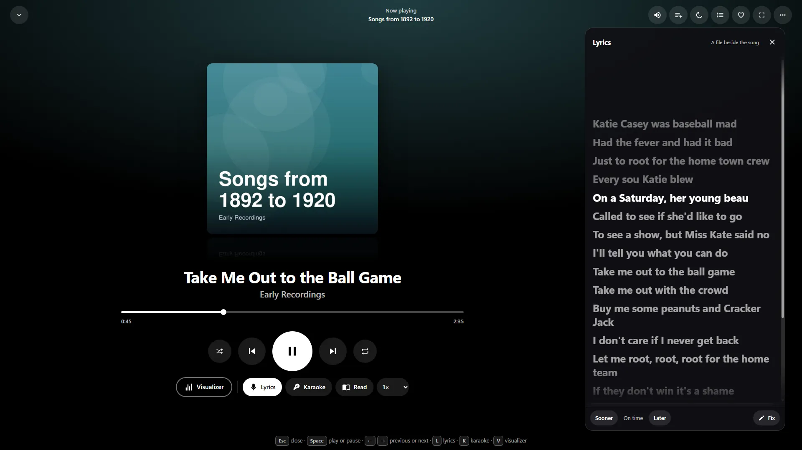
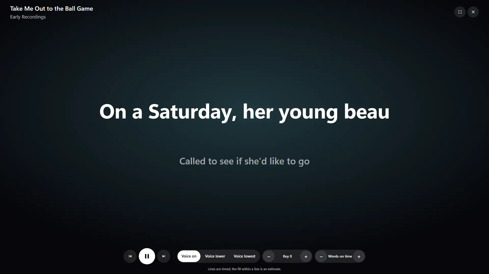

# Lyrics and karaoke

Use this guide to get words that follow your music, sing along in karaoke, add your own lyrics, and fix them when they're wrong. It also says exactly what goes online, and when.

Lyrics and karaoke are in the [full-screen player](MUSIC.md#the-full-screen-player), for songs in a **Music** library. Press **Lyrics** or **L**, or **Karaoke** or **K**. They're not offered for audiobooks, podcasts, radio or a disc in the CD player.

## How lyrics are found

The first of these that has words is used. The lyrics panel names where they came from.

1. **A correction made on this server.** Shown as *Corrected on this server*.
2. **A file beside the song.** `<song>.lrc`, then `<song>.txt`, with the same name as the song.
3. **The song's own tags.** ID3 `USLT` and `SYLT` frames in an MP3, and lyrics tags in other formats.
4. **Online,** only if the owner has turned it on.

The first three work with nothing sent anywhere.

## Finding lyrics online

Online lyrics are off until the owner agrees. There are two places to do that:

- **First-time setup:** tick **Find lyrics online, free and with no account**.
- **Settings → Metadata agents,** in **Lyrics and music information:** turn on **Find lyrics online**, then save. Only admins can see this page.

The free source is [LRCLIB](https://lrclib.net), an open database of timed lyrics. It needs no API key and no account.

### What's contacted, and when

Nothing is sent just because a song is playing. Your server asks only when someone opens **Lyrics**, **Karaoke** or **Read** on a song with none of its own.

| Source | What you need | What it's told |
|---|---|---|
| LRCLIB | Nothing. **Use LRCLIB's public service** is on once online lyrics are on | The song's artist, title, album and length |
| Your own LRCLIB server | Its address, under **Your own LRCLIB server** | The same, and it stays on your network |
| Musixmatch | Your own key, under **Musixmatch key**. Lyrics need one of its paid plans, and a free plan is refused | The song's artist, title and length, and your key |

- **Order:** your own server first, then Musixmatch, then the public LRCLIB. The first to have an answer is used.
- **Never sent:** a file name, a folder, or who's listening.
- **One at a time:** the server asks once per song and one song at a time, so skipping through an album doesn't flood a free service.
- **Devices:** your server does the asking, so your devices don't contact these sources.
- **Searching by hand:** when an admin uses **Other versions**, what they type goes to these sources too.

### Where answers are kept

Answers are kept in the server's cache folder, for that song, and aren't shared with anyone. The cache isn't part of a [backup](BACKUP.md). The words belong to their writers.

- A source that has nothing for a song isn't asked again for 14 days.
- A source that can't be reached is tried again the next time someone opens the lyrics.
- Turning online lyrics off stops new look-ups. Answers already kept are still shown until you press **Forget them** under **Lyrics kept from online**. Corrections are kept.

## Lyrics that follow the music

Timed lyrics show the line being sung in the middle of the panel. Press any line to go to it. If you scroll by hand, the view holds still for a few seconds. Lyrics without times read as plain text, and don't follow the music.


*"Take Me Out to the Ball Game", 1908, public domain.*

**Read,** beside **Lyrics**, shows the same words as plain text to read at your own pace.

**If the timing is slightly off:** press **Sooner** or **Later**. Each press moves the words a quarter of a second, up to two minutes either way, and **Reset** puts them back. This is for you alone, it stays with that song, and it follows your account.

### Music videos

A music video tied to a song ([Music videos](MUSIC.md#music-videos)) shows the song's lyrics: press **Lyrics** under the video. They're the same lyrics, kept once for the song, so what's found online or corrected for one is there for the other. Timed lines follow the video, starting from where the song starts in it, and **Sooner** and **Later** move them for that video alone. A video that isn't tied to a song shows a `.lrc` or `.txt` file beside it with its name, and nothing is looked up online for it.

## Karaoke

Karaoke is a big display for singing, made to read from across a room: the words fill in as they're sung, the next line waits below, and a three-second count comes before a line after a long break.


*Karaoke. "Take Me Out to the Ball Game", 1908, public domain.*

It needs timed lyrics. Without times it shows the words and says so. Use a timed `.lrc` file, or **Tap along**, below.

### What each control really does

**Voice lower and Voice lowest** turn the singer down. **This has limits.** It works by removing what's in the middle of the stereo mix, which is where most singers are.

- Echoes of the voice remain, and songs that spread the voice wide keep more of it.
- Anything else in the middle, often a snare or a solo, goes down with it. Bass is kept.
- A recording that's close to mono has nothing to separate, and the screen says so.
- It isn't a separate vocal track, and nothing is sent anywhere to make one.

**Key** moves the music up to six semitones either way, for the singer, without changing the speed. Long held notes can warble a little. A browser that can't do this says so.

**Words** moves the timing a tenth of a second at a time, the same setting as **Sooner** and **Later**.

**The fill across a line** is exact for lyrics with word timing. Otherwise it's estimated from the line's length, so a held note can get ahead of it, and the screen says which it's using.

Voice and key go back to normal when you leave karaoke, and don't carry over to the next time. Both need the sound to be routed through the browser's audio engine, so they don't work with a server on a different address from the page, and on iPhones and iPads they stop when the screen locks. This hasn't been run on a real iPhone or iPad yet.

### Stems: the real vocal track

Removing the middle of the mix is a guess. The real thing is a song split into its parts, or *stems*: the voice alone, and the music without it. Doing that well takes a neural network with a model of hundreds of megabytes and a fast processor or a graphics card, so the server doesn't include one. It serves stems you already have, made by a tool such as [Demucs](https://github.com/facebookresearch/demucs) or Spleeter, or bought as a Native Instruments `.stem.mp4`, and it can run such a tool for you if you install one: see [Making stems](#making-stems).

Put them beside the song, named after it. Any of these works, for a song called `01 Song.flac`:

| Where | Example |
|---|---|
| The song's name, a dot and the part | `01 Song.vocals.flac`, `01 Song.instrumental.m4a` |
| A folder named after the song | `01 Song.stems/vocals.wav`, `01 Song.stems/drums.wav` |
| A `stems` folder beside the album | `stems/01 Song/vocals.wav`, or `stems/01 Song.bass.mp3` |
| A Native Instruments file, every part in one | `01 Song.stem.mp4` |

The parts are `vocals`, `instrumental` (also called `accompaniment` or `no_vocals`, which is what Demucs writes with `--two-stems vocals`), `drums`, `bass` and `other`. They can be FLAC, WAV, M4A, MP3, Ogg, Opus, AAC or WebM. A link to somewhere outside your libraries is ignored.

With Demucs, for example, `demucs -n htdemucs "01 Song.flac"` writes `separated/htdemucs/01 Song/vocals.wav`, `drums.wav`, `bass.wav` and `other.wav`. Move that `01 Song` folder beside the song and rename it `01 Song.stems`.

An administrator can also upload a part for a song, which is kept in the server's own folder and never beside your music. Apps see what a song has in `GET /api/v1/media/{id}/stems`, and get the list with the playback answer when a song starts. See [the client API](CLIENT-API.md#media-extras).

The web app's karaoke screen doesn't play stems yet: it uses **Voice lower** and **Voice lowest**, above. Stems are there for the apps and for anything else that asks.

### Making stems

For a song that came without stems, the server can make them in two ways. Each is a [task](TASKS.md): it waits its turn (one at a time on the whole server, sixteen waiting at most), runs at low priority so playing isn't disturbed, shows in **Tasks**, and can be stopped there.

| | Your own separator | The approximate instrumental |
|---|---|---|
| **What it is** | A program you installed, such as Demucs or Spleeter | FFmpeg taking the right channel from the left |
| **Quality** | Real stems, as good as the tool | A guess. The voice is quieter, not gone; anything else in the middle goes with it; the result is mono |
| **Needs** | The program, and its name where the server starts | Only FFmpeg, and a stereo song |
| **Speed** | As fast as the tool: minutes a song is usual on a desktop, and these tools aren't for a Raspberry Pi | A few seconds a song on a desktop. Not yet timed on a Raspberry Pi |
| **Who can ask** | An administrator | Anyone who can play the song |
| **Listed as** | `source: "separated"` | `source: "approximate"`, `approximate: true` |

**Your own separator.** Tell the server what to run, where it starts, never in Settings: it names a program, and a web session must not be able to choose one. Use `{input}` for the song and `{output}` for an empty folder the parts go in:

```
WMS_STEM_SEPARATOR='demucs --two-stems vocals -o {output} {input}'
```

or `-stem-separator '…'`, or `"stemSeparator": "…"` in the [config file](CONFIG.md). The line is split into words (quotes keep spaces together) and run without a shell, so a song's name can never be read as a command. Then `POST /api/v1/media/{id}/stems/separate` starts it for one song. When it finishes, the server looks through the output folder, however deep the tool put its files, for audio named `vocals`, `no_vocals` or `accompaniment`, `drums`, `bass` and `other`, checks each really is audio, and keeps them in its own folder. One song may take 45 minutes at most. If the program fails, the task says what it printed.

**The approximate instrumental.** `POST /api/v1/media/{id}/stems/approximate` makes it, and it is kept (as AAC) so it's made once. It gives way to a real `instrumental` as soon as there is one. A mono song has no two channels to take from each other, and the task says so. Apps should tell people what it is: the listing carries a sentence for that in `separation.approximate.note`.

`GET /api/v1/media/{id}/stems` says under `separation` which of the two this server can do for a song, why not (`no-ffmpeg`, `not-configured`, `admin-only`, `not-a-song`, `not-a-file`), and the task when one is being made.

### Keys

| Key | What it does |
|---|---|
| Esc | Leave karaoke |
| Space | Play or pause |
| ← → | Previous or next line |
| V | Voice on, lower or lowest |
| − + | Lower or raise the key |
| `[` `]` | Words sooner or later |
| F | Fill the screen |

Up, Down or OK moves onto the controls for a remote.

## Adding your own lyrics

Put a file beside the song, with the same name, and it's used straight away:

```
Some Artist/An Album/01 First Song.mp3
Some Artist/An Album/01 First Song.lrc
```

A `.txt` file holds plain words. A `.lrc` file holds timed lines, with word timing if you want it:

```
[00:12.50]A line, with the time it starts
[00:16.00]<00:16.00> Each <00:16.40> word <00:16.90> timed
```

- `[00:12.00][00:45.50]Words` is one line sung twice.
- `[offset:500]` at the top moves everything half a second earlier.
- The file can be UTF-8, UTF-16 with a byte order mark, or Latin-1, up to 256 KB.

## If lyrics are missing or wrong

**If there are no words:**

1. Check the file beside the song has exactly the song's name, apart from its extension.
2. If online lyrics are on, check the song's artist and title tags are right. Online sources match on them, and on the length: a result more than a few seconds different is left out, because a live version or remix has the wrong timing.
3. If you're an admin, use **Fix**, below.

If you aren't an admin, ask whoever runs the server. Only admins can change lyrics for everyone.

**If the words or timing are wrong,** an admin can press **Fix** under the lyrics. Nothing is written beside your music.

| Tab | What it does |
|---|---|
| **Other versions** | Search online and choose another version. It shows **Timed** or **Words only**, and how close the length is. Only there when online lyrics are on |
| **Edit** | Paste or change the words, timed or not. **This song has no words** marks it as instrumental |
| **Tap along** | Time the words yourself. Press **Start**, and the song plays from the beginning. Press **This line starts now**, or Space, as each line starts. **Undo the last one** and **Start again** are there if you slip. It needs the words first, so add them under **Edit** |

**Start over,** under **Edit**, forgets the correction and any online answer, and goes back to what's found.

Corrections from **Edit** and **Tap along** are kept in the server's data folder, and apply for everyone. They're left out of a [backup](BACKUP.md) unless you choose **Lyrics corrections**, because they're the words of songs.

A choice from **Other versions** counts as an online answer, so it stays in the cache and **Forget them** clears it.

## For developers

The routes are under `/music/lyrics` in [Client API](CLIENT-API.md#every-route). `GET /music/lyrics/{id}` looks online only with `fetch=1`, and only if the owner has turned it on.

---

<sub>WittyMediaServer documentation</sub>
