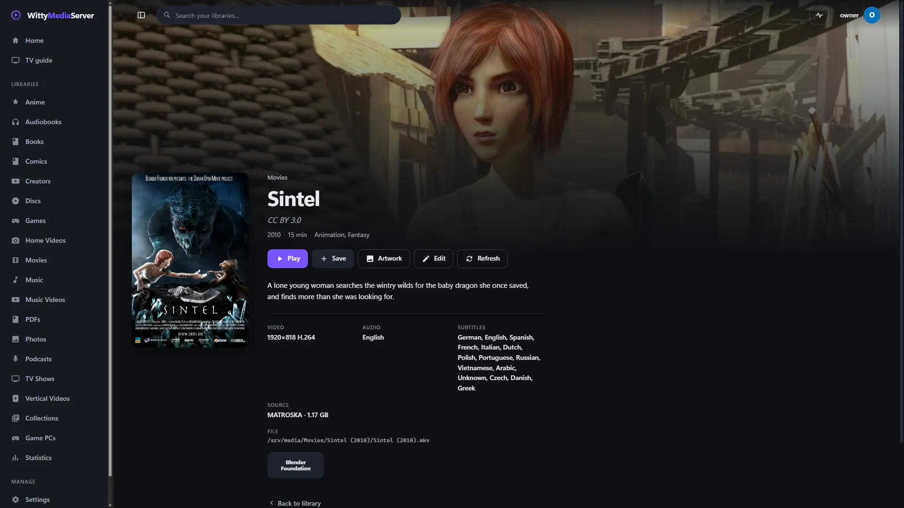

# Where details come from

Learn how the server finds titles, plots, posters and ratings for what's on it, what each source needs and what it's sent, and what the optional logos and streaming listings mean. Most of it works with no account or key.

Nearly all of this is set under **Settings → Metadata agents**. If something came out wrong, see [Fixing wrong details](FIXING-METADATA.md).

- [The order sources are used in](#the-order-sources-are-used-in)
- [API keys](#api-keys)
- [NFO files and artwork](#nfo-files-and-artwork)
- [What is saved next to your media](#what-is-saved-next-to-your-media)
- [Editing and fixing matches](#editing-and-fixing-matches)
- [Audio CDs](#audio-cds)
- [Custom agents](#custom-agents)
- [Categories, studios and browsing](#categories-studios-and-browsing)
- [Streaming listings](#streaming-listings)
- [The logo service](#the-logo-service)
- [Video games](#video-games)
- [Cast and crew](#cast-and-crew)
- [Lyrics and artist information](#lyrics-and-artist-information)
- [Coming from another media server](#coming-from-another-media-server)
- [For developers](#for-developers)

## The order sources are used in

Sources are used in this order, and later ones only fill gaps:

| # | Source | Example |
|---|---|---|
| 1 | `<file>.metadata.json` next to the file | `{"title":"My Film","year":2001,"overview":"…","genres":["Animation"],"poster":"https://…"}` |
| 2 | NFO file | `My Film (2001).nfo`, `movie.nfo`, `tvshow.nfo`, episode `<name>.nfo` |
| 3 | Local artwork | `poster.jpg`, `<name>-poster.jpg`, `folder.jpg`, `fanart.jpg`, `season01-poster.jpg`, `<episode>-thumb.jpg` |
| 4 | File and folder names | `My Film (2001).mkv`, `Show - S01E02 - Title.mkv`, `MY_FILM.ISO` (disc label) |
| 5 | Your [custom agents](#custom-agents), in their order | Anything your own service knows |
| 6 | TMDB and TheTVDB, if you added a key | Overview, genres, rating, network, posters, backdrops, episode titles |
| 7 | TVmaze, for TV, until you add a TheTVDB key | Overview, genres, network, status, posters, backdrops, season posters, episode titles and stills |
| 8 | Wikidata and Wikipedia, for films, until you add a TMDB key | Year, genres, US rating, runtime, plot summary, and a poster from Wikimedia Commons where the film has a free one (credited under Settings → Legal) |
| 9 | AniList, for Anime libraries | Titles in your chosen language, plots, posters, episode numbering |
| 10 | A generated thumbnail | A frame 20% into the video |

Audio CDs and games have orders of their own: see [Audio CDs](#audio-cds) and [Video games](#video-games).

An [id in a file or folder's name](FIXING-METADATA.md#naming-rules) wins over any search, and a match you chose or a field you locked is never changed by any of these.

**Content ratings.** TVmaze and Wikidata don't always have a content rating, which Kids and Guest profiles rely on. Set one under **Edit** on any film or show. A show's rating covers its episodes.

## API keys

TV shows and films get information without any account or key. Adding a key later upgrades titles the next time they're scanned or refreshed.

| Source | Needs | Good for | Licence |
|---|---|---|---|
| **TVmaze** | Nothing | TV shows | Data shared under CC BY-SA 4.0 |
| **Wikidata and Wikipedia** | Nothing | Films and games: facts, ratings, plot summaries | Wikidata is public domain, Wikipedia text is CC BY-SA 4.0 |
| **AniList** | Nothing. Always on for Anime libraries, which send it anime titles | Anime | |
| **MusicBrainz, Cover Art Archive** | Nothing | [Audio CDs](#audio-cds) | Album data is CC0 |
| **Radio Browser** | Nothing | [Internet radio](COLLECTIONS.md#internet-radio) | |
| **TMDB** | A free key from [themoviedb.org](https://www.themoviedb.org/settings/api) | Posters, plots and ratings for films and TV | This product uses the TMDB API but is not endorsed or certified by TMDB |
| **TheTVDB** | A key from [thetvdb.com](https://thetvdb.com/api-information), and a PIN if your key has one | Detailed episode information | |

To add a key:

1. Open **Settings → Metadata agents**, under **Built-in agents**.
2. Paste the key, and press **Test** to check it with the service.
3. Press **Save**.

Saved keys are hidden, so paste a key again to test it. TVmaze and Wikidata can be turned off there, and title pages credit their source.

## NFO files and artwork

The server reads and writes the standard NFO and artwork layout most other media software uses, so you can move a library in or out without re-tagging anything.


*Everything here came from files beside the film. [Sintel](https://durian.blender.org/), Blender Foundation, [CC BY 3.0](https://creativecommons.org/licenses/by/3.0/).*

An NFO can be up to 1 MB and a `.metadata.json` up to 256 KB. Anything read from beside your media, yours or anyone else's, is cleaned to plain text: no HTML, scripts or hidden characters, and pictures only as web addresses or files in that folder. A file that can't be read is left out, with a warning under **Settings → WittyLog** naming the file and the line.

More on what's safe to change, and how it's checked, is in [Files beside your media](METADATA-FOLDER.md#files-beside-your-media).

## What is saved next to your media

Your metadata is always in the server's database, and comes along in a [backup](BACKUP.md).

With **Save information and artwork next to your media** on, which is the default, the server also writes these:

| Media | Written |
|---|---|
| Film or disc image in its own folder | `<name>.nfo`, `poster.jpg`, `fanart.jpg` |
| Films sharing a folder, such as a folder of ISOs | `<name>.nfo`, `<name>-poster.jpg`, `<name>-fanart.jpg` |
| `VIDEO_TS` folder | `movie.nfo`, `poster.jpg`, `fanart.jpg` inside the film's folder |
| TV show | `tvshow.nfo`, `poster.jpg`, `fanart.jpg`, `season01-poster.jpg` and so on, in the show's folder |
| Episode | `<name>.nfo`, `<name>-thumb.jpg` |
| Game | `<name>.nfo`, `<name>-poster.jpg`, `<name>-fanart.jpg` beside the game |

Artwork saved this way is always a real picture from the internet, the image cache or your own disk. A file beside your media or a feed can't make the server copy another kind of file here, or fetch something from your local network.

Scans only write for titles that have no NFO yet. Your own NFOs are never touched by a scan. If you edit a title whose NFO you wrote by hand, the original is kept as `<name>.nfo.bak`. Mount media read-only and turn the option off if you'd prefer the server not to write there.

## Editing and fixing matches

[Fixing wrong details](FIXING-METADATA.md) covers all of this: the **Edit** dialog, choosing a match, locks, **Fix matches**, renumbering episodes and naming rules. [The metadata folder](METADATA-FOLDER.md) does the same with plain text files.

## Audio CDs

CD images have their own order: the file beside the image (`<name>.wittycd.json`, saved earlier), then CD-TEXT and the cue sheet, then folder and file names, then **MusicBrainz**, which fills in album and track names and a cover from the **Cover Art Archive** when it has one clear answer. Pictures beside the image always win.

**What is sent.** To look a disc up, the server sends MusicBrainz the disc's ID and its table of contents, which is the track count and each track's start. It says nothing about what the music is, what your files are called or who you are. Covers are fetched by the server, so nothing else learns your address. The lookup happens once for each new disc, at most one request a second, and **Use MusicBrainz** under **Settings → Metadata agents** turns it off.

**Several matches.** Pressings of one album share an answer, so any will do. If the matches disagree, or only the track lengths are close, nothing is guessed. The disc keeps its own names, and an administrator sees **Choose from N matches** on the CD player page, where you can pick the right one, change it later, or go back to the disc's own names.

**Saved beside your files?** Only with saving on: a `<name>.wittycd.json` with the names and release, and a `<name>-poster.jpg`. With it off, the names stay in the server's database.

Album data comes from [MusicBrainz](https://musicbrainz.org) (CC0), and covers from the [Cover Art Archive](https://coverartarchive.org). Cover pictures belong to their owners. Both are credited on the player page.

## Custom agents

A custom agent is a web service of your own that the server asks about titles the built-in agents don't know: a family archive, a club's catalogue, a script you wrote.

1. Open **Settings → Metadata agents**, under **Custom agents**, and press **Add agent**.
2. Fill in the fields below.
3. Under **Try it**, type a title and press **Look up**. That changes nothing.
4. Press **Add agent** to save it.

| Field | What it is |
|---|---|
| **Name** | What to call it |
| **Address** | A web address with `{title}` in it, and `{year}` and `{type}` (`movie`, `video` or `book`) if you want them. For example, `https://archive.local/lookup?title={title}&year={year}` |
| **API key header** | Optional, sent with every request. For example, `Authorization: Bearer abc123`. It's kept on the server |
| **Use it for** | Movies, DVDs & Blu-rays, Home videos and Books |

Agents run in the order listed, before TMDB, TheTVDB, TVmaze and Wikidata, and only fill in what's still empty. Information inside your files, NFO files and your own edits always win. They're also searched in **Search and match**, where an agent's answer can be chosen like any other.

The agent answers with JSON: one object, a list, or `{"results": [...]}`. The first entry is used, and every field is optional:

```json
{
  "id": "lx-2012",
  "title": "My Film",
  "year": 2012,
  "overview": "A lighthouse keeper finds a boat.",
  "tagline": "Some things come back.",
  "genres": ["Drama", "Mystery"],
  "rating": 6.4,
  "contentRating": "PG",
  "studio": "Lantern Works",
  "runtimeMinutes": 86,
  "poster": "https://archive.local/art/my-film.jpg",
  "backdrop": "https://archive.local/art/my-film-wide.jpg"
}
```

Answer `404` when you don't know a title. Pictures are downloaded when the title is scanned. A picture on the agent's own server is fetched like the agent, so it may be on your network. Any other picture is fetched from the internet only. Only real pictures (JPEG, PNG, WebP, GIF) are kept.

## Categories, studios and browsing

A film or TV library opens on **shelves**: categories, collections, studios, networks, recently added, highest rated, and a row for each category. Choosing a sort, a filter or a card turns it into a grid. The address holds the whole state, so any view can be bookmarked.

**Categories** are made from genres, one library at a time, with the art of what's in them. Different spellings of a genre are put together (*Sci-Fi* and *Science Fiction*), and combined ones are split (*Action & Adventure*). **Categories** on the page lets an administrator rename, hide, reorder and merge them. Only the changes are kept, so new genres appear by themselves, and **Start again** forgets them.

**Collections from film series** appear by themselves. When a source says a film is part of a series, and two or more films in a library share it, they show as a card under **Collections**. The **Collection** field in the Edit dialog changes or clears it. For lists you make yourself, see [Collections](COLLECTIONS.md#collections-and-smart-playlists).

**Studios and networks** come from metadata, every studio a source names. A card opens everything from that studio, across libraries. Kids and Guest profiles see neither the titles they can't watch, nor a studio or category only those titles are in.

**Filters** let you browse by almost anything: type, category, studio, network, collection, decade, year, age rating, score, picture size (4K, 1080p, 720p, SD), sound (such as `AC3 5.1`), audio and subtitle language, edition, tags, whether it's been watched, words in the title, and streaming listings if they're on. **Save this view** keeps a view for your account, and can pin it to Home.

## Streaming listings

This shows which of the titles **already on your server** a streaming service currently lists, for someone used to finding things that way. It's optional, and off until an administrator accepts each statement of what it means.

**Nothing plays from those services, no account with them is used, and there's no connection with any of them.** Every screen that shows a listing says so, and dates it.

To turn it on:

1. Add a free TMDB key, as in [API keys](#api-keys), and save.
2. Open **Settings → Metadata agents**, under **Streaming listings**.
3. Read each of the four statements, and tick it. They say that nothing streams from these services, that this project has no connection with them, that listings can be wrong or out of date, and that your server will send TMDB your titles.
4. Choose your **Region**, and press **Turn on listings**.

Titles then show **Also listed on** on their page, and a shelf and filter appear on the library page.

| | |
|---|---|
| **Source** | TMDB's watch providers, which come from [JustWatch](https://www.justwatch.com). TMDB's terms require JustWatch to be credited, which every screen does, and don't allow commercial use |
| **Needs** | Your own free TMDB key. Without one it stays off |
| **Sent** | The TMDB id of each title in your film and TV libraries, or its name and year to find that id, about once every two weeks. No files and nothing about you. A title that can't be found with near certainty isn't listed |
| **What counts** | Included with a subscription, free, or free with adverts. Rentals and purchases aren't counted |
| **Region** | Your choice, as listings differ by country. Changing it looks them up for that country |
| **Kept up to date** | A title you match, rematch or unmatch is looked at again straight away. **Check now** looks at everything again |
| **Names and logos** | Plain text, unless you've agreed to logos too |

Turning it off forgets everything it fetched.

### Where to watch

Apps can also ask where one title can be watched: `GET /api/v1/media/{id}/where-to-watch` for a title on the server, and `GET /api/v1/discover/where-to-watch?tmdb=603&type=movie` for any title on TMDB. The answer puts what's here (in which quality, and every version) next to the services that offer it in your region, grouped as included with a subscription, free, free with adverts, to rent and to buy, each with its logo and a link to TMDB's page of offers.

| | |
|---|---|
| **Source** | The same TMDB watch providers as the listings, credited to JustWatch on every answer (`attribution`) |
| **Needs** | Your own free TMDB key. Without one, the answer still says whether the title is here, with no services and `reason: "no-api-key"` |
| **Sent** | Only the TMDB id of the title asked about, and the region. Nothing about you |
| **Region** | The listings region, or `US`. An app can ask for another with `region` |
| **Kept** | As long as listings (two weeks). **Check now** under listings, or turning listings off, forgets them |
| **Who sees what** | Someone who can't see a title isn't told it's on the server |

**In the web app,** a film's or a show's page has a **Where to watch** section:

- **In your library** gives the quality of your copy, and lists every version when there are several, each a link to that version.
- With a TMDB key, the services follow, under **Stream**, **Free**, **Free with adverts**, **Rent** and **Buy**. Each one links to TMDB's page of offers, and the note under them says nothing plays from these services, names the country and the date, and carries the credit. **Country** looks at another country's offers for this one title; it doesn't change the server's region.
- Without a key, nothing about services is shown. An administrator sees one line saying where the key goes; other profiles see the section only for a title with several versions.

The services' logos are the ones TMDB sends, so the browser fetches those small pictures from TMDB's image server, without saying which page they are for.

Other sources can be added beside TMDB later without changing what apps get. See [the client API](CLIENT-API.md#media-extras).

## The logo service

This gives you logos for studios, networks, consoles, game studios and streaming services, in every part of the app. **Nothing is bundled, and nothing is downloaded until an administrator agrees.** Until then, and for anything with no logo, the app shows the name in plain text, and that's a finished look rather than a gap.

### Agreeing to logos

Open **Settings → Metadata agents**, and find **Logos**. Everywhere a logo can be set, it explains this and links here until you've answered. Press **I understand: download logos**, or **No thanks: use plain names**. Here's what you're agreeing to:

- Logos aren't part of this software. They're downloaded to your server, one at a time, from [Wikimedia Commons](https://commons.wikimedia.org/wiki/Commons:Licensing).
- Your server tells Wikidata and Wikimedia Commons the name of each studio, network, TV channel or console it finds, and nothing else.
- Only files whose own page says they're free to reuse are taken.
- Logos are still trademarks of their owners. They're shown only to name who made something, for your own use on your own server. If you share your server, that's for you to judge.

Afterwards, **Download logos** turns it off, **Remove them** also deletes the pictures, and **Show the list** gives where each came from. Everyone signed in can see the same list under **Legal**, along with any channel wearing a picture from its channel list or its owner, which has no licence to state. Logos you uploaded stay. Uploading your own works without agreeing, since nothing is downloaded.

### Where logos come from, and the terms

| | |
|---|---|
| **Source** | [Wikidata](https://www.wikidata.org) says which file is a company's logo. The data is CC0. The file itself is on Wikimedia Commons, where each file's page states its licence |
| **What's taken** | Only public domain files and free licences that allow changes and commercial use (`CC0`, `CC BY`, `CC BY-SA`). Anything marked non-free, non-commercial or no-derivatives is skipped |
| **Credit** | Source, licence and author are kept with each logo and listed under **Show the list**, which is what those licences ask for. The white and dark versions are recoloured, and the list says so |
| **Sent** | The name, and nothing else, at about one request a second |
| **TMDB's logos** | Not used. TMDB's API terms don't allow derivatives, and logos have to be recoloured to read on any background |

A logo is used without asking only if the name on Wikidata, or one of its other names, is the name in your library or, for a tuner or playlist channel, [its name with the quality and country taken off](CHANNELS.md#logos-and-title-art). Anything close but not exact is only offered under **Change**, where a person chooses. See [Logos](FIXING-METADATA.md#logos).

### What happens to a picture

It's read, limited to 8 MB and 25 megapixels, and written again from its pixels as a plain PNG, so nothing but pixels gets through: no SVG, scripts or metadata. Then two more versions are made, all white and all dark. If a logo has two clear tones, the larger tone is painted and the smaller is cut out, so the letters stay readable. A picture whose background can't be taken off stays as it is, and gets a plate of its own.

Pictures are kept in the image cache and served only by this server, so no browser or app contacts the source.

## Video games

Games get their details from their own set of sources, in the background, so a scan of thousands of games never waits on the internet. It works out of the box, and a free key adds more.

### Game sources

Choose which are on, and which is believed first, under **Settings → Metadata agents**, in **Video games**. Keys are added there too. The first source with a value for something wins, except for scores, age ratings and pictures, which are collected from all of them.

| Source | Needs | Good for | Sends |
|---|---|---|---|
| **libretro database** | Nothing | Recognising your exact files by checksum, dates, makers, genres, players, some age ratings and scores | Nothing about your games: a list for each console you have is downloaded once, checked monthly, and matched here |
| **libretro thumbnails** | Nothing | Box art, title screens, in-game pictures | Game names, as the database lists them |
| **Wikidata and Wikipedia** | Nothing | Summaries, makers, some review scores and age ratings | Which console, and the names of games it matches |
| **IGDB** | A free Twitch application's id and secret | The fullest source: covers, art, critic and user scores, every age rating board | Game and console names |
| **ScreenScraper** | A free account, and a developer id if your copy has none built in | Recognising files by checksum, with art, scores and age ratings | Names, console, checksums and sizes |
| **RAWG** | A free key | Metacritic and user scores, wide backdrops | Game and console names |
| **TheGamesDB** | A free key | Box art and fan art, some checksums | Names, console and checksums |

Each source's row under **Settings → Metadata agents** gives its licence and limits.

**Files never leave your server.** Only names, checksums and sizes are looked up, as the table says. Turning a source off stops it being asked. Pictures are fetched by the server and kept in its image cache, so a browser or an app never talks to a source.

### How a game is matched

1. **By checksum.** Archives record their files' checksums, so only the headers are read and nothing is unpacked. A cartridge file up to 128 MB is read once, with and without a copier's header. Nothing is read twice unless the file changes.
2. **By code.** A disc's product code is read from a few sectors near its start, or from its file name. A cartridge's code, and the title in its header, count only when the file's name agrees, because a fan's hack of a game keeps both.
3. **By name and console.** Region and dump tags are taken off and kept as details. Punctuation, articles and II or 2 don't matter, but different numbers always do. A name must be at least 85% alike to be used without asking, and only an exact name or a checksum renames a game. A close match gets its details, but keeps the name on its file.
4. **By another version in its archive.** In a set, what's asked about first is the file that would be played. If neither that nor the name is known, a checksum of another version in the archive still gives the game's details and art.

A file saved here earlier is only an old answer, which a better one replaces. An NFO a person wrote is theirs, and stays. A game from a gaming PC has no file to read, so it goes by name alone.

### Fixing a game

Every game's page shows administrators how it was matched and how sure that is, with **Fix match** (search every source and pick), **Lock** (leave it alone from now on) and **Look up again**. **It has no match**, in **Fix match**, clears what sources filled in.

### Keeping requests down

The queue is in the database, so a restart carries on where it stopped. Games are worked on in batches of 50, one console at a time. Each source's answer is kept, so changing the order of sources asks nobody anything, and adding one only asks that one, for what it can add.

| Source | How it's asked |
|---|---|
| libretro database | One download a console, then no requests at all |
| Wikidata | One request a second at most, in large batches. Backs off when it says it's busy |
| libretro thumbnails | Only covers and one in-game picture are fetched up front, and others when someone looks |
| IGDB | About three requests a second |
| ScreenScraper | One every 1.2 seconds, up to 18,000 a day |
| RAWG | Up to 18,000 a month. Only for games still missing something |
| TheGamesDB | One a second, for games still missing something, stopping when its monthly allowance runs low |

### Age ratings and Kids profiles

ESRB, PEGI, CERO, USK, ACB, GRAC, ClassInd and ELSPA ratings all become a minimum age. The strictest one a game has is its content rating, written like `ESRB T`, and that's what Kids and Guest profiles go by, as for a film. A game above a profile's limit doesn't appear at all, and can't be opened or played. A game with no rating counts as unrated, so it's hidden from profiles that don't allow unrated titles: set one with **Edit** on its page. Ratings a source marks as still pending count as no rating.

### What's kept, and what's saved beside your games

Answers go in the server's database and pictures in its image cache. With saving on, a game gets `<name>.nfo`, `<name>-poster.jpg` and `<name>-fanart.jpg` beside it, and a scan reads them back. With it off, nothing is ever written next to your games. Your own files always win: a picture or NFO beside a game, and anything typed under **Edit**, stays as it is.

## Cast and crew

Every film, show and episode can list who is in it and who made it: the cast
with the part each played, guest stars on episodes, and the crew by
department (Directing, Writing, Production, Camera, Lighting, Editing,
Sound, Art with production design, art direction and set decoration,
Costume & Make-Up, Visual Effects, and the rest of the crew). Each person has
a page of their own with their picture, dates, birthplace and biography, and
every title of theirs in this library. Search finds people by name, and a
library can be filtered to one person's titles (`person=` on `GET /browse`,
and in saved views).

**Where the names come from.** Each source's list is kept on its own, and a
page takes each part (the cast, the guest stars, each department) from the
best source that has that part, in this order:

| # | Source | What it gives |
|---|---|---|
| 1 | The NFO beside the file (`movie.nfo`, `<name>.nfo`, `tvshow.nfo`, an episode's `.nfo`) | `<actor>` with `<name>`, `<role>`, `<order>`, `<thumb>` and the person's `<tmdbid>`/`<imdbid>`; `<director>`, `<credits>` (writers), `<producer>`, and the other crew tags media servers write; an episode's `<actor>` are its guest stars |
| 2 | TMDB (with a key) | A film's whole cast and crew; a show's cast and crew and each episode's guest stars and crew; each person's picture, dates, birthplace and biography |
| 3 | TheTVDB (with the owner's key) | A show's people by type: actors, guest stars on their episodes, directors, writers, producers, creators |
| 4 | TVmaze | A show's cast and crew |
| 5 | The file's own tags | A video's `DIRECTOR`, `WRITTEN_BY`, `PRODUCER`, `COMPOSER`, `ACTOR` tags (Matroska) and the like |

So an NFO that names the actors but not the crew gets its cast from the NFO
and its crew from TMDB. Reading a source again replaces only what that source
said. **Refresh metadata** reads them all again; a new or changed file is
read when it is scanned; titles matched before credits existed get theirs by
themselves after the next scan, a few at a time.

**One person, many titles.** People are kept once: by their number at TMDB,
IMDb, TheTVDB or TVmaze when a source gives one, else by their name (ignoring
case, accents and punctuation). Two people with the same name but different
numbers at a source stay two people. Someone no title names any more is
forgotten at the end of a scan.

**Pictures.** A person's picture is a picture beside the media in an
`.actors` folder, as media centres keep them (`.actors/Ana_Lima.jpg`), the NFO's `<thumb>`, or
TMDB's. It is fetched once into the image cache and made smaller for each
size asked for, as posters are (`GET /api/v1/people/{id}/photo?w=`). A
picture of the owner's own beside the media is kept over one from the web.

**Biographies** come from TMDB, for people TMDB knows, when their page is
first opened and then at most once a month; a paced background pass after a
scan fills in the most credited people first. Nothing is asked for a person
without a TMDB number, and nothing at all without a key.

**What a profile sees.** Credits are read only for a title the profile may
see. A person's page lists only their titles the profile may see; someone
credited only on titles it may not see has no page and isn't found by
search, so nothing about a hidden title shows through its people.

**Saving beside the media.** With **Save information beside the media** on,
the NFO the server writes holds the cast (`<actor>` with name, role, order,
thumb and the TMDB number) and the crew (`<director>`, `<credits>`,
`<producer>` and the others), so another media server reads the same names.
It is never written while the setting is off.

For apps: [People](CLIENT-API.md#people) and the `Credits` component
([SDUI.md](SDUI.md#cast-and-crew)).

## Lyrics and artist information

Music can also find lyrics, and artists' biographies and photos, online. Both are off until the owner turns them on, under **Settings → Metadata agents**. What's sent to whom is set out there and in [Lyrics and karaoke](LYRICS-KARAOKE.md).

## Coming from another media server

- **Software that uses NFO files:** point a library at the same folders. Existing NFOs and artwork are read as they are, including TMDB and TheTVDB ids, so matches are exact.
- **Servers that keep metadata in their own database:** local artwork (`poster.jpg`, `fanart.jpg`) is still read, and titles match by the usual naming (`Movie (Year)`, `Show/Season 01/Show S01E01`). After a scan with saving on, your folders gain NFOs that other NFO-based tools can read too.

## For developers

### Using logos in the web app

```tsx
import BrandLogo from '../components/BrandLogo'

<BrandLogo kind="network" name={show.network} />            // follows the theme
<BrandLogo kind="studio" name={it.studio} on="dark" />       // on a plate that's always dark, such as over artwork
```

It renders the logo, or the name in text, on its own. Lookups in the same moment go as one request. On a screen showing logos, also show `<LegalNote kind="logos" />` once. `useLogo(kind, name)` and `lookupLogo(kind, name)` give the details, and `forgetLogos()` drops what's been remembered after a change.

Kinds: `studio`, `network`, `console`, `gamestudio`, `platform`.

`GET /api/games/consoles` gives each console a `logoName`, the name it goes by on Wikidata. On a games screen, use the marks made for this, which are the same size whichever way a console appears. With no logo they're a short typed label:

```tsx
import { ConsoleMark, StudioMark } from '../components/ConsoleMark'

<ConsoleMark console={c} />                     // sizes: sm, md, lg
<StudioMark name={it.studio} on="dark" />
```

### Using logos from the server

When you find a new console or game studio, call `Store.EnsureLogo(ctx, kind, name)`. It only adds a row. `Logos.Kick()` starts looking, and does nothing without the owner's agreement. The studios of films and networks of shows are added by scans already, and so are the consoles of a games library and the studios of its games.

### Logo routes

| Route | Who | What it does |
|---|---|---|
| `GET /api/logos/status` | Signed in | `consent` (`yes`, `no` or empty), `source`, `sourceUrl`, and for an administrator `counts` (`pending`, `found`, `none`, `text`) |
| `PUT /api/logos/consent` `{accepted, removeDownloaded}` | Admin | Records the answer. Agreeing starts the downloads. Declining stops them, and removes what was downloaded if asked. Uploaded logos stay |
| `POST /api/logos/lookup` `{logos: [{kind, name}]}` | Signed in | Up to 200 names at once. Answers each with `id`, `kind`, `name`, `status`, `has`, `version`, `opaque`, `source`, `sourceUrl`, `license`, `licenseUrl`, `credit`. An admin's lookup adds names nobody has asked about, and anyone else's only reads, because a looked-up name goes to the internet |
| `GET /api/logos/{id}/image?variant=white&v={version}` | Signed in | The PNG, or 404. `variant` is `white`, `dark` or `original` |
| `GET /api/logos/credits` | Signed in | Every logo with its source, licence and author. An account with limits gets the studios and networks of what it may see |
| `GET /api/logos/{id}/candidates?q=` | Admin | What the source offers, to choose from. 409 without the owner's agreement |
| `GET /api/logos/preview?src=` | Admin | A candidate's picture, through this server. Only Wikimedia addresses, and 409 until downloads are agreed to |
| `PUT /api/logos/{id}` `{sourceId, q}` or `{status}` | Admin | Use a candidate, or with `status` `text` the name alone, or with `pending` look again |
| `PUT /api/logos/{id}/upload` (the picture as the body) | Admin | Use your own. PNG, JPEG, WebP or GIF, up to 8 MB |
| `GET /api/brands?library=&kind=studio` | Signed in | The studios or networks (`kind=network`) of a library, most titles first, counting only what this viewer may see |

`status` is `pending` (not looked for yet), `found`, `none` (no source has one) or `text` (someone chose the name alone).

### The ScreenScraper developer id

ScreenScraper's terms identify each program by a developer id, which isn't in this repository. Without one the source says so and asks for one in Settings, and other sources aren't affected.

`scripts/build-release.sh` builds one in when `SCREENSCRAPER_DEV_ID` and `SCREENSCRAPER_DEV_PASSWORD` are set, and the release workflow sets those from secrets of the same names. The Docker image isn't built with them, because build arguments stay readable in an image.

---

<sub>WittyMediaServer documentation</sub>
