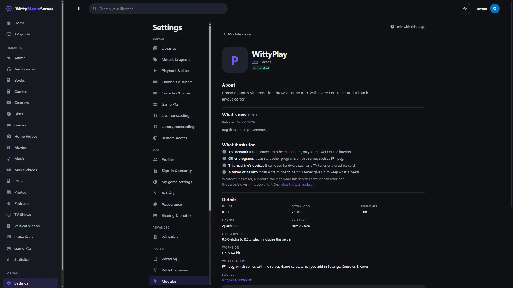
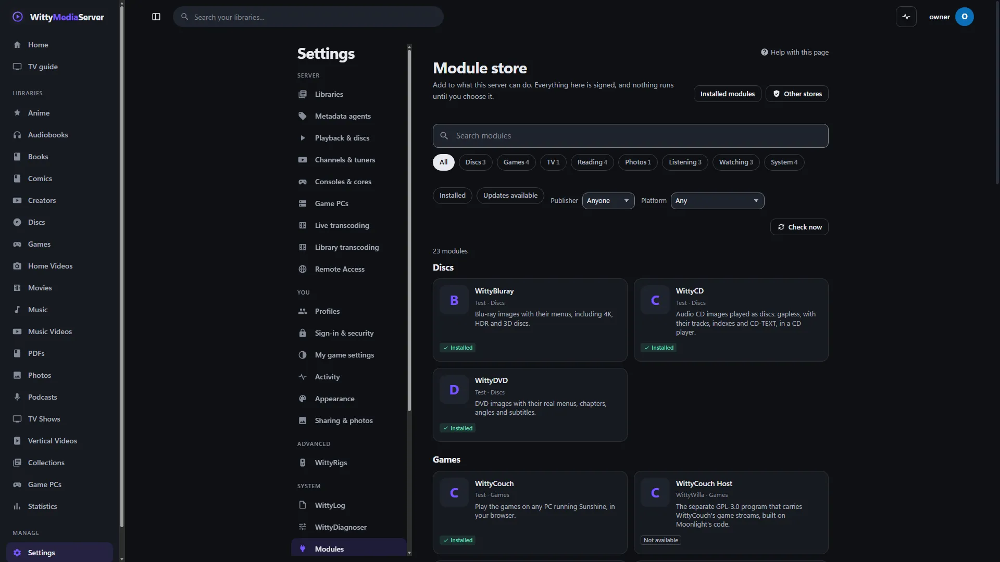

# Modules and the store

Modules are the parts of WittyMediaServer you can add and take away. This guide helps you choose them, keep them up to date, fix them when they fail, and decide how far to trust them.

- [What a module is](#what-a-module-is)
- [Every module and what it adds](#every-module-and-what-it-adds)
- [Finding and adding a module](#finding-and-adding-a-module)
- [Turning off and removing](#turning-off-and-removing)
- [Updating](#updating)
- [Automatic updates](#automatic-updates)
- [Choosing a version, pinning and going back](#choosing-a-version-pinning-and-going-back)
- [When something goes wrong](#when-something-goes-wrong)
- [What limits a module](#what-limits-a-module)
- [Other stores](#other-stores)
- [Using someone's fork](#using-someones-fork)

## What a module is

A module adds something your server can do, such as playing DVD menus or streaming console games. Most are projects of their own, with their own versions, and they arrive as signed downloads while the server keeps running. You never need to restart for one.

The server starts and works with very few of them, so you only add what you want. Taking a module away leaves your media, watch history and settings as they are.

Only administrators can add, update or remove modules. The pages are **Settings → Modules** for what's on this server, and **Browse the store** on that page for everything that can be added.

**Modules work with 0.6.0-alpha and later, and nothing older.** A module built for an older server can't run, and those older versions won't be fixed or updated. A later server may keep running a module built for 0.6.0-alpha or after, if the module says it fits. That's a courtesy and nothing is promised until the beta, so a module can stop fitting at a new server. When that happens, the page says so.

## Every module and what it adds

"Without it" says what you lose. Whatever is missing, the rest of the server carries on, and a page that needs a missing module says so. If you're an administrator, it offers an **Add** button.

### Parts of the server

These are in the store so that someone who only wants music can leave films out. They update with the server, and removing one doesn't free any disk space.

| Module | What it adds | Without it |
|---|---|---|
| **WittyVideo** | Films, TV shows, anime and home videos, with posters, plots and continue watching | You can't make libraries of those kinds |
| **WittyChannels** | Creator videos, music videos and concerts, grouped by who made them | You can't make those libraries |
| **WittyShorts** | Vertical videos in a feed you swipe through | You can't make a shorts library |
| **WittyAudio** | Music, audiobooks that remember your place, and internet radio | You can't make those libraries, except music if WittyCD is here |
| **WittyPodcasts** | Podcasts you follow, downloaded for you | You can't make a podcast library |

### Discs

| Module | What it adds | Without it |
|---|---|---|
| **WittyDVD** | DVD images and VIDEO_TS folders with their real menus, chapters, angles and subtitles | A DVD stays listed and waits. It can't be played, and the next scan after you add the module fills in its details |
| **WittyBluray** | Blu-ray images and BDMV folders with their menus, including 4K and HDR discs | The same, for Blu-rays |
| **WittyCD** | Audio CD images played as one gapless disc, with their tracks and CD-TEXT, in a CD player | CD images can't be read. Other music is unaffected |
| **WittyDisc** | Reads disc images without mounting them | Nothing to decide: it comes inside WittyDVD and WittyBluray |

A discs library needs any one of WittyDVD, WittyBluray or WittyCD. Encrypted discs are refused with a clear message whichever you have. WittyBluray has been tested on custom-authored discs, so retail discs may show problems not seen yet, and discs with Java menus need a Java you install yourself: see [Blu-rays](BLURAY.md).

### Reading

| Module | What it adds | Without it |
|---|---|---|
| **WittyEbook** | EPUB books with book view, typography and study tools | EPUB books don't open |
| **WittyPDF** | PDFs with selectable text, zoom, outline, thumbnails and search | PDFs don't open |
| **WittyComics** | Comics and manga: pages, spreads, vertical strips, either reading direction | Comics don't open |
| **WittyInk** | Highlights, notes, definitions, citations and handwriting, for all three readers | It comes with whichever reader you add, and stays |

A books library needs any one of the three readers. A book opens only if the reader for its format is here.

### Photos

| Module | What it adds | Without it |
|---|---|---|
| **WittyPhotos** | Reads when a photo was taken, with what camera and where, its size, and the preview inside a RAW file | You can't make a photo library. If its version stops working, a scan carries on, and photos have only what their files say on the outside |

### Live TV

| Module | What it adds | Without it |
|---|---|---|
| **WittyTuner** | Live TV and recording from network tuners, IPTV playlists, capture cards and more. Encrypted channels are refused | Tuners and IPTV aren't available. Channels you build from your own libraries are part of the server, and they keep working |

IPTV has been tested with local streams and network tuners only against stand-ins. SAT>IP, DVB and capture cards haven't been tried on real hardware. See [Channels and live TV](CHANNELS.md).

### Games

| Module | What it adds | Without it |
|---|---|---|
| **WittyPlay** | Console games streamed to a browser or an app, with every controller and a touch layout editor. Bring your own games, and add cores in **Settings → Consoles & cores** | You can't make a games library, and one you already have is left as it is |
| **WittyCouch** | Plays the games on any PC running Sunshine, in your browser. WittyCouch Host comes with it | No game PCs on this server |
| **WittyCouch Host** | A separate GPL-3.0 program that carries WittyCouch's game streams | WittyCouch can find and pair with PCs, but can't play in the page |
| **WittyRigs** | An advanced option, off until you turn it on: hosts demanding PC games on your server's own hardware, using a Sunshine you install yourself | Nothing most servers need. It's built on WittyCouch, which comes with it |

WittyCouch Host has no build for FreeBSD, so WittyCouch and WittyRigs say so there in place of **Add**. Real games on real gaming PCs haven't been tried yet. See [Games](GAMES.md) and [Game PCs](GAME-RIGS.md).

### Listening and system

| Module | What it adds | Without it |
|---|---|---|
| **WittyVisualizer** | Light shows that follow the music, full screen. Off until each person turns it on, after a notice about flashing | The audio player has no light shows |
| **WittyStats** | A statistics screen you arrange yourself, with charts, tables and exports | No such screen. The server still collects its numbers, and apps can still read them |
| **WittyIntegratedFileBrowser** | Lets a phone, a TV or a laptop pick the server's folders. It only reads | You type a folder's path by hand |
| **WittyModule** | The tool people use to make modules | Nothing to decide: it comes inside the modules built with it |

## Finding and adding a module

*A module's page in the store.*

*The module store, from a local test catalogue.*
1. Open **Settings → Modules**, and press **Browse the store**.
2. Type in the search box, or use the category buttons. Every word you type has to match the name, description, category or publisher, so "blu ray" finds Blu-ray.
3. Narrow it down if you want: **Installed**, **Updates available**, **Publisher** and **Platform**. These stay in the page's address, so Back returns you to the same results.
4. Open a module to read its page: what it does, what's new, what it asks for, its licence, which servers it fits, and what an update can change.
5. Press **Install**.

If the module is built on others, a dialog lists them in order and asks first: press **Install 2 modules**, or however many it says. You'll see **Downloading**, **Checking the signature** and **Installing**, and then it's ready. If something it's built on fails, the module isn't attempted.

You can also add a module from where you need it. **Settings → Modules** has a **Not installed** button that lists them with **Install**, adding a library shows which kinds need a module, and a page missing its module has its own button.

Opening the store doesn't look for new versions. It shows what the last check found, and a check happens when you press **Check for updates**, or by itself if you allow that. The one thing a page can fetch is a module's icon or screenshots, and the server does that itself.

### What the labels mean

| Label | What it means |
|---|---|
| **Installed** | It's here and working |
| **Update available** | A newer version fits this server |
| **Needs a look** | Something's wrong. Open it to see what, and what to try |
| **Pinned** | You've kept it on this version on purpose |
| **Turned off** | It's on this server, and not in use |
| **Other publisher** | This is someone's fork, not the official module |
| **Third-party** | It comes from a store you added |
| **Not available yet** | No version has been released |
| **Comes with other modules** | There's nothing to install on its own |
| **Not for this computer** | It has no build for this system |
| **Built for an older server** | It can't run here, and its page says what to do |
| **Needs a newer server** | Update this server first |
| **Withdrawn** | Its publisher took this version back |
| **In development** | A new kind of module, which can't be installed yet |

## Turning off and removing

Both are on a module's page in the store, under **Manage**. **Remove** is also on the module's row in **Settings → Modules**.

- **Turn off** keeps the module on this server and stops using it. **Turn on** brings it straight back, with nothing to download.
- **Remove** deletes the versions that were downloaded. You can add it back any time. A part of the server stays on disk, and only its row has **Remove**.

Neither touches your files, watch history or settings. Both are refused while a library or another module needs it, and the message names them. The modules listed under **Built into everything** stay, because others are built on them.

## Updating

- **One module:** press **Update** on its row, or open it and press **Update to** with the version.
- **All of them:** press **Update All Modules** on **Settings → Modules**, or in the store when there are updates. What others are built on goes first. One failure doesn't stop the rest.
- **To look for new versions now:** press **Check now** on **Settings → Modules**, or **Check for updates** in the store.

Update All shows each module's progress and ends with a summary, which stays until you press **Dismiss**, even across a restart. It skips these, and says why:

- A module you've **pinned**.
- A module from **another publisher**, whose versions you choose yourself.
- A version that was **taken out of use before**, by you or because it kept failing. It won't come back unless you choose it.

**Take these updates back**, on the summary, returns each module to the version it was on. An older version may lack security fixes, so it asks for your password. The versions it took back aren't installed automatically again.

Every update is signed, and the server installs only what it can verify. It installs beside the version in use and takes effect with no restart. If it fails, what you had keeps running.

## Automatic updates

Under **Updates** on **Settings → Modules**:

- **Look for updates automatically** looks online twice a day. Until you set it, it follows the server's own update check. When it's off, the server only looks when you press **Check now**.
- **Install updates automatically** installs what the check finds, if it works with this server. It's off to begin with. A version that fails is taken back out by itself. Pinned modules and forks are left alone.

Each module that updates on its own also has **Update this module by itself** when you open its row. Turn that off and the module still looks for new versions and shows them, and waits for you to install them.

If GitHub asks your network to wait, the page says until when, and everything keeps working as it is.

## Choosing a version, pinning and going back

Open a module's row on **Settings → Modules**.

- **Versions** lists every version the last check knew of, newest first, with its notes. One that doesn't fit this server shows why, and can't be chosen. Press **Install** or **Switch to this** on the one you want.
- **Pin this version** keeps it where it is. **Unpin** lets automatic updates move it again.
- **Go back to the latest**, or **Return to latest** in the versions list, ends a pin and moves to the newest version that fits.
- **Go back to version** with a number stops using this version and returns to the last one. If there's no earlier version here, the button says **Stop using this version**, and the module won't work until you install another.

Choosing an older version warns you first, then asks for your password, because it may lack security fixes. It's then pinned, so an automatic update doesn't undo your choice. A version already on the server is switched to with no download, so going back works offline.

### What happens without you

- **A version keeps failing.** After three failures in a row it's taken out of use, and the previous version takes over. For a part that runs in the browser, three reports within a day from an administrator's browser count. A bad file that a module refuses isn't a failure.
- **Its files change.** The server checks a module's files against their signature each time it starts one. If they've changed, that version goes out of use at once.
- **A publisher withdraws a version.** Withdrawn because it's broken: you get a warning, and it isn't picked automatically. Withdrawn for security reasons: it can't be chosen, and it goes out of use straight away, even if pinned.
- **A server update leaves a module out of range.** The server uses another version that fits, or goes without, and the page says what happened. The refused version stays on disk in case you go back to the older server.

## When something goes wrong

Each failure says what happened and has a button for the rest: **What to do**, with steps to try. **Show details** has the exact words behind it and the module's own log lines, and **Copy details** copies all of it for anyone helping you.

| What it says | What to do |
|---|---|
| The signature doesn't check out | Try again: a damaged download usually goes away. If it keeps happening, tell whoever publishes the module, and don't look for another copy elsewhere |
| The package is damaged | Try again. If it keeps happening, tell the publisher |
| The download didn't work | Check that this server can reach the internet, or try again later |
| The disk is full | Free some space on the disk that holds the server's data folder, then install it again |
| Built for an older server | Install the current version from the store, if there is one |
| Needs a newer server | Update this server in **Settings → About**, or choose an older version of the module if one fits |
| Nothing to install | Check for updates. If the module doesn't list this kind of computer, its publisher would need to build for it |
| The module's program wouldn't run | Try again, as a virus scanner can hold a new program the first time. If the data folder is on a network share or a disk that doesn't allow programs to run, move it or change that |
| The store's description doesn't match the module | Check for updates in case the list has been corrected. If it keeps happening, tell the publisher |
| This version was taken back | Check for updates, and install the newest version |
| The store's signing key has changed | See [If a store's key changes](#if-a-stores-key-changes) |

Nothing that fails changes what was running before.

**To read a module's log,** press **Show log** on its row or its page. Tokens and passwords are taken out before it reaches the page. **Logging** beside it opens **Settings → WittyLog**, where you can ask that module for more detail: see [Logs](LOGGING.md). Where the repair tools can help, a failure links to them: see [Repair](REPAIR.md).

## What limits a module

A module is code running on your server, so it's worth knowing what stops it and what doesn't.

**What it can always read.** A module's program can read what the server's account can read, on every system. That may include your media and the server's database. It reads media wherever that is, so this is the one limit no system here gives.

**What a part in the browser can do.** A reader or any other web part runs in the browser of whoever is using it, with their access, including yours as an administrator. The server can't limit that. Signing is what protects you here, so this matters most for a module from another publisher.

**What stays out of a module's hands.** The server decides who may see what, so a module can't show a title an account isn't allowed to see. Encrypted media stays refused whatever a module says: the server checks for itself, and no module gets a way around that.

### The sandbox on each system

The server starts each module's program with these limits:

| Limit | Linux | Windows | macOS | FreeBSD |
|---|---|---|---|---|
| Small environment and a soft memory limit | Yes | Yes | Yes | Yes |
| Hard memory limit | Yes | Yes | No | Yes |
| Can't write to or create files | Yes | Yes | Yes | Can't write into a file. **Can still delete and rename them** |
| No network | Yes, on 64-bit | No | Yes | Yes |
| Can't start other programs | No | Yes | Yes | Yes |
| Can't change who may use a file, or reach into another process | Yes, on 64-bit | Yes | Mostly | **No** |
| Can't signal your other programs | Where the system allows | Yes | Yes | **No** |
| Stops when the server stops | Yes | Yes | When its pipe closes | When its pipe closes |

Settings, Modules and the store say what your system does, wherever it's short of a full sandbox.

**On a Mac** that's Apple's own sandbox. It's checked before it's relied on, and if a helper won't start in it, it starts without it and the page says so. This hasn't been run on a real Mac yet. WittyPlay's helper runs outside it: a Mac can't start one sandbox inside another, and WittyPlay puts each game in a stricter sandbox of its own, with no network, no other programs and nothing to write but its saves.

**On FreeBSD these are limits, not a sandbox.** FreeBSD can only really box a program in with an administrator's help. They were tried from inside a helper in a FreeBSD 15.1 virtual machine. If the server runs as root, a helper also goes in a jail, with no network and no sight of other programs, but being root it can change any file, so run it as an ordinary account if you can.

On Linux some of this depends on the system. The limit on writing needs a kernel with Landlock (5.13 or newer, with it turned on), and emptying a file is only blocked from kernel 6.2. Containers often refuse the separate network and process view, and an official module then runs without those, keeping its other limits. On 32-bit Linux there's no filter on system calls, so the "64-bit" rows above don't apply.

### What a module can ask for

A module's page lists these under **What it asks for**. A module can't grant them to itself: the server has its own short list of which official modules may have each, and a fork gets none.

| It asks for | What that means | Who may have it |
|---|---|---|
| **The network** | It can connect to other computers, on your network or the internet | WittyTuner, WittyPlay, WittyCouch, WittyRigs |
| **Other programs** | It can start other programs on this server, such as FFmpeg | WittyTuner, WittyPlay, WittyCouch, WittyRigs, WittyBluray |
| **This machine's devices** | It can open hardware such as a TV tuner or a graphics card | WittyTuner, WittyPlay |
| **A folder of its own** | It can write to one folder this server gives it | WittyBluray, WittyPlay, WittyCouch, WittyRigs |

A module with other programs, devices or a folder of its own has fewer limits, because what it starts would be refused otherwise. On Windows it can write what the server's account can write, and with other programs it has no hard memory limit. What's left still applies.

### What a signature proves

Everything installed is signed. Before anything runs, the server checks the signature on the release's list of files, then the download's size and hash, then every file in it. It refuses links and paths that climb out of the module's folder. It checks the files again each time it starts the program.

A signature proves a file came from whoever holds that key, and that nobody changed it on the way. It doesn't prove the code is safe. This project's modules are signed with this project's key. Anything from another publisher is signed with theirs, and nobody here has reviewed it.

**What this doesn't cover.** Someone who can write to the server's data folder can also change the accounts in its database, so that folder has to be protected whatever else is done.

## Other stores

You can add a store run by someone else, and see the modules it offers beside this project's. This is someone else's code running on your server, so only do it for someone you trust.

**Read this before you add one:**

- Nobody at this project has reviewed anything in it.
- Whoever runs the store holds its signing key, not this project. If that key leaks, or its owner turns, this server can't tell.
- A module from it can read what this server's account can read. A web part runs in the browser of whoever uses it, including yours as an administrator.
- What a fork can do depends on your system: see [Using someone's fork](#using-someones-fork).

### Adding a store

1. Open **Settings → Modules → Browse the store → Other stores**.
2. Under **Add a store**, enter the **Address** of its `catalog.json`, which starts with `https://`. Get this from whoever runs the store.
3. Paste **The store's public key** if the owner gave you one. This is better, because then even the first answer doesn't have to be taken on trust. Otherwise the server shows the key the store itself offers, for you to check. A store that offers none needs its owner's key.
4. Tick **Allow an address on my own network** only for a store you run yourself. It asks for your password, as what comes back says what's listening there. Without the tick, an address on this machine or your own network is refused. With it, this one store may also use plain `http`.
5. Press **Look at this store**. Nothing is kept yet. You'll see the warning, what it offers and the key's fingerprint.
6. Compare the fingerprint with the store's owner, somewhere other than the store itself.
7. Tick **I understand, and I trust whoever runs this store**, press **Add this store**, and enter your password, with your code if you use two-factor sign-in. The change is written down, with your name.

A server can have up to 16 stores.

### What the server does about it

| Rule | How it works |
|---|---|
| The key is pinned | It's fixed from the moment you add the store. Anything signed by another key is refused |
| The list is checked first | The signature is checked against the pinned key before anything in the list is read. A list that fails any check is ignored, the last good one stays, and the store says why |
| A store can't go backwards | Its list's number only goes up. An older list, or the same number with different contents, is refused |
| Where a store can be | `https` on the public internet, with no redirect that breaks that, unless you ticked the box. Link-local addresses are never allowed |
| Sizes | 8 MiB for a list, 4 KiB for a signature, 256 KiB for an icon and 2 MiB for a screenshot, enforced while reading |
| Words and pictures | Everything is shown as text, with characters that reorder or hide text taken out. Pictures are fetched and checked by this server, so a page never asks anyone else for anything |
| Labels | Every module from a store says **Third-party** wherever it appears, with the store's name and address. A module using the name of one of this project's modules is called out |
| Updates | Nothing from a store updates by itself |

### What a store can offer

| It lists | What the server does |
|---|---|
| A module this server knows | A fork, with a fork's warning, key and limits. You choose it module by module |
| WittyTuner | **Refused:** it can't be replaced |
| A wholly new kind of module | Shown as **In development**. It can't be installed yet |

To use a store's version of a module, open it in the store and press **Use this fork…**. Read the warning, tick that you trust the store, press **Replace**, and enter your password. **Go back to the official version** on the same page undoes it.

### Turning a store off or removing it

On **Other stores**, the switch on a store's card turns it off. It isn't fetched or listed any more, nothing new can be installed from it, and what's installed from it stays until you remove it. **Remove store** forgets the store and its key, and first puts anything using it back to the official version. **Check now** looks at that one store.

### If a store's key changes

The store shows a loud refusal, and nothing from it can be installed. Someone may have taken the store over, or its owner may have changed their key.

1. Ask the store's owner, somewhere other than the store itself, whether they changed it.
2. If they did, remove the store and add it again, and compare the new fingerprint with what they tell you.
3. If you can't reach them, leave it or remove the store. What's installed from it keeps its own signature check.

There's no button to accept a new key, on purpose.

## Using someone's fork

A fork is someone's own version of a module. Choosing one replaces that module on this server, and everything else treats it as that module.

1. On **Settings → Modules**, open the module's row and then **Advanced**.
2. Under **Use someone's fork of this module**, enter the **Repository**, such as `someone/WittyDVD`, and **The publisher's public key**.
3. Press **Check**. Nothing changes yet. Read the warning and the key's fingerprint, and check the fingerprint with the publisher, somewhere other than where you got the key.
4. Tick **I trust this publisher**, enter your password and press **Confirm**.

The module then shows **Other publisher** for as long as you use it. **Go back to the official version** undoes it and removes what the fork installed.

What the server holds a fork to:

| | Official module | Fork |
|---|---|---|
| Signed | With this project's key | With the key you gave, for this one module only |
| Updates | Automatic if you turned that on | Never automatic: you choose each version |
| Permissions | Those it may have | None |
| Linux | The limits above | No network at all and no changing files. If the system can't apply those, it doesn't run (kernel 6.2 or newer, 64-bit) |
| Windows | The limits above | Can't change the server's files or start programs. **It keeps its network**, so it could send what it reads over the internet |
| macOS, FreeBSD | The limits above | Refused, from **Advanced** and from any store. See below |
| Encrypted media | Refused | Refused: the server checks for itself |

**WittyTuner can't be replaced.** It's what refuses encrypted channels, and it handles live streams with network access, so the server couldn't tell whether a fork still did.

**On macOS and FreeBSD** nothing can box in a fork, so **Advanced** refuses them. A store's **Use this fork…** isn't refused there, and its warning says this system can't limit the fork at all. Don't use one on those systems.

### Keeping forks off a server

If you run the machine and someone else administers the server, start the server with `WMS_NO_MODULE_FORKS=1`. **Advanced** then refuses forks, whatever an administrator asks, and at each start the server forgets any fork already chosen, including one from a store. See [Configuration](CONFIG.md).

### Custom modules

Wholly new kinds of module, rather than replacements for ones the server knows, can't be installed yet. They're marked **In development** wherever they're shown.

## For developers

To make a module, publish a fork or run a store, see [Making a module](MODULES.md).

---

WittyMediaServer documentation
