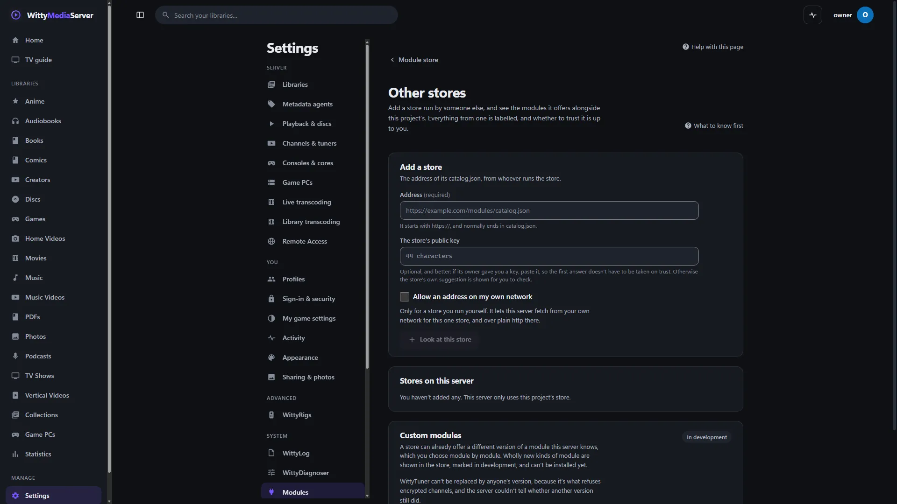

# Making a module

For developers: how to write a module, release it, list it in a catalogue, publish a fork or run a store of your own.

To add, update or remove modules on a server, see [Modules and the store](MODULE-STORE.md). That guide also has what limits a module, in plain words.

- [How a module runs](#how-a-module-runs)
- [Rules every module follows](#rules-every-module-follows)
- [The manifest](#the-manifest)
- [Version ranges, including the edges](#version-ranges-including-the-edges)
- [Writing a helper](#writing-a-helper)
- [The helper protocol (module API 3)](#the-helper-protocol-module-api-3)
- [Writing a service](#writing-a-service)
- [Writing a web part](#writing-a-web-part)
- [What a module may ask for](#what-a-module-may-ask-for)
- [Logging and file types](#logging-and-file-types)
- [Versions](#versions)
- [Releasing a module](#releasing-a-module)
- [What a server does with a release](#what-a-server-does-with-a-release)
- [Withdrawing a version](#withdrawing-a-version)
- [Data survives a version change](#data-survives-a-version-change)
- [The catalogue](#the-catalogue)
- [Stores other than this project's](#stores-other-than-this-projects)
- [Using someone's fork](#using-someones-fork)
- [Signing](#signing)
- [Which systems](#which-systems)
- [A starter set for offline use](#a-starter-set-for-offline-use)
- [Developing a server and a module together](#developing-a-server-and-a-module-together)
- [Custom modules: in development](#custom-modules-in-development)
- [How the apps use modules](#how-the-apps-use-modules)

**Modules work with WittyMediaServer 0.6.0-alpha and later, and nothing older.** Module API 3 and `minServer` 0.6.0-alpha are the start of the line. The server refuses a version built for less, and says why. A later server may keep running a module if its range says it fits, but nothing promises that until the beta.

**Two numbers that aren't the same.** The *module API* (`api` in a manifest, 3 today, `wittymodule.API`) is the contract between a server and its modules. The *client API revision* (`apiRevision`, in [Client API](CLIENT-API.md)) is the one apps use, and has nothing to do with this.

## How a module runs

The server has no module's source. Each module is a repository of its own at `github.com/wittywilla/<Repository>`, and arrives at run time as a signed archive. `go.mod` in the server names only **WittyModule**, which holds the contract between the two sides and has no dependencies, and **core libraries** such as WittyDisc: shared code with no program of its own, compiled into the server at the version `go.mod` pins, so no fork or release can change it. The server never builds with a module.

`delivery` in the manifest says what kind of module it is:

| Delivery | What a release holds | How it runs | Used by |
|---|---|---|---|
| `helper` | A program per platform | A separate process, one call at a time over pipes: [the helper protocol](#the-helper-protocol-module-api-3). It can also be a [service](#writing-a-service) | WittyPhotos, WittyIntegratedFileBrowser, WittyTuner, WittyDVD, WittyBluray, WittyCD, WittyRigs; as services, WittyPlay and WittyCouch |
| `program` | A program per platform | The server starts it for one job, in that job's own protocol. It must also answer the hello, so an install can check it runs | WittyCouch Host |
| `web` | One bundle for every platform | The browser loads it when a page first needs it, under the page's content security policy | WittyInk, WittyEbook, WittyPDF, WittyComics, WittyVisualizer, WittyStats |
| `library` | Nothing to install | Linked into others, and reaches a server inside them | WittyDisc, WittyModule |
| `builtin` | Nothing to install | Part of the server, and updates with it | WittyVideo, WittyChannels, WittyShorts, WittyAudio, WittyPodcasts |

A helper or service can also have a part in the browser: a web bundle in its archive, named by `webEntry` and `webStyle`. WittyPlay's player, WittyCouch's player and the file browser's window work this way.

The server keeps only the shape of what a module says:

| In the server | What it is |
|---|---|
| `internal/play/...`, `internal/couch/...` | Stubs written by `kit/facade` in WittyModule from `facade.json` in the module: the module's types, and functions that call its service. Never edited by hand, except `manual.go` |
| `internal/dvd`, `internal/bluray`, `internal/cd`, `internal/tuner` | The types those modules answer in, kept as a copy. A helper and the server compile them separately, and they match by field name |
| `internal/tuner/mpegts`, and `isofs` from WittyDisc | The server's **own** encryption guard and disc image reader, so it refuses encrypted media itself, whatever a module says |
| `web/src/moduletypes` | The TypeScript types of the browser parts, from `scripts/sync-module-types.mjs`. Types only: nothing from them runs |

Types are matched by name, in a self-describing format, so a field one side hasn't heard of is ignored. `wittymodule check` keeps a manifest honest, and a change the other side has to know of raises the API version.

A module's repository carries:

- **README.md:** what it does, ending with a **Legal** section.
- **LICENSE:** AGPL-3.0-or-later. WittyCouch Host is AGPL-3.0-or-later too, with Moonlight-derived parts under GPL-3.0 because it's built on Moonlight's code.
- **NOTICE:** credits `<name>, developed by WittyWilla`. The licence requires anyone who redistributes the code or builds on it to keep that attribution.
- **THIRD-PARTY-NOTICES.txt**, written by `wittymodule pack` into each archive: the license of every library in its programs. The server shows it at `GET /api/modules/{id}/notices`.

## Rules every module follows

1. **No reaching into the host.** Everything from the server comes through a small interface: the helper protocol, a service's calls, or what a web part is handed. The host interface that an app provides is the only way in.
2. **Isn't in the server.** A module reaches a server only as a signed release, and nothing unsigned is ever fetched and run. A page whose module is missing says so and offers to add it, and a signed-in person who calls its route gets `424 Failed Dependency` with `module` and `moduleName`.
3. **Light by default.** Heavy parts load only when used, and every module is expected to run on low-end hardware. A helper is gone after a minute idle, and a service after five.
4. **Untrusted files stay boxed in.** Books, PDFs and disc menus are untrusted input: no scripts run, documents are shown in sandboxed frames with a strict content security policy, and parsers have size and time limits.
5. **Encrypted media stays refused.** No module, helper or not, gets a way around that, and no extension point exists for it. The server reads disc structure and watches streams with its own code for this reason.
6. **Nothing from outside is trusted.** The server treats everything a helper says as untrusted, and you should treat every file you're given the same way.

## The manifest

Every module has a `module.json`, shipped in its releases and covered by their signature:

```json
{
  "id": "wittyphotos",
  "name": "WittyPhotos",
  "version": "0.3.0",
  "repo": "wittywilla/WittyPhotos",
  "license": "AGPL-3.0-or-later",
  "delivery": "helper",
  "entry": "wittyphotos-module",
  "api": 3,
  "minServer": "0.6.0-alpha",
  "maxServer": "0.6.x",
  "group": "photos",
  "summary": "Photo libraries: what a photo says about itself.",
  "libraries": ["photos"],
  "updates": "Reading EXIF, picture sizes, and the preview inside RAW files.",
  "stays": "The photo pages in the app."
}
```

| Field | What it means |
|---|---|
| `id` | Lowercase letters and digits, 2 to 64, starting with a letter |
| `name`, `version` | What people see. Versions follow [semantic versioning](https://semver.org) |
| `repo` | `owner/name` on GitHub, where its releases are |
| `license` | Its licence, shown in the store |
| `delivery` | `helper`, `program`, `web`, `library` or `builtin`: see [How a module runs](#how-a-module-runs) |
| `entry` | The program, without `.exe`, built from `cmd/<entry>`. For a web bundle, its script |
| `style` | A web bundle's stylesheet, if it has one |
| `programs` | More programs that come with a helper, each built from `cmd/<name>` |
| `webEntry`, `webStyle` | The script and stylesheet of a helper's part in the browser. They sit in `web/` inside each platform's archive |
| `api` | The module API version it was built for |
| `minServer`, `maxServer` | Which servers it fits: see [Version ranges](#version-ranges-including-the-edges) |
| `capabilities` | Facts the server needs without starting the helper, such as `rawExtensions` or `logTopics`. Signed with everything else |
| `permissions` | `network`, `programs`, `devices`, `data`: see [What a module may ask for](#what-a-module-may-ask-for) |
| `dataFormat`, `dataFrom` | See [Data survives a version change](#data-survives-a-version-change) |
| `group`, `summary`, `needs` | What the store shows: which shelf, one line, and what it needs in order to work |
| `updates`, `stays` | Honestly, which parts a release really changes, and which only a new server can |
| `libraries` | Kinds of library that need it. Any one module listing a kind is enough, and modules that list the same kind share it |
| `requires` | Modules it's built on, installed first |
| `core` | One others can't do without, so it can't be taken off a server |
| `pages` | Pages it adds to the app: see [Pages](#pages) |

**The module API.** A server takes `wittymodule.MinAPI` to `wittymodule.API`, and both are 3. Adding to the API raises only the top. Breaking it raises the bottom too, which disables older modules, so that's done rarely. It's one number for the whole server, as the helper protocol and host interfaces are one contract. API 3 adds services, notifications, what a module may ask for, pages, and a part in the browser for a helper.

`wittymodule check` refuses a manifest with an API outside that range or a `minServer` below `0.6.0-alpha`, and a server refuses such a release with a message that says so.

**Kinds of library.** Only the kinds the signed catalogue lists for a module count, so a release or a fork can't claim a kind it didn't come with. A kind is available if any one module providing it is there. A person can give a shared kind a name of this server's own, which changes nothing else.

## Version ranges, including the edges

Ordering is semantic versioning, so a pre-release comes before its release.

| Server | `minServer` / `maxServer` | Result | Why |
|---|---|---|---|
| 0.7.0 | `0.7.0` / `0.8.x` | Works | In range |
| 0.7.0-alpha | `0.7.0` / `0.8.x` | **Refused** | The alpha comes before 0.7.0. A module that works on the alpha says `minServer: 0.7.0-alpha` |
| 0.7.0-beta | `0.7.0-alpha` / `0.8.x` | Works | Beta is after alpha |
| 0.8.7 | `0.7.0` / `0.8.x` | Works | `x` covers every release and pre-release in that series |
| 0.9.0-alpha | `0.7.0` / `0.8.x` | **Refused** | A pre-release of a later series is past the maximum |
| 0.8.0-rc1 | `0.7.0` / `0.8.0` | Works | Comes before 0.8.0 |
| 0.8.1 | `0.7.0` / `0.8.0` | **Refused** | An exact maximum means exactly that |

`maxServer` is required, and `x` alone isn't allowed: every module states a real maximum.

Pre-release *modules* are offered only to a server that's itself a pre-release, or that already runs that module's pre-release. A stable server never gets one by surprise, but keeps one it already has, and an admin may still choose one from the list of versions, after a warning.

A server whose version can't be read (a build from a commit with no tag) can't be compared, so it installs nothing and says so.

**When a server upgrade leaves a module out of range,** nothing breaks. On start, the server takes the first of these that passes, and the settings page says what happened:

1. The chosen installed version.
2. The previous installed version.
3. Going without it: its pages say so, and offer to add a version that fits.

The refused version stays on disk, in case the server is rolled back, and the next check looks for a release whose range fits. A module never holds a server back.

## Writing a helper

A helper is a small Go program in `cmd/<entry>`, with its manifest embedded:

```go
func main() {
	wittymodule.Main(manifestJSON, func(method string, params json.RawMessage) (any, []byte, error) {
		switch method {
		case "read":
			// return a result to send as JSON, and optionally a blob
		}
		return nil, nil, &wittymodule.CallError{Code: "unknown", Message: "no such call"}
	})
}
```

`github.com/wittywilla/wittymodule` has both ends of the protocol, the manifest, the version rules and the release tool, and has no dependencies. An error that's a `*wittymodule.CallError` means the helper answered no, such as for a file it can't read, and says nothing about its health. Any other failure of a call counts against the version: see [What a server does with a release](#what-a-server-does-with-a-release). A panic in a handler answers that call with an error and doesn't end the helper.

The server starts a helper on first use and stops it after a minute idle, with one call at a time and a time limit of 60 seconds by default. A job that keeps state, such as an open disc, has a helper of its own for as long as it lasts.

## The helper protocol (module API 3)

A helper is started with `--wms-helper` and talks over stdin and stdout: one line of JSON per message, each at most 1 MiB, optionally followed by a binary blob of the size it announced (at most 128 MiB). Sizes are checked before memory is set aside.

```
helper → {"module":"wittyphotos","version":"0.3.0","api":3}
server → {"id":1,"method":"read","params":{"path":"..."}}
helper → {"id":1,"result":{...},"blob":0}
server → {"id":2,"method":"read","params":{"path":"..."}}
helper → {"id":2,"error":"...","code":"no-preview"}
helper → {"notify":"task","params":{...}}
```

- **Hello.** The first line names the module, its version and its API. They must match the manifest, or the install fails. A helper has 45 seconds to say it, as a virus scanner can hold a new program the first time.
- **Ending.** A helper exits when stdin closes, so it can't outlive the server.
- **Streams.** A stream is a helper that gives one answer and then writes the stream (`wittymodule.ServeStream`). Nothing else can be said on that pipe, and the process exits when the stream ends.
- **Notifications.** A helper may tell the server things as it goes with `wittymodule.Notify`, which is how a task's progress and a disc check's findings arrive. The server may ignore them, or drop them for arriving too fast.

## Writing a service

A service is for what one call at a time down a pipe can't do: a game has calls that overlap, and connections a browser makes straight to it. It's a `helper` in its manifest. The package `wittymodule/service` is both ends.

It starts the same way and says hello. The server then calls `service`, and it answers with the address it listens on and a token made for that start. The address must be on this machine. Every request carries the token in `X-Witty-Service-Token`. A service leaves about five minutes after its last use, unless it says it's still busy, and one that dies is started again on the next call.

It's held to the same limits as a helper, except where its manifest asks for what the server's list allows.

### Who is asking

When the server passes a person's request through to a service, it says who they are in two headers, and the service may trust them because only the server holds the token:

| Header | Value |
| --- | --- |
| `X-Witty-User` | The signed-in account's id |
| `X-Witty-Admin` | `1` for an administrator, and absent otherwise |

The server always removes every `X-Witty-` header a browser sent (including `X-Witty-Service-Token`) before it sets its own, along with its own sign-in: the `Authorization` header and its sign-in cookie. A request with no `X-Witty-User` didn't come from a signed-in person, and a service should refuse it. The server's own calls to a service (`/call/...`) carry no identity.

WittyPlay's standalone emulators are reached this way, under `/api/modules/wittyplay`:

- `/docker/status`, `/docker/diagnostics`, `/docker/settings`, `/docker/emulators`, `/docker/installed` and `/docker/emulators/{id}[/install]` are for administrators. The server checks that itself before passing them on, and WittyPlay checks `X-Witty-Admin` as well.
- `/docker/emulators/{id}/settings`, `/docker/sessions` and `/docker/sessions/{sid}[/connect|/pause|/resume]` are for anyone signed in. WittyPlay decides whose settings and whose session a request touches.
- Requests are held to 256 KB and answers to 4 MB and 45 seconds, an answer's cookies are dropped, and the server adds `X-Wittyplay-System-Dir` (its BIOS folder) over whatever a client sent.
- **Starting a game isn't passed through.** `POST /api/games/{id}/play/emulator` is the server's own route: it checks the account may play the game, finds the file, and calls the module (`docker.Launch`) with it. A module route that takes a path from a browser would let anyone read any file the emulator can be pointed at.
- `/kasm/{sid}/{ticket}/...` is an emulator's desktop, and is the one module route that asks for no sign-in. What it serves comes out of a container, so it's answered with `Content-Security-Policy: … sandbox` and shown in a sandboxed frame, where it has no origin of the server's and a browser sends no cookie. The session's random 256-bit ticket in the address is the way in; nobody's identity is passed on; nothing can be written.

See [SECURITY-ROUTES.md](SECURITY-ROUTES.md) for the full list.

For WittyPlay and WittyCouch, `kit/facade` in WittyModule writes the stubs on both sides from `facade.json`: see [Developing a server and a module together](#developing-a-server-and-a-module-together).

## Writing a web part

A web bundle runs in the browser, under the page's content security policy, with the access of whoever is signed in. It gets the app's React and shared parts from `globalThis.__wmsModuleHost` (`web/src/moduleHost.ts`), because a bundle has to use the app's React or its hooks break, and pdf.js stays there so a bundle doesn't carry its own copy. Adding to that object raises the module API, and removing anything breaks bundles already released.

If a bundle fails to load or crashes, the page says what's missing and tells the server. Three reports in a day from an admin's browser take that version out of use. Anyone else's report goes in the module's log.

### The reader host

WittyEbook, WittyPDF and WittyComics talk to the app around them only through `ReaderHost`, declared in WittyInk:

```ts
interface ReaderHost {
  key: string; book: BookMeta; format: 'epub' | 'pdf' | 'cbz'; reading?: string
  start: number; saveProgress(position, total): void
  annotations: { list(); add(a); update(a, patch); remove(a) }
  pdf?: { url?; data?; wasmUrl?; iccUrl? }               // what pdf.js opens
  comic?: { pages; pageUrl(n) }
  epub?: { info; chapterUrl(path); search(q) }
  define?(word): Promise<Definition[]>                   // optional dictionary
  toast(message): void; close(): void
}
```

In the server (`web/src/pages/Reader.tsx`) the host is backed by the HTTP API: notes and the reading position are kept per account. In WittyReader it's backed by local files and storage on the device.

### Pages

A manifest can list up to 16 `pages`, each with an `id`, `title`, `icon`, `where` (`main` or `settings`) and `admin`. They appear in the app's menus while the module is in use, at `/m/<module>/<page>`. Only a module with a web part can draw a page. Its bundle exports `pages`: components by id. Each gets one prop, `host`:

| | |
|---|---|
| `host.request(method, path, body?)` | Calls this server's API with the viewer's own access, and returns parsed JSON. Only this server: any other address is refused |
| `host.user` | `{ admin }` |
| `host.store` | `get(key)` and `set(key, value)`, as promises: a little JSON for this person and this module. At most 64 KB a key and 32 keys |
| `host.token()`, `host.base()` | For a page that opens a stream itself: the sign-in, and the server's address, or `''` on the same origin |

`admin: true` hides a page from anyone else. It keeps nothing safe by itself, so what the page calls has to check for itself.

## What a module may ask for

The manifest's `permissions` say what the sandbox leaves open, and the server has its own list of which stock modules may have each (`mayHave` in `internal/modules/service.go`). A manifest can't grant itself anything, and a fork has none of them.

| | What it opens | Who may have it |
|---|---|---|
| `network` | Sockets, as a tuner or a game streamed to a browser needs them | WittyTuner, WittyPlay, WittyCouch, WittyRigs |
| `programs` | Starting FFmpeg and its own programs | WittyTuner, WittyPlay, WittyCouch, WittyRigs, WittyBluray |
| `devices` | Capture cards, tuners and graphics on this machine | WittyTuner, WittyPlay |
| `data` | Writing in a folder of its own, given in `WITTYMODULE_DATA`, and those in `WITTYMODULE_WRITE` | WittyBluray, WittyPlay, WittyCouch, WittyRigs |

A permission a server doesn't know means the version can't run there, and it's shown with that reason.

**The limits on a program.** [What limits a module](MODULE-STORE.md#what-limits-a-module) has the table for each system. In terms a developer needs:

- **Everywhere:** a small environment (`GOMEMLIMIT` of 256 MiB, `GOMAXPROCS` of 2), with `PATH` and a few more only for a module with `programs`.
- **Linux:** the server starts itself as a launcher, which applies the limits and then becomes the program, so nothing in a program can skip them. It uses `PR_SET_NO_NEW_PRIVS`, an address space limit, Landlock for writes, a seccomp filter on 64-bit (no sockets unless it has `network`, no changing owners or modes, no reaching into another process), and namespaces where the system allows them.
- **Windows:** a low-integrity token and a job with a 512 MB limit and no other processes. A helper goes into its job just after it starts, so for a moment it's outside: starting it suspended made helpers hang at random for half a minute in testing, so it isn't done.
- **macOS:** the launcher starts the program in `sandbox-exec`, with a profile from `helperProfile` in `internal/modules/sandbox_profile.go`: no network, other programs or writes outside its folders, unless it has the permission for those. It also allows signals only within the helper's own sandbox: a plain `(deny signal)` with a rule for the helper's own programs let it signal the server on GitHub's Mac runner, so the rule is now `(target same-sandbox)` (#139). The profile is tried on a program that does nothing before it's relied on, and a helper that won't start inside it starts without it, with the pages saying so. `TestMacHelperSandbox` passed on a real Mac (an M3 Pro, macOS 27.0.1) on 2026-11-10, signalling the server refused too; the starter modules haven't been run under it there yet. WittyPlay's helper is started without it (`helperLauncher` in `internal/modules/sandbox.go`): WittyPlay puts each game in a `sandbox-exec` of its own, and a Mac won't start one sandbox inside another (`sandbox_apply: Operation not permitted`, seen on macOS 27), so inside the launcher's every game failed. Its game runners keep their own sandbox, which is the stricter one. A version an older server took out of use for that (its game runner kept stopping before the game was ready) is put back in use once, at the first start with the fix (`liftNestedSandboxBlocks`), with a `put-back` event; `nestedSandboxFixed` in the module's saved state keeps it from happening again.
- **FreeBSD:** a jail takes root, and Capsicum takes away opening files by name, which is how a helper reads your media. So the launcher sets what an ordinary account can give up for good, in `internal/modules/sandbox_freebsd.go`: `RLIMIT_NPROC` (no programs), `RLIMIT_SBSIZE` (no new socket of any kind), `RLIMIT_FSIZE` (no writing into a file), `RLIMIT_NPTS`, an address space limit and no new privileges, each only where it has no permission for that. It can still delete and rename this account's files, and signal its other programs. The server turns off being debugged, or a helper could get round all of it that way. As root, a helper also goes in a jail of its own over the whole file system, with no network, but root takes off the limits. Each of those was tried from inside a helper in a FreeBSD 15.1 virtual machine, with a real helper started the same way.
- **Saying so:** `GET /api/modules` and the store's view carry `sandbox`, with `level` as `full`, `partial`, `limited` or `unconfined`, and a `title` and `words` when it isn't full. The Modules page and the store show those.

A module with `programs`, `devices` or `data` can't have namespaces or Windows' low integrity, since what it starts or writes would be refused. Those run with the limits that are left. A module with `programs` also has no memory limit. Containers often refuse unprivileged namespaces, and a stock helper then runs without them, while a fork doesn't run.

Reading is left alone on every system, since a helper reads media wherever it is.

## Logging and file types

WittyLog notices a module by itself and gives it a level and options in **Settings → WittyLog**. A helper's stderr is kept, bounded, and logged if it fails. To offer more, list **topics** in the manifest:

```json
"capabilities": { "logTopics": ["scan|Scanning|Each file looked at", "cache|Cache|Hits and misses"] }
```

The helper is told what the owner chose through its environment when it starts: `WITTYMODULE_LOG` holds a level (`debug`, `info`, `warn`, `error` or `off`) and `WITTYMODULE_LOG_TOPICS` a comma-separated list of topics that are on. Print what's wanted to stderr, one thing per line. Never print tokens, passwords or the contents of files. See [how every part logs](LOGGING.md#module-logging-levels-and-options-per-module).

A module that needs to know about file types shouldn't keep a list of its own. `GET /api/media-types` gives every format, codec and container the server knows, with extensions, how each plays, which libraries take it and whether this machine can handle it. `docs/media-types.json` is the same list as a file, for use when a module is built. See [Supported formats](SUPPORTED-FORMATS.md).

## Versions

Versions move in small steps as work lands. A bump isn't a release: nothing is tagged or published by one.

```bash
go run github.com/wittywilla/wittymodule/cmd/wittymodule@v0.3.0 bump -note "Reads a new format." -changelog CHANGELOG.md .
scripts/bump-server.sh 0.6.1-alpha "What changed."
```

The first raises a module's version in its `module.json` and `package.json` and in its changelog, and refuses anything not newer. The second does the same for the server and says which modules' ranges no longer cover it. In a module's own repository, CI runs `wittymodule needs-bump`, which fails when it has changed since its last tag and still has that tag's version, since tags never move.

Versions stay below v1 while the APIs settle, so a minor version may change them.

## Releasing a module

`wittymodule` does this from the module's own folder:

```bash
go run github.com/wittywilla/wittymodule/cmd/wittymodule check .
go run github.com/wittywilla/wittymodule/cmd/wittymodule pack -out release .            # programs
go run github.com/wittywilla/wittymodule/cmd/wittymodule pack -out release -web dist . # a bundle
go run github.com/wittywilla/wittymodule/cmd/wittymodule sign release/wittyphotos-0.3.0-SHA256SUMS.txt
```

| Command | What it does |
|---|---|
| `check [-server version] <folder>...` | Checks manifests against the folder around them |
| `pack [-out dir] [-targets list] [-freebsd-gcflags flags] <folder>` | Builds every platform and writes the checksum list |
| `pack [-out dir] -prebuilt <folder of programs> <folder>` | The same for programs built some other way, named `<entry>-<goos>-<goarch>`. A system with none there is left out |
| `pack [-out dir] -web <built folder> <folder>` | Packs a built web bundle |
| `sign [-key file] <file>` | Writes `<file>.sig`. The key defaults to `WMS_SIGNING_KEY`, then `~/.wms-signing/release.key` |
| `keygen -key file` | Makes a signing key, and prints the public half |
| `bump`, `needs-bump` | See [Versions](#versions) |
| `withdraw`, `restore` | See [Withdrawing a version](#withdrawing-a-version) |
| `catalog-add`, `catalog-check`, `catalog-sign` | See [The catalogue](#the-catalogue) |

`kit/module-kit.sh` in WittyModule writes what a module's repository needs from its templates: its workflows, Dependabot's settings, a `.gitignore` and a section of its README. `.github/workflows/release.yml` runs when a `v*` tag lands. The building job has no signing key and no write token. The signing job runs on a clean machine, in a `release` environment, and sees only the checksum list and the key, and it refuses a list naming anything but its own module and version. A module with a part in the browser builds that first, and packs them together.

A release of version `V` has one signed list covering everything:

```
<id>-V-SHA256SUMS.txt       hashes of each archive, the manifest, and every file in each archive
<id>-V-SHA256SUMS.txt.sig   its signature
<id>-V-module.json          the manifest, so a release can be judged before downloading it
<id>-V-<os>-<arch>.tar.gz   a program's files (.zip on Windows), or
<id>-V-web.tar.gz           a bundle's files, the same for every platform
```

A release then has to be listed. The refresh in [WittyModuleCatalog](https://github.com/wittywilla/WittyModuleCatalog) adds it and signs the catalogue, and servers find it from there.

## What a server does with a release

**Check.** Reads the catalogue, or for a fork its GitHub releases. A release not seen before has its list, signature and manifest fetched and verified, up to twelve per check. What was learned about a fork is kept in `<data>/modules/<id>/feed.json` and verified again when it's read. Nothing leaves the server unless settings allow it: `moduleUpdateCheck` looks twice a day, and if never set it follows `updateCheck`. `moduleAutoInstall` installs what fits, and is off by default. An admin pressing **Check now** always works, and a module taken off this server asks nobody anything.

**Install.** Each step leaves the running module untouched if it fails:

1. Verify the list's signature, and that the manifest is for this module, this version and this repository, and agrees with what the catalogue said.
2. Download the archive, hashing as it arrives, and stop at the size in the release.
3. Unpack to a work folder, refusing links, devices, absolute paths and paths that climb out.
4. Check every file against the signed list, refusing any extra or missing file.
5. Start the helper once, where there is one. Its hello must name the same module, version and API. A `program` must answer the hello too.
6. Rename the folder into `versions/V`, then save the state atomically.
7. Switch over. The next call uses the new version, with no server restart.

**On disk.** Everything is in `<data>/modules/`, never in the program folder, so this also works in containers and in protected installs. The active, previous and pinned versions are kept. The signed list stays beside the files and is checked again every time a helper starts, so a file changed on a shared data folder is refused rather than run. If the data folder doesn't allow programs to run (`noexec`, common on network shares), the install fails at step 5 with a plain message.

**Going back by itself.** Three calls in a row failing at the process level (crash, hang, garbage), or a browser's reports as above, block that version with the reason, and the previous version takes over or the module goes without. A `*CallError` isn't a failure. Changed files end a version's use at once. A WittyPlay game that won't start isn't one either, unless WittyPlay's helper itself went away or answered nonsense (`stream.ErrHelper`): the runner stopping, a core crashing or refusing, or a console this server can't draw is that game's, core's or console's problem, and is recorded against the core (`game_core_plays`), so one console failing never takes every game away. A version blocked by games failing before this, with "the game runner stopped before the game was ready", is put back once (`liftGameFailureBlocks`, with a `put-back` event). A blocked version isn't installed automatically again, but an admin can choose it.

## Withdrawing a version

A release can't be taken back from everyone who has seen it. So each module can publish a signed list, `<id>-withdrawn.json` and its `.sig`, on a release with the tag `withdrawals`. The **Withdraw a version** workflow in a module's repository does this, from the Actions tab, using `wittymodule withdraw` and `restore`. Set `withdrawn` on the version in the catalogue too.

| Severity | Choosing it | If it's in use | Automatic updates |
|---|---|---|---|
| `broken` | A warning | Stays, with a warning | Never picked |
| `security` | **Refused** | Goes out of use straight away, even if pinned | Never picked |

The list has the module's name inside what's signed, so one module's list can't be used for another. It has a serial number that only goes up, and a server keeps the highest it has seen, so an old list can't bring a withdrawn version back, and hiding the list doesn't either. A newer signed list can restore a version.

## Data survives a version change

A version says, in its signed manifest, the newest format of data it writes (`dataFormat`) and the oldest it can read (`dataFrom`), and the server remembers the newest format used so far. A version that can't read what's there is **refused**, with the reason, both when choosing it and at every start. Today no module declares a format, as notes, progress and saves belong to the server. The first that keeps data of its own must set these.

## The catalogue

A server learns which modules exist from one signed file, with nothing compiled in. It lists every module and every version, with what a store shows and where each version's files are. This project's is in [WittyModuleCatalog](https://github.com/wittywilla/WittyModuleCatalog), at

```
https://github.com/wittywilla/WittyModuleCatalog/releases/download/catalog/catalog.json
https://github.com/wittywilla/WittyModuleCatalog/releases/download/catalog/catalog.json.sig
```

`internal/modules/known.json` in the server is a copy of its descriptions with no versions, so a page can name a module on a server that has never been online.

`Catalog` in WittyModule (`catalog.go`) is the code that reads and checks one, and `wittymodule catalog-add`, `catalog-check` and `catalog-sign` write them. The `.sig` is the same as a release's: base64 of Ed25519 over the file's exact bytes.

```json
{
  "format": 1,
  "name": "WittyMediaServer modules",
  "serial": 12,
  "generated": "2026-11-01T12:00:00Z",
  "modules": [
    {
      "id": "wittyphotos",
      "name": "WittyPhotos",
      "summary": "Photo libraries: what a photo says about itself.",
      "description": "Plain text, as long as a store page needs.",
      "icon": { "url": "wittyphotos.png", "size": 4210, "sha256": "…" },
      "publisher": { "name": "WittyWilla", "url": "https://github.com/wittywilla" },
      "repo": "wittywilla/WittyPhotos",
      "group": "photos",
      "libraries": ["photos"],
      "requires": [],
      "core": false,
      "needs": [],
      "updates": "Reading EXIF, picture sizes, and the preview inside RAW files.",
      "stays": "The photo pages in the app.",
      "versions": [
        {
          "version": "0.3.0",
          "delivery": "helper",
          "api": 3,
          "minServer": "0.6.0-alpha",
          "maxServer": "0.6.x",
          "license": "AGPL-3.0-or-later",
          "permissions": [],
          "released": "2026-11-01",
          "prerelease": false,
          "changelog": "Plain text: this version's section of the module's changelog.",
          "sums": "https://github.com/wittywilla/WittyPhotos/releases/download/v0.3.0/wittyphotos-0.3.0-SHA256SUMS.txt",
          "sig": "https://github.com/wittywilla/WittyPhotos/releases/download/v0.3.0/wittyphotos-0.3.0-SHA256SUMS.txt.sig",
          "manifest": "https://github.com/wittywilla/WittyPhotos/releases/download/v0.3.0/wittyphotos-0.3.0-module.json",
          "platforms": {
            "linux-amd64": { "url": "https://github.com/…/wittyphotos-0.3.0-linux-amd64.tar.gz", "size": 1446318, "sha256": "…" }
          },
          "withdrawn": { "severity": "security", "reason": "Only there when a version has been taken back." }
        }
      ]
    }
  ]
}
```

| Field | What it means |
|---|---|
| `format` | This file's format. A server refuses a higher one in words ("a newer server can read it") and keeps its last good catalogue. Adding a field doesn't raise it, and readers ignore fields they don't know |
| `serial` | Only ever goes up, and a server keeps the highest it has seen, so an older catalogue can't be replayed to bring a withdrawn version back |
| `summary`, `description`, `changelog`, `reason` | **Plain text**, with no control characters and line breaks only in the long ones. Always show it as text, never as HTML or Markdown |
| `icon` | Optional. A PNG of at most 256 KiB, checked against its size and hash. A server fetches and keeps it, so a page never asks anyone else for it. With no icon, the store draws one from the name |
| `screenshots` | Optional. Up to 8 PNG or JPEG pictures of at most 2 MiB each, checked the same way, fetched when someone opens the module's page |
| `publisher` | Who it comes from. `key`, also optional, is the base64 public key its releases are signed with, when that isn't the catalogue's own |
| `group`, `libraries`, `requires`, `core`, `needs`, `updates`, `stays` | As in the [manifest](#the-manifest), from the newest version |
| `versions` | Newest first, up to 100, and may be empty for a module listed before its first release. A version never changes once listed, except for `withdrawn` |
| `delivery`, `api`, `minServer`, `maxServer`, `license`, `permissions` | As in the manifest. An install is refused unless all of these match the release's signed manifest (`MatchesManifest`) |
| `prerelease` | Offered under the rules in [Version ranges](#version-ranges-including-the-edges). A version with a label such as `-beta` counts anyway |
| `changelog` | May be empty when there's nothing to report: the store then shows a plain line of its own |
| `platforms` | Keyed `GOOS-GOARCH` (`linux-arm` is the armv7 build), or `all` for a web bundle. A platform not listed means no build for it |
| `sums`, `sig`, `manifest`, each `url` | `https`, or a path below the catalogue's own folder, which is how an offline starter set and a test catalogue work. Nothing else: no `http`, `file`, `..` or query |
| `withdrawn` | `broken` warns, and `security` refuses it, as in [Withdrawing a version](#withdrawing-a-version). A module's own signed list still counts as well |

Limits: 8 MiB for the file, read with that limit in force; 1000 modules; 100 versions each; 256 MiB for an archive.

**What the signature means, and doesn't.** The catalogue only offers. An install still checks the release's own signed list and manifest and every file in the archive, and also that the catalogue's description of the version matches. So a catalogue can't describe a version as asking for less than it does, and holding only a catalogue's key runs nothing.

**The rules for a server.**

1. Check the signature before reading anything in the file (`VerifyCatalog`), then compare `serial`. Failing either keeps the last good catalogue, and the store says why in a line.
2. Keep the file and its signature in `<data>/modules/`, and check them again when reading them back, so the store works offline.
3. Offer a version only if `Supports` passes for this server. Show the reason on one that doesn't, rather than hiding it.
4. Ask for one file at a time, with its limit in force, and hash as it arrives.
5. Never let a page fetch from an address in a catalogue. The server fetches and serves what the page shows.

**A test or offline catalogue** is a folder holding `catalog.json`, `catalog.json.sig` and the files, with relative paths:

```bash
wittymodule pack -out release/wittyphotos .
wittymodule sign -key test.key release/wittyphotos/wittyphotos-0.3.0-SHA256SUMS.txt
wittymodule catalog-add -catalog catalog.json -base wittyphotos -pub <test public key> release/wittyphotos
wittymodule catalog-sign -key test.key catalog.json
```

## Stores other than this project's

A store is a `catalog.json` at an `https` address. To run one, make a folder with `catalog.json` and the release files, as in [the catalogue](#the-catalogue), and run `wittymodule catalog-sign -key <file> catalog.json`, which writes `catalog.json.sig` and `catalog.json.key`. Give people the address and, somewhere else, the key.


*Other stores, on a server using only this project's.*

What a server does with one, in `internal/modules/stores.go`:

- An admin adds it after a warning, with its key pinned at that moment. The key comes from what the admin pastes, or from `catalog.json.key` beside the catalogue, for the admin to check.
- Its signature is checked against the pinned key before anything in the file is read. Its serial only goes up, and raising the serial is required for any change: the same serial with different contents is refused.
- A module from it is held to the fork rules: an admin chooses each version, nothing updates by itself, and it gets a fork's limits. Its releases must be signed with the store's key, or the `publisher.key` it gives.
- An `id` that this project's catalogue also lists is a fork of that module. A store can't replace a module by listing it, and WittyTuner can't be replaced at all. An `id` nobody knows is shown as in development.
- A store's addresses are fetched like any other address someone typed: no private or local addresses unless the admin allowed that for this store, no following redirects that break that, and never link-local. Sizes are enforced while reading: 8 MiB for a catalogue, 4 KiB for a signature, 256 KiB for an icon, 2 MiB for a screenshot.
- Characters that reorder or hide text are taken out of what it says, and a module using the name of one of this project's modules is called out.

What a person sees and agrees to is in [Other stores](MODULE-STORE.md#other-stores).

## Using someone's fork

Someone can publish their own version of a stock module, and an admin can point that module at it. Every other part of the system then treats it as that module. What a person sees is in [Using someone's fork](MODULE-STORE.md#using-someones-fork).

**To publish a fork:** change `repo` in `module.json` to yours, keep the `id`, run `wittymodule keygen -key <file>`, and add that key as your repository's `WMS_SIGNING_KEY` secret. The release workflow that comes with the module does the rest. Give people the public key it printed.

**What your fork gets:**

- No permissions at all: `mayHave` is only for stock modules.
- The strict sandbox. On Linux it has no sockets and can't change what's in files, and if the system can't apply that (Landlock ABI 3, which is kernel 6.2, and a 64-bit system) it doesn't run. On Windows it keeps its network.
- No forks where there's nothing to box them in: `ForkRefusal` in `internal/modules/source.go` refuses a fork on macOS and FreeBSD, and whenever `WMS_NO_MODULE_FORKS=1` is set, whether it comes from the form or a store.
- Its key is good for that one module, and it never updates by itself.

A forked game runner goes through the same limits, and may also write to its own save folder and open devices such as a graphics card.

**WittyTuner can't be replaced.** Nothing outside it could tell whether a fork still refused encrypted channels. Disc engines can be replaced, because video never passes through them: FFmpeg reads the disc from locations the server has checked. This isn't a way to add decryption, because the refusal doesn't depend on the module. What FFmpeg opens for WittyTuner must name a limited list of protocols, never with `crypto` or files on it.

**What these limits don't cover.** A fork's menus and subtitles are pictures the server can't read, and it checks only samples of a disc for encryption, so a disc scrambled only in places a sample misses could in principle show a fork's pictures of it. FFmpeg still can't play such a disc's video.

## Signing

**One module key, separate from the server's release key, not one per module.**

- A release key can sign a server, which runs with no limits at all. A key that signs modules has to sit in the secrets of many repositories, where it's far more exposed, so it shouldn't be able to. `moduleKey` in `internal/update/keys.go` is trusted for modules and never for a server.
- One key per module would mean many keys to look after, and a new server for every rotation. What it would buy is limited: a bundle signed with a leaked key can already act as an admin in that admin's browser.
- Because one key is shared, the signing job refuses a checksum list naming anything but its own module and version, and required approval on the `release` environment, with a protection rule on `v*` tags, is strongly recommended.
- Forks have keys of their own, good for one module only.

If a module key leaks, remove it from `moduleKey` and release a new server, and any version it signed stops being trusted. The owner's steps are in `docs/MODULES-CUTOVER.md`.

## Which systems

A helper or service is built for every system the server runs on: Windows, Linux, macOS and FreeBSD, the last on amd64 and arm64. `wittymodule pack` builds them all by default, and each is listed in the catalogue under its system. WittyPlay's FreeBSD builds need `-freebsd-gcflags github.com/ebitengine/purego/internal/fakecgo=-std`, which the kit passes to anything using that library. A web bundle is one file for all of them.

A program built with something other than Go, as WittyCouch Host is, packs what it built with `-prebuilt`, and may not reach them all: WittyCouch Host has no FreeBSD build, or any for Linux on 32 bits or Windows on arm64. A server that finds no build for its own system says that in plain words in place of the button to add it, for that module and for any built on it.

FreeBSD builds are cross-compiled and packed, and haven't been run. macOS hasn't been built or run here.

## A starter set for offline use

A release of the server can carry signed modules, for a machine that never reaches the network. This is a step in packaging: it only copies a folder that a catalogue was built into.

```bash
WMS_STARTER=<a folder with catalog.json, catalog.json.sig and the archives> scripts/build-release.sh 0.6.0-alpha linux/amd64
```

They land in `modules/` beside the program, or in `Contents/Resources/modules` in a Mac app, and go through the same checks as a download: the catalogue's signature, its serial, and each archive's size, hash and signature. Nothing's installed until someone adds it.

## Developing a server and a module together

A normal build of the server needs only WittyModule and the core libraries `go.mod` names, at released versions. Nothing about a module needs to be beside it. How the repositories are set up on a development machine is in `docs/REPOSITORIES.md`.

**A change that crosses the line** is two changes in two repositories. For WittyPlay and WittyCouch, the server's stubs come from the module's source, so a new exported function means running the generator from a WittyModule checkout, which rewrites `gen.go` on both sides. Anything it can't write goes in `manual.go`:

```bash
go run ./kit/facade -config <module>/facade.json -module <module> -server <this checkout>
```

**To try a real module on a server,** build a catalogue from your checkouts with a throwaway key. Only a server built with the `updatetest` tag reads it, and no release can be:

```bash
scripts/make-test-catalog.sh /tmp/catalog <folder holding the repositories> WittyPlay WittyDVD
python3 -m http.server --bind 127.0.0.1 8099 --directory /tmp/catalog &
go build -tags updatetest -o /tmp/wittymediaserver ./cmd/wittymediaserver
WMS_UPDATE_KEY=$(cat /tmp/catalog/test-key.pub) WMS_MODULE_CATALOG=http://127.0.0.1:8099/catalog.json /tmp/wittymediaserver
```

**Tests of what the server does with a real module** need that folder, and are skipped without it:

```bash
WMS_TEST_CATALOG=/tmp/catalog go test ./...
```

## Custom modules: in development

Wholly new kinds of module, rather than replacements for ones the server already knows, aren't possible yet, because the server has nothing to connect an unknown one to. What it would take: a host interface a helper can call back through, a way for one to add a library type and its pages, and a permission model strong enough for code nobody here has seen.

## How the apps use modules

The same modules run inside apps built for one job. Each app has its own repository.

- **WittyReader** is a web app at heart: the reader modules with a host that opens files from the disk and keeps notes on the device. No server needed.
- **WittyMediaPlayer** is a Qt 6 window that decodes with FFmpeg's libraries, and runs the WittyDVD and WittyBluray engines in a small helper program beside it, reached over a pipe with the same helper protocol. WittyVisualizer's effect files run there too.
- **WittyMediaClient** is the apps that connect to a server. It uses the server's [Client API](CLIENT-API.md).

---

<sub>WittyMediaServer documentation</sub>
