# Music, audiobooks and podcasts

Use this guide to set up your music, audiobooks and podcasts, and to get the most from the player: the queue, stations, the full-screen player, the visualizer, sound settings and audio CDs.

- [Setting up a library](#setting-up-a-library)
- [What's read from your files](#whats-read-from-your-files)
- [Finding your music](#finding-your-music)
- [Playing and the queue](#playing-and-the-queue)
- [The full-screen player](#the-full-screen-player)
- [Lyrics](#lyrics)
- [Music videos](#music-videos)
- [Visualizer](#visualizer)
- [Sound](#sound)
- [Audiobooks](#audiobooks)
- [Podcasts](#podcasts)
- [Internet radio](#internet-radio)
- [Audio CDs](#audio-cds)
- [Formats](#formats)

This guide describes the web app, which the desktop WittyMediaClient also shows. The Android and Apple apps can't play these libraries yet, so use a browser or the desktop app.

## Setting up a library

1. Go to **Settings → Libraries**, or use first-time setup.
2. Choose **Music** or **Audiobooks**. If Music is listed under **Add a module to use these**, press **Add WittyCD** first.
3. Choose your folders, then add the library.

Any layout works when your files are tagged. Without tags, the folders are used:

```
Music/
  Some Artist/An Album/01 First Song.mp3      artist, album, track and title
  Some Artist - An Album/01 First Song.mp3    album folder only, artist from the tags
Audiobooks/
  Jane Author/A Short Book/01 Chapter 1.m4b   author, book, chapter
  Jane Author/Another Book.m4b                one file per book
```

## What's read from your files

| From | Used for |
|---|---|
| Tags (ID3, Vorbis comments, MP4) | Title, artist, album, album artist, track and disc number, year, genre, comment |
| A picture named `cover`, `folder`, `front`, `album`, `poster`, `artwork` or `albumart…` in the folder | The album cover. The largest one wins |
| A picture inside the file | The cover, when the folder has none |
| File and folder names | Title, track number, album and artist, when tags are missing |
| `<song>.lrc` or `<song>.txt` beside a song, and lyrics in its tags | Its [lyrics](LYRICS-KARAOKE.md) |
| `replaygain_*` or `R128_*` tags | [Volume leveling](#sound), if you turn it on |
| `artist.jpg` (or `.jpeg`, `.png`, `.webp`) in the artist's or album's folder | The artist's photo |
| PDFs and text files in the album's folder | **Read** in the full-screen player |
| M3U, PLS, XSPF and Windows Media playlists | [Collections](COLLECTIONS.md#collections-and-smart-playlists) of the songs they name that are in the library |

Nothing is written into your music folders.

### Artist biographies and photos

An artist's page can show the opening of their Wikipedia article and its picture. This is off until you agree, in first-time setup or under **Settings → Metadata agents**, in **Lyrics and music information**: turn on **Artist biographies and photos**.

When it's on, your server sends Wikipedia an artist's name when someone views that artist, and nothing else. It's the article with that name, which may not always be the right person. An `artist.jpg` in their folder is always used first.

## Finding your music

A music library opens on **Home**: a row of covers to flip through, with what you've played most at the front, then **Artists**, **Albums**, **Songs** and **Played lately**. Colours behind them come from the artwork. **Play my music** shuffles up to 500 songs from the library.

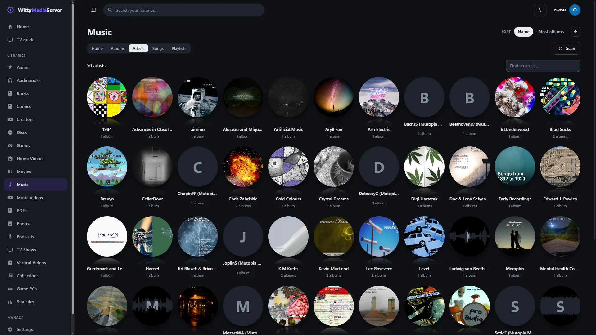
*Artists. Credited in [the list](images/CREDITS.md).*

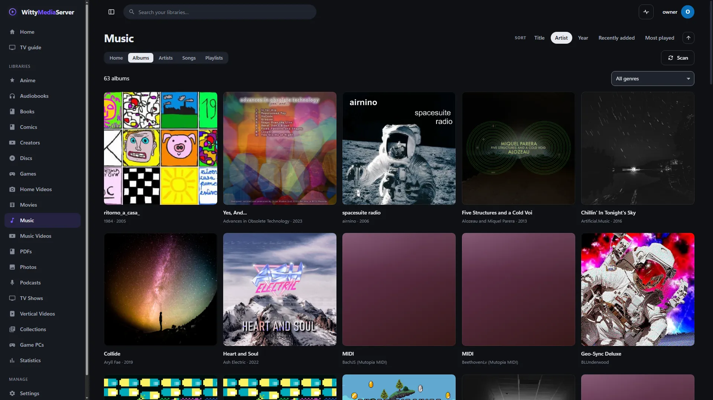
*Albums. Credited in [the list](images/CREDITS.md).*

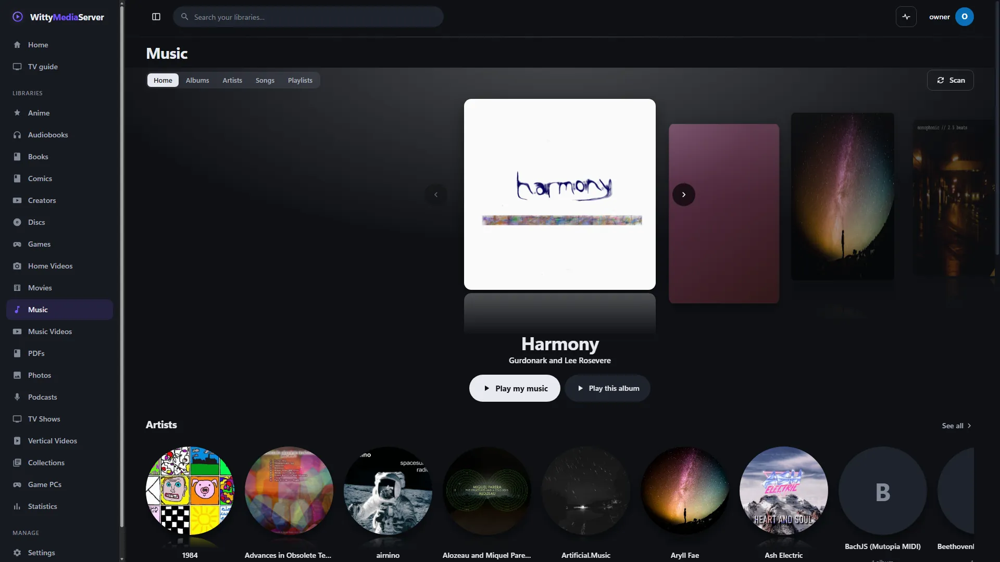
*A Music library. Albums from CC netlabels, credited in [the list](images/CREDITS.md).*

| Tab | What you can do |
|---|---|
| **Albums** | Sort by title, artist, year, recently added or most played, either way round. Filter by genre |
| **Artists** | Sort by name or most albums, and find one by name |
| **Songs** | Choose **All songs**, **Liked**, **Most played**, **Played lately** or **Newest**. Search, sort, filter by genre, and press **Play** or **Shuffle** |
| **Music videos** | The videos of every **Music videos & concerts** library you can see, by artist, with the album of the song each is tied to. Only there when the server has such a library. See [Music videos](#music-videos) |
| **Playlists** | The same four lists ready to play, and your own playlists |

**An album's page** has **Play**, **Shuffle**, **Station**, **Play next**, **Add to queue** and **Like all**. An album on more than one disc is divided by disc. Below the tracks are **Other versions** of it, such as a deluxe or remastered release, and **More by** that artist.

**An artist's page** has their most played songs, their **Discography** newest first or by title, and **Singles and EPs** apart, meaning anything with fewer than seven tracks.

**Any song's** menu has **Play next**, **Add to the queue**, **Like**, **Start a station from this**, **Add to a playlist…**, **Go to artist** and **Go to album**.

**Playlists are collections,** so one made here is on the Collections page too, and a smart playlist made there is listed here. See [Collections](COLLECTIONS.md#collections-and-smart-playlists).

## Playing and the queue

The bar floats along the bottom while you browse, and the page leaves room for it. Its arrow collapses it to a small button in the corner. On a phone it shows the art, title, play and next, above the tab bar.

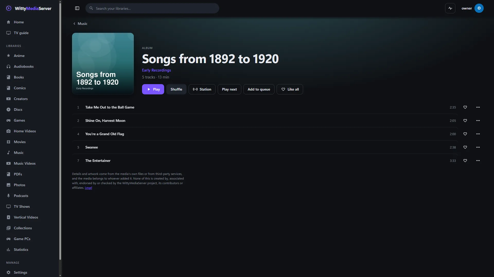
*An album's page. Credited in [the list](images/CREDITS.md).*

**What's playing comes back after a reload,** stopped where it was, with the queue, shuffle and repeat as they were. It's kept on that device for each person, for 30 days, and nothing is fetched until you press play. **Stop and close** forgets it.

- **Shuffle** really reorders the queue, so what's shown is what will play.
- **Repeat** goes from off, to all, to this song.
- Lock screens, headphone buttons and keyboard media keys control playback, with artwork and a progress bar on the lock screen.
- A video or game takes over the speakers, so it pauses the music.

**The queue** opens from its button in the bar or the full player, or with **Q**. It can change as it plays:

- Drag a row, or use its up, down and remove buttons from a keyboard or remote.
- Press a row to jump to it.
- **Save the queue as a playlist** keeps it.
- **Clear what's to come** leaves only the song playing.

**A station** makes a queue from one song using only your library: the same artist, the same genre and songs from about the same time, with some chance mixed in, leaving out anything you've disliked. Start one from **Station** on an album or artist, from a song's menu, or from **More** in the full player. Nothing online is asked. A small library may not have enough to make one, and it says so.

## The full-screen player

Press the artwork or title in the bar, or **Full screen**. **F** then fills the whole screen. It's the same for music, audiobooks, podcasts and radio, with what doesn't apply left out.

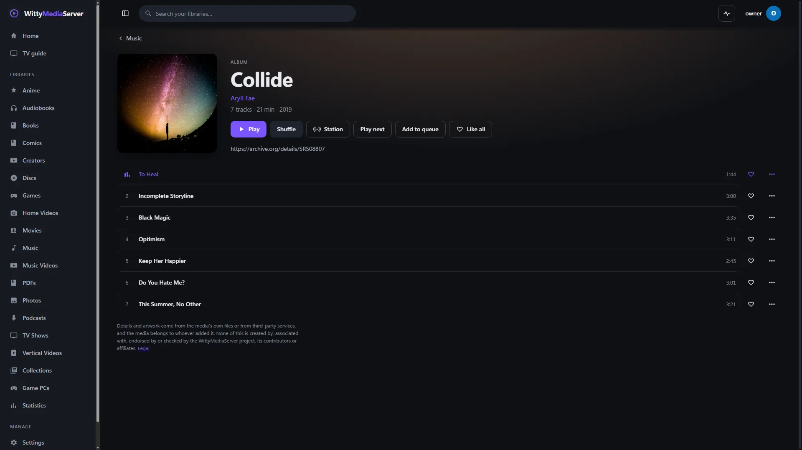
*The full-screen player. [Collide](https://archive.org/details/SRS08807), Aryll Fae, [CC BY 4.0](https://creativecommons.org/licenses/by/4.0/).*

**Top row:** close, volume, add to a playlist, sleep timer, queue, like, fill the screen, and **More**. **More** has **Sound: equaliser and more**, **Start a station from this song**, **Go to album**, **Go to artist** and **Stop and close**.

**Below the controls:** **Visualizer** and its styles, **Lyrics**, **Karaoke**, **Read** and playback speed.

**Read** shows the words at your own pace, and whatever came with the album: text files open in the panel, and a PDF booklet opens in a new tab. A text file named after one song counts as that song's lyrics instead.

**The sleep timer** stops playing in 15, 30, 45, 60 or 90 minutes, or **After this song**.

| Key | What it does |
|---|---|
| Esc | Close the panel, then the player |
| Space | Play or pause |
| ← → | Previous or next |
| L | Lyrics |
| K | Karaoke |
| Q | Queue |
| V | Visualizer on or off |
| S | Shuffle |
| R | Repeat |
| M | Mute |
| F | Fill the screen |
| `,` `.` | Back or forward 10 seconds |
| `<` `>` | Slower or faster |

Up, Down or OK moves onto the controls, and arrows then move between them, so a remote or a controller reaches everything.

### Canvas: a looping video behind the song

A song or an album can have a *canvas*: a short, silent video for an app to loop behind its full-screen player. Put it beside the music:

| File | Plays behind |
|---|---|
| `01 Song.canvas.mp4` or `.webm` | That song |
| `.canvas/01 Song.mp4` | That song, kept in a hidden folder |
| `canvas.mp4` or `canvas.webm` in the album's folder | Every song in the album without its own |
| `.canvas/canvas.mp4` | The same, in a hidden folder |

You can also put one in the [metadata folder](METADATA-FOLDER.md), named like the title's file with `-canvas.mp4` on the end, such as `My Film (2001) [item-123]-canvas.mp4`. Films, episodes and discs can have one the same way, and a `canvas.mp4` in a show's folder covers its episodes.

Keep it short (3 to 8 seconds is usual), silent, and small: an upload can be up to 30 MB. A file beside the media that is over 64 MB, or longer than a minute, isn't taken for a canvas: it would be sent to every phone that opened the title. MP4 (H.264) plays everywhere; WebM plays in browsers and Android. An administrator can upload one for any song or title, which is kept in the server's own folder and wins over one beside the media. Apps ask `GET /api/v1/media/{id}/canvas`, and get the video itself with byte ranges and a day's caching. See [the client API](CLIENT-API.md#media-extras).

**From the video itself.** For a film or an episode with no canvas, an administrator can have the server cut one: `POST /api/v1/media/{id}/canvas/generate`, with `startSec` and `durationSec` if the default (a quarter of the way in, 5 to 8 seconds) isn't wanted. It is a [task](TASKS.md) at low priority: FFmpeg takes a few seconds of the picture, drops the sound, makes it small (720 lines at most, 480 or 360 on a small machine), and fades its end into its start so the loop has no jump. It needs an FFmpeg with an H.264 encoder (`libx264`). A song has no picture to cut from, so a song's canvas is always one you supply.

**In the web app.** A canvas plays behind the full-screen player while the music does, behind an album's page, and behind a film's, an episode's or a show's page in place of the still backdrop. It is silent, it loops, and it is decoration: it never takes the keyboard and a screen reader isn't told of it. The still artwork stays until the video is really playing, and whenever it can't.

It gives way to everything else. It isn't fetched at all when:

- the device is set to reduce motion, or the browser to save data;
- the device was set to robust streaming, under **Settings → Playback**;
- you're away from home and the owner [limits streams there](REMOTE.md#limits-for-viewers-away-from-home);
- you turned off **Moving backgrounds**, under **Settings → Appearance → Motion and big screens**.

It is only fetched while it would be seen, so one that's scrolled off the page isn't, and it stops while the tab is hidden or the music is paused.

An administrator finds **Canvas** on a film's or an episode's page, and on an album's page for each of its songs: it shows what the title has, cuts one from the video with the progress of that task, uploads one, and removes one that was uploaded or cut. One beside the media is removed from its folder.

A canvas beside the media isn't listed as a title of its own: the scan leaves out `Name.canvas.mp4` beside `Name`, and a `canvas.mp4` (up to 64 MB) in a folder that holds titles.

## Lyrics

Lyrics follow the music in the full-screen player, and karaoke is one press from there. How they're found, what goes online and when, and how to add or fix them is in [Lyrics and karaoke](LYRICS-KARAOKE.md).

## Music videos

A song in a **Music** library and its video in a **Music videos & concerts** library ([Creator videos and music videos](CREATOR-VIDEOS.md#music-videos-and-concerts)) are tied together, so each can lead to the other.

### The Music videos section

Each music library has a **Music videos** tab beside **Songs**, and a **Music videos** shelf on its front page with the newest ones. It lists the videos of every **Music videos & concerts** library you can see, in order of artist, and you can find one by its title or artist. A video tied to a song in your music shows the song's album under it, which takes you there. Pressing a video plays it on its own page.

Profile limits apply as everywhere: a video a profile can't watch isn't listed, and neither is a song it can't hear.

### Going between a song and its video

- **From a song:** its menu (**⋯**) has **Watch the video**, and so does the full-screen player, under the artist and in its **⋯** menu. A song with more than one video, such as a live one, lists each.
- **From a video:** a music video's page shows its song under the title, with links to the artist and the album, and **Play the song**.

A music video shows its song's lyrics too, under **Lyrics** on its page. See [Lyrics and karaoke](LYRICS-KARAOKE.md#music-videos).

When the two line up, going from one to the other carries on at the same place: the song stops and the video starts where the song was, or the other way round. When they don't, the other one starts from the beginning.

### How songs and videos are matched

After a scan of either library, every video is compared with every song:

| What matches | What happens |
|---|---|
| The same **ISRC**, from the tags or a video's `.nfo` (`<isrc>`) | Tied |
| The same **MusicBrainz recording**, from the tags (as tagging programs write it) or the `.nfo` (`<musicbrainzrecordingid>`) | Tied |
| The same artist and title, when exactly one song fits | Tied |
| The same artist and title, but two songs fit (a single and its album), or one is another take (live, acoustic, a remix) | Suggested |
| A title or an artist that is nearly the same | Suggested |

Names are compared without case, accents, "feat." and what video titles add, such as "(Official Video)" or "[HD]". A nearly-the-same name is only ever a suggestion, which an admin confirms. Recordings of 20 minutes or more are concerts, and aren't tied to one song.

When the two are the same length, give or take two seconds, they're taken to line up, so playback can go from one to the other at the same place.

Codes in tags are read when a file is scanned, so files scanned before 0.7.0-alpha are matched by name until they change or the library is scanned again from scratch.

### Tying and untying by hand

Admins tie and untie from a song's menu (**Tie to a music video…**, or **Music videos of this song…** once it has one) or from a video's page (**Tie to a song…** or **Change**). The window shows what's tied, what's suggested and why, and a search of the other side:

- **Tie** ties them. A video has one song, so tying it to another unties the first.
- **Not this one** turns a suggestion down, and **Untie** parts a pair.
- **The song starts this many seconds into the video** is for a video with an intro, so switching lands in the right place. Leave it empty when the two are different takes and don't line up.

What an admin ties or unties stays that way, whatever later scans find.

A link only ever shows what a profile may see: a Kids profile that can't watch a video doesn't see that it exists.

## Visualizer

The visualizer draws moving shapes from the music behind the artwork in the full-screen player. It's on by default there, and **Visualizer** or **V** turns it off. It's part of the **WittyVisualizer** module: if its buttons aren't there, an admin can add it in **Settings → Modules**. **V** also opens it from anywhere the bar is showing.

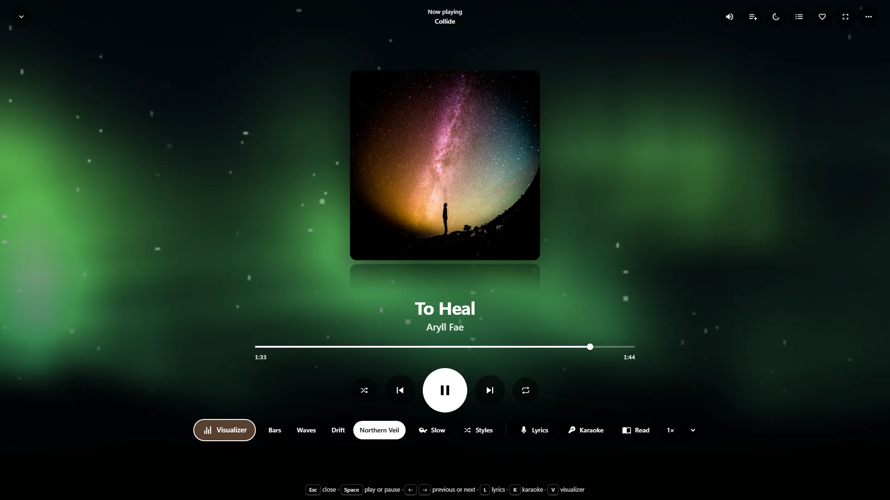
*A WittyVisualizer effect. [Collide](https://archive.org/details/SRS08807), Aryll Fae, [CC BY 4.0](https://creativecommons.org/licenses/by/4.0/).*

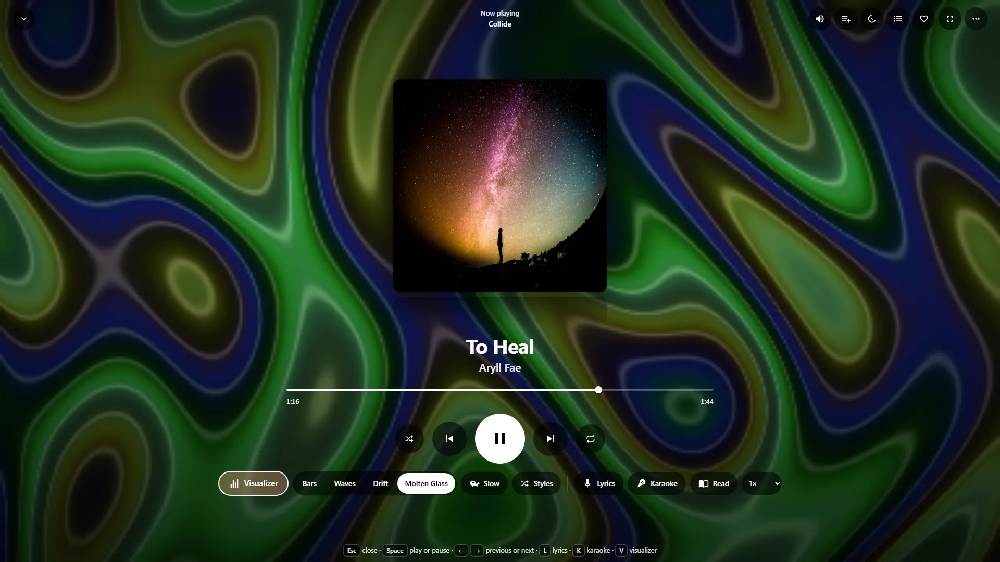
*A WittyVisualizer effect. [Collide](https://archive.org/details/SRS08807), Aryll Fae, [CC BY 4.0](https://creativecommons.org/licenses/by/4.0/).*

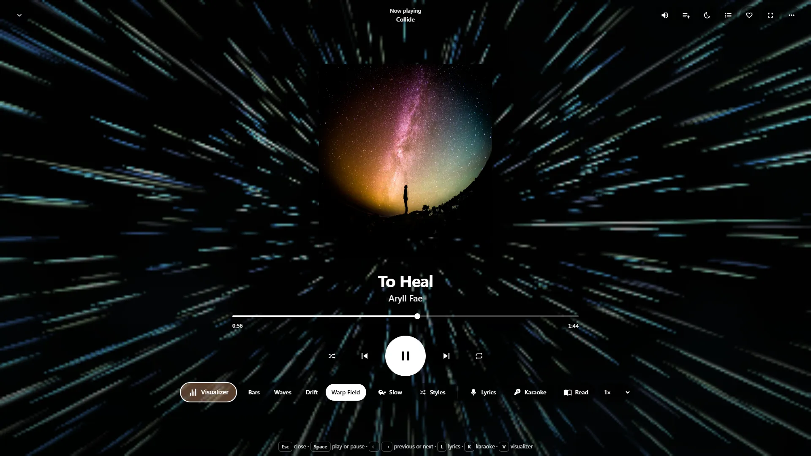
*WittyVisualizer. [Collide](https://archive.org/details/SRS08807), Aryll Fae, [CC BY 4.0](https://creativecommons.org/licenses/by/4.0/).*

- **Bars, Waves and Drift** are soft shapes in the artwork's colour. They don't flash, so they come with no warning.
- **More** has every other effect WittyVisualizer offers. A notice about flashing comes first, once, with the choice of calm mode. Choose **Not now** and it goes back to Bars.
- **Effect settings and your own effects…**, at the end of **More**, opens the full view, with its settings.
- **Slow** is a slower, gentler pace for whichever one is showing. Devices set to reduce motion start that way.
- **It never changes by itself unless you ask.** To have it change, press the shuffle button beside **Slow** and choose how often, from every 15 seconds to every 10 minutes. Then choose **Bars, Waves and Drift** or **Every effect**. Every effect only includes the others once you've read the notice, and with **Slow** on it keeps to the gentle ones.

Your choices are kept with your account, so they follow you between devices.

If the sound can't be read, the shapes move slowly on their own and aren't following the music. This happens when the server is on a different address from the page, and on iPhones and iPads.

The CD player has its own **Visualizer** button, which shows WittyVisualizer's effects.

## Sound

Open **More → Sound: equaliser and more** in the full player. These settings are kept on each device, because speakers differ.

- **No gaps** starts the next song right as this one ends, and is on by default. How close it gets depends on the file, as formats like MP3 have a little silence built in at each end.
- **Crossfade** runs from 2 to 12 seconds. Songs of the same album aren't crossed unless you tick **Also within an album**, as they're often meant to run together.
- **ReplayGain** levels the volume using tags in your files: **Each song the same** or **Keep each album's balance**. Songs without those tags play as they are. Tools such as MusicBrainz Picard can add them.
- **Equaliser** has ten bands, presets and an overall level. If boosting makes loud parts crackle, lower the overall level a little.

No gaps and crossfade work for files sent as they are. Formats converted while playing follow their own rules, and so do CD images.

These limits are worth knowing:

- On iPhones and iPads, the equaliser and leveling stop when the screen locks, and playing without them keeps going. This hasn't been run on a real iPhone or iPad yet.
- With a server on a different address from the page, the browser doesn't allow them at all, and the panel says so.

## Audiobooks

A library of the kind **Audiobooks** uses the *album* tag (or the folder) as the book, and the *artist* (or the parent folder) as the author. Each file is a chapter. Its tabs are **Home**, **Books** and **Authors**.

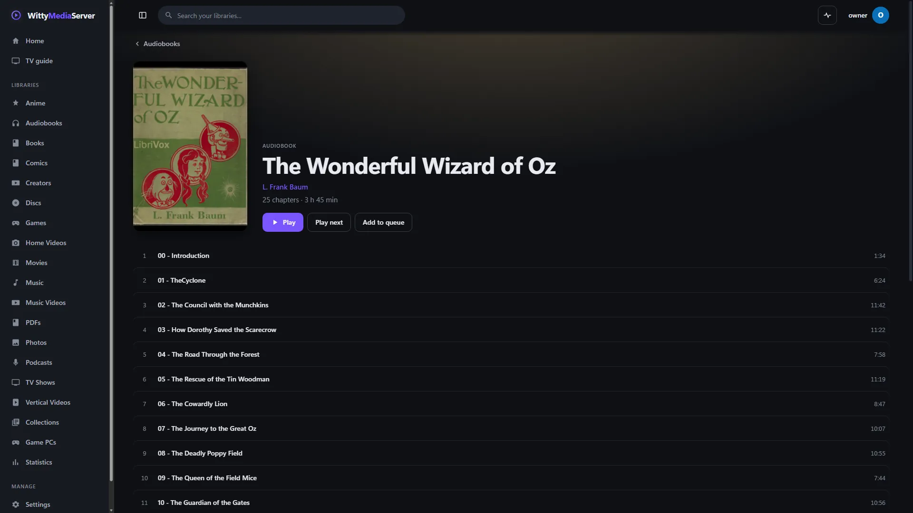
*An audiobook's page. Openly licensed and public-domain media, credited in [the list](images/CREDITS.md).*

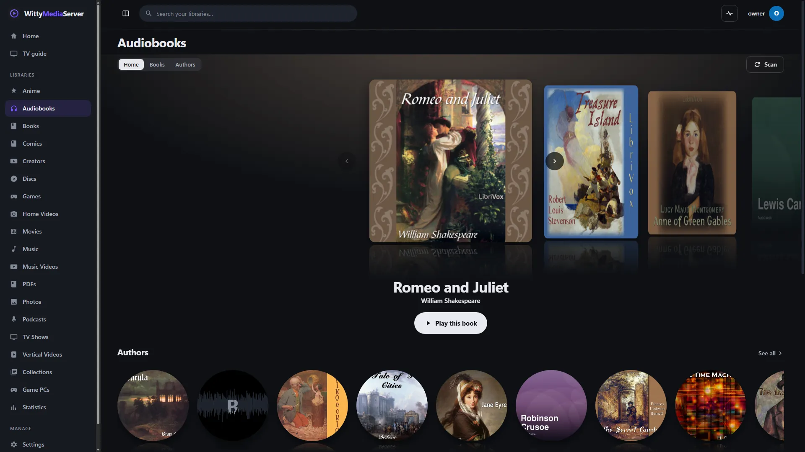
*Audiobooks, public-domain readings credited in [the list](images/CREDITS.md).*

- **Your place is saved** every 15 seconds while you listen, for your account, so you can carry on from any device. **Continue listening** on the home page, and **Continue** on a book's page, take you back.
- **Back 15 seconds** and **Forward 30 seconds** replace shuffle and repeat.
- **Speed** runs from 0.75× to 3× with the voice pitch kept, up to the fastest speed the server allows. Each kind of listening keeps its own speed on that device, so 1.5× for a book doesn't carry over to your next album.
- **The sleep timer** can also stop **At the end of this chapter**.

Lyrics, karaoke and online lyrics are for music libraries only.

## Podcasts


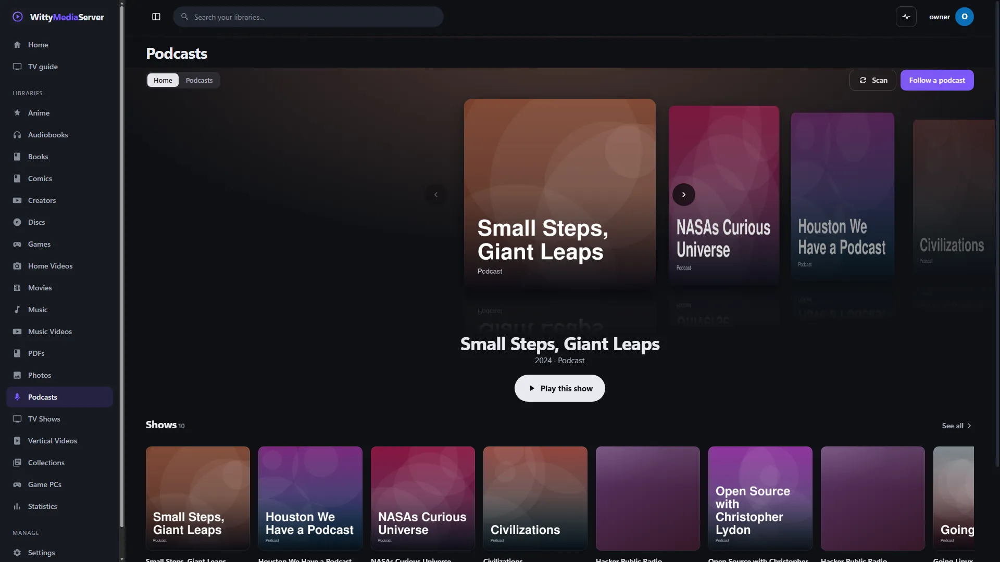
*Podcasts under open licences, credited in [the list](images/CREDITS.md).*
1. Add a library of the kind **Podcasts**. A folder is optional: it holds episode files you already have, and it's where downloads are saved.
2. Choose **Add, then follow shows**, or **Follow a podcast** on the library's page later.
3. Search the directory by name, or switch to **RSS feed address** and paste the show's feed. Private and members-only feeds work too.

Only admins can follow shows or download episodes. Everyone with access to the library can listen.

- New episodes are picked up every 2 hours, or with **Check for new episodes** on the show's page.
- Episodes play through your server, so your devices never contact the podcast's host, and seeking works as usual. Old `http://` feeds work on secure pages.
- **Download** keeps one episode in the library's first folder, as `<podcast>/<date> <title>`. **Keep downloaded** does it automatically for the newest 1, 3, 5, 10 or 25.
- **Unfollow** removes the episodes that weren't downloaded. Downloaded files stay.
- Episodes marked explicit are rated TV-MA, so Kids and Guest profiles don't see them.

Search results come from the free Apple Podcasts directory: what an admin types goes there from your server, and the cover pictures in the results load straight from Apple to that person's browser.

For safety, feeds and episodes are only fetched from the internet. The server refuses to connect to itself or to devices on your local network on a feed's behalf.

## Internet radio

A library of the kind **Internet radio** needs no folder. Press **Add stations** on its page, then search a free directory, type a stream address, or add a playlist. Stations play in the same bar and full player, without seeking or speed, and a stream that drops is tried again a few times.

Everything about stations, including what contacts what, is in [Collections, radio and Your year](COLLECTIONS.md#internet-radio).

## Audio CDs

Images of your audio CDs play in a CD player of their own, in the spirit of the desktop players of the early 2000s: the disc spins behind a window, and a lit display shows the track, index and time beside the list of tracks. This needs the **WittyCD** module.

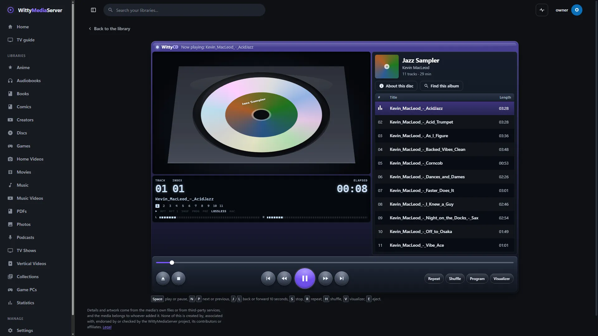
*The CD screen. An image authored for testing from Jazz Sampler, Kevin MacLeod, [CC BY 3.0](https://creativecommons.org/licenses/by/3.0/).*

**Which library should you use?**

- **Music,** unless you want your CDs on the same shelf as your films. The image becomes an album, with its tracks in **Songs** and search like any others. Press **Insert disc** on its page to bring up the player.
- **DVDs, Blu-rays & CDs,** to keep them on the shelf with your other discs.

**Formats:** `.cue` with `.bin`, `.wav`, `.aiff` or one `.flac`; `.toc`; `.ccd` with `.img`; `.nrg`; `.chd`; and a bare `.iso`, `.img` or `.bin` that's really audio, which plays as one long track because nothing says where the others begin. A sheet beside already tagged per-track files, or beside files such as MP3, is left alone, and those stay ordinary songs.

### What the player does

- **No gaps.** The whole disc goes as one continuous stream, so a live album plays as it was laid out, pregaps included. The display counts down through a pregap.
- **Quality.** It sends lossless sound as FLAC or WAV, and moves to compressed AAC if the connection keeps stalling. **About this disc** shows what it's sending and has **Sound quality**: **Automatic**, **Always lossless** or **Always compressed**. Limits for people away from home apply as usual.
- **Your place on the disc** is kept for each person, on every device.
- **Repeat, Shuffle and Program.** **Program** lets you choose your own order with the plus buttons. Neighbouring tracks of the disc play with no gap.
- **Hidden tracks.** Audio hidden before track 1 is listed as **Hidden track**. Pressing Previous at the start of track 1 finds it too.
- **Pre-emphasis,** a treble boost on some early CDs, is corrected, and the display shows **PRE**.
- **Index points** have **Index −** and **Index +** when a track has them.
- **CD+G pictures** show from a `.cdg` file beside the image, and **Pictures** turns them off.
- **The time display** changes between elapsed, remaining and disc left when you press it.
- **The music keeps playing** in the bar along the bottom when you leave the page.

Lyrics and karaoke aren't part of the CD player. Tracks can't have them while a disc is playing.

### Names and covers

A disc's own text comes first (CD-TEXT or the sheet), then its folder and file names. Each new disc is also looked up on MusicBrainz, using only its table of contents: see [Metadata](METADATA.md#audio-cds). A cover beside the image always wins.

An admin can press **Find this album** or **Change album**. If several albums match, the disc keeps its own names and offers **Choose from N matches**.

### Keys

| Key | What it does |
|---|---|
| Space or K | Play or pause |
| N, P | Next or previous track |
| J, L | Back or forward 10 seconds |
| S | Stop |
| R | Repeat |
| H | Shuffle |
| V | Visualizer |
| E | Eject |

Remotes and controllers move around the deck as they do everywhere else.

### If a disc is damaged or sounds wrong

A damaged image plays as far as it goes, and says so. To find out what's wrong with one, use **Settings → WittyDiagnoser**: see [WittyDiagnoser](DIAGNOSER.md).

Plain CD audio has no copy protection. An image whose audio looks like noise may be damaged, scrambled or copy protected, and the player warns you before playing it. Nothing here unscrambles it, so a clean copy is the way to play it. DTS surround discs are reported the same way, because they'd play as loud noise.

## Formats

MP3, AAC and M4A, FLAC, Opus, Ogg Vorbis and WAV go to the browser as they are, with instant seeking and no work for the server. ALAC, WMA, APE, WavPack, AIFF, DSD and others are converted to AAC while playing. MIDI files are played through the server's own synthesiser. Every format is in [Supported formats](SUPPORTED-FORMATS.md#music-and-audio).

---

<sub>WittyMediaServer documentation</sub>
