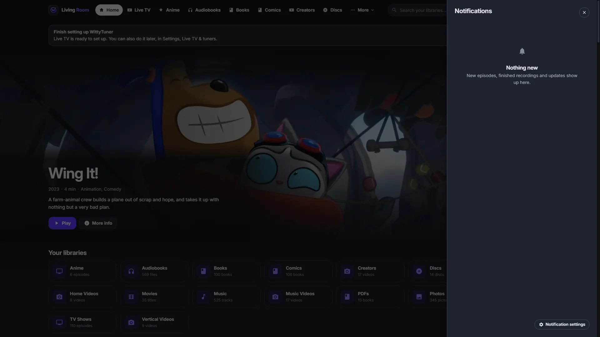
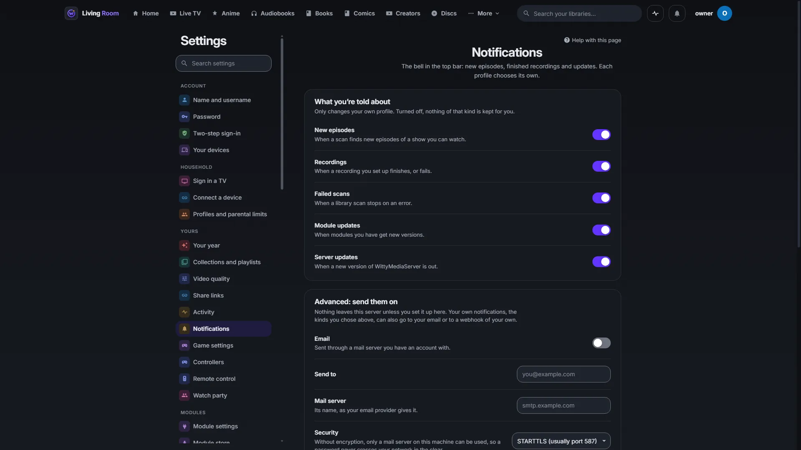

# Notifications

The bell in the top bar, beside the activity button, tells you what happened on your server while you
weren't looking. Each profile has its own bell and its own list.

## What you're told about

| Kind | Who gets it | When |
|---|---|---|
| New episodes | Everyone who can open the show | A scan finds episodes that weren't there before. Several of one show come as one notification |
| Recordings | Whoever set the recording up (administrators, for a recording nobody owns now) | A recording finishes, or fails |
| Failed scans | Administrators | A library scan stops on an error |
| Module updates | Administrators | The module store has new versions of modules you have |
| Server updates | Administrators | A new version of WittyMediaServer is out |

The first scan of a new library finds everything, so it tells nobody anything. Guest profiles get no
notifications: they're for anyone passing through.

Kids' profiles and profiles with limits are only told about shows they're allowed to open.

## The bell

The number on the bell is how many you haven't read. Open it to see the list, newest first. Choosing a
notification marks it read and takes you to what it's about. **Mark all read** clears the number;
**Clear** forgets them. The server keeps the newest 200 for each profile, for 90 days at most.


*The bell, on a test server with nothing new yet.*

On a TV, the bell is in the top bar like everything else: move to it with the remote and press OK.

The WittyMediaClient apps show the same bell and list. On Android, the app can also show a notification in
the phone's own notification area while it's open; it asks first, and you can turn that off on the
**Notifications** settings page.

## Choosing what you get

**Settings → Notifications** lists the kinds your profile can get. Turn off any you don't want. This only
changes your own profile.


*Settings, Notifications.*

## Sending them on (Advanced)

Nothing leaves your server unless an administrator sets it up. Under **Advanced** on the Notifications
settings page, an administrator can have their own notifications (the kinds they chose) sent on as well:

- **Email**, through a mail server you have an account with. Give its name, port and security (STARTTLS on
  port 587 is the usual one; TLS is port 465), the account's name and password, and the address to send
  to. Without encryption, only a mail server on the same machine can be used, so a password never crosses
  your network in the clear.
- **A webhook**: an address on a service of your own (a home automation hub, a chat bot) that is sent each
  notification as JSON. Give it a secret and each delivery is signed with it in the
  `X-WittyMediaServer-Signature` header (`sha256=` and the HMAC of the body), so the service can tell the
  message came from your server.

**Send a test** sends one through each channel that's filled in and says what went wrong, if anything.

The mail server's password and the webhook's secret are kept in the server's database and are never shown
again, only whether one is set. Each administrator's channels carry only their own notifications.

What a webhook is sent:

```json
{
  "server": "Living room",
  "kind": "episodes",
  "title": "New episode of The Show",
  "body": "S2 E5 · The Episode",
  "link": "/show/12",
  "at": 1795000000
}
```

`link` is a path in the web app: put your server's address in front of it to open it.

---

<sub>WittyMediaServer documentation</sub>
