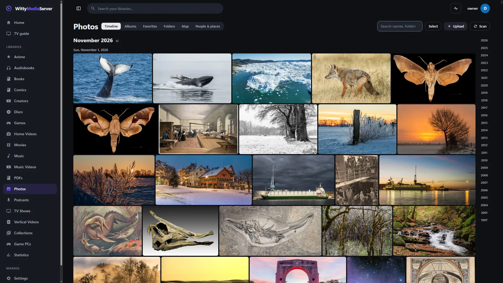
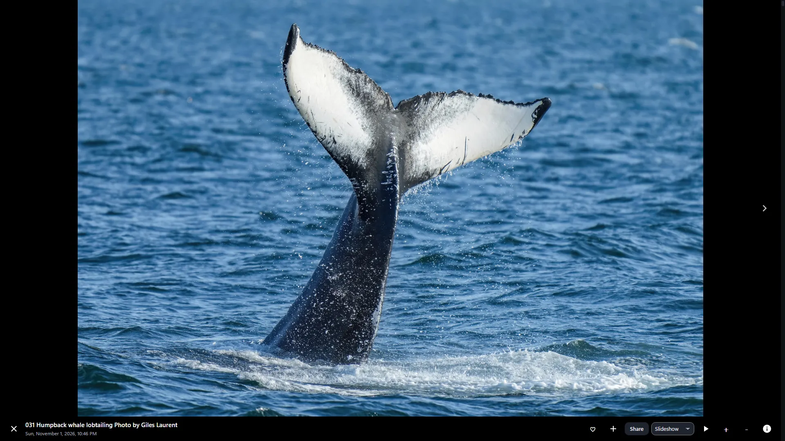
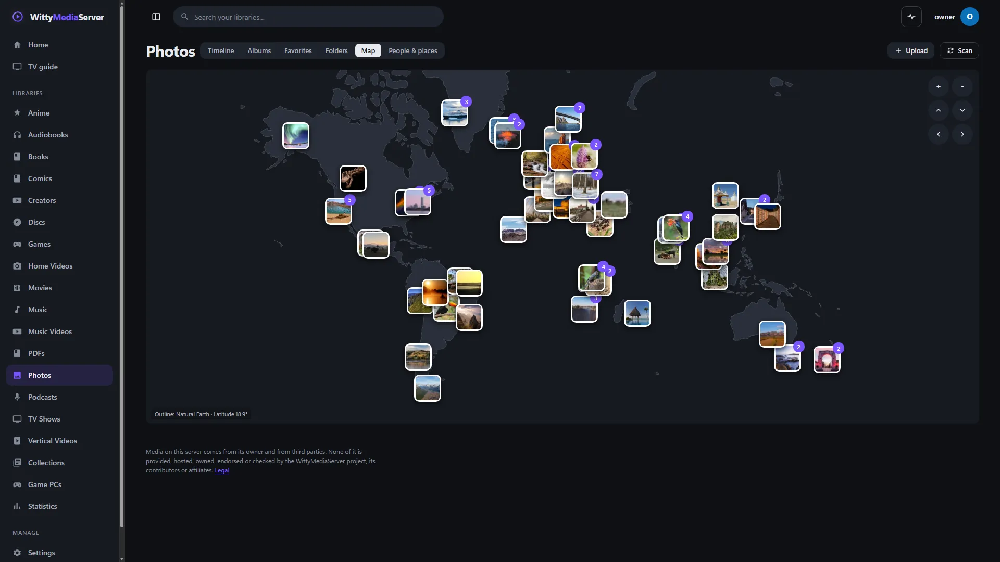
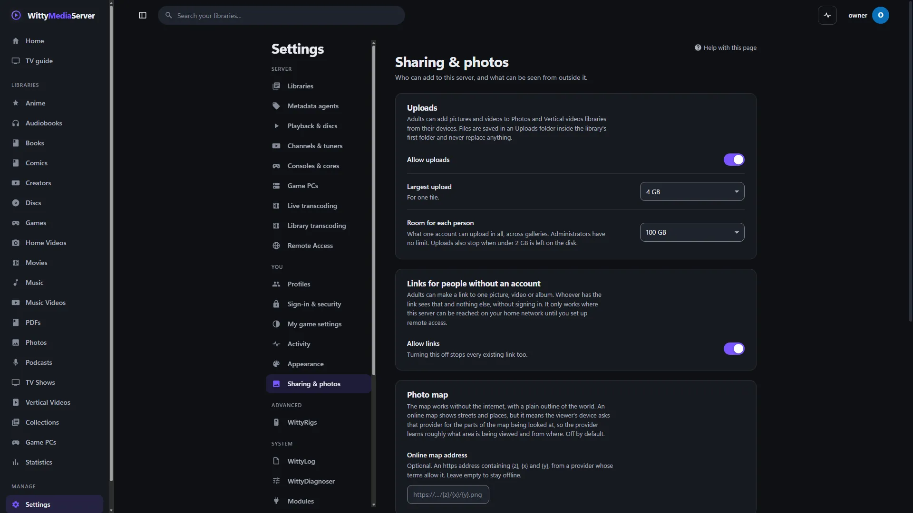

# Photos

Use this guide to set up a gallery of your own pictures and clips, then browse it by timeline, albums, folders and map, upload to it and share from it. Nothing is looked up online, and your files are never changed.

The Android and Apple apps can't open photo libraries yet, so use a browser or the desktop app.

## Setting it up

1. Go to **Settings → Libraries**, or use first-time setup, and choose **Photos**. If it's listed under **Add a module to use these**, press **Add WittyPhotos** first.
2. Choose the folders your pictures are in. Everything below them is picked up, in any layout.

Scanning reads only the start of each file, so a large collection scans quickly. Thumbnails are made the first time a picture is looked at, a few at a time, and kept. They live in the `thumbs` folder of the server's cache, and it's safe to delete it: they're made again as needed.

| Kind | Formats |
|---|---|
| Pictures | JPEG, PNG, GIF, WebP, BMP, TIFF, HEIC and HEIF, AVIF, JPEG XL, and the others in [Supported formats](SUPPORTED-FORMATS.md#photos) |
| Camera RAW | CR2, CR3, CRW, NEF, NRW, ARW, SRF, SR2, DNG, ORF, RW2, RAF, PEF, SRW, 3FR, FFF, ERF, KDC, DCR, MEF, MOS, MRW, IIQ, X3F, RWL |
| Clips | MP4, MOV, MKV, WebM, AVI and the other video formats the server plays |

HEIC and JPEG XL depend on the FFmpeg the server uses. A picture that can't be read shows its name instead of a thumbnail.

**RAW files show the preview the camera stored inside them.** They aren't developed: this gallery is for looking through pictures, not editing them.

Two things are grouped for you:

- A RAW file with a JPEG of the same name beside it shows once, as the JPEG.
- A short clip, up to 40 MB, with a picture of the same name beside it, becomes that picture's **Live** button instead of a separate entry. Phones save live photos this way. A motion clip inside the picture file itself is found too.

## Dates and places

A picture's date comes from its EXIF, then from its file name (`IMG_20230412_153045`, `2023-04-12 15.30.45`), then from the file's date. It's kept as the time on the clock where the picture was taken, so it stays in its month wherever you view it from.

Places come from EXIF GPS tags, and from the location tag of clips. Phones and some cameras write these.

## The screens

*The timeline, with pictures from [Wikimedia Commons](https://commons.wikimedia.org/), each credited in [the list](images/CREDITS.md).*
- **Timeline:** by month and day, newest first. A month loads when it comes into view, and the years down the side jump. Search looks through names, folders and cameras.
- **Albums:** yours, and those others have shared. An album belongs to whoever made it. Tick **Share with other profiles who can open this library** and every such profile can see it, each within their own limits. **Select**, in the timeline, adds many pictures at once.
- **Favorites:** the heart on a picture. Favourites are per profile.
- **Folders:** your folders, as they are on disk.
- **Map:** pictures with a place, grouped as you zoom. Choosing a group zooms in, or lists its pictures.
- **People & places:** marked **Planned**. It's waiting on a local AI that doesn't exist yet, so nothing looks at your pictures today.

## The picture viewer

Press a picture to open it. **Details** shows its date, file, camera, exposure and place, with **Download the original**. **Slideshow** runs at 2, 3, 5, 8 or 15 seconds a picture. A clip plays to its end before the slideshow moves on.

*The viewer, with pictures from [Wikimedia Commons](https://commons.wikimedia.org/), each credited in [the list](images/CREDITS.md).*

| Key | What it does |
|---|---|
| ← → | Previous or next picture. When zoomed in, these move the picture |
| + − | Zoom in or out. The wheel and a double-click do too |
| I | Details |
| F | Favourite |
| Enter or Space | Start or stop a slideshow at 5 seconds a picture |
| Esc | Close |

**With a TV remote:** ← and → step, OK starts or stops the slideshow, ↓ reaches the buttons, and Back closes.

On a touch screen, swipe to step.

## The map and the internet

The map needs nothing online. A small outline of the world's land comes with the app, from Natural Earth, which is public domain, and the groups of pictures come from your server.

*The map, with pictures from [Wikimedia Commons](https://commons.wikimedia.org/), each credited in [the list](images/CREDITS.md).*

If you want streets and place names, an admin can give an online map's address in **Settings → Sharing & photos**, under **Photo map**. It's off by default.

When it's on, **each viewer's device asks that provider for the parts of the map being looked at**, so the provider learns roughly what area is being viewed and from where. The pictures themselves stay on your server. Use a provider whose terms allow it.

## Uploads

Adults and admins see **Upload** in the gallery, and can drop files onto it. Kids and Guest profiles can't upload. A library needs a folder for this to appear.

Files are saved in `<the library's first folder>/Uploads/<profile>/<year-month>/` and appear at once. Uploads:

- never replace a file: a name already taken gets a number;
- are checked by their first bytes as well as their name, so a web page called `photo.jpg` is refused;
- stop when under 2 GB is left on the disk.

An admin can change these in **Settings → Sharing & photos**, under **Uploads**:

| Setting | Choices | Starts at |
|---|---|---|
| **Allow uploads** | On or off | On |
| **Largest upload** | 512 MB to 64 GB, for one file | 4 GB |
| **Room for each person** | 10 GB, 100 GB, 1 TB or no limit. Admins have no limit | 100 GB |

## Sharing

*Settings, Sharing & photos.*
**Share** on a picture, clip or album gives two ways. Adults and admins can use it.

- **With other profiles here:** a link for anyone signed in who can open this library. They still see only what their limits allow.
- **With someone without an account:** press **Make a link**, with an end date of 1 day, 7 days, 30 days, 1 year or no end date. They see only that and your profile name, with no way into the server.

For someone without an account, pictures are re-encoded, so camera details and locations stay home. Clips whose file says where they were shot go through the converted stream for the same reason. Tick **Allow downloading the original files** only if you mean it: an original carries everything in the file.

The server keeps only a fingerprint of a link, so **a link is shown once**. Copy it then.

- End one with **End link** in **Settings → Sharing & photos**, under **Your links**.
- Turn **Allow links** off to stop every link at once.
- A link stops working if the person who made it can no longer see what it shows.
- A link works wherever your server can be reached: only on your home network until you set up [remote access](REMOTE.md).

## Profiles

Each library can be limited per account, as everywhere. Pictures have no age rating, so **Kids and Guest profiles see no photos** unless you allow titles without a rating, or that library, in their limits under **Settings → Profiles**. Kids can favourite but can't upload or share. A Guest can only look.

## For developers

Every route is in [Client API](CLIENT-API.md#every-route), and everything is on the server as JSON. Clips are ordinary video items, played with `GET /api/items/{id}/play`, direct or HLS.

| Route | What it gives |
|---|---|
| `GET /api/photos/months?library=` | Months with pictures, for a timeline |
| `GET /api/photos/list?library=&ym=&album=&folder=&favorites=&kind=&search=&bbox=&limit=&cursor=` | One page, newest first, with `nextCursor` |
| `GET /api/photos/{id}` | One picture's details, including EXIF and place |
| `GET /api/photos/folders?library=` | Folders |
| `GET /api/photos/map?library=&zoom=` | Groups of pictures for a map zoom |
| `GET /api/items/{id}/image?w=` | A JPEG at 160, 320, 480, 640, 1280, 1920 or 2560 pixels. Without `w`, the original if it's a web format, otherwise a large JPEG |
| `GET /api/items/{id}/original` | The file, to download |
| `GET /api/items/{id}/motion` | A live photo's clip |
| `PUT /api/items/{id}/reaction` `{value}` | Favourite (1) or not (0) |
| `POST /api/libraries/{id}/upload` | Multipart upload, field `file` |
| `POST /api/shares` | Make a link: `{kind, id, days, allowDownload}` |
| `GET /api/share/{token}` | What a link opens, without an account. `…/image/{id}`, `…/play/{id}` and `…/original/{id}` serve its contents |

---

WittyMediaServer documentation
