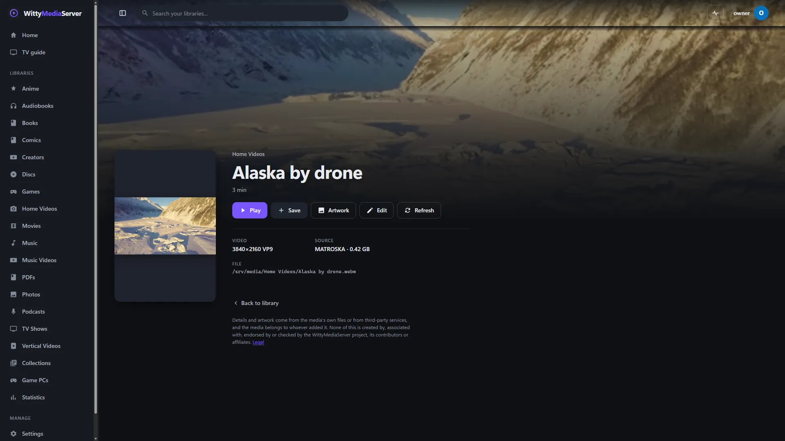
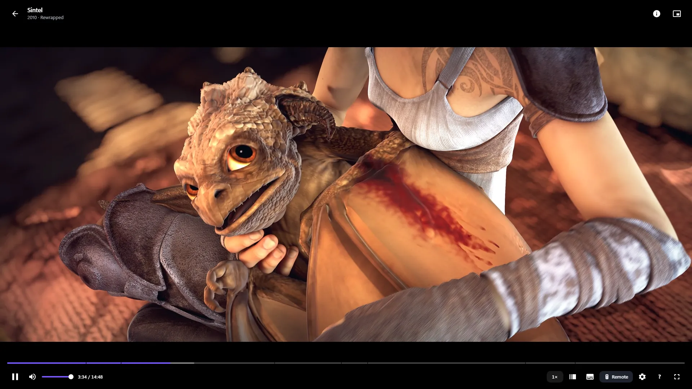

# Watching and listening

Use this guide to get the most from the player: its controls and keys, tracks and subtitles, and what happens behind the picture. It also covers TV remotes, controllers and the mini player.

This is about the player in a web browser and the desktop app. The apps for phones and TVs have their own player: see [Apps and devices](APPS.md).

## Starting something

Open a title and press **Play**. If you've started it before, the button says **Resume from** and the time, with **Play from start** beside it.

*A home video's page. Openly licensed and public-domain media, credited in [the list](images/CREDITS.md).*

Discs have their own buttons. See [DVDs](DVD.md) and [Blu-rays](BLURAY.md). Music, audiobooks and podcasts play in a bar along the bottom instead: see [Music](MUSIC.md). Books open in a reader: see [Books](BOOKS.md). Live channels have their own player: see [Live TV](TV.md).

## The player's controls

Move the pointer or press a key and the controls appear. They hide again after 3.5 seconds unless you change that under [Viewing settings](#viewing-settings).

*The player. [Sintel](https://durian.blender.org/), Blender Foundation, [CC BY 3.0](https://creativecommons.org/licenses/by/3.0/).*

Click the picture to pause or play. Double-click for full screen.

**Along the top:**

| Control | What it does |
|---|---|
| Back arrow | Goes back to the page you came from, and keeps playing in the [mini player](#the-mini-player) |
| The title line | The title, then how it's playing: **Direct play**, **Rewrapped** or **Transcoding** |
| Info button | Opens [How this is playing](#how-this-is-playing) |
| **Next episode** | Goes straight to the next episode, when there is one |
| Mini player button | Shrinks the player into the corner |

**Along the bottom:**

| Control | What it does |
|---|---|
| The timeline | Shows where you are. Click to jump. Small marks are chapters |
| Play and pause | Space does this too |
| Mute and volume | Hidden on narrow screens, where the device's own buttons do this |
| Speed, such as **1×** | Slower or faster. Voices keep their pitch |
| **Scenes** | Appears when there's more than one [chapter](#chapters), and lists them |
| **Audio & language** | Appears when there's more than one [sound track](#sound-tracks-and-subtitles) |
| **Subtitles** | Appears when the title has any |
| **Remote** | Shows a [remote on screen](#the-remote-on-screen) |
| Gear | [Viewing settings](#viewing-settings) |
| **?** | Lists every key |
| Full screen | F does this too |

The speeds go from 0.5× up to what the server allows, which is 4× unless an administrator has changed it under [Playback & discs](SETTINGS.md#playback-and-discs). Above 4×, most browsers mute the sound.

## Keyboard shortcuts

Press **?** in the player to see these.

| Key | What it does |
|---|---|
| Space or K | Play or pause |
| ← and → | Back 10 seconds, forward 10 seconds |
| ↑ and ↓ | Volume up or down |
| M | Mute or unmute |
| < and > | Slower or faster |
| F | Full screen |
| R | Show or hide the remote |
| I | How this is playing |
| Esc | Close a window, or shrink the player |
| ? | The list of keys |

With the timeline selected, Page Up and Page Down move a minute, and Home and End go to the start and the end.

**On a disc,** some keys change:

| Key | What it does |
|---|---|
| Arrow keys and Enter | Move around the disc's menu and choose |
| M | The disc's menu, or its pop-up menu on a Blu-ray |
| T | The title menu |
| A and S | Choose a sound track, choose subtitles |
| N and P, or Page Down and Page Up | Next and previous scene |
| 1 to 9 | Jump to that scene, or press that menu button |
| F1 to F4 | The colour keys, on a Java menu |

**With music on the full player:**

| Key | What it does |
|---|---|
| Space | Play or pause |
| ← and → | Previous and next track |
| , and . | Back and forward 10 seconds |
| L, K and Q | Lyrics, karaoke and the queue |
| S and R | Shuffle and repeat |
| M, V and F | Mute, the visualizer and full screen |

## Sound tracks and subtitles

Press **Audio & language** or **Subtitles** to open a screen of large tiles, one for each choice. A tick shows the one in use. Changing a track keeps your place.

- **Sound tracks** show the language, and the format and channels.
- **Subtitles** have **Off** first. Text subtitles are drawn by the player over the picture.
- **Subtitles stored as pictures**, as on many discs, have to be drawn into the video itself, so choosing one means the server converts the video while you watch.
- **Styled subtitles** can appear twice. The second tile says **With its styling** and **Drawn into the picture**. It keeps the fonts and placement, and the server has to convert the video to do it.

If subtitles can't be loaded, the player says so and carries on playing.

## Chapters

The player calls chapters **scenes**. They show as small marks on the timeline, and **Scenes** lists them all with their start times. On a disc each one has a picture. Choose one to jump there.

## Skip intro

**Skip intro** appears while the intro is playing. Press it to jump to where the intro ends.

The server works out where the intro is from the file's chapters. If it can't, an administrator can set it by hand: open the title's **Edit**, go to **Skip intro**, and type where it ends or choose **Pick in player**. Setting it on a show covers every episode with no intro of its own. See [Metadata](METADATA.md). Discs have their own menus, so they don't offer this.

## What's next

In the last 30 seconds, a card offers what to watch next. At the end of an episode it counts down from 8 seconds, then plays the next episode. **Dismiss** stops it. After a film or the last episode, it suggests something else instead, and doesn't start by itself.

## Resuming and what counts as watched

Your place is saved as you watch, about every 10 seconds, and when you leave. It belongs to your profile, so you can stop on one device and carry on from another.

- **Under a minute in:** it starts from the beginning next time.
- **Past that:** you can resume. It also appears in **Jump back in** on the home page.
- **More than 92% through:** it counts as watched and gets a tick. Next time it starts from the beginning.

Library pages have a filter for **Watched** and **Not watched yet**.

## Quality, direct play and converting

Many video files can't play on every device. Each time you press play, your device says what it can handle, and the server picks the simplest way to get it there:

| What the player shows | What it means | Work for the server |
|---|---|---|
| **Direct play** | The file is sent as it is. It's the full quality, and jumping around is instant | None: your device does the work |
| **Rewrapped** | The picture and sound are fine, but the file's outer format isn't, so they're moved into one your device can open | Very little |
| **Transcoding** | The picture or sound has to be converted while you watch. This is the only one that takes real work | A lot |

There's no quality menu in the player. Quality comes from what the file is, what your device can play and the limits set by an administrator:

- **At home,** under [Live transcoding](SETTINGS.md#live-transcoding).
- **Away from home,** under [Limits for viewers away from home](REMOTE.md#limits-for-viewers-away-from-home).

Occasionally a browser says it can play a file and then can't. The player notices and asks the server to convert it, once, without you doing anything.

### Robust streaming

For a slow or unreliable connection: a hotel's Wi-Fi, a phone on a train, a home connection that's slow to send. It favours keeping the video playing over the sharpest picture. An administrator can turn it on for everyone away from home, under [Playback & discs](SETTINGS.md#playback-and-discs), and each device can choose for itself, in the player's [viewing settings](#viewing-settings) or on that settings page. A device's own choice wins, at home or away, so it helps on poor Wi-Fi at home too.

With it on:

- **It measures your connection first**, in about a second, and starts at a steady quality that fits in part of it: 1080p, 720p, 480p, 360p or 240p, never above the film's own or the limits an administrator set.
- **It steps down instead of stalling.** When the picture stops to wait, the player moves to the next quality down within a few seconds, and back up once things have been smooth for a minute.
- **It keeps a bigger buffer**, a minute ahead rather than half that, so a short drop goes unnoticed.
- **It keeps trying when the connection drops**, waiting a little longer each time, and picks up where you were once it's back. If the server has ended the stream meanwhile, it asks for a new one at the same place.
- **Segments are two seconds long**, each starting with a full picture, so changing quality or picking up again is quick.
- **A file that could play as it is** is still sent as it is when it needs no more than half of what the connection carries. If it stalls for long anyway, the player asks for the steady stream instead, from the same place.
- **The player says what it did**, briefly over the picture ("Picture lowered to 480p to keep playing", "Reconnected after 12 s, at the same place"), and lists it under [How this is playing](#how-this-is-playing).

It costs the server more work than standard streaming, since more videos are converted, but only one quality of each video is converted at a time.

### How this is playing

Press the info button, or I, to see this. It says what the file is, what's happening to its picture, sound and subtitles, how much work that is for the server, and why it isn't simpler. Use it first when a film stutters or won't start.

Two choices can appear here:

- **Show it in 2D**, for a 3D film stored with both eyes in one frame.
- **A list of video streams**, for a file holding more than one, such as other camera angles.

See [Supported formats](SUPPORTED-FORMATS.md) for what plays and how.

## Viewing settings

The gear in the player. **Apply to** chooses **This video** or **Everything**. These are saved on this device, not on your profile.

- **Seek bar** and **Chapter marks** show or hide those.
- **Remote** and **Remote style** are for the [remote on screen](#the-remote-on-screen).
- **Hide controls after** is 2, 3.5 or 6 seconds, or **Never**.
- **Picture** is **Fit**, with black bars if needed, or **Fill screen**, which zooms and crops.
- **3D video** is for a film stored **Side by side** or **Over-under**. **Show 3D as** gives one eye's view, or red and cyan for glasses.
- **Streaming** is this device's choice of [robust streaming](#robust-streaming): **Server's choice**, **Standard** or **Robust**. It applies to everything on this device, and changing it picks the video up again at the same place.

On discs there are also **Forced captions**, **Disc restrictions** and **Subtitle size**.

## The remote on screen

**Remote**, or R, shows a remote you can use with the mouse or by touch. You can drag it by its header, and it remembers where you put it. **In control bar** under Viewing settings shows its buttons in a strip instead. Keys that only make sense on a disc are greyed out for ordinary videos.

## The mini player

The back arrow or Esc shrinks a video into the corner while you carry on browsing. Esc leaves full screen first, if you're in it.

The mini player has back 10 seconds, play and pause, next episode, **Full player** and **Stop**. Double-click it or click its title to bring back the full player.

Music has a bar of its own along the bottom, which can fold away to a small picture. See [Music](MUSIC.md).

## TV remotes and controllers

Everything works with arrow keys and OK alone, so a TV remote or a game controller can reach every control.

- **Arrows** move to the nearest control in that direction. Coming back to a row lands where you left it.
- **OK** presses what's selected.
- **Back** goes back a page, or closes what's open.

**In the player,** the arrows belong to the picture: left and right jump 10 seconds, and up and down change the volume. Press **OK** to reach the controls. It goes first to anything asking for an answer, such as **Skip intro**, then to the controls. To give the arrows back to the picture, move up or down past the last control.

**On a TV across the room,** turn on **TV mode** under [Appearance](SETTINGS.md#appearance): the app as the Apple TV and Android TV apps have it, with Home, Libraries, Games, Live TV, Search and You along the top. On a TV browser with no easy way to reach Settings, add `?tv=1` to the server's address. `?tv=0` turns it off again. In TV mode, up from a page's first row reaches the bar along the top; **Back** goes from inside a page to the bar, from the bar to Home, and from a page opened from one of them back to it; and **Back** in the player stops it. For games on a sofa, see [Couch mode](APPS.md#big-screens).

**Game controllers** connect by themselves. Nintendo layouts have A and B swapped, so the right-hand button still confirms.

| Button | In the app | Also in the player |
|---|---|---|
| D-pad or left stick | Move | |
| A or Cross | OK | |
| B or Circle | Back | |
| X or Square | | Play or pause |
| Y or Triangle | | Mute, or a disc's menu |
| Bumpers | In TV mode, the tab to the left or right | Previous and next scene on a disc |
| Triggers | | Rewind and fast-forward on a disc |
| View, Share or Select | | A disc's title menu |
| Menu, Options or Start | In TV mode, the page's options: Customize on Home, Look in the TV guide, Filters on a library | A disc's menu |

These have been run with simulated key presses and no real remote or controller. While a game is playing, the controller belongs to the game: see [Games](GAMES.md).

## The activity button

The round button in the top bar, just left of your name, shows the server's background work, such as library scans. A ring around it shows progress and a number shows how many tasks there are. An exclamation mark means something had a problem.

Press it for two tabs: **Now** and **History**. Where a task allows it, you can **Pause**, **Resume** or **Cancel** it.

Only administrators see it unless an administrator allows others, who then get a read-only view. To hide it for yourself, or change who sees it, go to [Activity](SETTINGS.md#activity). See [Background tasks](TASKS.md).

## Moving posters

Film and show posters lean toward your pointer as it crosses them, with a soft light moving over them. With a remote they settle in gently as you reach them.

**To turn it off:** go to **Settings → Appearance → Motion and big screens** and turn off **Moving posters**. The choice follows you to your other devices.

It's off by itself on a device set to reduce motion or to save data, and on a very modest one, and that section says why. There's no tilt on touch screens.

## If it won't play

| What you see | What to do |
|---|---|
| "Playback failed" and a reason | Press **Back** and try again. If it keeps happening, the reason is the thing to look up in [Troubleshooting](TROUBLESHOOTING.md) |
| "The stream has ended on the server" | The server restarted. Start playing again |
| It stops and starts | Open [How this is playing](#how-this-is-playing). If it says **Transcoding**, the server may not be keeping up: see [Transcoding](TRANSCODING.md) |
| It's fine at home and stutters away | Lower the [limits for viewers away from home](REMOTE.md#limits-for-viewers-away-from-home) |

More: [Troubleshooting](TROUBLESHOOTING.md).

---

WittyMediaServer documentation
