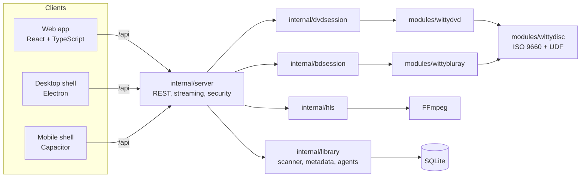

# Reference: configuration, tools, API and architecture

For people running, scripting or developing WittyMediaServer. Everyday settings live in the web app;
this page covers what sits underneath.

- [Command-line flags](#command-line-flags)
- [Command-line tools](#command-line-tools)
- [HTTP API](#http-api)
- [Architecture](#architecture)
- [Building from source](#building-from-source)

## Command-line flags

Every flag has an environment variable and a key in the [config file](CONFIG.md), which also covers
portable mode and the folders the server uses.

| Flag | Environment | Default | Purpose |
|---|---|---|---|
| `-config` | `WMS_CONFIG` | see [CONFIG.md](CONFIG.md) | the `wms.json` to read |
| `-data` | `WMS_DATA_DIR` | per OS (Windows `%LOCALAPPDATA%\WittyMediaServer`, macOS `~/Library/Application Support/WittyMediaServer`, Linux/BSD `~/.local/share/wittymediaserver`, containers `/config`) | database, settings, artwork cache |
| `-listen` | `WMS_LISTEN` | `:9797` | address and port; `127.0.0.1:9797` keeps it to this computer |
| `-ffmpeg`, `-ffprobe` | `WMS_FFMPEG`, `WMS_FFPROBE` | bundled `bin/`, then next to the program, then `PATH` | FFmpeg programs |
| `-max-transcodes` | `WMS_MAX_TRANSCODES` | `4` | FFmpeg jobs at once |
| `-log` | `WMS_LOG` | `info` | `debug` logs every FFmpeg command line |
| `-public-url` | `WMS_PUBLIC_URL` | — | the outside address, behind a reverse proxy; also turns remote access on |
| `-remote-access` | `WMS_REMOTE_ACCESS=1` | off | allow connections from outside the home network ([REMOTE.md](REMOTE.md)) |
| `-trusted-proxies` | `WMS_TRUSTED_PROXIES` | — | reverse proxies whose `X-Forwarded-For` is believed |
| `-watch-stdin` | `WMS_WATCH_STDIN` | off | exit when stdin closes (the tray launcher uses it) |
| `-dev` | `WMS_DEV=1` | off | serve `web/dist` from disk instead of the built-in copy |
| — | `WMS_TRANSCODE_DIR` | `<data>/transcode` | put it on an SSD or RAM disk |

Everything else (API keys, metadata agents, transcoding, disc behaviour, themes, profiles) is set in
the web app and kept in `<data>/wms.db`. Back up the data folder to keep libraries, people and watch
history.

## Command-line tools

```text
wms [serve] [flags]                    start the server (the default)
wms config path                        show the config file and folders in use
wms config init [--portable]           write a starter wms.json
wms disc ls <image>                    list files inside an ISO/UDF image
wms dvd info   <image>                 titles, chapters, menus, languages, region, first-play program
wms dvd walk   <image> [button…]       simulate inserting the disc; press menu buttons by number
wms dvd crawl  <image> [limit]         press every button of every reachable menu, report dead ends
wms dvd pgc    <image> fp|vmgm|vtsm|vts <vts> <pgcn>   disassemble one program chain
wms dvd render <image> <dir>           menu highlight PNGs and a sample of the first menu
wms bluray info   <disc>               titles, the disc's program, playlists, clips and streams
wms bluray walk   <disc> [button…]     simulate inserting a Blu-ray; press menu buttons by id
wms bluray render <disc> <dir>         the first menu's pages as PNG files
wms version
```

The disc tools never print video or artwork, so their output is safe to attach to a bug report. The
same tools ship on their own as `wittydvd` and `wittybluray`.

## HTTP API

**Writing an app or a tool?** [CLIENT-API.md](CLIENT-API.md) is the guide, with every route, and
[openapi.json](openapi.json) the same thing for machines. The newer libraries' routes are also in their own guides: [photos](PHOTOS.md#for-apps-apple-tv-android-tv-and-others), [vertical and creator videos](SHORTS.md#for-apps), and [collections, radio and Your year](COLLECTIONS.md).

Everything is under `/api` and answers JSON. Sign in with `POST /api/login` and send the token as
`Authorization: Bearer <token>` (or `X-WMS-Token`). Media URLs that a page can't add headers to
(images, video) take `?token=`; an HLS playlist fetched that way carries it on to its segments, but those
addresses can end up in the logs of a reverse proxy, so players that can add a header should. An account with two-factor sign-in answers `POST /login` with 401 and
`{"twoFactor": true}` until the request also has `code`.

**Security rules for API clients:** apps on other origins (the mobile app, your own tools) send the
token in a header; the server answers them with CORS but never honours the session cookie across
origins, and refuses state-changing requests signed in by cookie that come from another site. A page
elsewhere that sends no token gets no answer it can read; only the mobile app's origins may sign in.
Connections from outside the home network are refused until remote access is on ([REMOTE.md](REMOTE.md)).
Changing your own password needs the current one (`{"password", "current"}`) and signs out your
other devices.

| Area | Endpoints |
|---|---|
| Sign-in | `GET /status` · `POST /setup` · `POST /login` · `POST /logout` · `GET /me` · `GET /profiles` |
| Devices | `GET /sessions` (`?all=1`: everyone's, admin) · `DELETE /sessions/{id}` · `DELETE /sessions` (all your others) |
| Two-factor sign-in | `GET /me/2fa` · `POST /me/2fa/setup` · `POST /me/2fa/confirm` · `POST /me/2fa/disable` · `DELETE /users/{id}/2fa` (admin) |
| Remote access (admin) | `GET/PUT /remote` · `POST /remote/test` · `POST /remote/selfcheck` · `POST /remote/router` · `POST /remote/obtain` · `DELETE /remote/lockouts` · public: `GET /reach/{nonce}` (the outside test) |
| Home | `GET /home` · `GET/PUT /me/ui` (home layout) |
| Libraries | `GET/POST /libraries` · `PUT/DELETE /libraries/{id}` · `POST/GET /libraries/{id}/scan` |
| Items | `GET /items?library=&search=&sort=&desc=&genre=&kind=&limit=&offset=` · `GET/PUT /items/{id}` · `GET /items/{id}/poster` · `…/backdrop` · `…/recommend` · `…/artwork` |
| Watch state | `POST/DELETE /items/{id}/progress` |
| Video | `GET /items/{id}/play?audio=&subtitle=&maxHeight=&transcode=1` · `GET /items/{id}/file` · `GET /hls/{id}/playlist.m3u8` · `…/seg/{n}.ts` · `DELETE /hls/{id}` |
| Discs (DVD and Blu-ray) | `POST /items/{id}/dvd` `{mode, ttn, chapter}` → `{sessionId, presentation}` · `GET/DELETE /dvd/{sid}` · `POST /dvd/{sid}/action` · `GET /dvd/{sid}/subs` · `…/sub/{name}` · `…/menu/{serial}/overlay.png` · `…/highlight/{n}` · `…/still/{name}` (Blu-ray sessions start with `bd`) |
| TV | `GET /shows` · `GET/PUT /shows/{id}` · `PUT /shows/{id}/view` · `GET /shows/networks` · `GET /shows/genres` · `GET /shows/{id}/art/{kind}` |
| Music & podcasts | `GET /music/albums` · `…/artists` · `…/tracks` · `GET /items/{id}/stream` · `GET/POST /podcasts` · `PUT/DELETE /podcasts/{id}` · `POST /podcasts/{id}/refresh` · `POST /items/{id}/download` |
| Books | `GET /items/{id}/book` · `…/page/{n}` (comics) · `…/epub/{file}` · `…/search?q=` · `GET/POST /items/{id}/annotations` · `PUT/DELETE /annotations/{aid}` · `GET /dictionary?word=` |
| Metadata agents | `GET/PUT /agents` · `POST /agents/test` · `POST /metadata/test` |
| Administration | `GET/PUT /settings` · `GET /system` · `GET/POST /users` · `DELETE /users/{id}` · `PUT /users/{id}/access` · `PUT /users/{id}/password` · `GET /fs?path=` · `GET/PUT /logs` |
| Themes | `GET /themes` · `GET /themes/{id}/{file}` · `GET /themes/{id}/download` · `POST /themes` · `DELETE /themes/{id}` |

A disc *presentation* tells a client exactly what to show: `kind` (`menu`, `title` or `stop`),
`media` (an HLS URL or a still picture, loop flag, still time), `menu` (frame size, button rectangles
with their up/down/left/right links, the selected button, overlay and highlight pictures, and for
Blu-ray pop-up menus `popup` and `closed`) and, for titles, duration, chapters and track lists.

## Architecture



| Folder | What lives there |
|---|---|
| `cmd/wms` | the server, and the `disc`, `dvd`, `bluray` and `config` tools |
| `cmd/wms-tray` | the tray / menu-bar launcher |
| `internal/server` | the HTTP API, streaming endpoints, security middleware and the built-in web app |
| `internal/library` | libraries, scanning, TV shows, music, books, metadata (NFO, TMDB, TheTVDB, TVmaze, Wikidata, AniList, custom agents), watch state |
| `internal/dvdsession`, `internal/bdsession` | one viewer's DVD or Blu-ray: presentations, menus, subtitles, streams |
| `internal/hls`, `internal/ffmpeg` | on-demand HLS with instant seeking; FFmpeg discovery, probing and encoders |
| `internal/playback` | how a file plays on each kind of client: direct, remux or transcode, and which tracks |
| `internal/auth`, `internal/db`, `internal/config`, `internal/logging`, `internal/themes` | accounts, storage, configuration, logs, themes |
| `modules/wittydisc`, `modules/wittydvd`, `modules/wittybluray` | the disc engines, each its own Go module and repository |
| `web/` | the web app; `web/src/modules/*` holds the reader plugins (WittyInk, WittyEbook, WittyPDF, WittyComics) |
| `apps/wittyreader` | WittyReader, the standalone reading app |
| `clients/` | desktop and mobile shells |
| `deploy/`, `scripts/` | Docker, Kubernetes, release packaging, installers |

How a disc plays, end to end: the scanner opens the image with WittyDisc and records what the disc
holds. **Insert** starts a session: the engine runs the disc's first-play program and decides what to
show. For a menu it decodes the buttons and their pictures and returns rectangles and overlay images;
the stretch of video is handed to FFmpeg as exact byte ranges and streamed as HLS. Key presses go back
to the engine, which runs the button's commands, and the cycle repeats until the film plays, with
chapters, audio, subtitles and resume working as on a player.

More: [MODULES.md](MODULES.md) (the Witty modules and apps), [DVD.md](DVD.md), [BLURAY.md](BLURAY.md).

## Building from source

Requirements: **Go 1.26+** and **Node 22+**. FFmpeg is only needed to run it.

```bash
git clone https://github.com/wittywilla/WittyMediaServer && cd WittyMediaServer
(cd web && npm install && npm run build)        # the web app, built into the program
go build -o wms ./cmd/wms                        # the server
go build -o WittyMediaServer ./cmd/wms-tray      # the tray launcher (Windows: -ldflags -H=windowsgui)
./wms serve -ffmpeg /path/to/ffmpeg -log debug
go test ./...                                    # WMS_TEST_ISO / WMS_TEST_BD enable the real-disc tests
```

Release archives for every platform:

```bash
scripts/build-release.sh 1.0.0                 # macOS, Linux, WSL
scripts\build-release.ps1 -Version 1.0.0       # Windows
```

- The macOS tray launcher needs CGO (Cocoa), so it is built on a Mac; everything else cross-compiles
  with `CGO_ENABLED=0`.
- FreeBSD has no public static FFmpeg; `scripts/build-ffmpeg-static.sh` builds one in CI.
- `scripts/genicon` draws the app icon from code; the repository holds no binary assets.

See [CONTRIBUTING.md](../CONTRIBUTING.md) before sending changes.

---
<sub>WittyMediaServer documentation · [Back to the README](../README.md)</sub>
