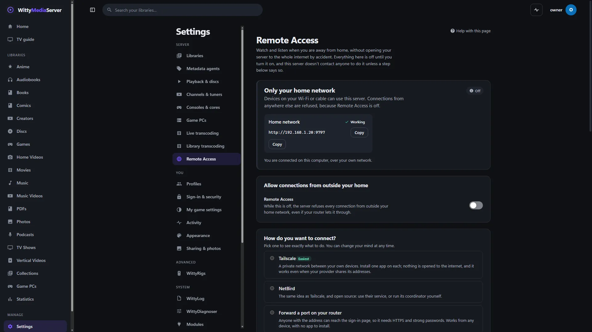

# Remote access

Use this guide to reach your server safely when you're away from home. You don't need any IT experience: it explains every term and walks you through every step.

**Assume someone will try to get in, and choose a setup that still protects you if they do.**

> **Read this before you turn anything on.**
>
> **The safest remote access is none.** WittyMediaServer works fully at home with everything on this page turned off, and that's how it starts.
>
> **WittyMediaServer is alpha software.** It hasn't had an independent security audit. Our own reviews keep finding real bugs, including security bugs, and there are surely more we haven't found. Treat every protection described here as something that helps, not a guarantee.
>
> **A server on the internet gets attacked. This isn't paranoia.** Automated programs constantly scan every address on the internet. They don't care who you are. Expect the first probes soon after you open a port, and expect them to continue for as long as it stays open.
>
> **If someone breaks in, they may get** your accounts and everyone's watch history, your saved API keys, your media and anything else your server's user account can read, and a foothold inside your home network, next to your other computers, phones and cameras.
>
> **This software comes with no warranty. You run it, so what you expose, who you let in and what you host are your responsibility.** The WittyMediaServer project doesn't host, see or check any of it, can't protect a server you've exposed, and isn't responsible for what happens to it. The law where you and your visitors are applies, including to sharing media. See **Settings → Legal**. This guide is general advice. It isn't legal advice, or a professional security assessment of your home.

**In a hurry?** Use [Tailscale](#the-recommended-way-a-private-network). Don't forward ports. Turn on [two-factor sign-in](#step-2-lock-down-your-accounts). Then run [the phone test](#testing-it-from-outside).

## Contents

- [The words you need](#the-words-you-need)
- [Who you're defending against](#who-youre-defending-against)
- [Which way should I choose?](#which-way-should-i-choose)
- [Things you must never do](#things-you-must-never-do)
- **Do these first, whichever way you choose**
  - [Step 1: Do you really need this?](#step-1-do-you-really-need-this)
  - [Step 2: Lock down your accounts](#step-2-lock-down-your-accounts)
  - [Step 3: Reduce what an intruder would get](#step-3-reduce-what-an-intruder-would-get)
- **The ways in, safest first**
  - [The recommended way: a private network](#the-recommended-way-a-private-network)
  - [Peer-to-peer connections](#peer-to-peer-connections)
  - [A rented server (VPS)](#a-rented-server-vps)
  - [A reverse proxy you already run](#a-reverse-proxy-you-already-run)
  - [Forwarding a port on your router](#forwarding-a-port-on-your-router)
- **After it works**
  - [Testing it from outside](#testing-it-from-outside)
  - [Unsafe settings, and what each one risks](#unsafe-settings-and-what-each-one-risks)
  - [Letting other people in](#letting-other-people-in)
  - [Regular checks](#regular-checks)
  - [If you think someone got in](#if-you-think-someone-got-in)
- **Reference**
  - [What the server protects by itself, and what it doesn't](#what-the-server-protects-by-itself-and-what-it-doesnt)
  - [Limits for viewers away from home](#limits-for-viewers-away-from-home)
  - [The apps](#the-apps)
  - [Games away from home](#games-away-from-home)
  - [What contacts what](#what-contacts-what)
  - [How the server decides](#how-the-server-decides)
  - [When it doesn't work](#when-it-doesnt-work)

## The words you need

| Word | What it means |
|---|---|
| **Router** | The box your internet comes through. It keeps the internet out of your home network unless told otherwise |
| **Home network** | Your devices connected to that router, by Wi-Fi or cable. Anyone on your Wi-Fi counts as "at home" |
| **Address (IP address)** | A device's number on a network. Your home devices usually have private ones such as `192.168.1.20`. Your router has a public one that the whole internet can see |
| **Port** | A numbered door on an address. WittyMediaServer's home door is **9797**, and its encrypted door is **9443** by default |
| **Port forwarding** | Telling your router to send visitors from the internet through a door to a device at home. **This is what makes your server visible to the whole internet** |
| **VPN or private network** | An encrypted connection that joins your own devices together. Tailscale and NetBird are the ones recommended here. The internet can't see a server reached this way |
| **HTTPS** | Encrypted web traffic, the `https://` at the start of an address. It stops people on the way from reading your password. **It doesn't stop anyone from trying to sign in** |
| **Certificate** | The file that makes HTTPS work and proves the address really is yours |
| **Domain name** | A name such as `media.example.com` that points at an address |
| **Reverse proxy** | A program that stands in front of the server, takes visitors from the internet, and passes them on |
| **VPS** | A small computer you rent in a data center |
| **Two-factor sign-in** | Signing in needs your password and a 6-digit code from an app on your phone |

## Who you're defending against

A good defense starts by naming the attacker. These are the realistic ones, most likely first.

| Who | What they do | What stops them |
|---|---|---|
| **Automated scanners** | Find open ports across the internet, identify the software and try known bugs. It costs them nothing | Not being on the internet at all: a [private network](#the-recommended-way-a-private-network). Otherwise, staying up to date |
| **Password guessers** | Try passwords leaked from other websites against your sign-in page | A password you use nowhere else, plus [two-factor sign-in](#step-2-lock-down-your-accounts) |
| **Someone you invited, or a device they lost** | A friend's reused password, a stolen phone still signed in, a shared link that got passed on | [Accounts with limits](#letting-other-people-in), never admin. [Regular checks](#regular-checks) of who's connected |
| **Someone tricking you** | Sends a sign-in code or link and asks you to approve it | Only ever approve a code you started yourself |
| **Someone on your network** | A visitor on your Wi-Fi, or a hacked device at home. At home the server trusts more | A guest Wi-Fi for visitors. Passwords on every adult account |
| **Someone targeting you personally** | An ex, a neighbor, a person you've annoyed online. They know you and may know your passwords | New passwords, two-factor sign-in, no port forwarding. **If your safety is at stake, get professional help, and don't rely on this guide** |

## Which way should I choose?

| Way in | Seen by the internet? | Skill needed | Our view |
|---|---|---|---|
| **Stay at home** (**Home network only**) | **No** | None | Safest. The default |
| **[Tailscale or NetBird](#the-recommended-way-a-private-network)** | **No.** Only your own signed-in devices can connect | Low: install an app | **Use this.** It's right for almost everyone |
| **[Peer-to-peer connections](#peer-to-peer-connections)** | **Not the sign-in page.** Only devices you paired can connect. Your home's internet address can be found by someone who has your server's connection ID | Low: one switch, and the app | For people who don't want an account with anyone. Newer and less proven than Tailscale; safer than forwarding a port |
| **[A rented server (VPS)](#a-rented-server-vps)** | The rented server, not your home | High, and you now look after a server on the internet | For people who need visitors with no app, and know how to keep a server safe |
| **[Your own reverse proxy](#a-reverse-proxy-you-already-run)** | **Yes**, the sign-in page | High | Only if you already run one and keep it updated |
| **[Forwarding a port](#forwarding-a-port-on-your-router)** | **Yes**, the sign-in page, directly from your home | Medium to do, high to do safely | **Not recommended.** The easiest way to get this wrong |

**If you aren't sure, choose Tailscale.** It's easier than port forwarding, and it also works when your internet provider shares one address between customers, where port forwarding can't work at all.

**WittyRelay**, shown greyed out on the page, doesn't exist yet. It's planned as a free service, and nothing on your server uses it.

**The master switch:** **Settings → Remote Access** starts as **Home network only**. While that's chosen, the server refuses every connection from outside your home network, including through a VPN, even if your router or firewall lets it through. Devices at home aren't affected. The page has three choices, each saying who it lets in:

| Choice | Who can connect |
|---|---|
| **Home network only** | Only devices on your Wi-Fi or cable at home. A phone on mobile data can't connect |
| **Home and away, through a private network** | Devices at home, and your own devices anywhere once they've joined your private network with Tailscale or NetBird |
| **Home and away, through the internet** | Devices at home, and anyone anywhere who has the address: they reach the sign-in page. Through a port on your router, a reverse proxy you already run, or a rented server |

## Things you must never do

**None of these is ever the right fix, however much a forum post insists.**

- **Never forward port 9797.** It's the unencrypted door, and it's meant only for your home network.
- **Never turn on "DMZ" on your router for this computer.** It exposes every port on the machine to the internet, not only this server's.
- **Never forward Sunshine's ports, and especially never port 47990.** Its web page can run commands on that PC. See [Games away from home](#games-away-from-home).
- **Never click through a browser's certificate warning** to reach your own server when you're away. That warning may be the only sign that someone is reading your password.
- **Never turn off your computer's firewall** to make this work. Fix the rule instead.
- **Never run the server as administrator or root** because something didn't work. A bug then becomes control of the whole machine.
- **Never reuse a password** for this server, and never use a password that has been in a leak.
- **Never give anyone your admin account**, or make a friend an administrator.
- **Never approve a sign-in code** you didn't start yourself, whoever asks.
- **Never expose a server that hasn't finished setup.** The first person to complete setup becomes its administrator.
- **Never post your server's address** publicly, or in a screenshot, a forum post or a support request.
- **Never send your data folder or database to anyone.** It holds your settings and API keys. For help, use **Download logs** in **Settings → WittyLog**, with **Sanitize for sharing** on, and read it before you send it.

## Step 1: Do you really need this?

Ask this honestly, because every option below adds risk you don't have at home.

- **Watching in another room:** you don't need any of this. That's already your home network.
- **A trip or two a year:** choose a way in before you go, and **Home network only** again when you're back.
- **You regularly watch away from home:** use a [private network](#the-recommended-way-a-private-network).
- **Family in another house:** a private network still works. Each person installs one app and signs in.

## Step 2: Lock down your accounts

Do all of this **before** you let devices away from home in.

1. **Use a long, unique password on every adult account.** Four or more unrelated random words is good, or better, let a password manager make one. **Remote Access** warns about a weak password, but it only learns how strong a password is when someone signs in with it, so an account shows as *Not checked yet* until then.
2. **Turn on two-factor sign-in.** This is the most useful thing you can do after a good password.
   1. Install an authenticator app on your phone, such as Aegis, Ente Auth, Google Authenticator or Microsoft Authenticator.
   2. Go to **Settings → Sign-in & security → Two-factor sign-in** and follow the steps.
   3. **Save your 8 recovery codes somewhere that isn't your phone**, such as on paper in a safe place. They get you back in if you lose your phone.
   4. Ask every adult on your server to do the same. It's set up per person, and nothing forces it.
3. **Use a normal account day to day.** Make a second adult account with no admin rights for watching, and keep the administrator account for changing settings. Signing in as admin on hotel Wi-Fi or a friend's TV is a risk you can avoid.
4. **Delete accounts nobody uses.** Every account is another password that can be guessed.
5. **Look at Settings → Sign-in & security → Your devices.** Sign out anything you don't recognize.
6. **Protect your own email and your phone.** A private network's account usually hangs off them, so anyone who gets into that account can add a device to your private network.

**Lost your phone and your recovery codes?** An administrator can turn off two-factor sign-in for someone else under **Settings → Sign-in & security**. For an administrator, on the server itself, stop the server and run:

```bash
wittymediaserver reset-2fa -data <your data folder> <name>
```

## Step 3: Reduce what an intruder would get

Assume that one day someone gets in. These decide how bad that day is.

1. **Update first, and keep updating.** Attackers read the same fix notes you do. Check **Settings → About** and install updates soon after they appear. The same goes for your computer's system and your router.
2. **Run the server as a normal user**, not an administrator. On Linux, give it a user of its own.
3. **Don't let it read what it doesn't need.** Point libraries at media folders only, and never at a whole drive, your home folder or a folder with documents and photos you'd hate to lose.
4. **Make media read-only for the server if you can.** This stops an intruder deleting your collection. Saving posters and info files beside your media then won't work, so leave that off under **Settings → Metadata agents → Saving information**. Uploads to those folders won't work either.
5. **Keep backups that the server can't reach.** A copy on a drive you unplug can't be deleted or encrypted by someone who breaks in. See [Backup](BACKUP.md).
6. **Turn off what you don't use:**
   - Share links and uploads: **Settings → Sharing & photos**.
   - Custom game cores stay off unless you allow them, and that's the right setting: they're programs from outside this project, running on your server.
   - Game PCs: see [Letting other people in](#letting-other-people-in).
7. **Change your router's admin password, and turn off its "remote administration".** A router you can manage from the internet is a serious target in its own right.
8. **Put visitors on guest Wi-Fi.** The server trusts your home network more, and your router's guest network is the easy way to keep visitors off it.

## The recommended way: a private network

**Tailscale** and **NetBird** connect your own devices into a private network. **Nothing is opened on your router**, so scanners on the internet find nothing, and video is encrypted between your devices. Both are separate services and aren't part of WittyMediaServer. You make an account with them and rely on them to decide which devices join, so read their terms and privacy policies. Plans and prices can change, so check those too. NetBird can also be run entirely by yourself, if you know how.

**Before you start:** do [Step 2](#step-2-lock-down-your-accounts) and [Step 3](#step-3-reduce-what-an-intruder-would-get).

1. **On the computer running the server**, install [Tailscale](https://tailscale.com/download) or [NetBird](https://netbird.io/download), and sign in. Use an account protected with two-factor sign-in.
2. **Keep it running.**
   - **Windows with Tailscale:** in its tray menu, turn on *Run unattended*, so it stays connected when nobody is signed in to the computer.
   - **Tailscale:** by default a device's sign-in expires after some months. In its admin console, turn off key expiry for the server, or remote access will stop by itself while you're away.
3. **Find the server's new address.** **Settings → Remote Access** notices the VPN once you choose **Home and away, through a private network**, and shows its address at the top of the page, such as `100.101.102.103`.
4. **On your phone or laptop**, install the same app and sign in with the **same account**.
5. **In Settings → Remote Access**, choose **Home and away, through a private network**, then Tailscale or NetBird.
6. **On your phone, with the VPN app on,** open `http://100.101.102.103:9797`, using your own address. Bookmark it, or enter it in [the app](APPS.md#typing-the-address).
7. **[Test it](#testing-it-from-outside).**

The address starts with `http://`, not `https://`, and that's fine here, because the VPN encrypts everything itself. This is the one situation where an unencrypted address is OK.

Devices on your VPN count as *away from home*: they get the [limits](#limits-for-viewers-away-from-home) and always need a password.

> **Ways to undo this safety.**
>
> **Tailscale Funnel** publishes a port to the whole internet. Don't use it for this server, or your private server becomes a public one.
>
> **Sharing a device with someone** lets them reach that machine. Check what else it offers before you do, and use their access controls to allow only port 9797.
>
> **Everyone on your private network can reach the server's sign-in page.** Remove old phones and laptops from the device list. A forgotten device is a way in.

**Why not a "tunnel" service?** Some companies offer a public address that tunnels to your home with no open port. It feels like a private network, but **it's a public sign-in page on the internet, the same as port forwarding**. Their servers can often also see everything passing through, including passwords, and their terms may restrict streaming video.

## Peer-to-peer connections

The app on your phone, TV or laptop finds its own way to your server and connects to it directly. **Nothing is set up on your router, nothing is rented, and there's no account with anyone.** It's built into the server and the apps, and it's off until you turn it on.

**How it compares.** It's the same idea as a private network: only devices you've approved can connect, and everything is encrypted between the device and your server. The differences are worth knowing:

| | Tailscale or NetBird | Peer-to-peer connections | Forwarding a port |
|---|---|---|---|
| Who can reach the sign-in page | Devices on your private network | Devices on your server's own list | **Anyone on the internet** |
| Set up on the router | Nothing | Nothing | A forwarded port |
| An account with a company | Yes | No | No |
| Who helps devices find each other | That company's servers | Volunteers' computers on a public network | Nobody: you give out an address |
| How proven | Used by millions, audited | **New in this release, never audited** | As old as the internet, and attacked constantly |
| Works from a web browser | Yes | **No: it needs the app** | Yes |
| Works with every router | Nearly | With most. Not when both ends have a strict router and nobody offers a relay: see below | If your provider gives you a real address |

**Our view:** if you're happy to make an account, Tailscale is still the better choice, because it has been tested by far more people than this has. If you aren't, this is much safer than forwarding a port, because strangers never see a sign-in page to attack.

### What it exposes

Read this before turning it on. It's the honest list.

- **Your server becomes one of many computers on a public network** (the IPFS network), which is how apps find it. Other computers on that network, run by people you don't know, learn your server's **connection ID** (a long name starting `12D3KooW`, the public half of a key), your **home's internet address**, and that it runs WittyMediaServer.
- **Anyone who has your connection ID can look up your home's internet address.** They can't connect with it. Treat the ID like your address: not a secret, not something to post. The server only gives it to signed-in accounts.
- **Relays see who talks to whom.** When a direct connection can't be made straight away, a relay (another volunteer's computer, or another WittyMediaServer owner's) introduces your device to your server. It sees both internet addresses, when, and how much is sent. **It can't see what is sent**: that's encrypted with a key only your server holds.
- **Your router may be asked to open a port**, if it offers that (UPnP, NAT-PMP or PCP) and you leave that switch on. The server asks for one port, renews it, and removes it when you turn this off. What listens on that port answers only your paired devices.
- **It's new code facing the internet.** A mistake in it, or in the libraries it's built on, could be a way in that none of the above accounts for. That's true of every way on this page; it's most true of the newest.

**Nobody on that network ever sees** your media, your file names, your passwords, your accounts, or what you watch.

### Turning it on

**Before you start:** do [Step 2](#step-2-lock-down-your-accounts) and [Step 3](#step-3-reduce-what-an-intruder-would-get). A paired device still needs a password, and it should be a good one.

1. Go to **Settings → Remote Access → Peer-to-peer connections**. The page lists everyone who'll be contacted. Tick the box and choose **Turn on peer-to-peer connections**.
2. **Pair your devices while they're at home.** Open the app on each phone, TV and laptop while it's on your home network and signed in. Within a minute it adds itself to **Devices that may connect**. That's all: from then on, when the app can't find your server at home, it connects this way by itself.
3. **A device that isn't at home** (yours while travelling, or a relative's) needs an invite. Choose **Invite a device that isn't at home**, and send them the link or show them the code. In the app they choose **Enter an address** and paste the link. It works once, for fifteen minutes, and signs the device in as you, so send it the way you'd send a password.
4. **A TV that isn't at home** can't take a link in: it has no keyboard worth the name and no camera. In the app on the TV choose **Join from away**. It shows a code of eight letters and digits. Type it into **A TV that shows a code** on this page, with your password, and within a minute or so the TV finds your server and signs in as you. Only type in a code you can see on your own TV: whoever is showing it gets in. It works once, for fifteen minutes, and needs **Public address book** on, as that is how the TV finds your server.
5. **[Test it](#testing-peer-to-peer-connections).**

You don't have to change the three choices at the top of the page. Peer-to-peer connections work with **Home network only** chosen, which keeps every other way in closed.

### What the page tells you

Each line says how one way of connecting is doing. The app tries them best first, and switches to a better one when it can, without stopping what's playing.

| Line | What it means |
|---|---|
| **Reachable from outside** | Whether other computers on the internet managed to connect straight to your server. "No" is normal behind a home router, and isn't a fault |
| **IPv6** | If your connection has IPv6 and your router agreed to let connections through, devices that also have IPv6 connect directly |
| **Port on your router** | Whether your router opened a port when asked. If it says your provider **shares addresses (CGNAT)** or there's **a second router**, an open port can't be reached and isn't used |
| **Hole punching** | Your device and your server connect to each other at the same moment, so both routers let it through. Works with most home and mobile networks. A router described as **strict** or **symmetric** usually defeats it |
| **Public address book** | Whether your server has reached the network apps find it on |
| **Relays** | Which relays your server has a place on. **Public relays** only introduce; **community relays** can carry a whole film, slowly, when nothing else works |

**When it can't connect.** If hole punching fails (a strict router at home, or on the network your phone is on) and there's no community relay, the app says a direct connection couldn't be made. Try another network: a different Wi-Fi, or mobile data. If your home router is the strict one, look for a setting called UPnP in it, or use a private network instead.

**Community relays** are other WittyMediaServer owners who turned on **Help other servers**. If your server can be reached from outside, you can turn it on too: up to 16 other people's connections may then pass through your internet connection, 2 GiB each at most, and you see none of it.

### Testing peer-to-peer connections

**Test my connection** on the page checks that your server can be found by its ID and answers. It runs from your own computer, so it can't check your router. The real test is the same as for every other way:

1. On your phone, open the app while you're on your home Wi-Fi and signed in. Wait a minute.
2. **Turn off Wi-Fi**, so the phone uses mobile data, and open the app again.
3. It should connect within about half a minute the first time. In **Settings → Remote Access**, the device shows as **Connected directly** or **Connected through a relay**.

On a computer, the desktop app's title bar says how it's connected: **direct**, or **through a relay**.

### Taking a device off

**Settings → Remote Access → Peer-to-peer connections → Devices that may connect** lists every device, whose it is, when it was added and when it last connected. **Remove** cuts it off at once. It stays signed in, so it still works at home: to stop that too, sign it out under **Sign-in & security**.

- **Lost a phone?** Remove it here and sign it out, then change that account's password.
- **Think your connection ID got out?** Under **More**, **Make a new ID** gives the server a new one. Every device then needs to learn it: the apps do that by themselves next time they're at home.
- **Turning the whole thing off** closes every connection, removes the port from your router, and stops talking to the network. Your devices stay on the list for when you turn it on again.

Devices connected this way count as *away from home*: they get the [limits](#limits-for-viewers-away-from-home), always need a password, and can't use password-free profiles.

> **Ways to undo this safety.**
>
> **Turning off "Only paired devices"** lets anyone with your connection ID reach the sign-in page and try passwords. Leave it on.
>
> **An invite link is a way in for fifteen minutes.** Don't post one, and don't send one over something you wouldn't send a password over.
>
> **Every device on the list can reach the sign-in page.** Remove old phones and laptops. A forgotten device is a way in.

Developers: [P2P.md](P2P.md) has the design, the protocol and the threat model.

## A rented server (VPS)

> **Advanced. You're now running a computer on the public internet, and keeping it safe is your job.** It needs system updates, a firewall and SSH keys. If those words are new to you, use a [private network](#the-recommended-way-a-private-network) instead. **Anyone can still reach your sign-in page**, so everything under [port forwarding](#forwarding-a-port-on-your-router) about passwords and attacks applies here too.

### Your server at home, with a rented one in front

Visitors reach the rented server, and it passes them on over a private tunnel. No port opens at home, and your home address stays private. This is the better of the two.

1. Rent a small server and point your domain name at it.
2. On the rented server: install updates, turn on automatic security updates, allow SSH sign-in by key only, and turn on a firewall that allows only ports 22, 80 and 443.
3. Install Tailscale or NetBird on both machines (or WireGuard, if you know it).
4. On the rented server, install Caddy, and pass visitors to your home computer's private address, as shown below.
5. In **Settings → Remote Access**, choose **Home and away, through the internet**, then **A rented server (VPS)**. Enter the outside address, and the rented server's address on the private network as the proxy.
6. [Test it](#testing-it-from-outside).

The Caddy file for step 4:

```caddyfile
media.example.com {
    reverse_proxy 100.101.102.103:9797
}
```

### The server itself on a rented machine

There's no home network to set it up from. Your media and accounts then live on a computer you don't physically control, so think about who runs it and what their terms allow.

- **Safer: use an SSH tunnel.** Run `ssh -L 9797:127.0.0.1:9797 you@server`, open `http://localhost:9797`, and go through setup and Settings as if at home.
- **Riskier: start it with `-remote-access`** (or `WMS_REMOTE_ACCESS=1`, or `"remoteAccess": true` in the [config file](CONFIG.md)). This lets devices away from home in, and **Home network only** can't be chosen on the page.

> **`-remote-access` on a server that isn't set up yet:** whoever completes setup becomes its administrator. From outside, setup needs the setup code on the server's console, and wrong codes are limited, but **don't leave it sitting there.** Have HTTPS in front of it first, then create the first account right away.
>
> **Setting `publicUrl` also turns remote access on**, so servers already behind a proxy keep working after an update. Don't set it by accident, and list the proxy in `trustedProxies` too.

**Docker on a rented server:** Docker's published ports can go around firewalls such as `ufw`. Publish only to this machine with `127.0.0.1:9797:9797`, and let the reverse proxy reach it there. Then check from another network that port 9797 doesn't answer.

## A reverse proxy you already run

> **Advanced, and on the internet.** This is for people who already run a reverse proxy and keep it updated. **Your sign-in page is public, and everything under [port forwarding](#forwarding-a-port-on-your-router) about passwords and attacks applies here too.** Getting the trusted proxy setting wrong can make strangers look like they're at home.

Your proxy handles HTTPS and passes requests to the server's home port. In **Settings → Remote Access**, choose **Home and away, through the internet**, then **A reverse proxy you already run**. Two settings matter:

- **The outside address**, such as `https://media.example.com`.
- **The proxy's address, as this server sees it.** On the same machine, that's `127.0.0.1`. Forwarded addresses are believed from these machines **only, and from nobody by default**. Until yours is listed, everyone behind it counts as one visitor from the internet: safe, but sign-in limits then hit everybody at once. The page offers to trust a proxy when it sees one at home.

> **List only the exact address of your own proxy.** Never list a whole network you don't fully control. A trusted machine can claim any visitor address, including a home address, and **someone claiming to be at home can see profile names and use password-free profiles.**

The proxy must set `X-Forwarded-For` and `X-Forwarded-Proto`, as all the common ones do. If it doesn't send `X-Forwarded-For`, everyone looks like the proxy itself, so don't list a proxy that doesn't. The `Forwarded` header is never used.

**Caddy** gets its own certificate, and sets the headers:

```caddyfile
media.example.com {
    reverse_proxy 127.0.0.1:9797
}
```

**nginx:**

```nginx
server {
    listen 443 ssl;
    server_name media.example.com;
    ssl_certificate     /etc/ssl/media/fullchain.pem;
    ssl_certificate_key /etc/ssl/media/privkey.pem;
    client_max_body_size 0;

    location / {
        proxy_pass http://127.0.0.1:9797;
        proxy_set_header Host $host;
        proxy_set_header X-Forwarded-For $proxy_add_x_forwarded_for;
        proxy_set_header X-Forwarded-Proto $scheme;
        proxy_set_header X-Forwarded-Host $host;
        proxy_read_timeout 120s;
        proxy_buffering off;
    }
}
```

**Treat the proxy's access logs as private.** They record full addresses. The web app keeps sign-ins out of them when it's used over HTTPS, but other apps may not.

`client_max_body_size 0` lets large uploads through. If you don't use uploads, set a limit, and turn uploads off too.

## Forwarding a port on your router

> **Not recommended. This puts your sign-in page on the public internet, running from inside your home.**
>
> **Anyone in the world can reach it.** Scanners will find it, and keep trying for as long as it's open.
>
> **Any serious bug in this alpha software, or in what it's built on, may be reachable by strangers**, with no password needed. HTTPS and a strong password don't protect against that kind of bug.
>
> **Getting in means being inside your home network**, next to your other devices.
>
> **Using Let's Encrypt makes your domain name public**, because every certificate is listed in public logs. Scanners watch those logs, so a new name can get visitors very quickly.
>
> **Your home address is exposed** to anyone who looks up that name.
>
> **Your internet provider's terms may forbid running a server.** Check them.
>
> **Use a [private network](#the-recommended-way-a-private-network) unless you can say exactly why you can't.** "It's easier" isn't a good reason: setting up a private network is less work than doing this safely.

If you go ahead, do **all** of this. Do [Step 2](#step-2-lock-down-your-accounts) and [Step 3](#step-3-reduce-what-an-intruder-would-get) first: treat two-factor sign-in on every adult account as required here.

The server enforces one part itself: it refuses unencrypted connections from the internet.

In **Settings → Remote Access**, choose **Home and away, through the internet**, then **A port on your router**.

1. **Check that it can work at all.** Press **Check my router**. This only asks the router what it can do, and changes nothing. If it says your outside address is shared (CGNAT), port forwarding can't work. [Use a private network](#the-recommended-way-a-private-network).
2. **Give this computer a fixed home address.** Otherwise the router may later send the internet to a different device.
   1. Find the computer's address. **Windows:** open Command Prompt and run `ipconfig`, then look for *IPv4 Address*. **Mac:** *System Settings → Network → your connection → Details*. **Linux and FreeBSD:** run `ip addr` or `ifconfig`.
   2. Sign in to your router. The address is usually on its label, often `192.168.1.1` or `192.168.0.1`. **If it still has the password from the label or the factory, change that first.**
   3. Find the setting called *DHCP reservation*, *address reservation* or *static lease*, and reserve this address for the computer. Router menus differ, so check the manual for your model.
3. **Get a name for your home.** Home internet addresses change, so use a dynamic DNS name (for example from DuckDNS or No-IP) or a domain of your own, pointing at your router's outside address. Dynamic DNS needs something to keep the name up to date, usually a setting on your router or a small program from that service. The server doesn't do this.
4. **Choose a certificate.** This opens the HTTPS port, **9443** by default, beside the home port (9797), which stays as it is. On Windows, the firewall asks the first time this opens: allow it on *Private networks* only.
   - **Let's Encrypt** is free and renews by itself. Enter your domain name and accept their agreement. Let's Encrypt learns your domain name and any email you give, and the certificate is listed publicly.
   - **My own certificate:** enter the full paths of the certificate and key files. When something renews the files, the server picks them up within a minute. **Don't use a self-signed certificate:** you'd have to teach yourself to click through the warning that protects you.
5. **Forward exactly one port.** On your router, forward outside port **443** (TCP) to this computer's fixed address, port **9443**. The manual calls this "port forwarding" or "virtual server". Let's Encrypt connects to your outside port 443 to check that the domain is yours, so that port must lead here. With your own certificate, any outside port works. **Forward only this port. Never forward 9797.** Don't choose "all ports", and don't use "DMZ".
6. **Get the certificate.** Press **Get the certificate now** if you chose Let's Encrypt.
7. **[Test it](#testing-it-from-outside) right away, and read how the connection was seen.** If a phone on mobile data shows as *at home*, **stop and undo the forward**: see the warning in that section.
8. **Keep watching it.** Do the [regular checks](#regular-checks). Close the forward when you won't need it for a while.

> **"Do this automatically" (UPnP or NAT-PMP).** The server can ask the router to open the port for you. It's off by default, only the HTTPS port is ever opened, and the server closes it again when this is turned off or the server stops. **We suggest leaving it off and forwarding by hand**, so you know exactly what's open. UPnP also lets programs on your home network open ports without asking, which is why many security guides recommend turning it off on the router altogether. If this feature fails, don't turn on UPnP on your router to fix it. Forward the port by hand instead.

**Undoing all this:** choose **Home network only**, delete the rule on your router, then check from your phone on mobile data that your `https://` address no longer answers.

## Testing it from outside

Do this every time you change anything. A server can't really tell from inside whether the internet can reach it, so the test uses **your own phone**. No service on the internet is involved, and nothing is sent anywhere.

1. Under **Check from outside**, press **Check with my phone**. The page shows a QR code and a secret address, good for 15 minutes.
2. On your phone, **turn off Wi-Fi** so it uses mobile data. Keep your VPN on, if you use one.
3. Scan the code. The page on your phone says whether it worked, and the settings page updates by itself with where the connection came from and how.

The test page shows nothing about your server. A test from your home network is noticed, and doesn't count.

> **Read how the connection was seen. It's the most important check on this page.** If your phone on mobile data shows as *at home*, **your server thinks strangers are family.** They could see profile names and use password-free Kids and Guest profiles. Some routers and Docker Desktop cause this by hiding visitors' real addresses: see [How the server decides](#how-the-server-decides). **Choose Home network only until it's fixed.** A private network avoids the problem.

**Check from this computer** looks at what can be seen from inside: whether your domain name leads to your router, whether the HTTPS port is open, and whether the address answers. It only uses your computer's usual name server. Many routers won't connect a computer at home to their own outside address, so a failure of the last step doesn't mean it fails from outside.

### Reading the status

The card at the top of **Settings → Remote Access** answers one question: who can connect right now, and from where. It never says only "on" or "off". It shows what the server has really seen, and says a phone on mobile data can connect only after a passed check or a real connection from outside. The same words are on the setup wizard's last page, in the tray icon's menu and in the apps.

| The card says | Colour | What it means |
|---|---|---|
| **Home network only** | Green | Working as you chose: devices at home can connect, and devices away from home aren't allowed, by your choice |
| **Reachable from away: yes** | Green | A device away from home has connected, or your phone passed the check, recently. The card says through what and at which address |
| **Reachable from away: not yet** | Amber | You chose to let devices away from home in, and it isn't working yet: a step is unfinished, or nothing from outside has arrived. Often the router isn't forwarding yet. Run the check |
| **Reachable from away: no** | Red | Something is broken, such as the HTTPS port not opening or a certificate failing. The card says what |

Below that, **Devices at home** and **Devices away from home** each get their own line, then how it was checked.

**For a port you forwarded, also check what you exposed.** From your phone on mobile data, try `http://<your address>:9797`. It should **not** show your server. If it does, you've forwarded the wrong port, so close it now.

## Unsafe settings, and what each one risks

Each of these exists for a reason, and each one gives something up. Leave them off unless you can say why you need them.

### Highest risk

| Setting | Where | What it risks | Do this instead |
|---|---|---|---|
| **Allow unencrypted connections from away** | **Remote Access** | **Passwords, sign-ins, stream addresses and what you watch cross the internet readable and changeable by anyone on the way.** See [Unencrypted connections from away](#unencrypted-connections-from-away) | A private network, or HTTPS |
| **Also count as my home network** | **Remote Access → Advanced** | **Anyone from those addresses is treated as family**: they see profile names and can use password-free profiles, with no HTTPS requirement. A wrong range can mean strangers | List only networks you fully control. Most people should leave it empty |
| **Trusted reverse proxies**, listed too widely | **Remote Access → Advanced** | **Those machines can claim any visitor address**, so an attacker can claim to be at home and avoid sign-in limits | Only your proxy's exact address |
| **`-remote-access`, `WMS_REMOTE_ACCESS=1`, `remoteAccess`, or `publicUrl`** | Start-up options and [config file](CONFIG.md) | Devices away from home are let in, and **Home network only** can't be chosen on the page | Choose on the page instead. See [A rented server](#a-rented-server-vps) |
| **Custom game cores** | `WMS_GAMING_CUSTOM_CORES=1` on the machine, then **Settings → Consoles & cores** | They're programs from outside this project, running on your server. A sandbox limits them, but limits can have bugs | Leave it off, or only use cores you trust, and never from a stranger's link |
| **Modules from someone's fork, or from another store** | **Settings → Modules** | You're trusting that person with code on your server. The project doesn't check it | Use the project's own modules. If this server is someone else's to run, `WMS_NO_MODULE_FORKS=1` keeps forks off |
| **`setupFromHome`** | Config file, `-setup-from-home`, `WMS_SETUP_FROM_HOME=1` | Anyone on your network can make the first account on a fresh server and own it | Read the setup code from the console or `setup-code.txt` |

### Some risk

| Setting | Where | What it risks | Do this instead |
|---|---|---|---|
| **`allowNetworkPaths`** | Config file, `-allow-network-paths`, `WMS_ALLOW_NETWORK_PATHS=1` | On Windows, naming a network share makes the server sign in there with its own account, so a stolen admin session could send those credentials to any machine | Add shares on the server's own desktop, or map a drive |
| **Show profiles outside your home** | **Settings → Profiles → Signing in** | Strangers can see who lives in your house, and names help password guessing | Leave it off. People can type their name |
| **Do this automatically** (port mapping) | **Remote Access** | You may forget a port is open | [Forward by hand](#forwarding-a-port-on-your-router), or don't |
| **Game PCs: who may connect, PCs on this server's own network, PCs over the internet** | **Settings → Game PCs** | By default, any adult with no limits can make the server connect to a Sunshine PC on your home network or the internet, and it then handles data from a machine it doesn't control | If you've invited people, allow only admins, and turn off what you don't use |
| **Ports other than Sunshine's usual one** | **Settings → Game PCs** | Lets adult accounts make the server knock on other services on your network | Leave it off |
| **UDP port for games** | **Settings → Consoles & cores**, **Settings → Game PCs** | A second port open on the internet | Leave it empty unless games won't connect. See [Games away from home](#games-away-from-home) |

### Worth a thought

| Setting | Where | What it risks | Do this instead |
|---|---|---|---|
| **Allow links** (on by default) | **Settings → Sharing & photos** | **Anyone who has a link can open it, with no account.** Links get forwarded, and end up in chats and browser histories | Share rarely, and end a link when it's done. Turn the feature off if you don't use it |
| **Allow uploads** (on by default) | **Settings → Sharing & photos** | Someone who gets into an account may be able to fill your disk | Turn it off if you don't use it |
| **Update checks** | **Settings → About**, **Settings → Modules** | **Turning these off is the unsafe choice.** You'd miss fixes | Keep them on. Install updates soon |
| **Reset** | **Settings → Reset** | Anyone with an admin password can wipe the server from anywhere | A strong admin password with two-factor sign-in. Keep backups |

### Unencrypted connections from away

> **Leave this off unless you can say exactly why you need it.** With it on, anyone between a device and your server can read and change what passes, and nothing on the screen will show they did.

This server refuses unencrypted (`http://`) connections from the internet. **Allow unencrypted connections from away**, under **Settings → Remote Access**, lets them in. It's for people who reach their server through a network or tunnel of their own that the server can't recognise, and who accept the risk. **It doesn't change "never forward port 9797"**: forwarding the home port to the internet with this on puts your password on every network between you and home.

**What anyone on the way can do while it's on**, on a café's or hotel's Wi-Fi, the mobile network, or any network on the route that someone has broken into:

- Read your **password** as you sign in, and the sign-in that keeps a device signed in afterwards.
- Read **stream addresses**, which play your media without a password while they last.
- See **what you watch, listen to and search for**.
- **Change the pages** on the way, for example to ask for your password again.

**What the server still does:**

- It's **off by default, for administrators only**, and turning it on asks you to accept the risk in plain words and type your password (and code, with two-factor sign-in).
- While it's on, **the status at the top of Remote Access, a bar at the top of every page for administrators, and the server log** say so, and the log says so again at every start. A sign-in page reached this way says the connection isn't encrypted.
- **Every sign-in that crosses the internet unencrypted is marked**, in **People connected from outside** as *Signed in unencrypted*, and **lasts a day at most**. One button signs them all out, and **turning this off signs them all out** too.
- Cookies sent this way are `HttpOnly` and `SameSite=Strict`, and last a day. They can't be `Secure` without HTTPS.
- Requests to read a page are still sent to your `https://` address, if you have one.

**Safer instead:** a [private network](#the-recommended-way-a-private-network) encrypts everything without this setting, and so does HTTPS through [your router](#forwarding-a-port-on-your-router) or [a reverse proxy](#a-reverse-proxy-you-already-run).

## Letting other people in

Everyone you invite adds a password you don't control and devices you can't see.

- **Never make them an administrator.** Make an adult account with limits, and allow only the libraries they should see, under **Settings → Profiles**.
- **Ask them to use a unique password and two-factor sign-in.** You can't force it, but you can decline to invite someone who won't.
- **Prefer a private network for family.** On Tailscale, share only this machine, and use their access controls to allow only port 9797.
- **Kids and Guest profiles with no password work only at home.** That's on purpose. To use one away from home, give it a password.
- **Approve sign-in codes only if you started them.** A TV showing a code asks you to approve it, and approving signs that device in as the account you choose. Someone can send you their code and ask you to "just approve this". Say no.
- **When someone stops using it**, delete their account or sign out their devices, under **Remote Access → People connected from outside**.
- **You're responsible for what you share and who you share it with**, including having the rights to do so. See **Settings → Legal**.

## Regular checks

**Once a month, or after anything looks odd:**

1. **Update** the server, your computer and your router.
2. **Look at Remote Access → People connected from outside.** Do you recognize every device and place? Sign out anything you don't.
3. **Look at Sign-in protection.** A few wrong sign-ins are normal once you're on the internet. A sudden flood, or wrong tries for a name only you use, deserves a closer look.
4. **Read Settings → WittyLog** for sign-ins and warnings you can't explain.
5. **Check your router's forwarding rules.** Only what you meant to open should be there.
6. **Check your private network's device list.** Remove old phones and laptops.
7. **Run [the phone test](#testing-it-from-outside) again** after changing or moving your router or other network gear.
8. **Ask whether you still need this.** If not, turn it off.

## If you think someone got in

Signs include a device or sign-in you don't recognize, an account you didn't make, settings you didn't change, a share link you didn't create, files missing or changed, or sign-ins from an unexpected place. Move quickly, and in this order.

1. **Cut it off.** Choose **Home network only** in **Remote Access** and remove any forward on your router. If you can't reach the settings, unplug the computer from the network. **Don't delete anything yet.**
2. **Save the evidence.** Download the logs from **Settings → WittyLog → Download logs**, with **Sanitize for sharing** off so you have the full addresses for yourself, and note the date and what you saw.
3. **From a different, clean device, change passwords** for your email and your private network's account, and anything that shared a password with this server.
4. **Check the computer.** Run a full malware scan, and look for programs and accounts you don't recognize. A scan finding nothing doesn't prove the machine is clean. **If you have any real reason to think programs were run on it, the only trustworthy fix is to reinstall the system from scratch** and restore your media from a backup you trust.
5. **On the server,** sign out every device, delete accounts you don't recognize, delete all share links, change every password and turn on two-factor sign-in. Remove anything under **Custom cores** in **Settings → Consoles & cores**, and anything in **Settings → Modules** that you didn't add, including stores under **Other stores**.
6. **Replace your API keys:** TMDB, TheTVDB, IGDB, RAWG, ScreenScraper, TheGamesDB and any others you added. Revoke the old ones on those services' sites.
7. **Consider a clean start.** **Settings → Reset** gives you a new install. **Reset doesn't clean the computer**, and if you keep a copy, that copy may hold whatever the intruder changed. Don't bring it back without good reason.
8. **Check your other devices** on the home network, and change your router's password.
9. **Don't let devices away from home in the same way again.** Use a [private network](#the-recommended-way-a-private-network).
10. **Report it if it matters.** If personal or financial information may have been taken, or someone is targeting you, think about telling the relevant services or the police. If you found a security bug in WittyMediaServer, report it privately using **Report a vulnerability** on the [project's security page](https://github.com/wittywilla/WittyMediaServer/security), and don't post the details publicly.

## What the server protects by itself, and what it doesn't

**Always on:**

- **Encryption from the internet.** Unencrypted requests from the internet are refused or sent to your HTTPS address, so a wrongly forwarded plain port can't expose your password. Browsers that have used HTTPS keep using it for a week. The one exception is [Allow unencrypted connections from away](#unencrypted-connections-from-away), off unless an administrator turns it on.
- **Sign-in limits.** After 5 wrong tries for one name from one address, each further try waits longer, up to 15 minutes. Away from home there are also limits on one address trying many names (20 wrong tries, and an IPv6 network counts as one address) and one name tried from many addresses (30). Counts are kept until an address has been quiet for six hours. One address alone can't lock a name for anyone else, and **nobody on the internet can lock you out at home.** Wrong tries are shown on the page, where you can also clear the locks. Only a few passwords are checked at once, so a flood of attempts can't take the whole machine.
- **Cookies** are `HttpOnly`, `SameSite=Lax` and, over HTTPS, `Secure`. A cookie sent unencrypted to the internet is `SameSite=Strict` and lasts a day.
- **Other websites** can't read answers from the server unless they hold a sign-in token, and can't act with your cookie. This matters at home too: any page you visit could otherwise ask a server on your network who its profiles are.
- **Your password is asked for again**, with your two-factor code if you have it on, so a device you left signed in can't do these: adding or removing an administrator, changing another administrator's password, resetting the server, changing where a module comes from, going back to an older version of one, adding a module store, and taking back an **Update All**.
- **Password-free Kids and Guest profiles** only work at home, sign-ins made earlier included, and profile names aren't shown elsewhere unless you turn that on. The version isn't shown to anyone not signed in on the internet.

**What these don't do. A researcher reads this part first.**

- **HTTPS protects the trip, not the server.** It keeps passwords private on the way. It doesn't stop a stranger reaching the sign-in page, or a bug being used.
- **Sign-in limits slow guessing. They don't stop a password that's right.** A password leaked from another site can work on the first try. Two-factor sign-in is what covers that, and it's optional and per person.
- **Some addresses work with no sign-in**, as they must: the sign-in page, basic server information, themes, signing in with a code, and share links. Each is more code a stranger can reach.
- **There's no web application firewall, and no automatic blocking of bad addresses.**
- **Server updates aren't automatic.** A fixed bug stays open on your server until you install the fix.
- **A sandbox limits helpers and game cores. It isn't perfect**, and its protection varies by operating system. On FreeBSD a module's helper program has limits rather than a sandbox, and on macOS Apple's sandbox hasn't been run on a real Mac yet, so modules from other publishers and custom cores can't be used there.
- **The server can't see your router, your other devices or a stolen phone.**

## Limits for viewers away from home

Home connections are often slow when sending. Under **Settings → Remote Access**, **Highest resolution** and **Most data per stream** apply to anyone away from home, including over a VPN. Playback at home is never affected.

- Video over the limit is converted, with every encoder told in the way it really obeys: hardware encoders switch from constant quality to a target bitrate when limited. [Expert options](TRANSCODING.md) can't lift the limit, though options that make an encoder ignore limits may.
- A file over the limit isn't sent as it is, unless it fits.
- What is sent is also held to the limit, with about a quarter to spare so players can get ahead, so a file can't be fetched faster by asking for it directly.
- A viewer with limits never shares a stream with one without.

Choose a limit below your connection's upload speed, divided by how many people may watch at once.

For viewers on poor connections, also consider **Robust** streaming under **Settings → Playback & discs**: it measures each viewer's connection, starts at a steady rate that fits, steps down instead of stalling and picks up where it was after a drop. The limits here still apply to it. See [Robust streaming](PLAYING.md#robust-streaming).

## The apps

The apps ask for your server's address: see [Apps and devices](APPS.md#typing-the-address).

- **They refuse an unencrypted `http://` address on the internet**, because your password would travel unencrypted. Use `https://`. Private addresses, including Tailscale and NetBird ones, are fine. [Allow unencrypted connections from away](#unencrypted-connections-from-away) is for the server only: it doesn't change what the apps accept.
- **Desktop app:** **Change server** in the title bar. **Android:** **Change server** on the sign-in screen and on your Profile.
- **Two-factor accounts on phone and TV apps** can't type their code at a password sign-in yet. Sign in with a code instead.

Check a device's address before you sign in on it, and sign out of any device you don't own.

## Games away from home

Games use WebRTC, which needs UDP. Most homes need nothing extra: it often finds its own way, with a STUN server if you've set one.

> **Avoid forwarding a UDP port if you can.** It's a second door from the internet. If games won't connect without it, set a fixed port, forward only that port, and close it when you're done. It's **UDP port for WebRTC** under **Settings → Consoles & cores → How games play → Advanced**, and **UDP port** under **Settings → Game PCs → Reaching browsers away from home**.

**A gaming PC at home doesn't need to be on the internet at all**, because the server reaches the PC for you. Keep it that way.

> **Never forward Sunshine's ports to the internet. Never forward port 47990**, its web page, which can run commands on that PC. For a PC elsewhere, such as a friend's, use a private network instead. See [Game PCs](GAME-RIGS.md).

## What contacts what

The server contacts nobody for remote access unless you choose one of these:

| You chose | Who is contacted | What they learn |
|---|---|---|
| Let's Encrypt | Let's Encrypt, to get and renew the certificate | Your domain name, any email you gave, your internet address. Certificates are public |
| Automatic port mapping, or **Check my router** | Your router, on your home network only | That this computer wants a port open |
| Tailscale, NetBird | These are their apps, not part of the server | See their privacy policies |
| Peer-to-peer connections | The public IPFS network: its starting points at `bootstrap.libp2p.io`, then other people's computers that keep its address book, and relays. Your router, if it offers to open ports | Your server's connection ID, your internet address, that it runs this software. A relay also sees the address of a device connecting through it, and how much is sent. Never what is sent |
| **Check from this computer** | The name server your computer already uses, and your own address | Your domain name |

Nothing else for remote access. The outside test uses your phone. Metadata services and other online features are separate, and are listed in **Settings → Legal**.

## How the server decides

Who counts as at home decides who gets trusted, so it's worth understanding.


*Settings, Remote Access. The address is an example.*

- **At home:** this computer, private addresses (`192.168.x.x`, `10.x.x.x`, `172.16.x.x` to `172.31.x.x`, `fc00::/7`, link-local), and IPv6 addresses on this computer's own network, if that network card also has a private IPv4 address.
- **VPN:** `100.64.0.0/10` and `fd7a:115c:a1e0::/48`, the addresses Tailscale and NetBird use.
- **Internet:** everything else, and **every peer-to-peer connection, whatever address it comes from**. That's decided when the connection is accepted, not from an address, so it can't be made to look like home.

Under **Advanced** you can add networks to either side. List a **WireGuard** or other VPN with private addresses under **Count as away from home**, **or it looks like home**.

Forwarded addresses are read only from the proxies you listed, from the right: everything to the left of the last address that isn't a trusted proxy could have been written by the visitor. A request with forwarded headers from anyone else counts as coming from the internet, even from this computer.

> **Some setups hide the real address, so outside visitors look like they're at home.** Some routers rewrite the address on forwarded ports, and Docker Desktop shows every connection as coming from its own network. **Such a visitor could use password-free profiles.** If your router does this, or on Docker Desktop, use a VPN or a reverse proxy with `--network host`, and test with your phone: the test result shows how a connection was seen.

## When it doesn't work

**Slow down here.** Most security mistakes get made while trying to fix something. If a step asks you to turn off a protection, that's the wrong step.

| What you see | What it means | What to do |
|---|---|---|
| **Home network only** | Working as chosen: only devices at home can connect | To watch away from home, choose a private network. See [Reading the status](#reading-the-status) |
| **Reachable from away: not yet** | You chose to let devices away from home in, but nothing from outside has arrived | Finish the steps for your choice, then run the check. With a port on your router, check the forward |
| **Reachable from away: no** | Something is in the way, and the card says what | Fix what it names. Ask before you turn off any protection |
| "This server is only available on its home network" in a browser | The server sees you as outside, and **Home network only** is chosen | Choose a way in from home. Behind a proxy, also list it as trusted |
| "This server only accepts encrypted connections…" | You came in over plain HTTP from the internet | Use the `https://` address. On the router, forward the HTTPS port and **not 9797** |
| "Your router's outside address is shared" | Your provider shares one address between customers (CGNAT), or there's a second router in front | Port forwarding can't work. Use Tailscale, NetBird or a rented server, or ask your provider for a public address |
| "port … can't be opened" | Something else uses the HTTPS port. On Linux, ports below 1024 need extra rights | Choose another port. **Don't run the server as root** to get around it |
| Let's Encrypt fails | Its servers couldn't reach port 443, or the name doesn't lead to your router | Check the name and the forward. Let's Encrypt limits failed tries to a few an hour, so wait before trying again |
| "Requests are arriving through a reverse proxy…" | A proxy that isn't trusted | Press **Trust**, **only if it's yours**. If you don't run a proxy, find out what this is before doing anything else |
| Someone reached "the server's plain, unencrypted port" | Port 9797 is open on your router | **Close it now.** Only the HTTPS port should be forwarded |
| "Too many wrong tries" | Sign-in limits | Wait, try from home, or press **Let everyone try again**. **If it wasn't you, someone's guessing**: check that password is strong and turn on two-factor sign-in |
| A browser warns about the certificate | The certificate is wrong or expired, or someone's in the way | **Don't continue.** Check from another network and look at the certificate's status on the page |
| A phone on mobile data shows as *at home* | Something hides visitors' real addresses | **Choose Home network only.** See [How the server decides](#how-the-server-decides) |
| The test works, but video stutters | Not enough upload speed | Lower the [limits](#limits-for-viewers-away-from-home) |

---

<sub>WittyMediaServer documentation</sub>
