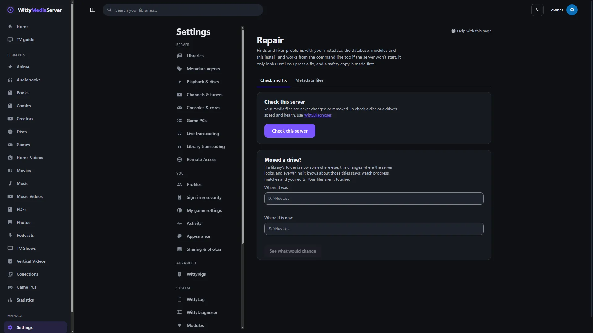
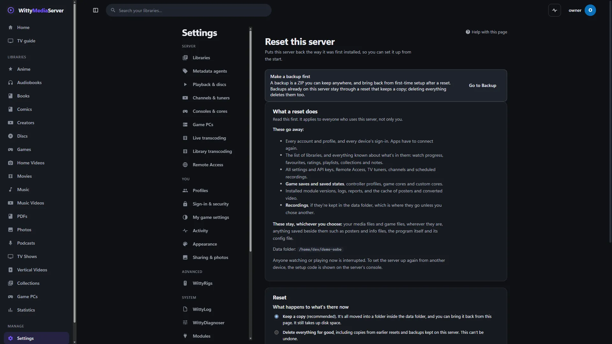

# Repair

Find and fix problems with the server's own data and install, from **Settings → Repair** or from the command line when the server won't start. Both are the same code and find the same things.

It only looks until you press a fix or add `--fix`, and a safety copy is made first. Your media files are never changed or removed. It's for administrators.

- [If the server won't start](#if-the-server-wont-start)
- [Repairing from Settings](#repairing-from-settings)
- [Repairing from the command line](#repairing-from-the-command-line)
- [What the words mean](#what-the-words-mean)
- [What it checks and fixes](#what-it-checks-and-fixes)
- [A module is broken](#a-module-is-broken)
- [Moved a drive?](#moved-a-drive)
- [A damaged database](#a-damaged-database)
- [Safety copies](#safety-copies)
- [Starting again: the Reset page](#starting-again-the-reset-page)
- [With the server running](#with-the-server-running)
- [For developers](#for-developers)

## If the server won't start

1. Open a terminal on the machine the server runs on.
2. Run `wittymediaserver doctor`. It says what's wrong, and changes nothing. It needs no running server, no open port and no FFmpeg.
3. Run `wittymediaserver doctor --fix`. It fixes what can be fixed, and asks first before anything that changes data.
4. Start the server again.

The usual causes are a damaged database, a mistake in `wms.json`, FFmpeg missing, or the port being taken. For what only you can do, such as installing FFmpeg, it gives the steps for your system.

Run it as the same account that runs the server, so it can reach the same files. For a Linux system service, that's `sudo -u wms wittymediaserver doctor`.

Still stuck?

- **Bring back a backup:** `wittymediaserver backup restore <file>`. See [Backup and restore](BACKUP.md#from-the-command-line).
- **Get the logs out:** `wittymediaserver logs zip`. See [Logs](LOGGING.md#from-the-command-line).
- **Fix titles by hand:** `wittymediaserver metadata check`. See [The metadata folder](METADATA-FOLDER.md#on-the-command-line).
- **Start again:** `wittymediaserver reset`. See [the Reset page](#starting-again-the-reset-page).
- **Forgot a password:** `wittymediaserver reset-password <username>` gives that account a new one, and nothing else changes. See [If you forget your password](ACCOUNTS.md#if-you-forget-your-password).
- **Lost your phone and your recovery codes:** `wittymediaserver reset-2fa <name>` turns off that account's two-factor sign-in.

## Repairing from Settings



*Settings, Repair.*
1. Open **Settings → Repair**, on the **Check and fix** tab.
2. Press **Check this server**. You can leave the page while it runs.
3. Each thing it finds says what it found, what the fix does, and how safe that is.
4. Press **Fix everything that's safe** for what can't lose anything, or **Fix this** on one finding. Anything that changes data asks for your password, one at a time, and then **Go ahead**.
5. It looks again and shows **What was done**, and where the safety copy is.

If a fix needs the database file to itself, the page says **A restart finishes the repair**. Press **Restart now**, and anyone watching is interrupted. If the server can't restart itself, stop it and start it again.

The other tab, **Metadata files**, is the page for [the metadata folder](METADATA-FOLDER.md).

To check a disc, or a drive's speed and health, use [WittyDiagnoser](DIAGNOSER.md), which only reads.

## Repairing from the command line

```
wittymediaserver doctor                         look, and say what's wrong
wittymediaserver doctor --fix                   fix what can be fixed, asking first
wittymediaserver doctor --fix --safe-only       only what can't lose anything
wittymediaserver doctor --fix --yes             don't ask
wittymediaserver doctor --only data             one area: data, metadata, modules or install
wittymediaserver doctor --only ffmpeg,port      particular checks
wittymediaserver doctor list                    every check
wittymediaserver doctor --json                  a report for a program
wittymediaserver doctor --try-port              also try the port, on this machine, for a moment
wittymediaserver doctor -data /path/to/folder   a data folder other than the usual one
wittymediaserver doctor remap --from <old> --to <new> [--fix]
wittymediaserver doctor reinstall <module>      the only thing here that goes online
wittymediaserver doctor reset-password <username>   a new password for someone locked out
```

It finds the folders the way the server does, and `wittymediaserver config path` shows which. A `wms.json` with a mistake in it doesn't stop it: it says what the mistake is.

| Exit code | Means |
|---|---|
| 0 | Nothing needs attention. Notes may still be listed |
| 1 | Something does |
| 2 | It couldn't run |

This has not been run on a real Mac or on FreeBSD yet.

## What the words mean

How much it matters, in the same words as [WittyDiagnoser](DIAGNOSER.md#reading-the-results): **Problem**, **Warning**, **Note**, **Fine**. **Not checked** means it couldn't look, which says nothing good or bad.

How safe the fix is:

| Word | Means |
|---|---|
| **Safe** | Nothing can be lost by it. A safety copy is made anyway |
| **Backed up first** | It changes data, so it asks first, and a safety copy is made |
| **You'll need to do this yourself** | Only a person can, and it gives the steps for this system |

## What it checks and fixes

The name on each row is what `--only` takes.

**The database and data folder** (`data`)

| Check | Finds | Its fix |
|---|---|---|
| `database` | Damage, a file that isn't a database, indexes out of step | Rebuilds indexes, or [recovers what can be read](#a-damaged-database) |
| `database-links` | Rows pointing at things that no longer exist | Removes those rows |
| `database-size` | A large journal, or a lot of empty space | Folds it in, or compacts the file |
| `temp-files` | Temporary files left by something that stopped | Moves them to the safety copy. Old streams and unpacked games are removed, as they're made again when needed. In a conversion folder you chose, anything that isn't a stream's folder is yours, and stays |
| `reset-state` | A reset or repair waiting from a while ago, a reset that stopped halfway, copies taking up space | Takes the request back, or brings the copy back. It never deletes copies: [the Reset page](#starting-again-the-reset-page) does that |
| `restore-state` | A restore waiting from a while ago, cut off, or failed | Takes the request back. A restore that was cut off puts everything back at the next start |
| `accounts` | Accounts, but no administrator with a password | You do it, with steps. A new password is never set from here: it takes [the command on the server itself](ACCOUNTS.md#on-the-server-itself), which works from no other device |

**Metadata** (`metadata`)

| Check | Finds | Its fix |
|---|---|---|
| `library-folders` | A library's folder that can't be reached or is empty | Nothing is touched, in case the drive comes back. [If it moved, say where](#moved-a-drive) |
| `missing-files` | Titles whose files have gone, in a folder that's there | Hides them, as a scan would. They come back if the files do |
| `artwork-refs` | Titles pointing at artwork that has gone | Clears the reference, so a refresh fetches a new one. If every picture is missing it's the folder that's away, and nothing changes |
| `artwork-orphans` | Artwork nothing uses | Moves it to the safety copy. Logos, web-address copies and small copies stay, and so does anything under a day old |
| `matches` | A match with no id, an id with no source, or an id that can't exist | Forgets the match, so it's looked up afresh. What you typed and locked stays |
| `duplicates` | The same place listed twice, a file in two libraries, two shows with one name | Merges only what is truly the same place, moving watch progress and episodes. The others are for you to decide |
| `nfo-files` | NFO and `.metadata.json` files that can't be read, with the file and line | You fix it. Nothing here writes beside your media. See [the metadata folder](METADATA-FOLDER.md#files-beside-your-media) |
| `metadata-files` | Files in the metadata folder with mistakes, by file and line | You fix it, or delete the file and export again |

**Modules** (`modules`)

| Check | Finds | Its fix |
|---|---|---|
| `module-state` | A damaged list of what's installed | Moves it aside. Updates install as usual afterwards |
| `module-versions` | A version with a failed signature, missing files, or not for this server | [Takes it out of use](#a-module-is-broken) |
| `module-updates` | An update that stopped partway, or installed files nothing uses | Moves them to the safety copy |
| `module-helpers` | Helpers still running with no server | Ends them. Only programs running from this data folder's modules |

**The install** (`install`)

| Check | Finds | Its fix |
|---|---|---|
| `config-file` | A mistake in `wms.json`, or a path in it that isn't there | You fix it, with steps |
| `ffmpeg` | FFmpeg or ffprobe missing or not running | You install it, with steps for your system |
| `folders` | Folders missing, not folders, or that can't be written | Makes missing ones. It never changes permissions, and gives the steps |
| `disk-space` | Under 5 GB where the server keeps things | You make room, with suggestions |
| `port` | The port taken, and by what if the system says, or a server of another version already on it | You choose, with steps |
| `firewall` | Nothing it can see: a note on what to allow if other devices can't connect | You do it, with steps. Firewall settings are never changed |
| `leftover-processes` | FFmpeg still converting for a server that stopped | Ends them. Only an FFmpeg whose command line names a stream's folder in this server's conversion folder |
| `layout` | A data folder inside the program's folder, which a reinstall can remove | You move it, with steps |

## A module is broken

Each module is checked on its own: whether it's whole, whether its signature is good, and whether it's right for this server.

**In Settings:**

1. Press **Check this server** under **Settings → Repair**. A broken module is listed under **Modules**.
2. **Fix this** takes that version out of use and moves its files to the safety copy. The module goes back to the version before it. With none, it's out of use until you install it again.
3. **Reinstall it** does that and also downloads the newest compatible version from its publisher. Nothing is downloaded unless you choose this.

A module whose install failed also says so on its page under **Settings → Modules**, with a way to retry and a link here.

**On the command line:**

```
wittymediaserver doctor --only modules --fix
wittymediaserver doctor reinstall wittyplay
```

`doctor reinstall` needs the internet, and refuses while a server is running on that data folder. Use **Settings → Modules** then, or stop the server first.

Module updates and versions are covered in [Modules and the store](MODULE-STORE.md).

## Moved a drive?

If a library's folder is now somewhere else, the server only needs to be told. Watch progress, matches, ratings and your edits all stay, and your files aren't touched.

**In Settings:** under **Moved a drive?** on the Repair page, type **Where it was** and **Where it is now**, and press **See what would change**. If it looks right, type your password and press **Move it**.

**On the command line:**

```
wittymediaserver doctor remap --from "D:\Movies" --to "E:\Movies"
wittymediaserver doctor remap --from "D:\Movies" --to "E:\Movies" --fix
```

The first line says what would change, and the second does it. Either way:

- It looks for the files in the new place first, up to 2,000 spread through the library. Unless at least 60% are there, it says so and stops, because those aren't the same files.
- Every path that starts with the old place changes, all at once or not at all. A path that only starts with the same letters doesn't change (`D:\Movies2` for `D:\Movies`).
- A move from Windows to Linux or back works: the rest of the path takes the new system's separators.

If you've already added the new folder and scanned it, the titles are there twice, and it says so instead of changing anything. Take that folder out of the library first.

Scan the library afterwards to pick up anything new.

## A damaged database

A power cut, a failing drive, or a copy taken while the server was running can damage the file. If that's what the check finds:

1. A new database is made by this version of the server, and every row that can still be read is copied into it, table by table. It says how many rows couldn't be read, and in which tables.
2. Rows pointing at something lost are left out, as a delete would have taken them.
3. The new file is checked. With the server stopped it takes over at once. From Settings, it takes over at the next start, which **Restart now** does for you.
4. The damaged file is kept in the safety copy, as it was.

If nothing can be read, nothing is replaced. A recent [backup](BACKUP.md#restoring-a-backup) may save more than this does, so it's worth comparing first.

## Safety copies

Before the first fix of a run, the database is copied to `backups/before-repair-<date>-<time>` in the data folder. If the copy can't be made, for lack of space for example, nothing is changed.

Whatever a fix would remove goes into that folder's `removed` folder, with its place in the data folder kept, instead of being deleted. A replaced database goes in `replaced`. The one exception is converted video and unpacked game files, which can be many gigabytes and are never anyone's only copy of anything.

The newest five are kept, and older ones are removed by the next run. Settings lists them under **Safety copies**.

To undo a repair, stop the server and copy `wms.db` back from that folder into the data folder.

## Starting again: the Reset page



*Settings, Reset.*
**Settings → Reset** puts the server back the way it was first installed. It applies to everyone on this server, so make a [backup](BACKUP.md#making-a-backup) first: **Go to Backup** is at the top of the page.

**These go away:**

- every account and profile, and every device's sign-in;
- the list of libraries and everything known about what's in them, including watch progress, favourites, ratings, playlists, collections and notes;
- all settings and API keys, Remote Access, TV tuners, channels and scheduled recordings;
- game saves and saved states, controller profiles, game cores and custom cores;
- installed module versions, logs, reports, and the cache of posters and converted video;
- recordings kept in the data folder.

**These stay, whichever you choose:** your media files and game files, anything saved beside them such as posters and info files, the program itself and its config file.

To reset:

1. Choose **Keep a copy**, which is recommended, or **Delete everything for good**. A copy goes in a folder inside the data folder, and still takes up disk space. Deleting everything also deletes copies from earlier resets and backups kept on this server.
2. Type your password, and `RESET`.
3. Press **Reset this server** or **Delete everything and reset**.

The server restarts, and first-time setup begins, where you can [restore a backup](BACKUP.md#restoring-during-first-time-setup). If the server can't restart itself, stop it and start it again. Until then, **Cancel it** takes the reset back.

**Copies from earlier resets** are listed on the same page, with **Bring back** and **Delete**. Bringing one back keeps what's there now as another copy.

If you're locked out or the server won't start, the command line does the same:

```
wittymediaserver reset                back to a new install at the next start, keeping a copy
wittymediaserver reset -delete -yes   deleting everything, without asking
wittymediaserver reset -list          the copies kept
wittymediaserver reset -restore <copy>
wittymediaserver reset -cancel        take back a reset that's waiting
```

## With the server running

- **In Settings,** the server repairs itself. Anything needing the database file to itself waits for the next start. If anything can't move then, every file goes back.
- **On the command line,** `wittymediaserver doctor` can look while a server is running, and `--fix` still works for what's safe alongside it. It refuses what needs the server stopped, and points you to Settings.
- Helpers, FFmpeg and working files are only called leftovers when no server is running. With one, they're its own.

## For developers

The code is `internal/diagnose/doctor*.go`. A check is a `Check` with an id, an area, `Run` and optionally `Fix`. `Run` returns `Issue`s, and has to work with no server, on a database that may be damaged: open it with `e.metaDB(...)` or `e.readDB()`, and if a read fails, say *not checked*, never *nothing wrong*. `Fix` moves files with `f.Remove` and writes through `withWrite`, in a transaction. Add a test with a fixture for each check.

The database is read with `db.OpenExisting`, which doesn't migrate or create anything. `db.RecoverInto` is the recovery. The next-start request is `reset.AskRepair` and `reset.ApplyRepair`, which `cmdServe` calls right after `reset.Apply`. What it knows of modules is in `internal/modules/doctor.go`, which reads `state.json` and version folders with no `Manager`.

The routes are `/api/repair/...` ([API](CLIENT-API.md)), and the page is `web/src/pages/settings/Repair.tsx`, sharing `FindingCard` with WittyDiagnoser.

---

<sub>WittyMediaServer documentation</sub>
