# Settings tour

Use this guide to find where a setting lives and what it does. It goes through every Settings page, in the order the menu lists them.

Open Settings from your name at the top right. On a phone, it's in the **You** tab at the bottom. On a wide screen the menu sits beside the page. On a narrower one the menu is a page of its own, with a one-line note on each item.

**Finding a setting.** Type in **Search settings**, at the top of the menu: a page's name, a setting's name or a word for it, such as *dark mode*, *colour* or *subtitles*. What it finds takes the menu's place. Press Enter for the first, or move to another with the arrow keys or Tab. Escape empties the search and brings the menu back. Each result goes straight to its part of the page.

**Long pages** have **On this page** under their title: a link to each section, which stays at the top as you scroll and marks the one you're in.

**Who sees what.** Administrators see every page. Everyone else sees the pages listed under **You**, plus **About** and **Legal**. If you open an administrator's page without being one, you land on **Profiles**.

**Saving.** Some pages save each change straight away. Others show a bar saying "You have unsaved changes", with **Save changes** and **Discard**. If you see that bar, nothing has been saved yet.

## Where do I change this?

| I want to | Go to |
|---|---|
| Add, change or remove a folder of media | [Libraries](#libraries) |
| Add a key for posters and plots | [Metadata agents](#metadata-agents) |
| Fix a film matched to the wrong title | [Metadata agents](#metadata-agents), **Fix matches** |
| Save posters and info files beside my media | [Metadata agents](#metadata-agents), **Saving information** |
| Skip disc menus, or change the disc region | [Playback and discs](#playback-and-discs) |
| Allow faster playback speeds | [Playback and discs](#playback-and-discs) |
| Add a TV tuner, an IPTV list or guide data | [Channels and tuners](#channels-and-tuners) |
| Make a channel from my library | [Channels and tuners](#channels-and-tuners) |
| Install what a console needs to play | [Consoles and cores](#consoles-and-cores) |
| Change how my games look and sound | [My game settings](#my-game-settings) |
| Make conversion easier on my computer | [Live transcoding](#live-transcoding) |
| Use my graphics card to convert video | [Live transcoding](#live-transcoding) |
| Convert files ahead of time | [Library transcoding](#library-transcoding) |
| Watch away from home | [Remote Access](#remote-access) |
| Limit quality for viewers away from home | [Remote Access](#remote-access) |
| Add a person, or a Kids or Guest profile | [Profiles](#profiles) |
| Limit what someone can watch | [Profiles](#profiles), **Limits** |
| Change my password or my name | [Profiles](#profiles) |
| Choose the sign-in screen | [Profiles](#profiles), **Signing in** |
| Stop apps finding this server by themselves | [Profiles](#profiles), **Signing in** |
| Turn on two-factor sign-in | [Sign-in and security](#sign-in-and-security) |
| Sign out a device I lost | [Sign-in and security](#sign-in-and-security) |
| Hide the activity button | [Activity](#activity) |
| Change the theme, or switch between light and dark | [Appearance](#appearance), **Theme** |
| Make a theme in my own colours | [Appearance](#appearance), **Colours** |
| Change the menu layout | [Appearance](#appearance), **Layout** |
| Turn off the moving posters | [Appearance](#appearance), **Motion and big screens** |
| Make text larger for a TV | [Appearance](#appearance), **Motion and big screens** |
| Change how the TV guide looks | [Appearance](#appearance), **WittyTV** |
| Hide the seek bar, or fill the screen with the picture | [Appearance](#appearance), **Player** |
| Rename this server, or change its logo | [Appearance](#appearance), **Name and logo** |
| Turn off uploads or share links | [Sharing and photos](#sharing-and-photos) |
| Send logs to someone helping me | [WittyLog](#wittylog), **Download logs** |
| Check a disc image or a drive | [WittyDiagnoser](#wittydiagnoser) |
| Add or update a module | [Modules](#modules) |
| Make or restore a backup | [Backup](#backup) |
| Tell the server a drive has moved | [Repair](#repair), **Moved a drive?** |
| Update the server | [About](#about), **Updates** |

Three things people look for here live elsewhere:

- **Rearranging the home page:** **Customize home**, at the foot of the home page.
- **Controllers:** **Controllers** in the menu under your name, when you have a games library.
- **Signing in a TV:** **Sign in a TV** in the menu under your name. See [Apps and devices](APPS.md).

## Server

Everything in this group is for administrators only.

### Libraries

Each library is one or more folders of one kind of media. The server watches them and keeps everything up to date.

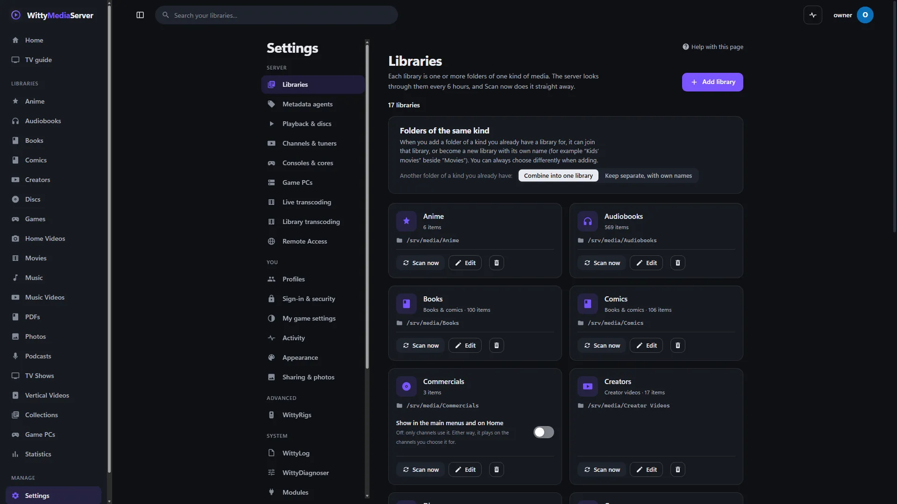
*Settings, Libraries.*

- **Add library** asks what's in the folder and where it is. **Edit** changes the name, kind and folders, then scans. **Scan now** looks again straight away. The bin icon removes a library: your files stay where they are, and only the server forgets them.
- **Folders of the same kind** decides what happens when you add a folder of a kind you already have. It can join that library, or become a new one with its own name, such as "Kids' movies". You can choose differently each time you add one.
- A kind that needs a module you don't have is greyed out, with a link to the store.
- A **Commercials** library has a switch, **Show in the main menus and on Home**. Off means only channels use it.

More: [Libraries](LIBRARIES.md), [Media types](MEDIA-TYPES.md).

### Metadata agents

Where titles, posters, plots and ratings come from. Information inside your files and NFO files comes first, then your custom agents in order, then the built-in ones.

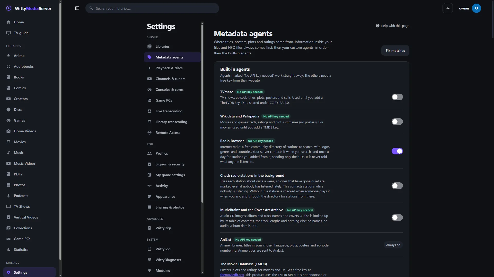
*Settings, Metadata agents.*

- **Built-in agents:** the ones marked "No API key needed" work straight away. **The Movie Database (TMDB)** and **TheTVDB** need a free key from their sites, and **Test** checks a key.
- **Fix matches** at the top opens the list of titles to look over.
- **Custom agents** are your own web services, for catalogues nothing else covers.
- **Logos** downloads logos for studios, networks, TV channels, consoles and services, only if you agree, and finds or sets any one of them by name. **Streaming listings** shows which of your titles a streaming service has now.
- **Anime** sets where anime from TV libraries appears, and how titles are written.
- **Saving information:** **Save information and artwork next to your media** writes NFO files and pictures beside your files. It's off by default, so nothing is written to your media folders until you turn it on.

More: [Metadata](METADATA.md), [Fixing metadata](FIXING-METADATA.md), [The metadata folder](METADATA-FOLDER.md).

### Playback and discs

The page is called **Playback & discs**. It sets how videos, shows and discs play for everyone.

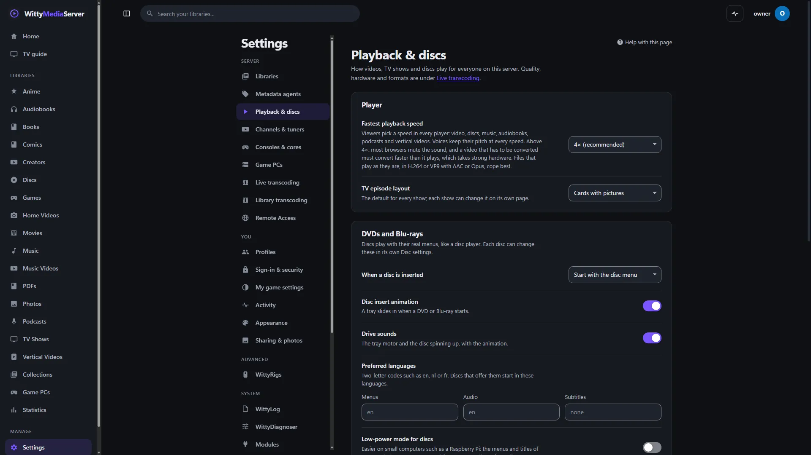
*Settings, Playback & discs.*

- **Fastest playback speed** is the highest speed the player offers. 4× is the recommended limit: above it, most browsers mute the sound, and a video being converted has to convert faster than it plays.
- **TV episode layout** is the default for every show. A show can change it on its own page.
- **When a disc is inserted** starts with the disc's menu, or skips to the movie.
- **Disc insert animation** and **Drive sounds** are the tray effect.
- **Preferred languages** take two-letter codes such as `en` or `fr`, for menus, audio and subtitles on discs that offer them.
- **Low-power mode for discs** helps small computers such as a Raspberry Pi, at a small cost in quality.
- **Run Blu-ray Java menus (BD-J)** shows menus written in Java. It needs Java 8 or newer installed on the server, and runs code from the disc in a boxed-in process, so it starts off. With it off, these discs play their main feature directly.
- **DVD region** and **Blu-ray region** are for discs that check where they're being played. A Blu-ray from another region shows its own message instead of the movie, so pick the region your discs are from.
- **Parental limits** are the disc's own checks, used to choose a version of the film. They aren't a lock on the server: use [Profiles](#profiles) for that.

More: [Watching and listening](PLAYING.md), [DVDs](DVD.md), [Blu-rays](BLURAY.md).

### Channels and tuners

The page is called **Channels & tuners**.

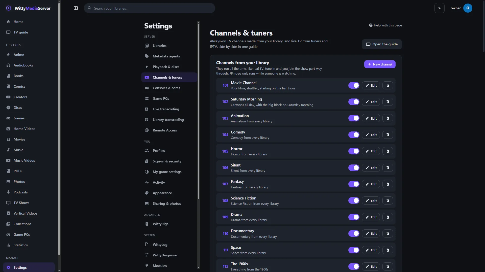
*Settings, Channels & tuners.*

- **Channels from your library** run all the time, like real TV. You tune in and join the show part-way through. They're made and changed on a page of their own, **Channels** (**Open the channel list**, or **Edit channels** in the guide), with the channels suggested from your library and **Network facts**, which fills in the network and original day and time of shows.
- **Tuners and IPTV** adds tuners and internet TV lists. No channel lists or stream addresses come with the server. Encrypted channels are shown as encrypted and are never decrypted.
- **Guide data** adds listings for tuner and IPTV channels, in XMLTV format.
- **Options** holds the guide's starting layout and colours, how far back people can pause (**Pause buffer**), the largest picture on channels and where recordings go. Each person can change the guide's look on their own device with the **Look** button on the guide.

More: [Live TV](TV.md), [Channels](CHANNELS.md).

### Consoles and cores

The page is called **Consoles & cores**. Games run on this server and stream to whatever you're playing on.

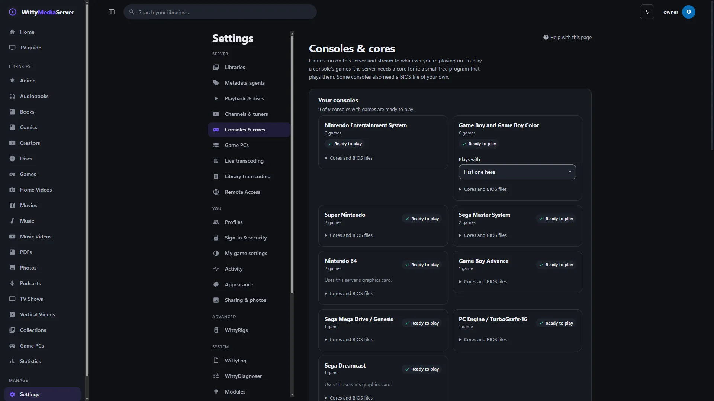
*Settings, Consoles & cores.*

- **Your consoles** shows what each console with games needs. A core is a small free program that plays a console's games. A button to install all the recommended cores appears when more than one is missing. Installing one downloads it from the libretro project's build server, after asking.
- **BIOS files** says where to put the files some consoles need, copied from a console you own. They're never downloaded for you.
- **Which version comes first** is the order of regions when a game has more than one version.
- **How games play** sets the picture quality and **Games at once**. Under **Advanced** are the internal resolution, fast-forward, rewind, run-ahead, the space for unpacked games, and the network settings for playing away from home.
- **Custom cores** and **Custom consoles** are for cores this project hasn't checked. They're off, and whoever runs the machine has to allow them first.

More: [Games](GAMES.md).

### Game PCs

Lets people play the games on any PC running Sunshine, in their browser, through this server. This feature is called WittyCouch.

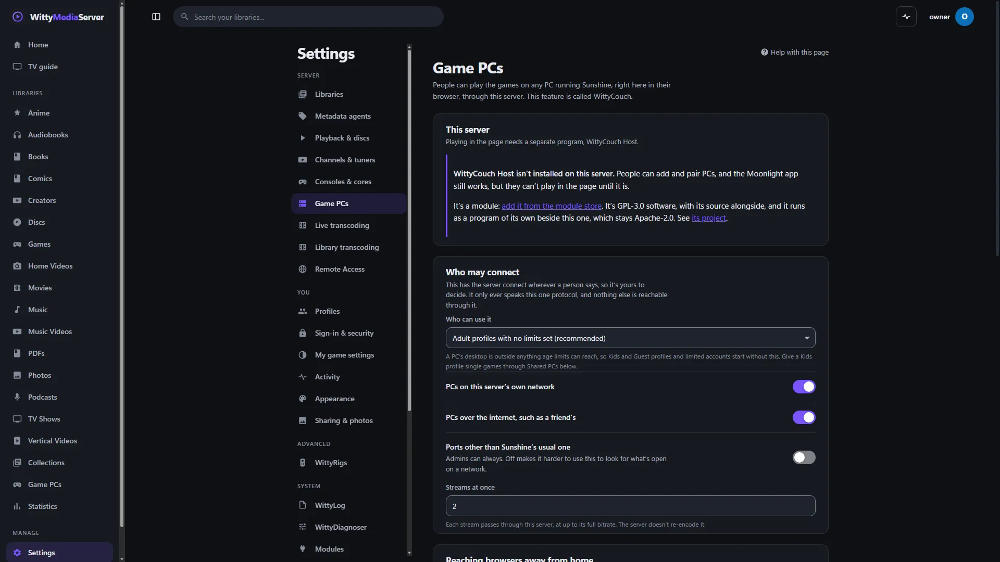
*Settings, Game PCs.*

- **This server** says whether WittyCouch Host, a separate program, is installed. Without it, people can add and pair PCs but can't play in the page.
- **Who may connect** sets who can use it. The recommended choice is **Adult profiles with no limits set**. The switches below it decide whether that covers PCs on this network, PCs over the internet, and ports other than Sunshine's usual one.
- **Streams at once** matters because each stream passes through this server.
- **Reaching browsers away from home** is the UDP port and public address. Nothing is needed at home.
- **Share a PC with this server's people** pairs a PC once, and its games become a library, with everyone's limits applied.

More: [Game PCs](GAME-RIGS.md).

### Live transcoding

What happens while someone watches a video their device can't play as it is. Your files aren't changed, and the work stops when they stop watching.

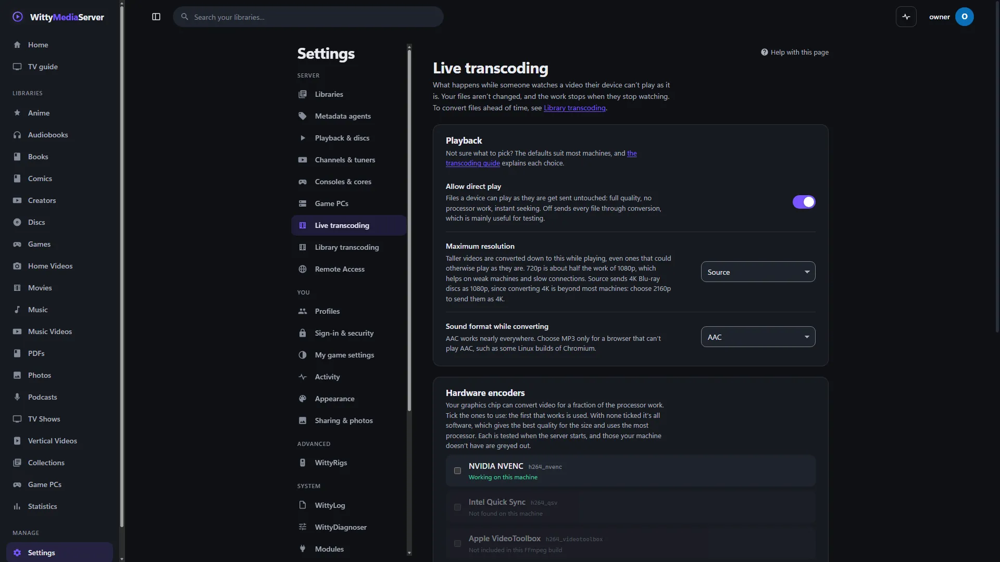
*Settings, Live transcoding.*

- **Allow direct play** sends a file untouched when the device can play it. Leave it on.
- **Maximum resolution** converts taller videos down, even ones that could play as they are. 720p is about half the work of 1080p.
- **Sound format while converting** is AAC unless a browser can't play it.
- **Hardware encoders** lists what your graphics chip can do. Tick the ones to use, and the first that works is used. With none ticked it's all software, which gives the best quality for the size and uses the most processor.
- **Picture quality** starts in **Easy** with **Speed**, **Balanced** and **Quality**, each saying which machines it suits. **Advanced** and **Expert** give you more to choose.

More: [Transcoding](TRANSCODING.md).

### Library transcoding

Converts the files in a library ahead of time, so they play without being converted later. It changes your files, so it starts off.

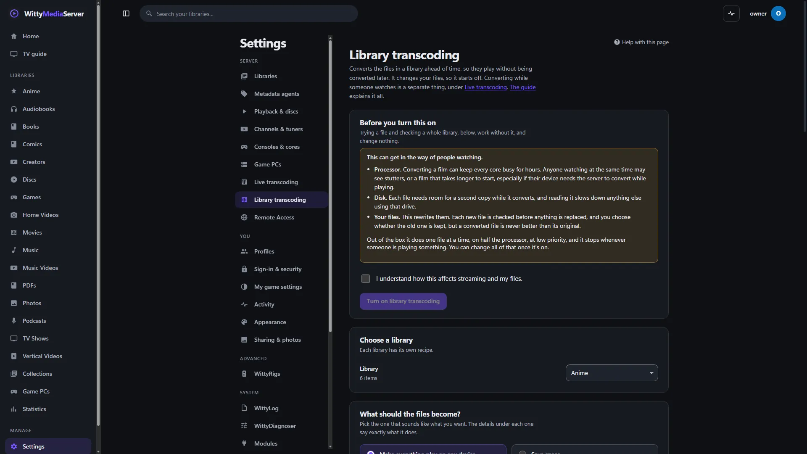
*Settings, Library transcoding.*

- **Before you turn this on** explains the risks. **Try it on one file** and **This whole library** can show what would happen, and change nothing.
- **How it runs on this server** keeps it out of people's way: pausing while anyone is streaming, low priority, certain hours, and how much free space to leave.
- Each library has its own recipe: **What should the files become?** and **What happens to the old file?**. Keeping the original is the default.
- **Convert new files by themselves** handles new arrivals. **This library is read-only** stops the server changing a library's files at all.
- **Originals and copies** lists what's waiting for a decision.
- **Connect your own Tdarr** links a Tdarr server you already run.

More: [Library transcoding](LIBRARY-TRANSCODING.md), [Tdarr](TDARR.md).

### Remote Access

Reaching your server when you're away from home. Everything here is off until you turn it on. Read [Remote access](REMOTE.md) before you do.

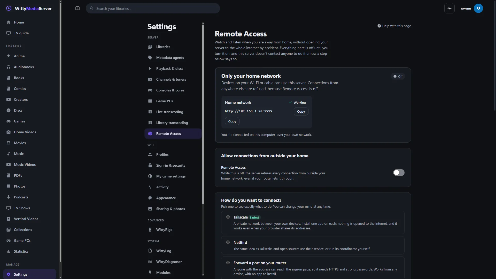
*Settings, Remote Access. The address is an example.*

- The status card at the top says what really works, from where, and how you're connected now.
- **Remote Access** is the master switch. While it's off, the server refuses every connection from outside your home network.
- **How do you want to connect?** walks you through one way in. Tailscale is marked **Easiest**.
- **Test it from outside** proves it with your own phone.
- **Limits for viewers away from home** sets **Highest resolution** and **Most data per stream**.
- **People connected from outside** lists those devices, and can sign them out.
- **Sign-in protection** shows wrong sign-ins and locked addresses, with **Let everyone try again**.
- **Advanced** holds the outside address, trusted reverse proxies and which networks count as home. Mistakes here can make strangers look like family.

## You

Everyone can open these pages. Some have parts for administrators or adults only, which are marked.

### Profiles

Everyone who uses this server, with their passwords and what they may watch.

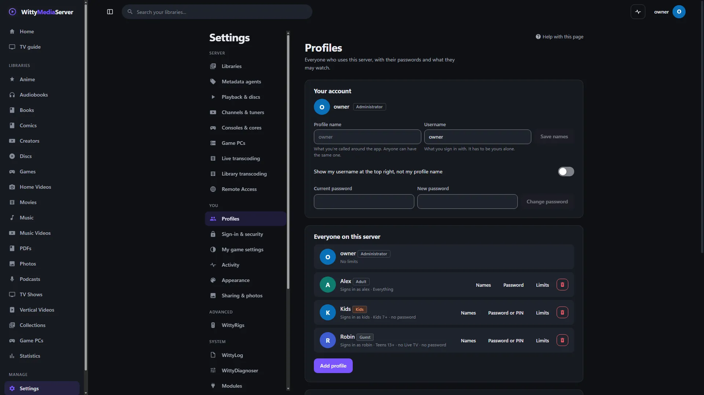
*Settings, Profiles, with made-up names.*

- **Your account** has your **Profile name**, your **Username** (what you sign in with) and **Change password**. Changing your password signs out your other devices. Kids and Guest profiles can't rename themselves or change a password: an adult does that.
- **Everyone on this server** (administrators) or **Kids profiles you manage** (adults) lists people, with **Names**, **Limits** and a remove button. Removing a profile deletes its watch history too, and can't be undone.
- **Password** or **Password or PIN** beside someone gives them a new one, for a forgotten password. See [If you forget your password](ACCOUNTS.md#if-you-forget-your-password).
- **Add profile** makes an **Adult**, **Kids** or **Guest** profile. Other adults may add Kids profiles only, unless an administrator keeps that to themselves. A Kids or Guest profile with no password signs in with a tap, and only on your home network.
- **Limits** sets an age level, which libraries are allowed, genres to hide, titles always or never allowed, and Live TV.
- **Signing in** (administrators) chooses **Profiles** or **Classic**, whether to **Show profiles outside your home**, **Let apps find this server**, and **Who may manage Kids profiles**.

More: [Accounts and profiles](ACCOUNTS.md).

### Sign-in and security

The page is called **Sign-in & security**.

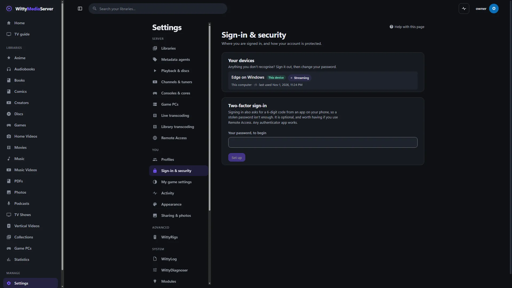
*Settings, Sign-in & security.*

- **Your devices** lists where you're signed in. Sign out anything you don't recognise, then change your password. **Sign out the others** does them all.
- **Two-factor sign-in** (adults) asks for a 6-digit code from an app on your phone as well as your password. Save the 8 recovery codes it gives you somewhere that isn't your phone. Turning it on signs out your other devices.
- **Other people's two-factor sign-in** (administrators) turns it off for someone who lost their phone and their recovery codes. An administrator's own can only be reset on the server itself, with `wittymediaserver reset-2fa`.

More: [Remote access](REMOTE.md#step-2-lock-down-your-accounts).

### My game settings

How your games look, sound and behave: picture, speed, shortcuts and more. You can set something for every game or for one console, and a game's own page can change it for just that game. It follows you to every device. Administrators can choose **Everyone** at the top of a panel to set the starting point for all.

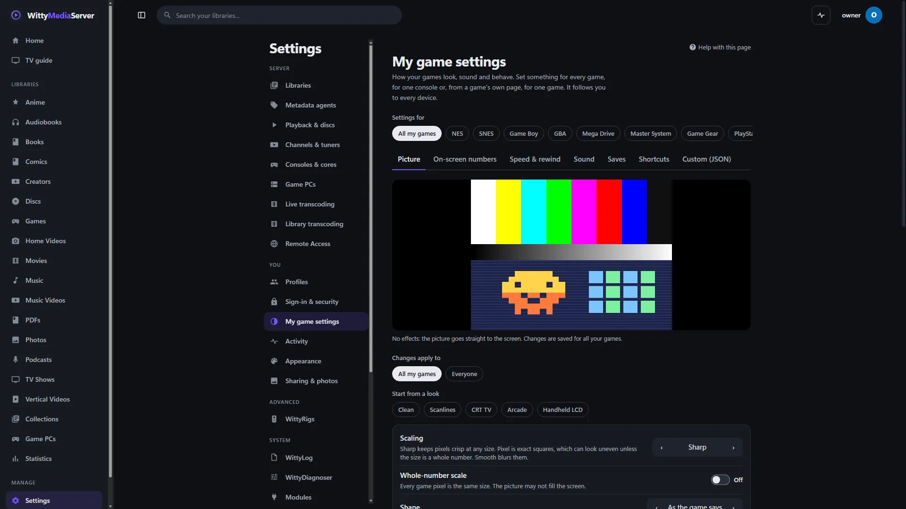
*Settings, My game settings.*

More: [Games](GAMES.md).

### Activity

The button in the top bar that shows library scans and other background work.

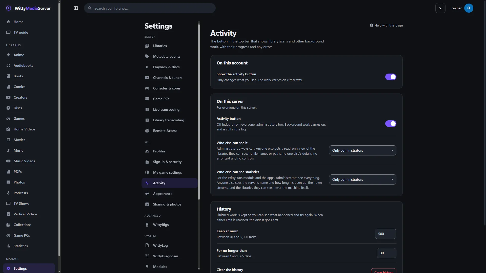
*Settings, Activity.*

- **Show the activity button** only changes what you see. The work carries on either way.
- **On this server** (administrators) turns the button off for everyone, and sets **Who else can see it**. Anyone but an administrator gets a read-only view with no file names and no controls. **Who else can see statistics** does the same for [statistics](STATS.md#who-may-see-it).
- **History** (administrators) keeps at most 500 tasks for 30 days unless you change it, and **Clear history** empties it.

More: [Background tasks](TASKS.md), [Watching and listening](PLAYING.md#the-activity-button).

### Appearance

How this server looks for you, from the app's theme to the look of each part of it. **On this page** at the top jumps to each section, and **Search settings** finds any of them by name.

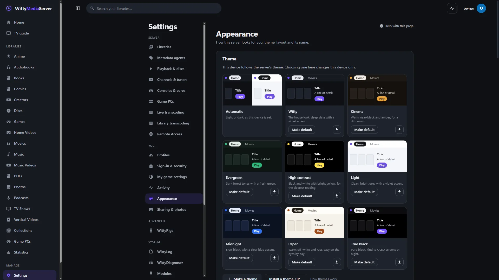
*Settings, Appearance.*

- **Theme:** a large preview shows the theme in use, and any other you point at or move to, before you choose it. Choosing one changes this device only. **Automatic** follows the device's light or dark setting. Administrators also get **Make default** and **Install a theme ZIP…**.
- **Colours:** make a theme of your own from a few choices, with a preview as you go. **Use on this device**, or, for administrators, **Add for everyone**.
- **Layout:** **Side menu**, **Top bar** or **Both**. Phones always have the bar at the bottom. Below that you can arrange the menu.
- **Motion and big screens:** **Moving posters** is the tilt when your pointer crosses a poster. **Big screen mode** makes text larger and the focus outline stronger, on this device.
- **WittyTV:** the TV guide's own theme, colours, preview and rows, the same as its **Look** panel. See [The look](CHANNELS.md#the-look).
- **Player:** the seek bar, chapter marks, how soon the controls hide, fitting or filling the screen, and the size of disc subtitles, for every video on this device. A disc or video you've set differently from the player's own menu keeps its own.
- **Name and logo** (administrators): **Rename…** changes what shows in the corner, on the sign-in page and in the browser tab.

More: [Themes](THEMES.md), [Watching and listening](PLAYING.md#moving-posters).

**WittyTV** has themes of its own, apart from the app's theme: see [The look](CHANNELS.md#the-look).

### Sharing and photos

The page is called **Sharing & photos**. **Your links** is for everyone who has made one. The rest is for administrators.

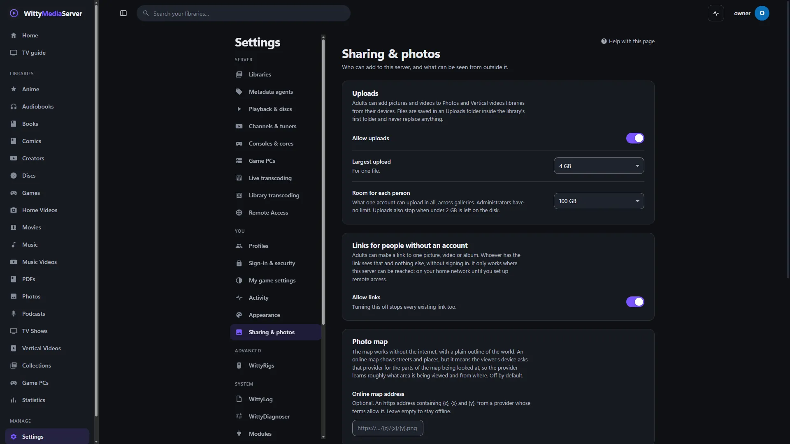
*Settings, Sharing & photos.*

- **Uploads:** **Allow uploads** lets adults add pictures and videos to Photos and Vertical videos libraries. It's on by default. **Largest upload** and **Room for each person** set the limits. Uploads also stop when under 2 GB is left on the disk.
- **Links for people without an account:** **Allow links** is on by default. Turning it off stops every existing link too.
- **Photo map** works offline with a plain outline of the world. **Online map address** is optional, and tells that provider roughly what area is being viewed.
- **Local AI** is planned and doesn't exist yet. The switch does nothing.
- **Your links** lists your links, with **End link**. Administrators can tick **Everyone's**.

More: [Photos](PHOTOS.md), [Vertical videos](SHORTS.md).

## Advanced

### WittyRigs

For administrators. It's for playing demanding PC games installed on this server itself, using this machine's graphics card. Most servers don't need it. To play on other PCs, use [Game PCs](#game-pcs).

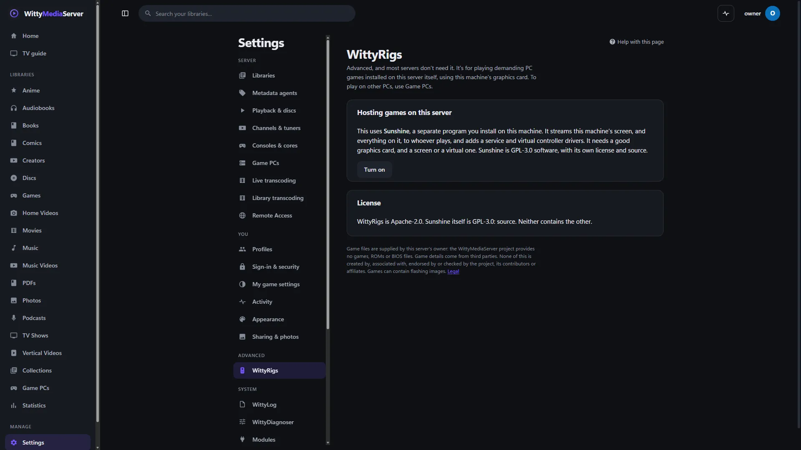
*Settings, WittyRigs.*

**Turn on** explains what you're agreeing to first. It uses Sunshine, a separate program you install yourself, which streams this machine's screen to whoever plays.

More: [Game PCs](GAME-RIGS.md).

## System

Everything here except **About** and **Legal** is for administrators only.

### WittyLog

What the server records and for how long. Nothing is ever sent anywhere. The tabs are:

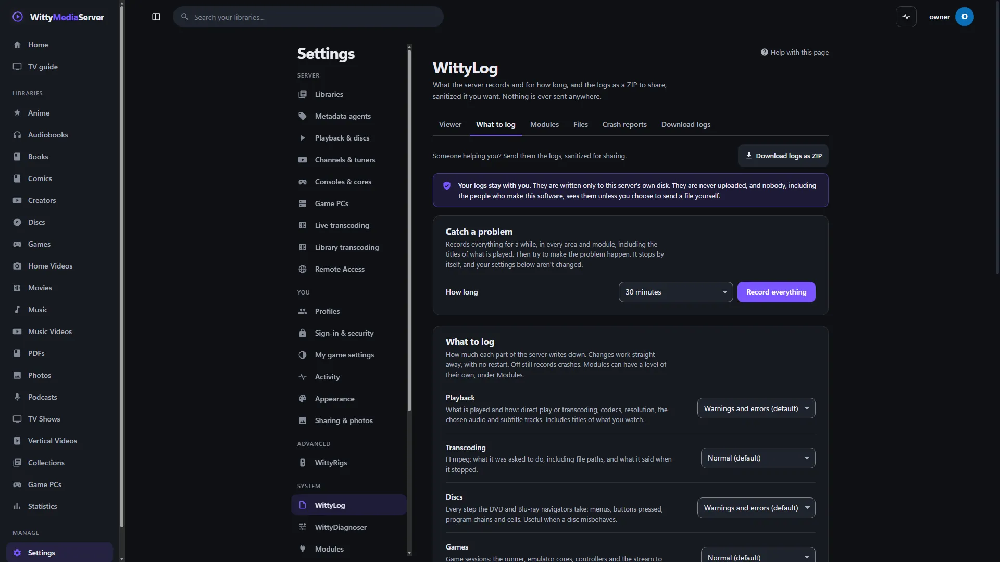
*Settings, WittyLog.*

- **Viewer** reads the log as it's written.
- **What to log** sets how much each part of the server writes down. **Catch a problem** records everything for a while, then goes back to your usual settings.
- **Modules** sets the same for each module.
- **Files** shows where the logs are, with the log files themselves.
- **Crash reports** lists times the server stopped unexpectedly. A notice appears on every Settings page until you've looked.
- **Download logs** makes a ZIP. Leave **Sanitize for sharing** on for anything you send to someone else.

More: [Logging](LOGGING.md).

### WittyDiagnoser

The disk diagnoser. It checks your discs and your drives, and changes nothing.

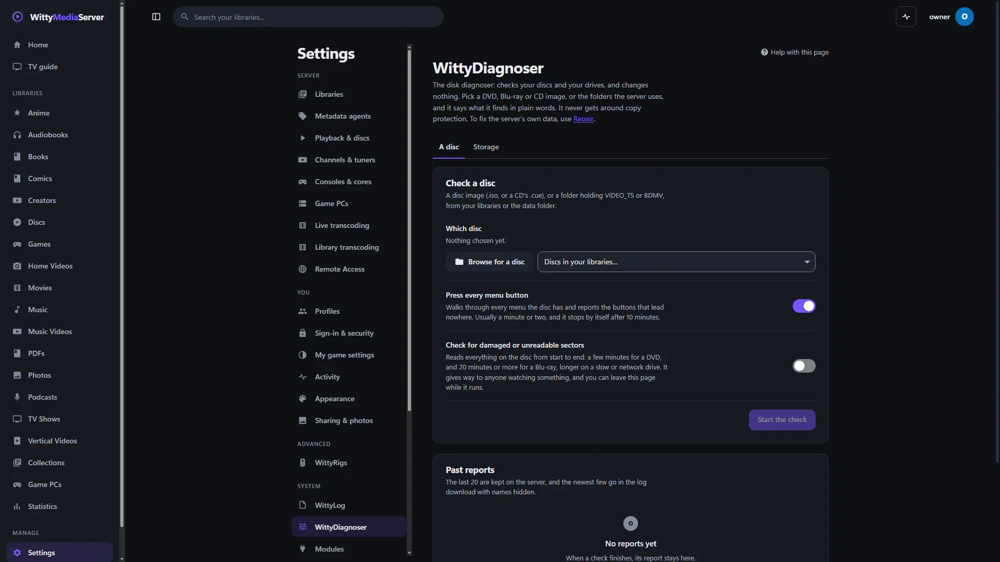
*Settings, WittyDiagnoser.*

- **A disc** checks a disc image, or a folder holding `VIDEO_TS` or `BDMV`. **Press every menu button** finds buttons that lead nowhere. **Check for damaged or unreadable sectors** reads the whole disc.
- **Storage** checks free space, drive health and read speed for the server's folders.

It never gets around copy protection. To fix the server's own data, use [Repair](#repair).

More: [WittyDiagnoser](DIAGNOSER.md).

### Modules

What this server can do, one piece at a time.

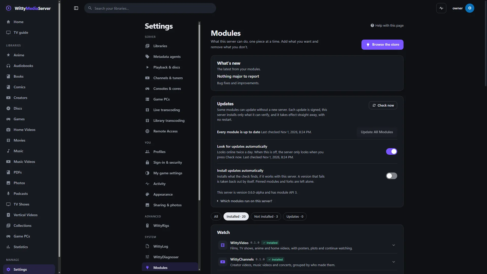
*Settings, Modules.*

- **Browse the store** opens the module store. **Other stores** is on its page.
- **Updates** has **Look for updates automatically** and **Install updates automatically**. Each update is signed, and takes effect with no restart.
- Each module has its own version, **Store page** and **Logging**. Using someone's fork is under its **Advanced**.
- **Built into everything** lists modules others depend on, which can't be removed. **Installed separately** lists programs that run beside the server.

More: [Modules and the store](MODULE-STORE.md).

### Backup

A ZIP of your data and metadata, for when something goes wrong or you move to another machine. Your media files are never in a backup, and neither are modules, game cores, BIOS files, logs or sign-ins.

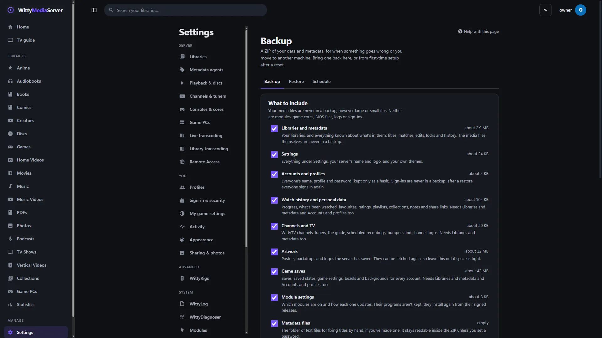
*Settings, Backup.*

- **What to include**, **Protect it with a password** and **Make the backup** make one now. A password encrypts it, and everything comes back, including API keys.
- **Backups on this server** can be downloaded. Download one to keep it on another drive.
- **Back up by itself** makes one on a schedule.
- **Restore a backup** brings one back, from this server or from a file.

More: [Backup](BACKUP.md).

### Repair

Finds and fixes problems with your metadata, the database, modules and this install. It only looks until you press a fix, and a safety copy is made first. It never changes or removes your media files.

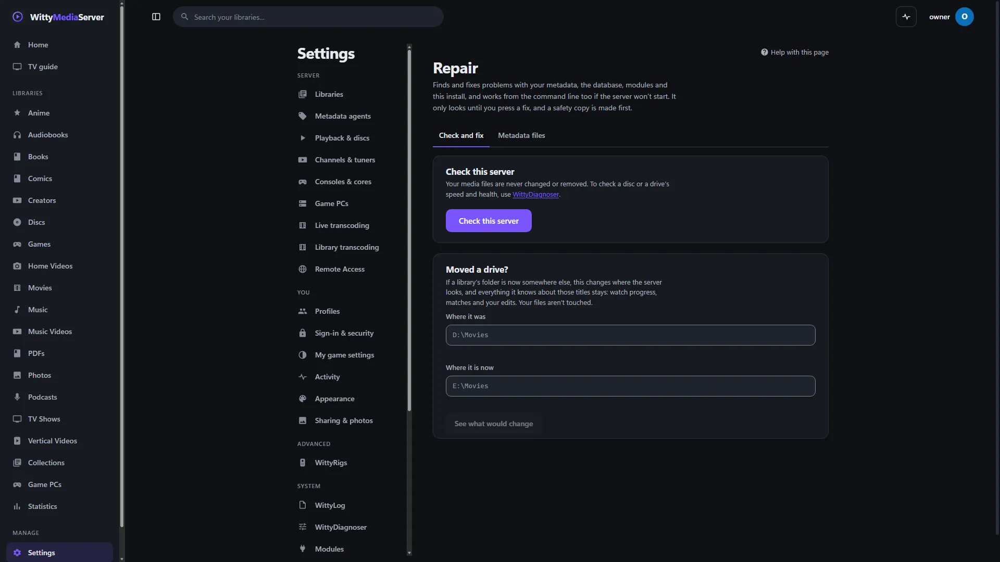
*Settings, Repair.*

- **Check and fix** runs the checks and shows what it found. **Moved a drive?** changes where the server looks when a library's folder has moved, and keeps everything it knows about those titles.
- **Metadata files** is for editing what the server knows about a title by hand.

If the server won't start, the same checks are on the command line. See [Repair](REPAIR.md) and [The metadata folder](METADATA-FOLDER.md).

### Reset

The page is called **Reset this server**. It puts the server back the way it was first installed, for everyone who uses it.

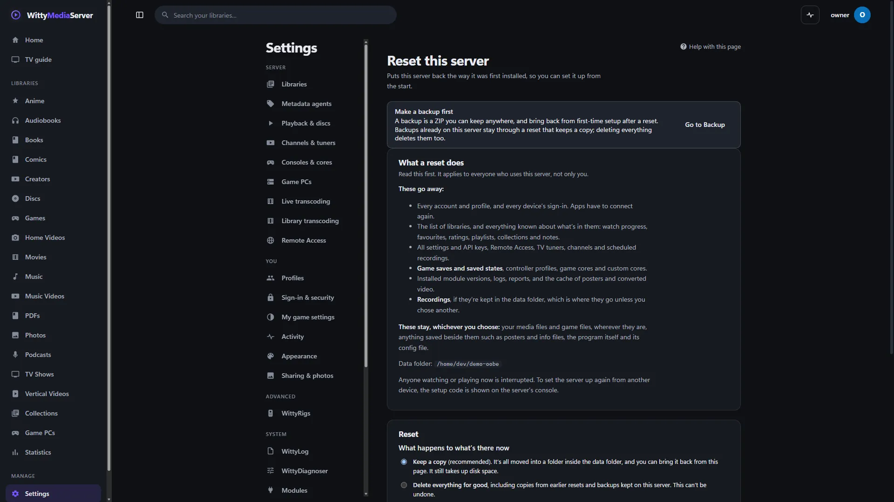
*Settings, Reset.*

Accounts, library lists, watch progress, settings, API keys, game saves and installed modules go away. Your media files, the program and its config file stay. Read the page's own list first.

- **Keep a copy** (recommended) moves it all into a folder you can bring back from this page.
- **Delete everything for good** also deletes earlier copies and any backups kept on this server. It can't be undone.

It asks for your password, and for you to type `RESET`. Make a [backup](#backup) first.

### About

For everyone: the version, the modules inside this server, the license, every kind of file it takes, and third-party licenses.

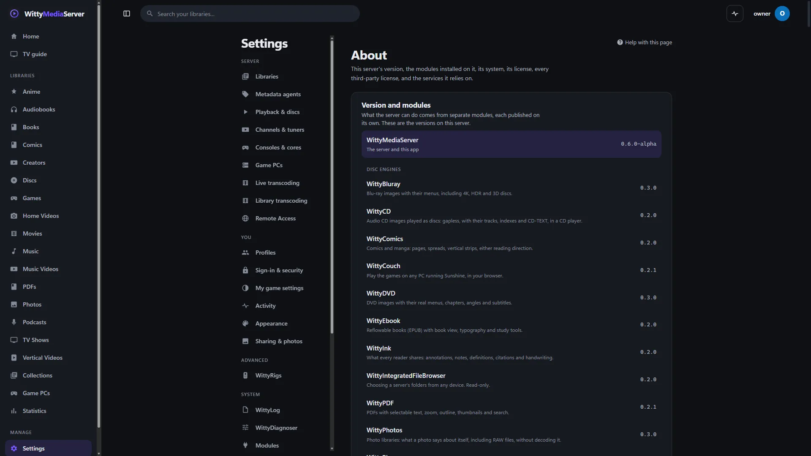
*Settings, About.*

For administrators, also:

- **Updates**: **Check now**, **Update now** when there's a newer version, and **Check for updates automatically**. Twice a day the server asks GitHub for its list of releases and shows a dot on Settings when there's a newer one. Nothing about you or your library is sent, and nothing installs without you.
- **This server**: the addresses to open it on other devices at home, the system, hardware video and the data folder.

More: [Supported formats](SUPPORTED-FORMATS.md).

### Legal

Terms of use, who's responsible for what, what leaves this server, and the notices the law or a license asks for. Administrators can add **Your notice** and a **Contact** for people using this server.

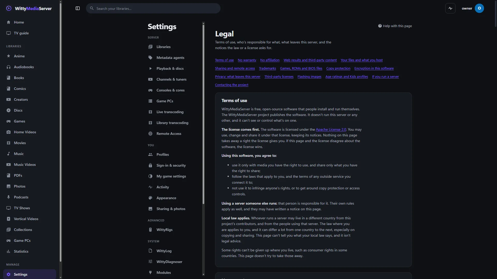
*Settings, Legal.*

## From modules

Some modules add a settings page of their own. It appears in the menu under **From modules**, once the module is on your server. See [Modules and the store](MODULE-STORE.md).

---

WittyMediaServer documentation
