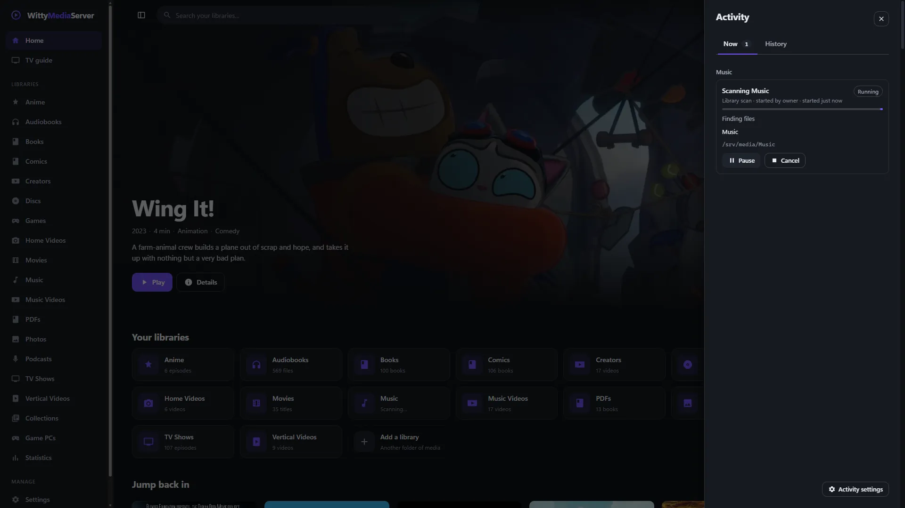

# Background tasks

See what your server is busy with, how far along it is and what went wrong, from the activity button in the top bar. Library scans, backups, conversions and other long jobs all show here.

- [The activity button](#the-activity-button)
- [Who sees it](#who-sees-it)
- [What's going on now](#whats-going-on-now)
- [Pausing and cancelling](#pausing-and-cancelling)
- [History](#history)
- [What doesn't show here](#what-doesnt-show-here)
- [For developers](#for-developers)

## The activity button

The button is in the top bar, just left of the account menu. On a phone it sits at the right of the row of sections.


*The activity panel. Openly licensed and public-domain media, credited in [the list](images/CREDITS.md).*

- While something is running, a ring around it shows how far along everything is, with a count.
- A **!** means something finished with a problem you haven't looked at.
- When nothing is going on, it's quiet.

Press it to open the **Activity** panel, which has two tabs: **Now** and **History**.

## Who sees it

Open **Settings → Activity**.

**On this account**, anyone who's offered the button can turn off **Show the activity button**. That only changes what you see, and the work carries on either way.

**On this server**, administrators choose for everyone:

| Setting | What it does | Default |
|---|---|---|
| **Activity button** | Off hides it from everyone, administrators too. Background work carries on, and is still in the log | On |
| **Who else can see it** | **Only administrators**, **Adult profiles too**, or **Everyone, including kids and guests** | Only administrators |

Press **Save** to apply them.

Anyone who isn't an administrator gets a read-only view, and sees less:

| | Administrator | Anyone else allowed |
|---|---|---|
| **Which tasks** | All | Those on libraries they can see, their own, and general ones. Never backups, repairs, module work or other admin-only work |
| **File names and paths** | Yes | No |
| **Who started it** | Yes | Only if it was them |
| **The words of an error** | Yes | No, because these often hold paths. They get a general sentence, and how many problems there were |
| **Pause, Resume, Cancel, Try again, clearing the history** | Yes | No |

## What's going on now

The **Now** tab groups work by library, with the server's own work after that, under **This server**. Each task shows:

- what it is, who started it and when;
- how far along it is, its speed and about how long is left, when that's known;
- which stage it's at, and what it's working on now. A library scan lists its stages under one bar that runs from start to end, with those done ticked, rather than a bar that starts again at each;
- how many problems it has met. Open that to read them. The first 50 are kept here, and **Settings → WittyLog** has the rest.

If the panel says **Reconnecting to the server**, what you're looking at may be out of date.

## Pausing and cancelling

Only tasks that can stop safely offer these buttons, so not every task has both.

- **Pause** and **Resume** are offered on library scans, finding suggested matches, finding out about games, and library transcoding.
- **Cancel** is offered on library scans, backups and restores, repairs, WittyDiagnoser checks, finding suggested matches, streaming listings, library transcoding, and finding channels on a tuner.

Both take effect when the job next reaches a point where it can stop, which is usually within a moment. A task says **Pausing…** until then. A scan stops at the next file, even while it's still walking through the folders.

A cancelled scan can be run again, and picks up where it stopped: files it has already seen, unchanged, take almost no time.

Modules' own tasks show here too, but they don't offer **Pause** or **Cancel**.

## History

The **History** tab lists what has finished, newest first, with how long it took and what came of it. **All** and **Failed** choose what's listed, and **Show more** goes further back.

- Anything that failed says what happened and what to do. **Technical details** has the error as it came.
- **Try again**, or **Scan again** on a scan, starts it again, where that's possible.
- The bin button removes one task from the list, and **Clear history** removes them all. **Settings → WittyLog** keeps its own record either way.
- Work that was running when the server stopped shows as failed, saying so.

Under **Settings → Activity**, **Keep at most** (10 to 5,000 tasks, 500 by default) and **For no longer than** (1 to 365 days, 30 by default) limit how much is kept. When either limit is reached, the oldest goes first.

## What doesn't show here

- Thumbnails and intro detection have no tasks of their own yet.
- A game scan's bar starts again between its stages, because each stage counts on its own.
- Some small jobs that wake up and find nothing to do leave no trace.

## For developers

Everything the server does in the background goes through one registry, `internal/tasks`. The activity button reads it, and so can WittyStats, the native apps and anything else with the API below.

### Reporting a task from the server

Every server job gets the registry as `s.Tasks` (or a `Tasks` field on its service). A nil registry and a nil handle both do nothing, so a job and its tests never have to check.

```go
ctx, cancel := context.WithCancel(context.Background())
t := s.Tasks.Start(tasks.Spec{
    Type:     tasks.TypeBackup,      // a Type* constant, or a short name of your own
    Title:    "Backing up",          // no file paths: non-admins may read it
    Unit:     "files",               // what Done and Total count
    By:       byUser(userFrom(r)),   // who asked; leave it out for the server's own work
    Cancel:   cancel,                // offers Cancel
    Pausable: true,                  // offers Pause and Resume; you must call Wait
    RetryKey: "all",                 // offers Retry, with OnRetry below
})
logging.Go("backup", func() {
    var err error
    defer func() { t.Finish(err) }()         // nil: done. context.Canceled: cancelled. Else: failed.
    for i, f := range files {
        if err = t.Wait(ctx); err != nil {   // holds here while paused; ctx's error once cancelled
            return
        }
        t.Progress(int64(i), int64(len(files)))
        t.Item(filepath.Base(f), f)          // name and path: only admins see them
        if err := copyFile(f); err != nil {
            t.Problem(f, "This file couldn't be copied. Check that it can still be read.")
        }
    }
    t.Result(fmt.Sprintf("Backed up %d files.", len(files)))
}, "cat", "server")
```

| Call | What it does |
|---|---|
| `Start(spec)`, `Queue(spec)` | A task running now, or one waiting its turn, which `Begin()` then starts |
| `Phase(s)` | Says which stage it's at, such as "Finding files" |
| `Steps(steps...)` | Names the stages it goes through, in order, each with a rough share of the work, so the app shows one bar across them all with each stage named. `Phase` with one of those names moves it on, and that stage's `Progress` counts from nothing. A phase that isn't one of them, such as waiting for a turn, leaves the bar where it was |
| `Progress(done, total)`, `Add(n)` | How far along. A total of 0 means nobody knows yet, and the app shows it as busy. The speed and time left come from these |
| `Item(name, path)` | What it's working on now |
| `Problem(item, message)`, `ProblemN` | One thing went wrong and the task carries on. The first 50 are kept and the count goes on. Write the message for a person: what happened and what to do |
| `Wait(ctx)`, `PauseWanted()` | `Wait` holds while paused, and returns `ctx`'s error, so it's also the check for cancelling. Use `PauseWanted` to let go of something first, as a scan does with its turn at the disk |
| `Result(s)` | What came of it, in a sentence, for the history |
| `Finish(err)` | Ends it. A failure is put in words by `tasks.Explain`, and the error as it came is kept for admins |
| `Fail(message, fix, cause)` | Ends it as failed, in your own words. Better than `Finish` whenever you know what went wrong |

Calling these often is fine: see [what it costs](#what-it-costs). Report as you go, and don't add timers of your own.

**Spec options**

| Field | Use it for |
|---|---|
| `LibraryID`, `LibraryName` | Work on one library. It's listed under that library, and hidden from anyone who can't see it |
| `Private` | One person's activity, such as their transcode. Only they and admins see it |
| `AdminOnly` | Never shown to anyone else, whatever the settings say |
| `NoHistory` | Left out of the history. For things that come and go constantly |
| `Quiet` | Dropped when it ends having done nothing, with nothing wrong: a service that woke up and found no work |

**Retry.** Say once how to start a kind of task again. It works from the history too, even after a restart, so it can only use what's in `RetryKey`:

```go
s.Tasks.OnRetry(tasks.TypeBackup, func(old tasks.Task, by tasks.By) error {
    return s.startBackup(old.RetryKey, by)
})
```

**Games.** A scan of a games library reports as `scan`, with phases for working out what each file is, listing the games and putting versions together, and says what it found and how many files need a look. Finding out about them is one `games` task, *Finding out about games*, which can be paused: names from the local list first, then online sources and box art. Neither holds a file path where anyone without admin rights can read it.

**Kinds of task.** `scan`, `analysis`, `metadata`, `thumbnails`, `intros`, `games`, `module`, `backup`, `transcode`, `convert` (library transcoding), `tdarr`, `update`, `guide`, `recording`, `diagnose`, `other`. A new kind needs nothing but its name.

### Reporting a task from a module

A helper calls `wittymodule.ReportTask` (module API 3), and the task shows beside the server's own:

```go
wittymodule.ReportTask(wittymodule.TaskReport{Key: "reindex", Title: "Reindexing", State: wittymodule.TaskRunning, Done: 3, Total: 10, Item: "a file"})
```

A helper may be someone's fork, so the server believes it only about itself:

- Every report goes through `TaskReport.Validate`. A task's name is `<module id>/<key>`, with the id from the manifest and never from what the helper says, so a module can't touch another's tasks.
- Each module can have 16 tasks going, and each task's reports apply at most 4 times a second, keeping the latest.
- Module tasks are for admins only, and offer no Pause or Cancel.
- When the process stops, whatever it left going ends: failed if the process failed, and otherwise cancelled.

Most helpers are stopped after a minute idle and report only during a call. Long work needs a process that stays running and never streams (`keep` and `background` on its `proc`). Don't start a process just to report.

### Settings

The server enforces these, and a client only follows `access` in the answer.

| Setting | Values | Default |
|---|---|---|
| `activityEnabled` | `1` on, `0` off for everyone | `1` |
| `activityViewers` | Who gets the read-only view besides admins: `admins`, `adults`, `everyone` | `admins` |
| `activityKeepCount`, `activityKeepDays` | How much history is kept, at most | `500`, `30` |
| `activityHidden` in `/me/ui` | This person has hidden the button for themselves | Not set |

Fields a non-admin never gets: `item`, `path`, `detail`, `fix`, `problems`, `result`, and `by` and `byId` unless it was them. `error` becomes a general sentence, and the number of problems stays.

### The API

Paths are relative to `/api/v1`. All of it needs a signed-in account. A task's fields are the `Task` schema in `docs/openapi.json`.

| Route | Who | What |
|---|---|---|
| `GET /system/tasks` | user | `access`, `tasks` (going on now), `recent` (finished lately) and `summary`. If the account may not see activity, the lists are empty and `access.visible` is false. It's always safe to ask |
| `GET /system/tasks/stream` | user | Server-sent events. See below. 403 if the account may not see activity |
| `GET /system/tasks/history` | user | Finished tasks, newest first. Query: `limit` (at most 200), `before` (the last row's `finishedAt`), `type`, `state`, `library` |
| `DELETE /system/tasks/history`, `DELETE /system/tasks/history/{id}` | admin | Forget the history, or one task of it |
| `POST /system/tasks/{id}/pause`, `/resume`, `/cancel` | admin | 404 if it has finished, 409 if this task can't do that. Offered by `canPause`, `canResume`, `canCancel` |
| `POST /system/tasks/{id}/retry` | admin | Starts a failed or cancelled task again, under a new id. Offered by `canRetry` |

**States.** `queued`, `running`, `paused`, then one of `done`, `failed` or `cancelled`. Pausing and cancelling take effect when the job next checks, usually within a moment, so wait for the state to change rather than assuming it. Between asking and stopping, a task is `running` with `canResume` true: show that as pausing.

**The stream.** Send the token in a header. `EventSource` can't, so a browser or an app reads the response body as it arrives:

```
GET /api/v1/system/tasks/stream
Authorization: Bearer <token>

event: snapshot
data: {"access":{...},"tasks":[...],"recent":[...],"summary":{"active":1,"queued":0,"paused":0,"percent":25}}

event: update
data: {"tasks":[{"id":"...","state":"running","done":10,"total":40,...}],"gone":["..."],"summary":{...}}

: still here
```

- `snapshot` comes first and holds everything. Each `update` holds the tasks that changed, whole, including ones that just finished. Replace by `id`. Drop any listed in `gone`, and move finished ones from your current list to your history.
- Updates come at most twice a second, and not at all when nothing is changing. A comment line every 25 seconds keeps the connection open, so treat 60 seconds of silence as a lost connection.
- On losing it, connect again with a growing wait. The new `snapshot` replaces all you had, so nothing needs replaying.
- **Close it when you aren't showing it.** A stream is one of the few connections a browser allows per server, and the web app closes its own whenever its tab is hidden. Signing out, losing access or the owner turning this off ends it.
- At most 16 streams per account (429 past that).

### What it costs

With nobody watching, reporting takes a short lock and sets a few fields: no timer, no goroutine and no copying (`BenchmarkProgressNobodyWatching`). With someone watching, one goroutine sends what changed at most twice a second, however often jobs report, and a slow watcher gets the latest state rather than a backlog. History rows are written by a goroutine that exists only while there's something to write, because a job may be holding the database when it reports.

---

<sub>WittyMediaServer documentation</sub>
