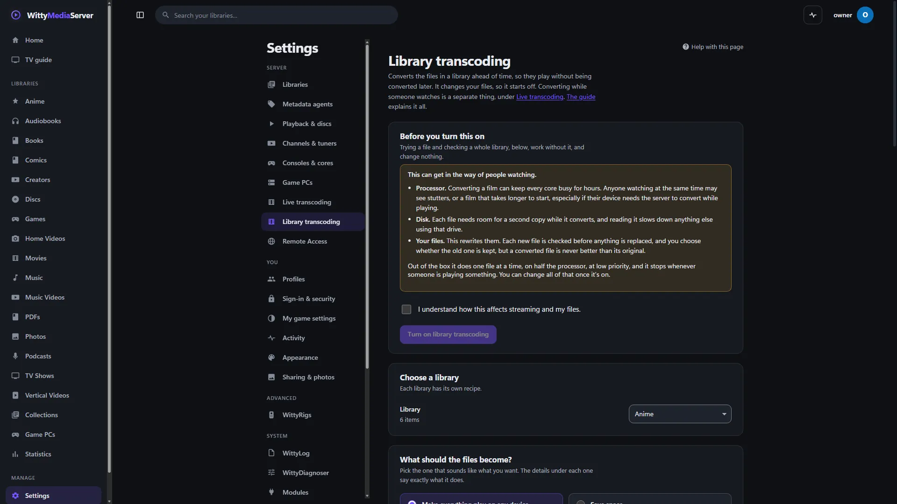

# Using Tdarr

Use this guide to connect a Tdarr server you already run, so this server can show what it's doing and hand it files. You don't need Tdarr to convert your library: the built-in engine does that, and [Library transcoding](LIBRARY-TRANSCODING.md) explains it.

**This connection has never been run against a real Tdarr.** It was written from Tdarr's published API and tested against a stand-in. Downloading Tdarr binds whoever does it to Tdarr's licence, so it hasn't been done here. If something doesn't work, the page says what Tdarr answered.

## What Tdarr is, and why it isn't included

Tdarr is a separate program, made by other people, that converts video across several computers. Its server and node aren't open source. They come under their own licence, with free and paid tiers, which forbids redistributing or reverse engineering them.

So this server doesn't include Tdarr, doesn't download it and doesn't install it. You install it from [tdarr.io](https://tdarr.io) and agree to its terms yourself. No Tdarr code or plugin is used here, and its name is only used to say what this connects to.

The converter built into this server is its own, written on FFmpeg, and is complete without Tdarr.

## Connecting it



*Settings, Library transcoding.*
1. Install Tdarr on any machine.
2. In Tdarr, make an API key under **Tools, API Keys**. If its sign-in is off, you can leave the key out.
3. Here, go to **Settings → Library transcoding → Connect your own Tdarr**.
4. Enter its address with its server port, which is 8266 unless you changed it. It isn't the web page's port:

   ```
   http://192.168.1.20:8266
   ```

5. Enter the API key, and press **Test the connection**. You'll see its version, its nodes, what they're working on, and how many libraries it has.
6. Turn on **Use this connection**, and press **Save the connection**.

With the switch off, nothing contacts Tdarr. A saved key is only ever sent to the address it was saved for, and if you change the address you're asked for the key again. **Forget the saved key** removes it.

## Handing it a library

1. With the connection on, test it, so that Tdarr's libraries are listed.
2. Under **Handing files to Tdarr**, choose a **Tdarr library** for your library.
3. If the two machines call the folder by different names, fill in **Folder name here** and **Folder name in Tdarr**, such as `/srv/films` and `/media`.
4. Press **Save the connection**.
5. Press **Ask Tdarr to look through this library**.

Tdarr then looks for files it hasn't seen. Its own plugins and flows decide what happens to each one.

## Nodes

A Tdarr node connects to a Tdarr server. How they talk isn't documented for anything else to use, so stock nodes can't connect to this server, and working it out from the programs would break Tdarr's licence.

Attach your nodes to your Tdarr server as usual, and connect that server here. You'll see the nodes on this page, and what they're doing in the activity panel. This server has no worker nodes of its own.

## What it shows in the activity panel

While Tdarr's nodes have files to work on, an entry appears in the activity panel, for administrators:

- **Tdarr is working**, with how many files on how many nodes, such as "3 files on 2 nodes".
- The average progress of those files, and the name of one of them.
- When they finish, "Tdarr finished what it was doing".
- If it stops answering partway through, "Tdarr stopped answering, so there's no telling what it's doing now". It waits for three missed answers first, so a quick restart of Tdarr doesn't set this off.

Tdarr can't announce anything, so this server asks it: every 20 seconds while something's going on or someone has the panel open, and every 2 minutes otherwise. You can look at what it's doing, but you can't pause or cancel it from here.

## What Tdarr does to your files

Tdarr's rules apply, not this server's. None of the checks in [What it does to your files](LIBRARY-TRANSCODING.md#what-it-does-to-your-files) happen, so a recipe chosen on the Library transcoding page has no effect on what Tdarr does, and there's no **Put the original back** for its work. Tdarr's own terms say it isn't responsible for data lost during processing, so test it on a few files first.

**If it replaces a file under the same name,** the next scan picks up the new details, and the item stays the same.

**If it changes the file's extension,** this server sees a new file on its next scan, and what's been watched doesn't carry over to it. To avoid that, have Tdarr keep the extension, such as MKV to MKV, or use the [built-in converter](LIBRARY-TRANSCODING.md), which keeps an item's history when the extension changes.

## If it won't connect

| What it says | What to do |
|---|---|
| Nothing answered at that address | Check that Tdarr is running, and that the address and server port are right |
| It doesn't look like a Tdarr server | You may have the web page's port. Use the server port |
| Tdarr refused the API key | Make a new one in Tdarr under **Tools, API Keys** |
| Tdarr said no to that request | Tdarr understood and refused. Look in Tdarr's own log |
| None of those files could be named in Tdarr's terms | Check **Folder name here** and **Folder name in Tdarr** for this library |

## For developers

To check the connection against a real Tdarr you've installed yourself:

```bash
WMS_TDARR_URL=http://192.168.1.20:8266 WMS_TDARR_KEY=your-key go test ./internal/libtranscode/tdarr -run TestLive -v
```

---

<sub>WittyMediaServer documentation</sub>
