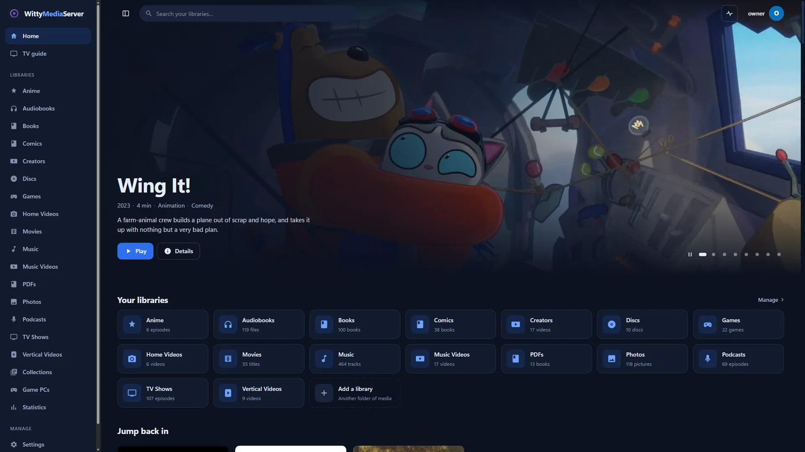
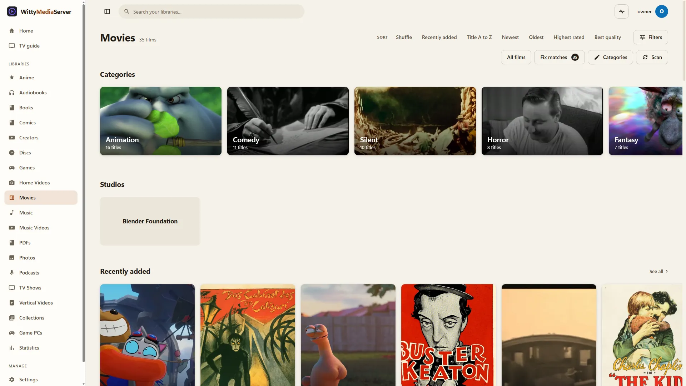
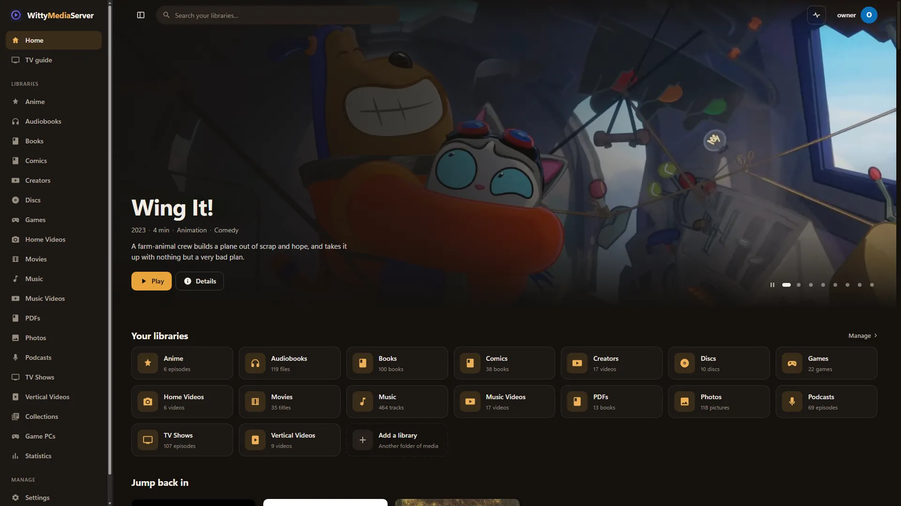
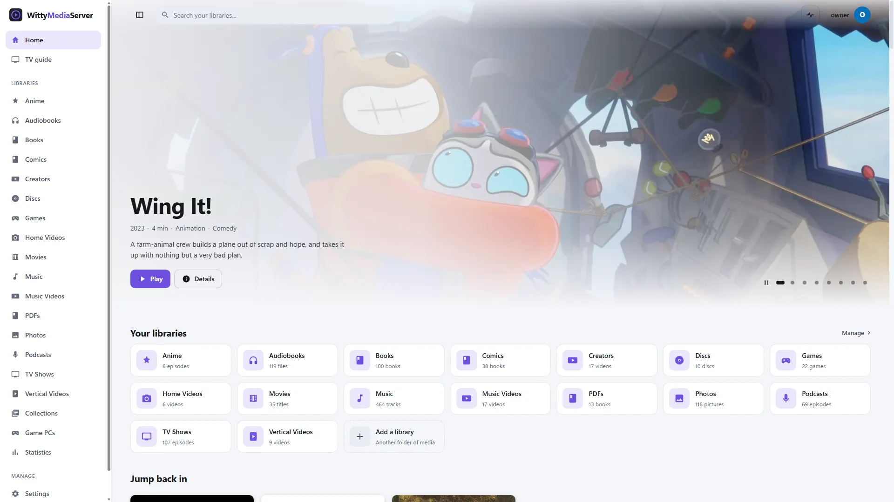
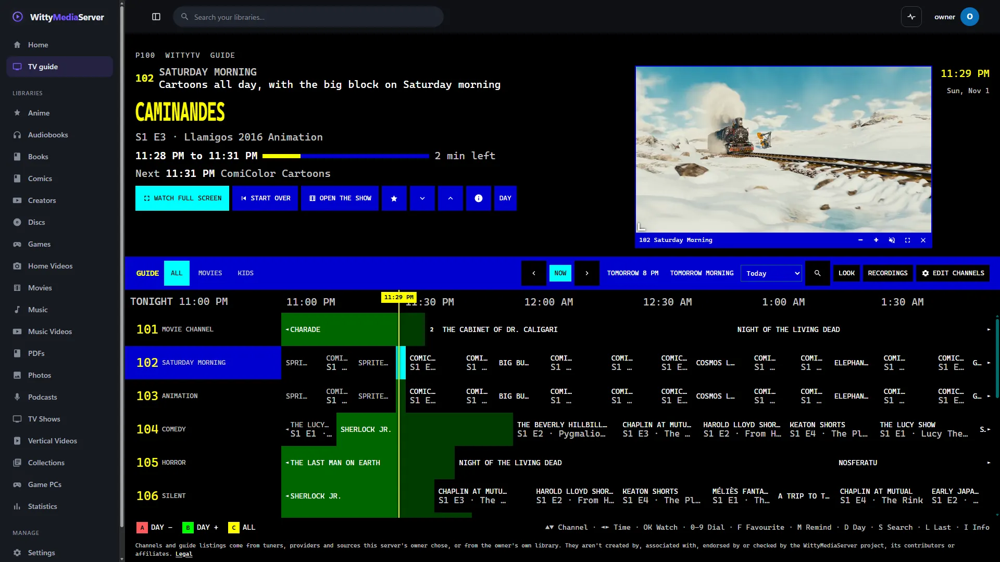
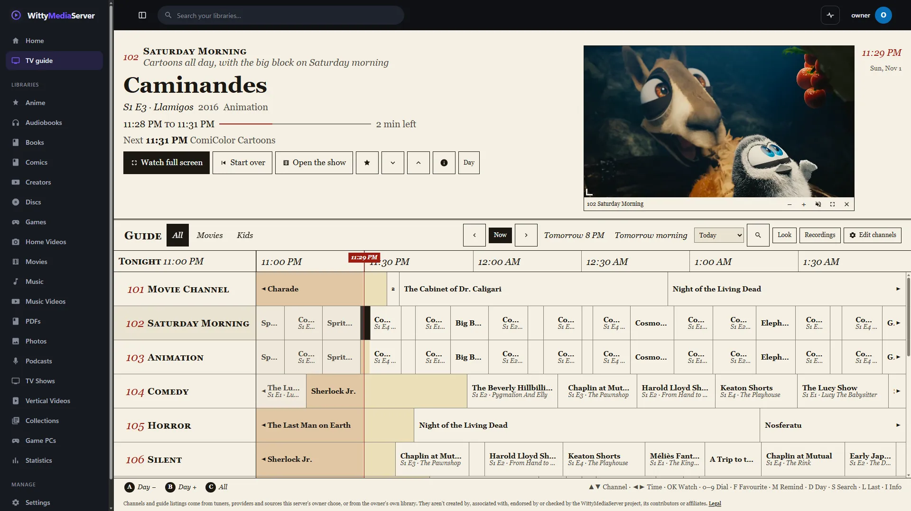

# Themes

A theme changes how WittyMediaServer looks: its colours, its corners, even its font. This guide helps you pick one, or make your own in a few lines with no code.

## A look is an experience and a theme

Two separate choices make a look. The **experience** is the layout, shape, finish, type and motion (fourteen ship: [Experiences](SDUI.md#experiences)); the **theme** is colour and scene. Each experience wears a default theme (Lumen: Witty, Rail: Cinema, Stage: Midnight, Aero: Aero Day, Classic Cable: Cable blue, Retro: Teletext, and so on), and any experience can wear any theme, built in or imported. The order for each part: what an administrator **requires** (for everyone, for kids or for one profile; shown locked with who set it), then the person's own choice, then the server's, then, for the theme, the experience's own default. The server works it out and sends it finished: `look` in `GET /theme`.

**Import a theme** is under **Settings → Appearance** and in the first run's Theme step: an administrator can install a ZIP (`POST /themes`), and when the administrator allows it (`profileThemes` in the experience policy) each profile can import its own. Imported themes work in every experience. A ZIP whose `theme.css` holds anything but variables is refused with the offending rule named. There are fifteen built-in themes: Witty, Midnight, Cinema, Evergreen, True black, Light, Paper, High contrast, Aero Day, Aero Aurora, Aero Meadow, Aero Sunset, Cable blue, Satellite and Teletext.

## Changing your theme



*The Midnight theme. Openly licensed and public-domain media, credited in [the list](images/CREDITS.md).*

*The Paper theme. Openly licensed and public-domain media, credited in [the list](images/CREDITS.md).*

*The Cinema theme. Openly licensed and public-domain media, credited in [the list](images/CREDITS.md).*

*The Light theme. Openly licensed and public-domain media, credited in [the list](images/CREDITS.md).*
1. Open **Settings → Appearance**.
2. Point at a theme, or move to it with the keyboard or a remote, to see it in the large preview at the top. Click it, or press Enter or OK, to use it. It applies straight away, on this device only, and other devices aren't affected.

**Automatic** follows your device's light or dark setting. **Follow the server's** puts this device back on the server's theme. If you're an administrator, **Make default** sets the theme everyone starts with, including on the sign-in page.

| Theme | Looks like |
|---|---|
| Witty | The house look: deep slate with a violet accent |
| Midnight | Blue-black, with a clear blue accent |
| Cinema | Warm near-black and amber, for a dim room |
| Evergreen | Dark forest tones with a fresh green |
| True black | Pure black, kind to OLED screens at night |
| Light | Clean, bright grey with a violet accent |
| Paper | Warm off-white and rust, easy on the eyes by day |
| High contrast | Black and white with bright yellow, for the clearest reading |

If you were using one of the older colour themes, such as Dark Red, you've been moved to the closest of these. A theme you made yourself stays.

## Making a theme in the app

This is the quickest way, and the result is always easy to read.

1. On **Settings → Appearance**, go to **Colours** (or press **Make your own** under the themes). The preview beside it changes as you choose.
2. Give it a **Name**, and choose **Dark** or **Light**.
3. Pick an **Accent**, the colour of buttons and highlights, and a **Background tint**, a hint of colour in the page.
4. Choose **Corners**: **Crisp**, **Soft** or **Round**.
5. Press **Use on this device**. If you're an administrator, you can press **Add for everyone** instead.

The app works out every other shade and checks that the text stays readable. If your accent would make the words on a button hard to read, it's adjusted a little and the app says so.

## Making your own by hand

A theme is a ZIP with two small text files. CSS is only a list of settings, so you don't need to have written it before.

### The shortest working theme

Make a new folder with these two files in it. Any text editor will do.

`theme.json`, which names it:

```json
{
  "id": "my-theme",
  "name": "My theme",
  "scheme": "dark"
}
```

`theme.css`, which sets its colours:

```css
:root {
  color-scheme: dark;
  --bg: #14090b;     --bg-rgb: 20 9 11;
  --accent: #d4a017; --accent-rgb: 212 160 23;
  --accent-2: #b98b12;
  --accent-fg: #17120a;
  --accent-text: #e0b542;
}
```

Then [pack it as a ZIP](#packing-it-as-a-zip) and install it. Everything you leave out keeps its normal value, and hover and tinted shades are worked out for you.

### The settings most people change

A colour like `#d4a017` is a code. Search the web for "colour picker", choose a colour and copy its code in.

| Setting | What it changes |
|---|---|
| `--bg` | The page background |
| `--bg-2`, `--bg-3`, `--bg-4` | Panels and side menu, then fields and cards, then hovered things |
| `--fg`, `--fg-2`, `--fg-3` | Main text, secondary text, hints and captions |
| `--accent` | Buttons, highlights, progress bars and selected items |
| `--accent-2` | The accent when hovered or pressed |
| `--accent-fg` | Text on the accent |
| `--accent-text` | The accent as words: links and highlighted text |
| `--radius` | Corners everywhere. `0` makes everything square |
| `--font` | Every piece of text |

**Two to keep in step:** `--bg-rgb` is `--bg` written as three numbers, and `--accent-rgb` is `--accent` the same way. A colour picker shows these too, as RGB.

**For a light theme,** set `color-scheme: light` and `"scheme": "light"`, and choose dark text on light surfaces.

**To keep it readable,** text needs to stand out from what's behind it. The bar is a contrast of 4.5:1 for text. Search the web for "contrast checker", and test `--fg-3` and `--accent-text` against `--bg-3`, and `--accent-fg` against `--accent`. The built-in themes all pass.

### Starting from a built-in theme

To change a theme that's nearly right, press the download button on its card in **Settings → Appearance**. Unzip it into a new folder. Then, in `theme.json`, change `id` and `name`, and delete the `"builtin": true,` line, as a ZIP with that line is refused. `theme.css` has a note beside each setting.

## WittyTV themes

WittyTV, the TV guide, has eight themes of its own, separate from the app's theme and from the looks above. An app theme can suggest one, with one more setting in `:root`:


*The Teletext look, playing [Caminandes: Llamigos](https://commons.wikimedia.org/wiki/File:Caminandes_3_-_Llamigos_-_Blender_Animated_Short.webm), Pablo Vazquez, Blender Foundation, [CC BY 3.0](https://creativecommons.org/licenses/by/3.0/).*


*The Newspaper look, playing [Caminandes: Llamigos](https://commons.wikimedia.org/wiki/File:Caminandes_3_-_Llamigos_-_Blender_Animated_Short.webm), Pablo Vazquez, Blender Foundation, [CC BY 3.0](https://creativecommons.org/licenses/by/3.0/).*

```css
:root {
  --tv-theme: modern;  /* modern, classic, satellite, teletext, listings, bigpicture, outline or compact */
}
```

Modern, Big picture, Outline and Compact take their colours from your theme's tokens, so they look like part of it. The others have their own.

It's only a suggestion. What a viewer picks comes first, then the app theme's suggestion, then what the server's owner chose for new viewers, and **Look** on the guide says which is showing. Custom can't be suggested, because it's each viewer's own. The built-in Midnight theme suggests Modern this way. See [Channels and live TV](CHANNELS.md#the-look).

Each look (experience) also names a WittyTV theme, sent to the apps as `tvTheme` in the finished look (`look` in `GET /theme`). The guide doesn't follow that one yet, in the web or the apps: the order above is what decides.

### The TV pass

Design 2 gives every theme a ten-foot look, set in `theme.css` and written into `theme.json` `tv` for the apps:

| Variable | Default | Meaning |
|---|---|---|
| `--tv-ring-color` | `--fg` | the focus ring across the room. 4.5:1 on every surface and 3:1 on raised fills (`--bg-4`) |
| `--tv-text` | `--fg` | body text a step stronger for distance (10% toward white on dark themes, toward black on light ones). 7:1 on every surface |
| `--hero-scrim` | `.72` | how strong the dark scrim behind hero text is, 0 to 1: strong enough that white text still reads over the brightest picture (4.5:1) |

`scripts/theme-contrast.py` checks all of it, and `--focus` on the surfaces too. The accent is not checked as the thing
behind a focus ring: a ring sits a gap away from what it surrounds, so the surface shows between them (a control
filled with the accent is separated from its ring by that gap). A theme that omits these gets them derived.

## Packing it as a ZIP

`theme.json` and `theme.css` must be at the top of the ZIP, not inside a folder.

- **Windows:** select the files, right-click, and choose **Compress to ZIP file**.
- **macOS:** select the files, right-click, and choose **Compress**.
- **Linux or FreeBSD:** `cd my-theme && zip -r ../my-theme.zip .`

To install it, press **Install a theme ZIP…** on **Settings → Appearance**. You need to be an administrator. To change it later, install a ZIP with the same `id` again. To take it away, press **Remove** on its card.

You can also copy the ZIP into the server's `themes` folder and reload the page. The ZIP's file name is then the theme's id.

| Install | Themes folder |
|---|---|
| Windows | `%LOCALAPPDATA%\WittyMediaServer\themes` |
| macOS | `~/Library/Application Support/WittyMediaServer/themes` |
| Linux, your own account | `~/.local/share/wittymediaserver/themes` |
| Linux package, as a service | `/var/lib/wittymediaserver/themes` |
| FreeBSD package, as a service | `/var/db/wittymediaserver/themes` |
| Docker | `/config/themes` |
| A data folder you chose | `<data>/themes` |

## Limits

- **No remote images or fonts.** A theme uses its own files. A stylesheet that names an address on another site is refused, even in a comment, because a stylesheet that can load from elsewhere can read what's typed into a page. That includes `//` anywhere in it, so don't use that for comments. Pictures kept in the stylesheet as `data:` addresses are fine.
- **No scripts.** A theme can hold only `.css .json .png .jpg .jpeg .webp .gif .avif .svg .woff2 .woff .ttf .otf .txt .md`, and anything else makes the install fail.
- **Size.** ZIPs up to 25 MB, each file up to 10 MB, and up to 200 files. Keep images small, as WebP and AVIF give the smallest files.
- **File names** are plain relative paths: no `..`, no absolute paths, no backslashes.
- **Ids** are letters, digits, `.`, `-` and `_`, up to 64 characters. A built-in theme's id is taken, so give your copy a new one. A built-in theme can't be removed.
- **Who can install.** Only administrators can install or remove themes on the server. Anyone can make a theme under **Colours** for their own device.
- **Theme files are public,** because the sign-in page is themed too, so don't put anything private in one.
- **A theme is variables, a scene and assets.** `theme.css` holds `:root` variables (and `color-scheme`) and `@font-face` for the theme's own fonts, nothing else. Rules for the interface's classes, other selectors and other stylesheets are refused when the ZIP is installed, with the first offending rule in the message. Every app draws from the same variables, so a theme looks the same everywhere.

Viewers using a theme that has been removed go back to the server's theme after a reload. Check that the licence of any font or image lets you share it.

## Going further

Every colour, corner and shadow goes through the settings below, so most themes need nothing else. For more, a theme can have a scene, a finish and its own fonts and pictures.

### Pictures and fonts

Put them in the ZIP and use relative addresses in variables:

```
my-theme.zip
  theme.json
  theme.css
  assets/backdrop.webp
  assets/fonts/MyFont.woff2
```

```css
@font-face {
  font-family: "MyFont";
  src: url("assets/fonts/MyFont.woff2") format("woff2");
  font-display: swap;
}
:root { --font: "MyFont", Georgia, serif; }
```

### A scene

`theme.json` may have a `scene`: ordered layers drawn behind the page and under the menu, bottom first, positions in percent of the window. A layer is a `gradient` (`angle`, `stops: [{at, color}]`), a `radial` light (`x`, `y`, `w`, `h`, `color`, `fade`), a `shape` (`kind` `circle` or `hill`, `x`, `y`, `size`, `color` or `stops`) or an `image` (`file`, a picture of the theme). On modest hardware and with reduced transparency or motion an app draws only the first layer. Without a `scene` the page is its `bg` colour.

```json
"scene": { "layers": [
  { "type": "gradient", "angle": 180, "stops": [{ "at": 0, "color": "#6fcfff" }, { "at": 100, "color": "#e1f8d6" }] },
  { "type": "shape", "kind": "circle", "x": 12, "y": 22, "size": 9, "color": "rgba(255,255,255,.3)" }
] }
```

### A finish

`theme.json` may have a `finish`: `glass` (`hi` and `lo` fills, an `edge` and a `shadow` colour: the recipe for a glass panel) and `gloss` (five colours for a glossy button: highlight, upper body, lower body, glow, edge). The experience says how much to use (`effects`: none, subtle or full). Left out, both are worked out from the colours.

**How the web draws them.** `theme.ts` puts the look on `<html>`: `data-fx-glass`, `-gloss`, `-glow`, `-texture` and `-bevel` (`none`, `subtle`, `full`), `data-type`, `data-card-set`, `data-focus-style` and `data-screen`, plus `--shape-mult` (the radius multiple) and the theme's finish as `--glass-hi`, `--glass-lo`, `--glass-edge`, `--glass-shadow` and `--gloss-hi`, `--gloss-up`, `--gloss-lo`, `--gloss-glow`, `--gloss-edge`. Colours in a finish are accepted only as `#hex`, `rgb()`, `rgba()`, `hsl()` or `hsla()`; anything else is dropped. `web/src/finish.css` turns them into glass bars, menus, dialogs and panels, glossy buttons and rows, bevels, glow, paper grain or scanlines and the focus style, and names no look. The scene is drawn by `web/src/ui/Scene.tsx` behind the page: a gradient (sky), radial lights (a light sweep that drifts), circles (bubbles, bokeh) and a hill. The type sets are bundled (Nunito for `rounded`, Source Sans 3 for `humanist`, Source Serif 4 for `serif`, JetBrains Mono for `mono`, all SIL OFL, in `web/public/fonts`).

### Recipes

**Only change the accent:**

```css
:root { --accent: #e50914; --accent-2: #b20710; --accent-rgb: 229 9 20; --accent-text: #ff5a5f; }
```

**Square and flat:**

```css
:root { --radius: 0; --shadow: none; --card-shadow: none; }
```

**Bigger posters:**

```css
:root { --card-w: 200px; }
```

The name in the corner isn't part of a theme. To change it, use **Name and logo** on **Settings → Appearance**. The license notice in **Settings → About** always remains.

## Every setting

Set these in `:root`. Hover, selected and tinted shades are worked out from them. The sizes, spacing and motion the interface is built from are settings you can change too, such as `--card-w` or `--text-base`: see [Design standards](DESIGN.md).

| Setting | Normal value | Used for |
|---|---|---|
| `--bg` | `#0f1115` | Page background |
| `--bg-rgb` | `15 17 21` | `--bg` as R G B, for the fades over artwork: `rgb(var(--bg-rgb) / .6)`. Keep it in step with `--bg` |
| `--bg-2` | `#171a21` | Side menu, panels, dialogs |
| `--bg-3` | `#1f232c` | Inputs, selects, cards, hovered rows, tiles |
| `--bg-4` | `#2a2f3a` | Hover on `--bg-3`, chip outlines, scrollbar thumb |
| `--border` | 10% of `--fg` | Hairlines around panels, lists and tiles. Built on `--fg` it shows on any background |
| `--border-strong` | 20% of `--fg` | Emphasised lines |
| `--control-line` | half of `--fg` | Outlines of fields and switches. Keep it 3:1 on `--bg`, `--bg-2` and `--bg-3` |
| `--fg` | `#e8eaf0` | Main text |
| `--fg-2` | `#a9afbd` | Secondary text: meta lines, overviews, inactive tabs |
| `--fg-3` | `#848b99` | Hints, captions, table headers, section labels |
| `--accent` | `#7955ff` | Primary buttons, progress bars, selected items |
| `--accent-2` | `#6a4df0` | Hover and pressed state of accent buttons |
| `--accent-fg` | `#fff` | Text and icons on the accent |
| `--accent-text` | `--accent` | The accent as text. Keep it readable on `--bg`, `--bg-2` and `--bg-3` |
| `--accent-rgb` | `121 85 255` | `--accent` as R G B for glows: `rgb(var(--accent-rgb) / .25)`. Keep it in step with `--accent` |
| `--brand-accent` | `--accent-text` | The highlighted "Media" in the default name |
| `--danger` | `#ff5c6c` | Errors, delete buttons |
| `--ok` | `#3ad29f` | Success messages |
| `--warn` | `#e0a030` | Warnings, the rating star |
| `--radius` | `10px` | The whole interface's corners: every other radius is worked out from it |
| `--shadow` | `0 10px 30px rgba(0,0,0,.45)` | Panels, dialogs, popovers |
| `--card-shadow` | `0 10px 24px rgba(0,0,0,.5)` | Poster cards on hover |
| `--overlay` | `rgba(0,0,0,.6)` | Backdrop behind dialogs |
| `--sidebar` | `240px` | Side menu width |
| `--card-w` | `148px` | Poster card width |
| `--font` | `"Inter", "Segoe UI Variable Text", system-ui, …` | Every piece of text |
| `--tv-theme` | not set | See [WittyTV themes](#wittytv-themes) |

`color-scheme` (`dark` or `light`) in `:root` tells the browser how to draw its own controls.

## Every field in theme.json

| Field | Required | Meaning |
|---|---|---|
| `name` | Yes | Shown in the theme picker |
| `id` | No | Defaults to the ZIP's name. Installing with the same id replaces it |
| `scheme` | No | `dark` (the default) or `light` |
| `description`, `author`, `version` | No | Shown in the picker, or for your records |
| `colors`, `radius` | No | The colours as data, which draws the picker's preview exactly |
| `scene`, `finish` | No | The background scene and the glass and gloss recipes (see "Going further"). Worked out from the colours when left out |
| `tv` | No | `{ringColor, heroScrim, tvText}`: the ten-foot pass (see "The TV pass"). A theme that leaves it out gets them worked out |
| `preview` | No | Four colours for the preview if `colors` isn't there: `bg`, `surface`, `text`, `accent` |
| `builtin` | | Reserved: a ZIP with this is refused |

## For developers

`python scripts/theme-contrast.py` checks the built-in themes against the contrast rules, and `--fix` adjusts them. `scripts/design-tokens.py` writes `colors`, `radius`, `shape` and `type` in `theme.json` for the built-ins, from their CSS and the stylesheet's defaults, which are written out as ZIPs at start-up when their `version` changes.

Theme files need no sign-in: `GET /api/themes`, `GET /api/themes/<id>/theme.css`, `GET /api/themes/<id>/<file>`, `GET /api/themes/<id>/tokens.json` and `GET /api/themes/<id>/download`. Making a theme on the server is `POST /api/themes/custom` (administrators), which accepts only plain `#rrggbb` colours. See [Client API](CLIENT-API.md#themes-and-design-data).

### The theme engine

On top of the themes, the server keeps colour overrides and resolves, for each account, the one set of colours it sees. `GET /api/theme` (any signed-in account; also `/api/v1/theme`) answers with it.

#### Precedence

Six layers, each over the ones before it (later wins):

1. **The theme pack**: the server's theme, which is the `theme` setting when the administrator chose one, else **the default theme of the look the server starts people in** (Paper is cream, Rail amber, Classic Cable deep blue: `theme` in each experience), the same `/api/status` and `/api/themes` report as `theme` and `default`; or **the account's own choice**, `theme` in `/api/me/ui`, when it names a theme that's installed.
2. **The administrator's global overrides**. Left out when the account chose its own theme: they were chosen for the server's.
3. **A module scope's own colours**: what a module's `sdui.json` gives its theme scope ([SDUI for modules](SDUI-MODULES.md)).
4. **The administrator's overrides for the scope** (`PUT /api/v1/theme/modules/{scope}`), token by token over the module's own.
5. **The profile's own colours** (`PUT /api/v1/theme/personal`), everywhere: they beat the module's colours too, so someone who needs a stronger text colour gets it on every page.
6. **The profile's own colours for the scope**, over all of the above, in that scope only.

A look brings its default theme until a different one is chosen. Choosing the theme the server already wears (what the first-run Look and Theme steps do when nothing changes) does not pin it: `PUT /api/settings {theme}` with the theme the server wears right now stores nothing, so the next look brings its own. Any other theme is a choice and stays through looks; `{theme: ""}` goes back to following the look, and `PUT /api/theme/global {id}` pins any theme, the look's own included.

Layers 1, 2 and 5 make `tokens`; every scope with colours of its own (3, 4 or 6) has its whole palette under `modules`. Server-driven pages get the scopes too: a page or section that names a scope receives, as `tokens`, what that scope's palette has that the account's `tokens` don't (see [SDUI](SDUI.md#theme-scopes)). A scope needn't be a module: `PUT /api/v1/theme/modules/family` gives a page of your own, with `"scope": "family"`, its own accent.

The answer is `{id, source, scheme, tokens, overrides, personal, modules: {<scope>: {tokens, overrides, personal}}, shape, type, tv, elevation, density, look, brand, variants, warnings, etag, revision}`, with an `ETag` header; send it back as `If-None-Match` for a 304. The ETag changes with anything in it: the theme, any layer, the server's name.

#### Derived colours

A theme sets a handful of colours and works the rest out from them (`web/src/styles.css`, `scripts/theme-contrast.py`). Every layer does the same: an override that sets only `accent` also gets, unless it sets them itself,

| Token | Worked out as |
|---|---|
| `accentHover` | the accent, 12% towards black |
| `accentFg` | white when it reads on the accent (4.5:1), else the dark ink `#0E1013`, else whichever reads better |
| `accentText` | the accent, lightened (dark themes) or darkened (light themes), keeping its hue, until it reads on `bg`, `bg2` and `bg3`: as `theme-contrast.py` does it |
| `focus`, `brandAccent` | `accentText` (also when a layer sets `accentText` itself) |
| `accentSoft`, `accentLine` | the accent at 14% and 45% |
| `border`, `borderStrong`, `hover`, `pressed` | from `fg`, at 10%, 20%, 7% and 12%, or as see-through as the theme makes them (the high contrast theme's hairlines are stronger) |
| `okSoft`, `warnSoft`, `dangerSoft` | from `ok`, `warn` and `danger`, at 13%, 13% and 11% |
| `controlLine` | from `bg`, `bg2` or `bg3`: the raised surface moved until it reaches 3:1 on all three |

A token set to the value it already has derives nothing. So a module scope with only an accent looks whole: its hover, selected rows, focus ring and links follow its accent. Contrast is checked on the result.

#### Shape and type

`shape` is the theme's corners and focus ring in points: `radius` (the theme's `--radius`), and the corner of each part, worked out from it the way the stylesheet does (`--r-xs` … `--r-xl` are 0.4, 0.6, 1, 1.4 and 2 times it): `card`, `button`, `field` and `row` (1×), `thumb` (0.6×), `badge` (0.4×), `image` and `sheet` (1.4×), `dialog` (2×), `chip` and `pill` (999: fully round), and `focusWidth`, `focusOffset` and `focusScale`. `themes/tokens.json` `shape.roles` has the same table. On a television use `tenFoot.focus` from `themes/tokens.json` instead of the three focus values.

`type` is its typefaces and weights: `display` (page titles and headings), `body` and `mono`, each a list of families best first, and `weights` (`body` 400, `medium` 500, `strong` 600, `heading` 650). Sizes aren't the theme's: they are the device's, in a server-driven page's `layout.text`. The built-in themes carry both in `theme.json`; a theme uploaded without them gets them from its CSS (`--radius`, `--focus-width`, `--focus-offset`, `--font`, `--font-mono`, `--weight-heading`), else the stylesheet's. Each look in `variants` has its own `shape` and `type`.

#### Design 2: tv, elevation, density

`tv` is `{ringColor, heroScrim, tvText, units}`: the theme's ten-foot colours (derived again when a profile's override changes `fg`, so the ring and text stay legible) and `units`, the `tv` block of `themes/tokens.json` in TV units. `elevation` has `"0"` to `"3"`, each `{fillToken, fill, lineToken, line, shadow}` with the colours resolved in this look, so a client draws the page, a panel, a lifted card and an overlay without its own table. `density` is `{default, tvDefault, steps: {compact|comfortable|spacious: {space, control}}}`. Each look in `variants` has its own `tv` and `elevation`.

#### The look

`look` is the finished look: `experience` and `theme` in force, `requiredExperience` and `requiredTheme` (`{value, by, at, scope}`) when an administrator requires them, `tvTheme` (the WittyTV look the experience suggests), `effects`, `shape` (radius multiple and card set), `type` (the type set: system, humanist, rounded, mono or serif), `density`, `motion`, and the theme's `finish` and `scene` (recipes in "Going further"). `GET /theme` takes `experience=` and `theme=` to answer for a look being tried (a requirement wins), and `source` says where the theme came from: `required`, `trial`, `user`, or `server`.

#### The server's name

`brand` is the server's name ready to draw, `parts` exactly as `brandParts` in `/api/status` and `/api/themes` ([Client API](CLIENT-API.md#themes-and-design-data)), with `token` (`brandAccent`) and `color`, that token resolved through every layer: parts with `accent` are drawn in it, the rest in `fg`. An override of the accent moves the name's colour with it (through the derived `accentText`); an override of `brandAccent` itself sets it directly; the profile's own wins over the administrator's. In a look of `variants`, take `tokens.brandAccent` of that look. `brandAccent` is checked for contrast like the other text colours.

#### SDUI tokens

Server-driven components have no colour, type or corner of their own. The catalogue (`GET /api/v1/sdui/catalog`) gives every component and card style `tokens`:

```json
"tokens": {
  "colors": { "surface": "bg3", "text": "fg", "secondaryText": "fg2", "focus": "focus", "progress": "accent", "progressTrack": "bg4", "badge": "scrim", "badgeText": "onImage" },
  "type":   { "title": "title", "subtitle": "caption", "badge": "badge" },
  "shape":  { "corner": "card", "badge": "badge", "focus": "focusWidth", "focusGap": "focusOffset" }
}
```

- `colors` maps each coloured part to a colour token. The part names (background, surface, text, link, accent, onAccent, focus, onImage, scrim, badge, progress, …) are listed with what they mean in the catalogue's `theme.colorRoles`.
- `type` maps each piece of text to a text role: its size is the page's `layout.text[role]`, and its family and weight are `theme.typeRoles[role]` (for example `heading`: the `display` family, `heading` weight) looked up in the resolved theme's `type`.
- `shape` maps each rounded part to a name in the resolved theme's `shape`, whose value is the corner radius in points.

The full table is in the [SDUI reference](SDUI.md#theme-tokens). A component a module adds takes the tokens of the component it expands into.

**What each app does.** With `sdui-tokens` and `theme-shape-type` in `/capabilities` features:

1. Fetch `GET /api/v1/theme` when a profile signs in or switches, and again with `If-None-Match` when the app comes back to the foreground; pick `variants[scheme]` when following the device's light or dark setting.
2. Draw every SDUI node from its component's `tokens` (or its card style's): colour = the resolved theme's `tokens[token]`, with the node's own `tokens` (its scope's) and the document's `theme.tokens` laid over them for that node and everything in it; corner = `shape[token]`; text = `layout.text[role]` points in `type[typeRoles[role].family]` at `type.weights[typeRoles[role].weight]`. No literal colours, radii or font names in the renderer.
3. Draw the server's name from `brand`.
4. Offer the profile's own colours in the app's Settings (with `theme-personal`), writing `PUT /api/v1/theme/personal`, and show a refusal's `contrast` pairs.

Against a server without these features, apps keep what they draw today.

#### A profile's own colours

`GET /api/v1/theme/personal` gives the signed-in profile's own overrides, `{tokens, modules: {<scope>: tokens}, warnings, etag}`; `PUT` replaces them with `{"tokens": {...}, "modules": {"<scope>": {...}}}` and `DELETE` takes them away. Only a profile's own: the routes name no profile. Token names and colours are checked as below; scopes are module ids by form, at most 16; the body is strict JSON of at most 32 KB. They are kept with the profile's other interface choices (`themePersonal` in `/api/me/ui`), so they follow it to every device and go when it does.

Unlike the administrator's overrides, which are saved with a warning, a profile's own are **refused** (400) when any text would fall below WCAG AA on the theme it sees, in either look of the automatic theme; the answer lists the failing pairs in `contrast`. Colours saved for one theme can become hard to read after the theme changes: they still apply, and `warnings` (scope `personal`, or `personal:<scope>`) says so.

#### Looks, the web app and the routes

**Light and dark.** `scheme` says which the theme is. The automatic theme (`auto`) is two looks, the dark one (the `default` theme) and the light one (`light`), and `scheme` is then `auto`. `variants` has each look resolved the same way, as `{id, tokens, modules}` under `dark` and `light`; an ordinary theme has the one. `tokens` and `modules` at the top are the dark look's, for apps that know nothing of variants. The same overrides go over both looks, so a colour that reads well on one may not on the other: each look gets its own warnings, and a warning says which in `variant`.

**For module authors: read the host's tokens.** A module's pages and its frame (a reader, a player, a window) must not carry colours, corner sizes, font sizes or fixed dark skins of their own. Read the host's CSS variables instead: `--bg`, `--bg-2` to `--bg-4`, `--fg`, `--fg-2`, `--fg-3`, `--accent`, `--accent-fg`, `--accent-text`, `--border`, `--hover`, `--focus`, the `--elev-*-fill` surfaces, the `--r-*` shapes, `--sp-*` spacing, `--text-*` sizes and `--control-h*` target sizes. Then a look, a theme, an administrator's module colours and a person's own colours all reach the module without it doing anything, and the contrast checks run on the result. The one thing a module keeps is what a person sets in it (a book's white, sepia or black page, a disc's own artwork). Until the readers' own frames (WittyInk, WittyEbook, WittyPDF, WittyComics) read the tokens themselves, the server's `web/src/pages/reader.css` maps their variables onto the host's tokens; that host-side override is accepted for now and goes when the modules' own stylesheets do the same.

**In the web app.** The web app asks for the resolved theme when someone signs in and lays the overrides over the theme's own stylesheet: the global ones everywhere, and a module's on that module's pages (WittyTV's guide and channels, WittyPlay's games and controllers, and any module's own pages under `/m/<module>/`). So a module's pages can have an accent of their own while the rest keeps the theme's. A device that picked another theme for itself gets only the module colours, and a look made in the theme maker is left exactly as it was made. An administrator changes them in **Settings → Appearance**:

- **Colours for everyone** has the global overrides: single colours of the server's theme, for everyone who follows it.
- **Module colours** has one module's. Choose the module, then its colours.

Both list every colour by what it is for, in groups (**Surfaces**, **Text**, **Accent**, **Status**, **Lines**, **Shades**). Each has a colour picker, the colour as a code (`#rrggbb`, `#rrggbbaa`, `rgb()` or `rgba()`; a see-through colour keeps how see-through it is when you use the picker) and **Reset**, which goes back to the theme's own. The page draws the theme with your colours as you choose, once for each look when the theme has a dark and a light one, and says straight away which text would be hard to read and on what. Nothing changes for anyone until you press **Save for everyone**; it then shows on your own screen at once and on other devices the next time they load. After saving, the warnings shown are the ones the server worked out. **Use the theme's colours** takes a whole set of overrides away.

Administrators change the overrides with:

| Route | What it does |
|---|---|
| `PUT /api/theme/global` | `{"id": "midnight", "tokens": {"accent": "#ff8800"}}`: the server's theme and global overrides. Either may be left out; `"tokens": {}` removes the overrides. |
| `GET /api/theme/modules/{module}` | A module's overrides. |
| `PUT /api/theme/modules/{module}` | `{"tokens": {"accent": "#3ad29f"}}`: replaces them. |
| `DELETE /api/theme/modules/{module}` | Removes them. |

**Token names** are the colour names in `theme.json` `colors`: `bg`, `bg2`, `bg3`, `bg4`, `fg`, `fg2`, `fg3`, `accent`, `accentHover`, `accentFg`, `accentText`, `brandAccent`, `danger`, `ok`, `warn`, `border`, `borderStrong`, `controlLine`, `hover`, `pressed`, `accentSoft`, `accentLine`, `okSoft`, `warnSoft`, `dangerSoft`, `focus`, `onImage`, `scrim` and `overlay`. **Colours** are `#rgb`, `#rrggbb`, `#rrggbbaa`, `rgb()` or `rgba()`, and come back as `#RRGGBB` or `#RRGGBBAA`. Anything else, or an unknown name, is refused with 400, so nothing but a colour reaches a stylesheet.

**Readability.** Every answer lists in `warnings` the text colours an override leaves below WCAG AA (4.5:1), with the same pairs and formula as `scripts/theme-contrast.py`: `fg`, `fg2`, `fg3`, `accentText`, `brandAccent`, `danger`, `ok` and `warn` on `bg`, `bg2` and `bg3`, and `accentFg` on `accent`. Only pairs the override touches, or the colours derived from it, are reported, and translucent colours are skipped. For the administrator a warning doesn't stop the change; it's there for the settings page to show. A profile's own colours are refused instead (above).

**The server's name.** Saving it (`PUT /api/settings` with `brandName`, `brandColouring`, `brandSpans` or `brandMark`) answers the settings as always plus `brandWarnings`: where a fixed colour of the name (a `static` part, or a gradient's stops) is under 4.5:1 on a surface it is drawn on in the server's theme, as `[{text, surface, where, ratio, need, variant?}]`. `surface` is `bg`, `bg2` or `bg3` and `where` says what is drawn on it (`top bar and page`, `side menu and bars`, `bevelled bars`); `variant` is `dark` or `light` for an automatic theme's two looks. The list is empty when the name reads everywhere. The name editor and apps show each as a "Check:" note; the save is not refused. The same warnings are in `brand.warnings` of `GET /api/theme`, for the theme the person sees. Parts that follow the theme are the theme's to get right.

**Gloss.** A theme's `finish.gloss` (highlight, upper body, lower body, glow, edge) is the paint of buttons and rows under the full gloss effect, and their label is `accentFg`. The label must read at 4.5:1 over the middle of the button, 30% to 70% down, where the paint runs from the upper body to the lower; `scripts/theme-contrast.py` checks every theme that has a gloss (the four Aero themes) in CI.

The overrides live in the `theme` section of `ui_config.json` in the data folder, with the server-driven pages, so they have its revisions, `If-Match` (412 when someone changed them in between) and rollback: see [SDUI](SDUI.md#ui_configjson). `/api/themes` and `/api/themes/<id>/tokens.json` are unchanged, and still give a theme's own colours.

---

<sub>WittyMediaServer documentation</sub>
