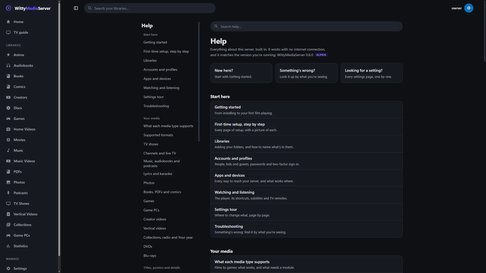

# Troubleshooting

Find what you're seeing in the lists below, and what to do about it. If it isn't here, start with Repair and the logs.

- [Start here](#start-here)
- [Connecting](#connecting)
- [Setting up and signing in](#setting-up-and-signing-in)
- [Libraries and scanning](#libraries-and-scanning)
- [Titles and posters](#titles-and-posters)
- [Playing video](#playing-video)
- [Discs](#discs)
- [Modules](#modules)
- [Games](#games)
- [If it won't start](#if-it-wont-start)
- [Starting again](#starting-again)
- [Other questions](#other-questions)
- [Getting help](#getting-help)

## Start here

**Settings → Repair** checks the database, metadata, modules and this install. It says what it found in plain words, and fixes what can be fixed, with a safety copy first. Your media files are never changed. See [Repair](REPAIR.md).

If you can't open the app, the same thing works on the computer running the server:

```bash
wittymediaserver doctor         # looks, and changes nothing
wittymediaserver doctor --fix   # fixes what it can
```

**Settings → WittyLog** shows what the server recorded, and explains common failures in plain words. See [Getting help](#getting-help).

## Connecting

| What you're seeing | What to do |
|---|---|
| **Other devices at home can't open the server** | Use the computer's network address, not `localhost`. **Settings → About** shows it. Check that the firewall on that computer allows port 9797. On Windows, the network has to be marked *Private* for the installer's firewall rule to apply |
| **It says the server only accepts connections from this computer** | The server is set to listen only on this computer. Set `listen` to `:9797` in its [config file](CONFIG.md), then restart it |
| **An app doesn't list the server** | Apps find it over UDP ports 5353 and 9797, which a firewall may block. Wi-Fi with client isolation or a guest network keeps devices apart, and a container needs host networking. Check **Settings → Profiles → Signing in → Let apps find this server**. Typing the server's address in the app always works. See [Apps and devices](APPS.md) |
| **It doesn't work away from home** | That's expected until you turn on **Settings → Remote Access**. See [Remote access](REMOTE.md), which has [its own troubleshooting](REMOTE.md#when-it-doesnt-work) |
| **"This server is only available on its home network."** | Remote Access is off, and the server sees you as outside. Turn it on from a device at home. Behind a reverse proxy, also list the proxy as trusted: see [Remote access](REMOTE.md#a-reverse-proxy-you-already-run) |
| **An app warns that this isn't the server you used before** | Compare the fingerprint with the one on your server's **Sign in a TV** page. See [Apps and devices](APPS.md#if-the-app-warns-about-the-server) |

## Setting up and signing in

| What you're seeing | What to do |
|---|---|
| **Setup asks for a setup code** | You're setting up from another device. The code is on the server's console, in `docker logs wittymediaserver`, in `journalctl -u wittymediaserver`, or in `setup-code.txt` in its data folder. It changes each time the server starts. See [Setting up from another device](ACCOUNTS.md#setting-up-from-another-device) |
| **"Too many wrong setup codes."** or **"Too many wrong tries."** | Wait, then try again. The second message says how long |
| **You forgot your password** | See [If you forget your password](ACCOUNTS.md#if-you-forget-your-password) |
| **You lost your phone and can't get a sign-in code** | Enter a recovery code in its place. If those are gone too, see [Two-factor sign-in](ACCOUNTS.md#two-factor-sign-in) |
| **A profile with no password won't sign in** | These work only on your home network, and only with the **Profiles** sign-in screen. See [Signing in](ACCOUNTS.md#signing-in) |
| **A native app won't sign in to an account with two-factor** | Those apps don't ask for the code yet. Use [Sign in with a code](APPS.md#sign-in-with-a-code) |
| **Part of Settings is missing** | Pages about the server are for administrators. See [Who can do what](ACCOUNTS.md#who-can-do-what) |
| **Someone can't see a library or a title** | Check their **Limits** under **Settings → Profiles**. A title with no rating stays hidden under an age limit unless you allow it. See [Hiding things, and who sees what](LIBRARIES.md#hiding-things-and-who-sees-what) |

## Libraries and scanning

| What you're seeing | What to do |
|---|---|
| **New files don't appear** | The server scans every 6 hours, and doesn't watch folders as they change. Press **Scan now** under **Settings → Libraries** |
| **"folder not found"** | The server has to be able to see the folder, and it may run as a different account from you. A Windows service runs as `LOCAL SERVICE`, and a Linux service as `wms`: give that account permission to read it. In Docker, use the path inside the container, such as `/media/movies` |
| **"That path is on another machine"** | Network shares can't be added from another device, unless you allow it. See [Network shares](LIBRARIES.md#network-shares) |
| **A scan finds nothing, or misses files** | The activity button lists folders it had trouble with. Check the file types in [Supported formats](SUPPORTED-FORMATS.md). Film and TV libraries skip folders named `extras`, files starting with `sample`, and videos under 5 MB. See [How to lay out and name your files](LIBRARIES.md#how-to-lay-out-and-name-your-files) |
| **A kind of library is under "Add a module to use these"** | It needs a module this server doesn't have. Press the button beside it. See [Modules and the store](MODULE-STORE.md) |
| **Everything from one drive is still listed while it's away** | That's on purpose. A folder that's empty or can't be reached keeps its titles until it's back, because an unplugged drive looks like an empty folder. Files really deleted from a folder that's there leave at the next scan |
| **You moved a drive, and everything's gone from the library** | Use **Settings → Repair → Moved a drive?**, or `wittymediaserver doctor remap --from <old> --to <new> --fix`. Watch progress, matches and your edits stay. See [Moved a drive?](REPAIR.md#moved-a-drive) |

## Titles and posters

| What you're seeing | What to do |
|---|---|
| **A title is named strangely** | Rename the file to `Title (Year).ext`, or press **Edit** on its page |
| **A title has the wrong details** | Press **Edit** on its page and use **Search and match**, or go through **Fix matches** on the library's page. See [Metadata](METADATA.md) |
| **Lots of titles have wrong details, or an NFO is broken** | **Settings → Repair → Metadata files** lets you fix them in a text editor, with what would change shown first, and problems named by file and line. With the server stopped, `wittymediaserver metadata check` does the same. See [The metadata folder](METADATA-FOLDER.md) |
| **Posters are missing** | Add a free TMDB key, or a custom agent, under **Settings → Metadata agents**, then press **Refresh** on the title |

## Playing video

Start with [If it won't play](PLAYING.md#if-it-wont-play) for anything to do with the player itself.

| What you're seeing | What to do |
|---|---|
| **"ffmpeg not found"** | Keep the program's `bin` folder as it was installed, install FFmpeg on your `PATH`, or set `WMS_FFMPEG`. **Settings → About** shows which one is in use |
| **Video stalls, or has no sound, in one browser** | Some Linux builds of Chromium can't play AAC. Set **Settings → Live transcoding → Sound format while converting** to MP3 |
| **"this server is busy with other streams"** | As many videos are converting as `maxTranscodes` allows, all with someone watching. Raise it in the [config file](CONFIG.md) if the machine can take it |
| **Video stalls, or a folder or drive misbehaves** | **Settings → WittyDiagnoser → Storage** checks free space, permissions, read speed and known trouble. See [WittyDiagnoser](DIAGNOSER.md) |

## Discs

| What you're seeing | What to do |
|---|---|
| **"This disc is encrypted, so it can't be played"** | The image is copy protected. Encrypted media isn't supported, and nothing here bypasses copy protection |
| **A disc won't play, stutters or stops partway** | **Settings → WittyDiagnoser** says what's wrong with a copy: scrambled, incomplete, or with sectors that can't be read |
| **A DVD or Blu-ray menu shows no buttons** | Check the disc in **Settings → WittyDiagnoser** with **Press every menu button** on. Its report says which buttons lead nowhere. Share the report, never the disc image |
| **A disc's page has no way to play it** | Playing a disc takes a disc module. See [Modules and the store](MODULE-STORE.md) |

## Modules

| What you're seeing | What to do |
|---|---|
| **A page says its module is missing** | An administrator can add it from there, or under **Settings → Modules** |
| **A module won't install or update** | The error says what happened and what to try, and **Show details** has more. See [When something goes wrong](MODULE-STORE.md#when-something-goes-wrong) |
| **A module won't load after an update** | Use **Settings → Repair**, or `wittymediaserver doctor --only modules`. To download it again, use `wittymediaserver doctor reinstall <module>`. See [A module is broken](REPAIR.md#a-module-is-broken) |

## Games

| What you're seeing | What to do |
|---|---|
| **A game takes a long time to start the first time** | On Windows, a security scanner may hold a new program the first time it runs, for up to about half a minute. It's quick after that |
| **A PSP game is slow to start the first time** | The PSP core sets up its own files in that game's save folder, about 20 MB, once per account for each game |
| **A game is refused as encrypted** | See [Encrypted games](GAMES.md#encrypted-games) |

[Games](GAMES.md) covers saves, controllers and streaming.

## If it won't start

| What you're seeing | What to do |
|---|---|
| **The server won't start** | Run `wittymediaserver doctor` on that computer. It works when nothing else does, and says why: a damaged database, a mistake in `wms.json`, FFmpeg missing, the port taken. `wittymediaserver doctor --fix` repairs what can be repaired |
| **"WittyMediaServer is already running"** | It is: a second start of the same data folder doesn't start a second server on it. **Open WittyMediaServer** opens the one that's running. **Start another server…** starts a separate one, with a data folder and port of its own (its own libraries, accounts and settings), never the same folder: two servers on one database would damage it |
| **`wittymediaserver` says it's already running and exits with code 3** | A start without a desktop (a service, Docker, a terminal, a script) prints where the running server is and exits with code 3, instead of asking. The service files don't restart on that code. If it says the server is starting or not answering, wait a moment and try again; if it never answers, end it (Task Manager, `kill`) and start again. A server that crashed or was ended leaves nothing behind that blocks the next start |
| **The server says port 9797 is in use** | It names what has it: another WittyMediaServer with a data folder of its own (the installed service, or a second server), or another program. Stop that, or use another port: set `listen` in the [config file](CONFIG.md), or start with `-listen :9798`. The message suggests a free one |
| **Windows blocks the installer or the program** | Alpha builds aren't code-signed yet. Choose *More info*, then *Run anyway*. See [Installing](INSTALL.md) |

## Starting again

| What you want | What to do |
|---|---|
| **A copy of everything before something risky** | **Settings → Backup** makes one ZIP of your data and metadata, and first-time setup can bring it back. On the command line, use `wittymediaserver backup create` and `wittymediaserver backup restore`. See [Backup and restore](BACKUP.md) |
| **To start again from a new install** | **Settings → Reset** puts the server back as it was first installed, with warnings first, and asks for your password. It keeps a copy you can bring back, unless you choose to delete everything. Your media files are never touched |
| **To reset when you're locked out, or the server won't start** | Run `wittymediaserver reset` on the server, then start it. `wittymediaserver reset -list` and `-restore <copy>` work with the copies, and `-cancel` takes back a reset that's waiting |

## Other questions

| Question | Answer |
|---|---|
| **Where is my data?** | **Settings → About** shows the data folder, and so does `wittymediaserver config path`. `wms.db` there is the database, `cache/images` the artwork, and `transcode` is temporary. See [Config file](CONFIG.md#folders-the-server-uses) |
| **Can I use an LGPL-only FFmpeg?** | Yes, nothing requires GPL parts. Set `WMS_FFMPEG` to an LGPL build with `libopenh264` or a hardware encoder |

## Getting help



*The built-in Help.*
1. Make the problem happen again.
2. Go to **Settings → WittyLog** and press **Download logs as ZIP**, on any tab of that page.
3. Leave **Sanitize for sharing** on. Names, addresses, paths and titles become placeholders, and you can see what it holds first. Passwords, tokens and API keys are taken out of every copy.
4. Pass that file to whoever is helping you. Nothing is ever uploaded by the server.

If the server won't start, `wittymediaserver logs zip` makes the same file without it. For anything to do with discs or drives, also run **Settings → WittyDiagnoser**, and share its report. Never share a disc image.

---

<sub>WittyMediaServer documentation</sub>
