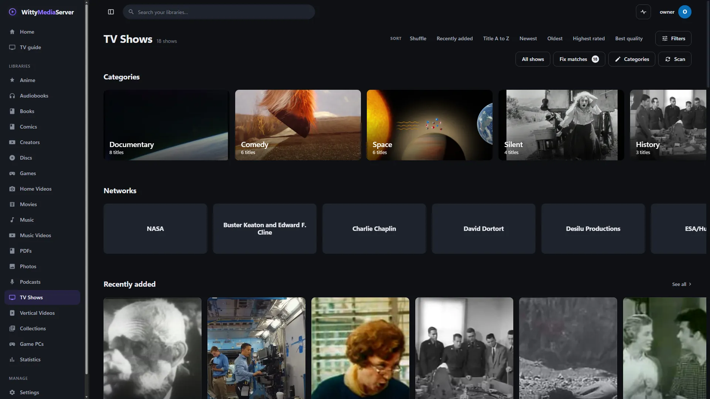
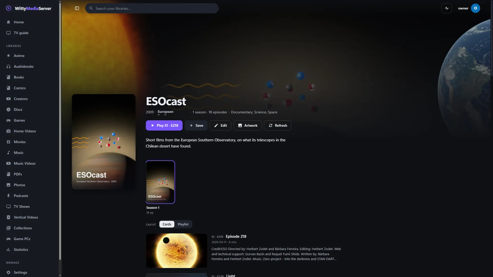
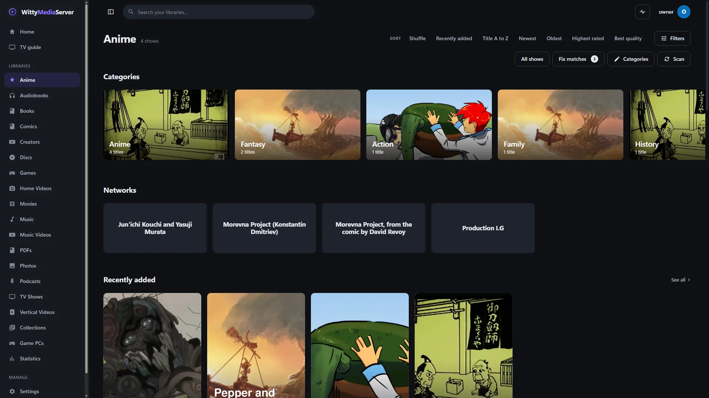

# TV shows

Use this guide to add TV shows, name their files so each episode is recognised, and fix a show that was matched wrongly. Episodes are organised by show, season and episode, and you get Skip intro and the next episode offered near the credits.

For always-on TV channels and the guide, and WittyTV's own themes, see [Channels and live TV](CHANNELS.md#the-look).

- [Setting up](#setting-up)
- [Naming your files](#naming-your-files)
- [Seasons and specials](#seasons-and-specials)
- [Show pages](#show-pages)
- [Fixing a wrong match](#fixing-a-wrong-match)
- [Networks and genres](#networks-and-genres)
- [Anime](#anime)
- [For developers](#for-developers)

## Setting up



*A TV shows library. Openly licensed and public-domain media, credited in [the list](images/CREDITS.md).*
1. Go to **Settings → Libraries → Add library**, choose **TV shows**, and pick your TV folder.
2. Press **Add library**. It scans straight away.

That's all it needs. Show details come from TVmaze, with no key. For more detail, get a key from [TheTVDB](https://thetvdb.com/api-information), and paste it under **Settings → Metadata agents**. Subscriber keys also need the PIN. Titles then improve the next time they're scanned or refreshed.

With neither, shows still work, with names from folders and episode titles from file names. Disc images of a series can go in a TV shows library too, and need the [disc modules](DVD.md).

## Naming your files

Give each show its own folder. Season folders are optional if the file name says the season.

```
TV Shows/
  Copper Harbour (2005)/
    tvshow.nfo, poster.jpg, fanart.jpg
    Season 02/
      Copper Harbour - S02E01 - The Storm.mkv
      Copper Harbour - S02E15-E16 - Two Parter.mkv
  Lantern Street/
    Lantern.Street.S03E10.Lost.and.Found.mkv
  Pine Hollow/
    2x05 - Found Out.avi
```

| The name says | Example | Needs a season folder |
|---|---|---|
| Season and episode | `S01E01`, `s1.e1` | No |
| Season and episode, the short way | `1x01` | No |
| Several episodes in one file | `S01E01E02`, `S01E01-E02`, `S01E01-02`, `1x01-02` | No |
| Episode only | `Episode 5`, `Ep 05`, `E05` | Yes |
| A number first | `05 - Title.mkv` | Yes |
| A number counted across the whole show, as anime does | `Show - 012.mkv` | No. It goes in season 1 |

Words after the numbers become the episode's title. A year is never mistaken for an episode number.

**Season folders** can be called `Season 2`, `Series 2`, `Staffel 2`, `Saison 2`, `Temporada 2` or `S02`.

**A file that can't be numbered** still appears, on its show's page, under **Other videos**.

## Seasons and specials

Specials are season 0. Put them in a folder called `Specials` or `Extras`, or name them `S00E01`. They show as **Specials**, after the other seasons.

Each season gets its own tab on the show's page, with its poster and how many episodes are left. A season poster can sit beside the show as `season01-poster.jpg`, and `season-specials-poster.jpg` for specials.

Numbering comes from your files. If a source numbers a show differently, see [Fixing wrong details](FIXING-METADATA.md).

## Show pages



*A show's page. Openly licensed and public-domain media, credited in [the list](images/CREDITS.md).*
- **Play** carries on from the next episode, and says which, with **Resume** if you're part-way through.
- **Layout** switches between **Cards**, with pictures and overviews, and **Playlist**, a compact list. Each show remembers its own choice. **Settings → Playback & discs → TV episode layout** sets the default.
- **Skip intro** appears during an episode's intro when the file has a chapter called `Intro` or `Opening`, or when you set where it ends: press **Edit** on the show or episode, and go to **Skip intro**. You can type the time, or use **Pick in player**. On a show, it covers every episode with no intro of its own.
- **Next episode** is offered near the credits, with a short countdown. At the end of a show it offers something else to watch.
- **Subtitles and sound** work as for any video: see [Watching and listening](PLAYING.md).

## Fixing a wrong match

1. Open the show, and press **Edit**.
2. Type its name, or paste an id or address from TheTVDB, TVmaze, TMDB, IMDb, AniList or Wikidata.
3. Choose a result. It shows what would change, field by field, and how many of your episodes the source knows.
4. Untick anything you want to keep, and save.

A match you choose stays, through every scan and refresh. **Refresh** on the show's page shows what looking it up again would change, and lets you choose what to take.

You can also put an id in the folder's name, such as `Copper Harbour (2005) [tvdb-456]`, or in `tvshow.nfo`:

```xml
<uniqueid type="tvdb">76163</uniqueid>
```

More in [Where details come from](METADATA.md) and [Fixing wrong details](FIXING-METADATA.md).

## Networks and genres

Each show carries its network and genres, which is what [one-click TV channels](CHANNELS.md#channels-in-one-click) are built from. They come from TVmaze, TheTVDB or AniList. For a show none of them knows, put a `tvshow.nfo` in its folder, where `<studio>` is the network:

```xml
<tvshow>
  <title>Copper Harbour</title>
  <studio>Northshore Television</studio>
  <genre>Drama</genre>
</tvshow>
```

You can also set them in the show's **Edit** dialog. When **Save next to media** is on, the network and genres are written to `tvshow.nfo`, so they survive a database reset or a move to another server.

## Anime

Anime can live in its own **Anime** library, in your TV folders, or both:


*An Anime library. Openly licensed and public-domain media, credited in [the list](images/CREDITS.md).*

- **An Anime library with its own folders** gets its details from AniList, with no key: titles, synopsis, studio, genres, score, cover and banner, and episode names where AniList has them. **Settings → Metadata agents → Title language** chooses how titles are written. Titles AniList marks as adult are rated 18, so Kids and Guest profiles never see them.
- **Anime kept in a TV library** is any show with the genre Anime, which you can also add yourself in **Edit**. It appears in your Anime library too. **Settings → Metadata agents → Where anime from TV libraries appears** chooses **Anime and TV libraries**, or **Only the Anime library**.
- **An Anime library with no folders** just collects the anime from your TV libraries.

File names with episode numbers counted across the whole show are understood, and tags in square brackets are ignored:

```
Star Harbor/[Group] Star Harbor - 012 [1080p].mkv   episode 12
Star Harbor/Star Harbor - 05v2.mkv                  episode 5
Star Harbor/Star Harbor - 1071 - The Long Road.mkv  episode 1071, "The Long Road"
```

## For developers

These all need a token.

| Request | Returns |
|---|---|
| `GET /api/shows/networks?library=N` | Every network, with its shows and the genres found on them |
| `GET /api/shows?library=N&network=Northshore%20Television` | The shows of one network |
| `GET /api/shows?library=N&genre=Comedy` | The shows of one genre. Combine both to narrow it |
| `GET /api/shows/{id}` | The show, its seasons and its episodes in order |

---

<sub>WittyMediaServer documentation</sub>
