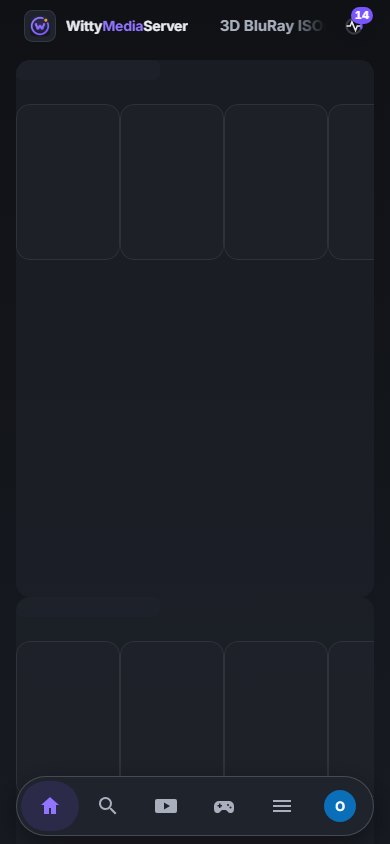
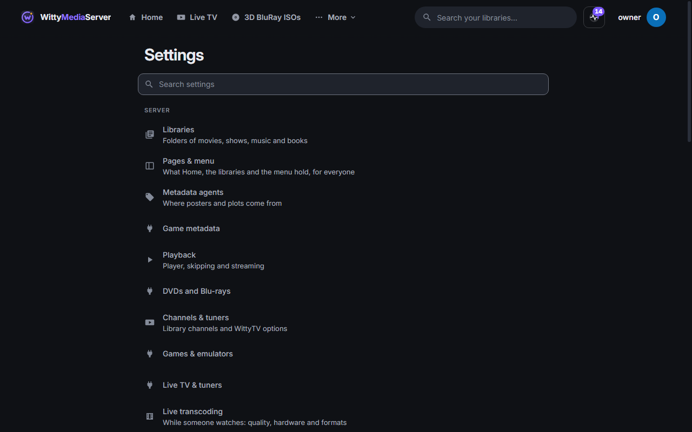
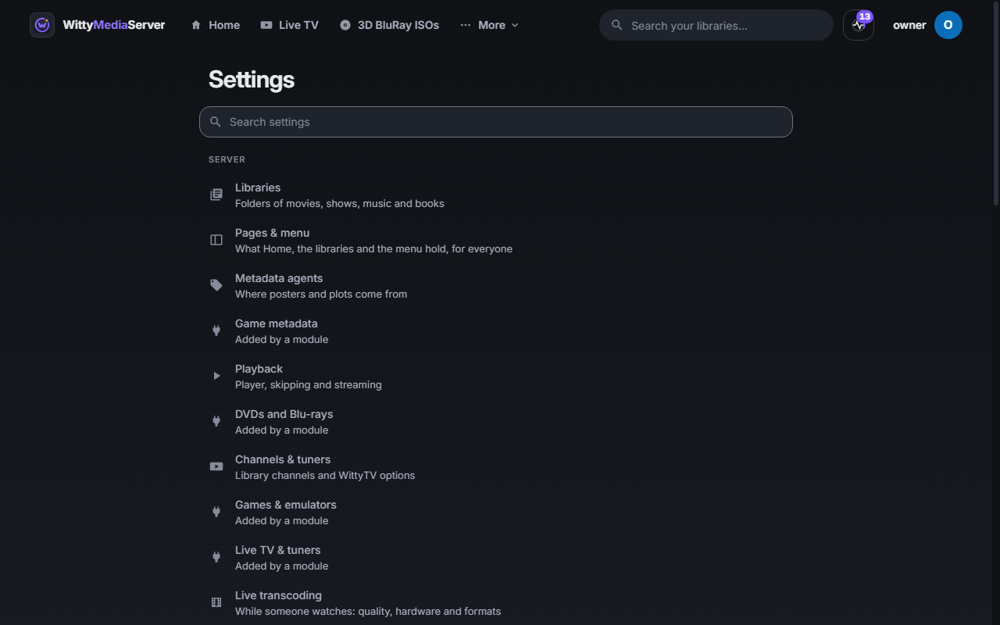
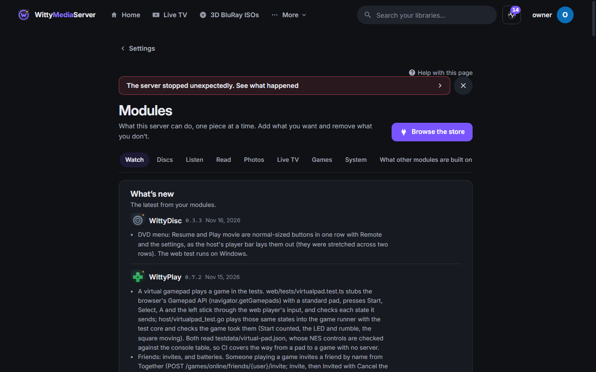
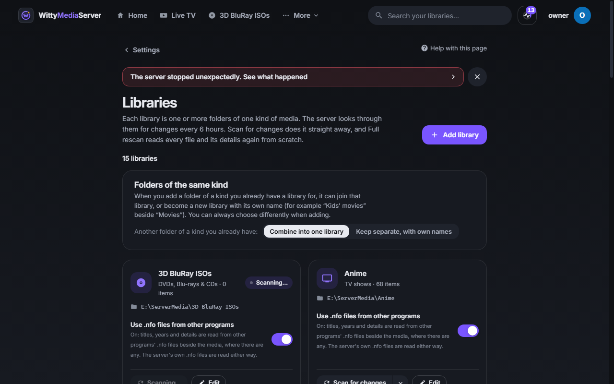

<!-- SPDX-License-Identifier: AGPL-3.0-or-later -->
<!-- Copyright (C) 2026 WittyWilla and contributors -->
# Interface audit, 0.8.1-alpha

Umbrella issue: wittywilla/WittyMediaServer#438. Method and the shared-layer approach: `docs/UI-PLATFORMS.md`.

## What was audited, and how

- **Build:** `origin/v0.8.0-alpha` (the 0.8.1 line starts identical) merged with every open PR branch at the time
  (#379, #381, #383, #386, #388, #391, #409 to #413, #415 to #418, #420, #422, #425). #389 (the strings pass) was left out: it conflicts across a dozen
  files and only wraps strings.
- **Data:** the owner's media on `E:\ServerMedia` with `saveMetadata=0`. Libraries added: Movies, TV Shows, Anime,
  Music, Podcasts, Audiobooks, Photos, Books, Ebook, Comics, PDFs, DVD ISOs, BluRay ISOs, 3D BluRay ISOs and Games,
  with every module installed. The libraries were still scanning during much of the pass, so detail pages of the
  later libraries are thin.
- **Tool:** `web/scripts/ui-audit.mjs` (headless Chromium, no windows). It took a picture of 45 routes, covering Home,
  Search, You, every library, a movie and a show detail page, the Music and Games pages, Live TV, Help, the design
  page and 19 Settings pages, at the sizes in the table below, and ran detectors on each.
- **Honest coverage:** the machine was overloaded for the whole session, so the matrix was walked in slices
  rather than all at once.

| Slice | Done |
|---|---|
| Desktop 1280, default theme, every route | yes (pictures and detectors) |
| Phone 390, default theme, key routes (Home, library, detail, Settings, Search, You, Music) | yes |
| Tablet 768, desktop 1920, TV 10-foot, phone 360 | harness supports them; run once the machine is quiet |
| Light and Aero Sunset themes | harness supports them; first run was interrupted. Contrast across all themes belongs to `theme-readability` (#423) |
| Keyboard-only and remote focus | detector for invisible focus not yet written; TV focus is covered by `npm run test:tv` |
| Players (video, music, karaoke, live TV, games) | not walked: needs a person to start playback; seeking error is `seek-errors` |
| WittyMediaClient desktop, Android, TV | not run; see the MacBook list |

## Systemic causes

Most of what shows by eye comes from a few places. They are listed first because fixing them fixes many pages.

| # | Cause | Effect | Status |
|---|---|---|---|
| R1 | `.skeleton-grid > div` paints each child as a 2:3 tile. A loading SDUI page's children are whole rows, so each row became one giant grey slab | Home, every SDUI page on first visit: a huge rounded block instead of rows of cards, on all phones and small windows | **Fixed** in `web/src/sdui/sdui.css` |
| R2 | Settings destinations are built in two places; the ones supplied by modules had no description and so were a different height (Game metadata, DVDs and Blu-rays, Games & emulators, Live TV & tuners) | Uneven list, plug icons with no explanation | **Fixed** in `SettingsPage.tsx` |
| R3 | The Settings help link takes a line of its own between the back link and the notices | A gap above and below it, the notice pushed down | **Fixed** in `components/helplink.css` |
| R4 | Pixel spacing and bar offsets are written directly in 552 places | The cause of "content under the bar here, too low there": `88px`, `90px`, `96px` for "under the top bar" are written in `audio.css`, `creators.css`, `settings.css` and others | **Guarded**: new lint rules `spacing` and `bar-offset` keep it from growing. Clearing the existing ones belongs with `topbar-overlap` |
| R5 | Switches (44x26), small and ghost buttons (26 to 32px high) and `a.t` rows (23px) fall under the 40px touch size | Fiddly to tap on phones and tablets | **Mostly a false alarm, rest fixed**: on a real touch screen `--control-h` is already 44px (`pointer: coarse`); the first run measured with a fine pointer. The harness now emulates touch. Switches keep their small look but get a 44px tap area. Remaining small things are inline links inside larger tappable cards |
| R6 | The Library toolbar shows the Filters button and the same filters inline, with a large gap between the two rows | Looks like two toolbars | **Fixed**: the page title, actions and filters are one header, a step apart (the filters were 40px under the buttons) |
| R7 | Settings pages, You and the Library pages each set their own page width and top spacing | Content starts at a different height on each page | Measured, not changed: title starts at y=80 on library pages, 88 on Settings sub-pages and 102 on the Settings index. One page-top token belongs with `topbar-overlap`, which owns the content offset |

Checked and not a bug: Music appears dim in a picture taken while the page is still fading in; the second
picture, taken once loaded, is correct. Pictures need a settle time that is longer under load.

## Findings by page

Severity: **P1** broken or hard to use, **P2** visibly off, **P3** polish.

| Page, size | Finding | Category | Sev | Cause |
|---|---|---|---|---|
| Home, phone | A loading page is one giant slab per section | layout shift, loading | P1 | R1 (fixed) |
| Home, phone | Setup notices ("Finish setting up WittyPlay") use two full-width stacked buttons, each notice taking a third of the screen, pushing the hero off | inconsistent components, layout | P2 | R7 |
| Home, phone | The nav strip crowds the logo: "3D BluRay ISO" truncates under the bar next to the logo | truncation | P2 | `mobile-logo` (#409) |
| Home, phone | Hero title falls behind the floating bottom bar at first scroll position | overlap | P2 | page bottom space (`--tabbar-space`) |
| Show, phone | A black band above the poster and title | alignment | P2 | `phone-detail-pages-hero` (#422) |
| Show, phone | The text under the description is cut by the bottom bar at rest | overlap | P3 | `--tabbar-space` |
| Settings, all | Help link on its own line | alignment and spacing | P2 | R3 (fixed) |
| Settings index | Rows from modules have no description, different height | inconsistent components | P2 | R2 (fixed) |
| Settings, Libraries, phone | "0 items" wraps to a second line under the status chip; library names and counts wrap beside the button | truncation | P3 | R5/R7 |
| Settings, switches | 44x26 targets | small targets | P2 | R5 |
| Library (Movies), desktop | Two toolbars: Filters/Select/Categories/Scan row, then Sort/Genre/Decade/Watched; large gap | inconsistent components | P2 | R6 |
| Library, desktop | Missing posters show only a coloured gradient with no title on the card face (the title is below); fine but "10" and similar read as blank cards | empty state | P3 | no-poster frame |
| Item detail, desktop | A grid of empty rounded tiles and a large empty panel while loading (under load it stayed this way for the full wait) | loading state | P1 | placeholders for item pages should match the page, see below |
| You (Profiles), desktop | Disabled Save/Change password buttons are barely legible | contrast | P2 | disabled state token |
| Settings, all | The red crash notice's dismiss button is taller than the notice | alignment | P3 | `set-notice-row` |
| Modules | "What's new" shows raw release-note text including internal test paths (`web/tests/virtualpad.test.ts`) | content | P2 | release-note source: notes written for developers; the card should show a summary |
| Games | First-run dialog is clean | | | |

**Owned by other sessions (not edited here):** top bar over the title and its square backing (`topbar-overlap`),
logo position (#409), detail page hero on phones (#422), action placement (#410), hard edges (#411), player menu
contrast (#415), bumper list (#420), Live button (#416), show cards (#417), karaoke (#412, #413, #418, #425), Music
rebuild (`music-nav`), theme contrast and hero scrims (#423, `theme-readability`), setup WittyTuner step
(`oobe-tuner`), seeking errors (`seek-errors`), performance (`play-perf`, `server-perf`).

## Not checked on this PC: the MacBook list

- iOS and tvOS: SDUI pages (Home, Library, Detail, Settings, You) in light, dark and each look; Dynamic Type at the
  largest size; the safe areas and notch on Home and Detail; the bottom bar over the hero text on Home; the loading
  placeholder rows (R1 applies to the web renderer; confirm the apps never drew the same slab).
- macOS app: the same as desktop, plus window resize between phone and desktop widths, and full-screen titlebar offset.
- Android phone and TV (emulator on the MacBook): touch targets under 48dp (R5), the TV rail focus ring, and Home's
  hero under the status bar.
- Native clients that draw theme scenes: the hill fade from #411 needs the same treatment.

## Next

Page-top token (with `topbar-overlap`), the tablet, 1920, TV 10-foot, light and Aero Sunset slices, and the
players (listed only: `seek-errors` and `transcode-options` own seeking and the quality menu).

## Round two

- **Loading shapes:** `PageLoading` (SDUI) is now the shape of the page coming: a poster and lines for a title's
  page, a header and grid for a library, rows of cards for the rest. Before, a title's page showed a grid of empty
  tiles and a big panel (see `item-loading-desktop.png`).
- **Library header (R6):** `R6-library-header-before.png` and `-after.png`.
- **Keyboard focus:** `WMS_FOCUS=1` tabs through 30 stops a page and reports focus that cannot be seen, is under a
  fixed bar, is off screen, or a trap. On Home, a library, a title, a show, Settings, Search and You the rings
  show on buttons and, for cards, on the picture (a lift and a 3px ring); the episode title link draws its ring on its
  stretched `::after`. The probe was taught both. No trap and nothing under a bar was found on those pages.
- **Touch:** the harness emulates a coarse pointer for phone and tablet sizes, and counts a pseudo-element's tap area.

## Before and after

| Fix | Before | After |
|---|---|---|
| R1 loading rows, Home on a phone |  | A loading page now measures three 292px rows with no tile background (checked in the browser; a loading page cannot be held still for a picture) |
| R2 Settings rows from modules |  |  |
| R3 help link |  |  |

Other pictures referred to above: `item-loading-desktop.png`, `show-phone-band.png`, `settings-libraries-phone.png`.
