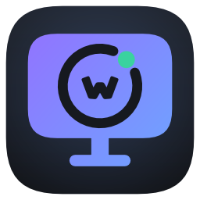
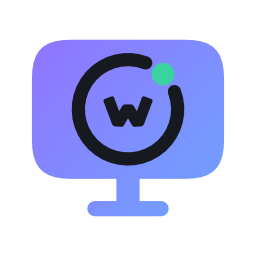
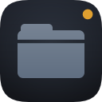

# The orbitw logos, every form

Generated by `go run ./scripts/genicon -target kit` (see [../../BRAND.md](../../BRAND.md)). Do not edit: change the drawings in `internal/brandart` and run it again.

Every variant comes as **SVG** (vector, any size), **PNG** (transparent where it says so) and **JPEG** (no transparency, so on a stated background). Square marks are rendered at 16, 24, 32, 48, 64, 128, 256, 512 and 1024 pixels; the 16 to 32 pixel ones are drawn with heavier lines and fewer details, not shrunk. Lockups are rendered 64, 128, 256 and 512 pixels high.

## WittyMediaServer

**icon**: The app icon: the mark on its dark tile. Use it wherever the app itself is meant (a download button, a list of apps).

SVG: [server-icon.svg](server/icon/server-icon.svg) · PNG: [16](server/icon/server-icon-16.png) [24](server/icon/server-icon-24.png) [32](server/icon/server-icon-32.png) [48](server/icon/server-icon-48.png) [64](server/icon/server-icon-64.png) [128](server/icon/server-icon-128.png) [256](server/icon/server-icon-256.png) [512](server/icon/server-icon-512.png) [1024](server/icon/server-icon-1024.png) · JPEG: [on-dark](server/icon/server-icon-on-dark-1024.jpg) [on-light](server/icon/server-icon-on-light-1024.jpg)

**mark-colour**: The mark alone in its colours, on transparency. Reads on dark and light backgrounds.

SVG: [server-mark-colour.svg](server/mark-colour/server-mark-colour.svg) · PNG: [16](server/mark-colour/server-mark-colour-16.png) [24](server/mark-colour/server-mark-colour-24.png) [32](server/mark-colour/server-mark-colour-32.png) [48](server/mark-colour/server-mark-colour-48.png) [64](server/mark-colour/server-mark-colour-64.png) [128](server/mark-colour/server-mark-colour-128.png) [256](server/mark-colour/server-mark-colour-256.png) [512](server/mark-colour/server-mark-colour-512.png) [1024](server/mark-colour/server-mark-colour-1024.png) · JPEG: [on-dark](server/mark-colour/server-mark-colour-on-dark-1024.jpg) [on-light](server/mark-colour/server-mark-colour-on-light-1024.jpg)

**mark-black**: The mark in black on transparency (cuts are holes): for light backgrounds, print, engraving, one-colour use.

SVG: [server-mark-black.svg](server/mark-black/server-mark-black.svg) · PNG: [16](server/mark-black/server-mark-black-16.png) [24](server/mark-black/server-mark-black-24.png) [32](server/mark-black/server-mark-black-32.png) [48](server/mark-black/server-mark-black-48.png) [64](server/mark-black/server-mark-black-64.png) [128](server/mark-black/server-mark-black-128.png) [256](server/mark-black/server-mark-black-256.png) [512](server/mark-black/server-mark-black-512.png) [1024](server/mark-black/server-mark-black-1024.png) · JPEG: [on-light](server/mark-black/server-mark-black-on-light-1024.jpg) [on-white](server/mark-black/server-mark-black-on-white-1024.jpg)

**mark-white**: The mark in white on transparency (cuts are holes): for dark backgrounds and photographs.

SVG: [server-mark-white.svg](server/mark-white/server-mark-white.svg) · PNG: [16](server/mark-white/server-mark-white-16.png) [24](server/mark-white/server-mark-white-24.png) [32](server/mark-white/server-mark-white-32.png) [48](server/mark-white/server-mark-white-48.png) [64](server/mark-white/server-mark-white-64.png) [128](server/mark-white/server-mark-white-128.png) [256](server/mark-white/server-mark-white-256.png) [512](server/mark-white/server-mark-white-512.png) [1024](server/mark-white/server-mark-white-1024.png) · JPEG: [on-dark](server/mark-white/server-mark-white-on-dark-1024.jpg) [on-black](server/mark-white/server-mark-white-on-black-1024.jpg)

**lockup-dark**: The mark and the name, for dark backgrounds: light text with "Media" (or "Reader") in the accent, as on the website.

SVG: [server-lockup-dark.svg](server/lockup-dark/server-lockup-dark.svg) · PNG: [64](server/lockup-dark/server-lockup-dark-64.png) [128](server/lockup-dark/server-lockup-dark-128.png) [256](server/lockup-dark/server-lockup-dark-256.png) [512](server/lockup-dark/server-lockup-dark-512.png) · JPEG: [on-dark](server/lockup-dark/server-lockup-dark-on-dark-512.jpg) [on-black](server/lockup-dark/server-lockup-dark-on-black-512.jpg)

**lockup-light**: The mark and the name, for light backgrounds: dark text with the accent part in violet.

SVG: [server-lockup-light.svg](server/lockup-light/server-lockup-light.svg) · PNG: [64](server/lockup-light/server-lockup-light-64.png) [128](server/lockup-light/server-lockup-light-128.png) [256](server/lockup-light/server-lockup-light-256.png) [512](server/lockup-light/server-lockup-light-512.png) · JPEG: [on-light](server/lockup-light/server-lockup-light-on-light-512.jpg) [on-white](server/lockup-light/server-lockup-light-on-white-512.jpg)

**lockup-black**: The mark and the name in black on transparency.

SVG: [server-lockup-black.svg](server/lockup-black/server-lockup-black.svg) · PNG: [64](server/lockup-black/server-lockup-black-64.png) [128](server/lockup-black/server-lockup-black-128.png) [256](server/lockup-black/server-lockup-black-256.png) [512](server/lockup-black/server-lockup-black-512.png) · JPEG: [on-light](server/lockup-black/server-lockup-black-on-light-512.jpg) [on-white](server/lockup-black/server-lockup-black-on-white-512.jpg)

**lockup-white**: The mark and the name in white on transparency.

SVG: [server-lockup-white.svg](server/lockup-white/server-lockup-white.svg) · PNG: [64](server/lockup-white/server-lockup-white-64.png) [128](server/lockup-white/server-lockup-white-128.png) [256](server/lockup-white/server-lockup-white-256.png) [512](server/lockup-white/server-lockup-white-512.png) · JPEG: [on-dark](server/lockup-white/server-lockup-white-on-dark-512.jpg) [on-black](server/lockup-white/server-lockup-white-on-black-512.jpg)

## WittyMediaClient

**icon**: The app icon: the mark on its dark tile. Use it wherever the app itself is meant (a download button, a list of apps).

SVG: [client-icon.svg](client/icon/client-icon.svg) · PNG: [16](client/icon/client-icon-16.png) [24](client/icon/client-icon-24.png) [32](client/icon/client-icon-32.png) [48](client/icon/client-icon-48.png) [64](client/icon/client-icon-64.png) [128](client/icon/client-icon-128.png) [256](client/icon/client-icon-256.png) [512](client/icon/client-icon-512.png) [1024](client/icon/client-icon-1024.png) · JPEG: [on-dark](client/icon/client-icon-on-dark-1024.jpg) [on-light](client/icon/client-icon-on-light-1024.jpg)

**mark-colour**: The mark alone in its colours, on transparency. Reads on dark and light backgrounds.

SVG: [client-mark-colour.svg](client/mark-colour/client-mark-colour.svg) · PNG: [16](client/mark-colour/client-mark-colour-16.png) [24](client/mark-colour/client-mark-colour-24.png) [32](client/mark-colour/client-mark-colour-32.png) [48](client/mark-colour/client-mark-colour-48.png) [64](client/mark-colour/client-mark-colour-64.png) [128](client/mark-colour/client-mark-colour-128.png) [256](client/mark-colour/client-mark-colour-256.png) [512](client/mark-colour/client-mark-colour-512.png) [1024](client/mark-colour/client-mark-colour-1024.png) · JPEG: [on-dark](client/mark-colour/client-mark-colour-on-dark-1024.jpg) [on-light](client/mark-colour/client-mark-colour-on-light-1024.jpg)

**mark-black**: The mark in black on transparency (cuts are holes): for light backgrounds, print, engraving, one-colour use.

SVG: [client-mark-black.svg](client/mark-black/client-mark-black.svg) · PNG: [16](client/mark-black/client-mark-black-16.png) [24](client/mark-black/client-mark-black-24.png) [32](client/mark-black/client-mark-black-32.png) [48](client/mark-black/client-mark-black-48.png) [64](client/mark-black/client-mark-black-64.png) [128](client/mark-black/client-mark-black-128.png) [256](client/mark-black/client-mark-black-256.png) [512](client/mark-black/client-mark-black-512.png) [1024](client/mark-black/client-mark-black-1024.png) · JPEG: [on-light](client/mark-black/client-mark-black-on-light-1024.jpg) [on-white](client/mark-black/client-mark-black-on-white-1024.jpg)

**mark-white**: The mark in white on transparency (cuts are holes): for dark backgrounds and photographs.

SVG: [client-mark-white.svg](client/mark-white/client-mark-white.svg) · PNG: [16](client/mark-white/client-mark-white-16.png) [24](client/mark-white/client-mark-white-24.png) [32](client/mark-white/client-mark-white-32.png) [48](client/mark-white/client-mark-white-48.png) [64](client/mark-white/client-mark-white-64.png) [128](client/mark-white/client-mark-white-128.png) [256](client/mark-white/client-mark-white-256.png) [512](client/mark-white/client-mark-white-512.png) [1024](client/mark-white/client-mark-white-1024.png) · JPEG: [on-dark](client/mark-white/client-mark-white-on-dark-1024.jpg) [on-black](client/mark-white/client-mark-white-on-black-1024.jpg)

**lockup-dark**: The mark and the name, for dark backgrounds: light text with "Media" (or "Reader") in the accent, as on the website.

SVG: [client-lockup-dark.svg](client/lockup-dark/client-lockup-dark.svg) · PNG: [64](client/lockup-dark/client-lockup-dark-64.png) [128](client/lockup-dark/client-lockup-dark-128.png) [256](client/lockup-dark/client-lockup-dark-256.png) [512](client/lockup-dark/client-lockup-dark-512.png) · JPEG: [on-dark](client/lockup-dark/client-lockup-dark-on-dark-512.jpg) [on-black](client/lockup-dark/client-lockup-dark-on-black-512.jpg)

**lockup-light**: The mark and the name, for light backgrounds: dark text with the accent part in violet.

SVG: [client-lockup-light.svg](client/lockup-light/client-lockup-light.svg) · PNG: [64](client/lockup-light/client-lockup-light-64.png) [128](client/lockup-light/client-lockup-light-128.png) [256](client/lockup-light/client-lockup-light-256.png) [512](client/lockup-light/client-lockup-light-512.png) · JPEG: [on-light](client/lockup-light/client-lockup-light-on-light-512.jpg) [on-white](client/lockup-light/client-lockup-light-on-white-512.jpg)

**lockup-black**: The mark and the name in black on transparency.

SVG: [client-lockup-black.svg](client/lockup-black/client-lockup-black.svg) · PNG: [64](client/lockup-black/client-lockup-black-64.png) [128](client/lockup-black/client-lockup-black-128.png) [256](client/lockup-black/client-lockup-black-256.png) [512](client/lockup-black/client-lockup-black-512.png) · JPEG: [on-light](client/lockup-black/client-lockup-black-on-light-512.jpg) [on-white](client/lockup-black/client-lockup-black-on-white-512.jpg)

**lockup-white**: The mark and the name in white on transparency.

SVG: [client-lockup-white.svg](client/lockup-white/client-lockup-white.svg) · PNG: [64](client/lockup-white/client-lockup-white-64.png) [128](client/lockup-white/client-lockup-white-128.png) [256](client/lockup-white/client-lockup-white-256.png) [512](client/lockup-white/client-lockup-white-512.png) · JPEG: [on-dark](client/lockup-white/client-lockup-white-on-dark-512.jpg) [on-black](client/lockup-white/client-lockup-white-on-black-512.jpg)

## WittyMediaPlayer

**icon**: The app icon: the mark on its dark tile. Use it wherever the app itself is meant (a download button, a list of apps).

SVG: [player-icon.svg](player/icon/player-icon.svg) · PNG: [16](player/icon/player-icon-16.png) [24](player/icon/player-icon-24.png) [32](player/icon/player-icon-32.png) [48](player/icon/player-icon-48.png) [64](player/icon/player-icon-64.png) [128](player/icon/player-icon-128.png) [256](player/icon/player-icon-256.png) [512](player/icon/player-icon-512.png) [1024](player/icon/player-icon-1024.png) · JPEG: [on-dark](player/icon/player-icon-on-dark-1024.jpg) [on-light](player/icon/player-icon-on-light-1024.jpg)

**mark-colour**: The mark alone in its colours, on transparency. Reads on dark and light backgrounds.

SVG: [player-mark-colour.svg](player/mark-colour/player-mark-colour.svg) · PNG: [16](player/mark-colour/player-mark-colour-16.png) [24](player/mark-colour/player-mark-colour-24.png) [32](player/mark-colour/player-mark-colour-32.png) [48](player/mark-colour/player-mark-colour-48.png) [64](player/mark-colour/player-mark-colour-64.png) [128](player/mark-colour/player-mark-colour-128.png) [256](player/mark-colour/player-mark-colour-256.png) [512](player/mark-colour/player-mark-colour-512.png) [1024](player/mark-colour/player-mark-colour-1024.png) · JPEG: [on-dark](player/mark-colour/player-mark-colour-on-dark-1024.jpg) [on-light](player/mark-colour/player-mark-colour-on-light-1024.jpg)

**mark-black**: The mark in black on transparency (cuts are holes): for light backgrounds, print, engraving, one-colour use.

SVG: [player-mark-black.svg](player/mark-black/player-mark-black.svg) · PNG: [16](player/mark-black/player-mark-black-16.png) [24](player/mark-black/player-mark-black-24.png) [32](player/mark-black/player-mark-black-32.png) [48](player/mark-black/player-mark-black-48.png) [64](player/mark-black/player-mark-black-64.png) [128](player/mark-black/player-mark-black-128.png) [256](player/mark-black/player-mark-black-256.png) [512](player/mark-black/player-mark-black-512.png) [1024](player/mark-black/player-mark-black-1024.png) · JPEG: [on-light](player/mark-black/player-mark-black-on-light-1024.jpg) [on-white](player/mark-black/player-mark-black-on-white-1024.jpg)

**mark-white**: The mark in white on transparency (cuts are holes): for dark backgrounds and photographs.

SVG: [player-mark-white.svg](player/mark-white/player-mark-white.svg) · PNG: [16](player/mark-white/player-mark-white-16.png) [24](player/mark-white/player-mark-white-24.png) [32](player/mark-white/player-mark-white-32.png) [48](player/mark-white/player-mark-white-48.png) [64](player/mark-white/player-mark-white-64.png) [128](player/mark-white/player-mark-white-128.png) [256](player/mark-white/player-mark-white-256.png) [512](player/mark-white/player-mark-white-512.png) [1024](player/mark-white/player-mark-white-1024.png) · JPEG: [on-dark](player/mark-white/player-mark-white-on-dark-1024.jpg) [on-black](player/mark-white/player-mark-white-on-black-1024.jpg)

**lockup-dark**: The mark and the name, for dark backgrounds: light text with "Media" (or "Reader") in the accent, as on the website.

SVG: [player-lockup-dark.svg](player/lockup-dark/player-lockup-dark.svg) · PNG: [64](player/lockup-dark/player-lockup-dark-64.png) [128](player/lockup-dark/player-lockup-dark-128.png) [256](player/lockup-dark/player-lockup-dark-256.png) [512](player/lockup-dark/player-lockup-dark-512.png) · JPEG: [on-dark](player/lockup-dark/player-lockup-dark-on-dark-512.jpg) [on-black](player/lockup-dark/player-lockup-dark-on-black-512.jpg)

**lockup-light**: The mark and the name, for light backgrounds: dark text with the accent part in violet.

SVG: [player-lockup-light.svg](player/lockup-light/player-lockup-light.svg) · PNG: [64](player/lockup-light/player-lockup-light-64.png) [128](player/lockup-light/player-lockup-light-128.png) [256](player/lockup-light/player-lockup-light-256.png) [512](player/lockup-light/player-lockup-light-512.png) · JPEG: [on-light](player/lockup-light/player-lockup-light-on-light-512.jpg) [on-white](player/lockup-light/player-lockup-light-on-white-512.jpg)

**lockup-black**: The mark and the name in black on transparency.

SVG: [player-lockup-black.svg](player/lockup-black/player-lockup-black.svg) · PNG: [64](player/lockup-black/player-lockup-black-64.png) [128](player/lockup-black/player-lockup-black-128.png) [256](player/lockup-black/player-lockup-black-256.png) [512](player/lockup-black/player-lockup-black-512.png) · JPEG: [on-light](player/lockup-black/player-lockup-black-on-light-512.jpg) [on-white](player/lockup-black/player-lockup-black-on-white-512.jpg)

**lockup-white**: The mark and the name in white on transparency.

SVG: [player-lockup-white.svg](player/lockup-white/player-lockup-white.svg) · PNG: [64](player/lockup-white/player-lockup-white-64.png) [128](player/lockup-white/player-lockup-white-128.png) [256](player/lockup-white/player-lockup-white-256.png) [512](player/lockup-white/player-lockup-white-512.png) · JPEG: [on-dark](player/lockup-white/player-lockup-white-on-dark-512.jpg) [on-black](player/lockup-white/player-lockup-white-on-black-512.jpg)

## WittyReader

**icon**: The app icon: the mark on its dark tile. Use it wherever the app itself is meant (a download button, a list of apps).

SVG: [reader-icon.svg](reader/icon/reader-icon.svg) · PNG: [16](reader/icon/reader-icon-16.png) [24](reader/icon/reader-icon-24.png) [32](reader/icon/reader-icon-32.png) [48](reader/icon/reader-icon-48.png) [64](reader/icon/reader-icon-64.png) [128](reader/icon/reader-icon-128.png) [256](reader/icon/reader-icon-256.png) [512](reader/icon/reader-icon-512.png) [1024](reader/icon/reader-icon-1024.png) · JPEG: [on-dark](reader/icon/reader-icon-on-dark-1024.jpg) [on-light](reader/icon/reader-icon-on-light-1024.jpg)

**mark-colour**: The mark alone in its colours, on transparency. Reads on dark and light backgrounds.

SVG: [reader-mark-colour.svg](reader/mark-colour/reader-mark-colour.svg) · PNG: [16](reader/mark-colour/reader-mark-colour-16.png) [24](reader/mark-colour/reader-mark-colour-24.png) [32](reader/mark-colour/reader-mark-colour-32.png) [48](reader/mark-colour/reader-mark-colour-48.png) [64](reader/mark-colour/reader-mark-colour-64.png) [128](reader/mark-colour/reader-mark-colour-128.png) [256](reader/mark-colour/reader-mark-colour-256.png) [512](reader/mark-colour/reader-mark-colour-512.png) [1024](reader/mark-colour/reader-mark-colour-1024.png) · JPEG: [on-dark](reader/mark-colour/reader-mark-colour-on-dark-1024.jpg) [on-light](reader/mark-colour/reader-mark-colour-on-light-1024.jpg)

**mark-black**: The mark in black on transparency (cuts are holes): for light backgrounds, print, engraving, one-colour use.

SVG: [reader-mark-black.svg](reader/mark-black/reader-mark-black.svg) · PNG: [16](reader/mark-black/reader-mark-black-16.png) [24](reader/mark-black/reader-mark-black-24.png) [32](reader/mark-black/reader-mark-black-32.png) [48](reader/mark-black/reader-mark-black-48.png) [64](reader/mark-black/reader-mark-black-64.png) [128](reader/mark-black/reader-mark-black-128.png) [256](reader/mark-black/reader-mark-black-256.png) [512](reader/mark-black/reader-mark-black-512.png) [1024](reader/mark-black/reader-mark-black-1024.png) · JPEG: [on-light](reader/mark-black/reader-mark-black-on-light-1024.jpg) [on-white](reader/mark-black/reader-mark-black-on-white-1024.jpg)

**mark-white**: The mark in white on transparency (cuts are holes): for dark backgrounds and photographs.

SVG: [reader-mark-white.svg](reader/mark-white/reader-mark-white.svg) · PNG: [16](reader/mark-white/reader-mark-white-16.png) [24](reader/mark-white/reader-mark-white-24.png) [32](reader/mark-white/reader-mark-white-32.png) [48](reader/mark-white/reader-mark-white-48.png) [64](reader/mark-white/reader-mark-white-64.png) [128](reader/mark-white/reader-mark-white-128.png) [256](reader/mark-white/reader-mark-white-256.png) [512](reader/mark-white/reader-mark-white-512.png) [1024](reader/mark-white/reader-mark-white-1024.png) · JPEG: [on-dark](reader/mark-white/reader-mark-white-on-dark-1024.jpg) [on-black](reader/mark-white/reader-mark-white-on-black-1024.jpg)

**lockup-dark**: The mark and the name, for dark backgrounds: light text with "Media" (or "Reader") in the accent, as on the website.

SVG: [reader-lockup-dark.svg](reader/lockup-dark/reader-lockup-dark.svg) · PNG: [64](reader/lockup-dark/reader-lockup-dark-64.png) [128](reader/lockup-dark/reader-lockup-dark-128.png) [256](reader/lockup-dark/reader-lockup-dark-256.png) [512](reader/lockup-dark/reader-lockup-dark-512.png) · JPEG: [on-dark](reader/lockup-dark/reader-lockup-dark-on-dark-512.jpg) [on-black](reader/lockup-dark/reader-lockup-dark-on-black-512.jpg)

**lockup-light**: The mark and the name, for light backgrounds: dark text with the accent part in violet.

SVG: [reader-lockup-light.svg](reader/lockup-light/reader-lockup-light.svg) · PNG: [64](reader/lockup-light/reader-lockup-light-64.png) [128](reader/lockup-light/reader-lockup-light-128.png) [256](reader/lockup-light/reader-lockup-light-256.png) [512](reader/lockup-light/reader-lockup-light-512.png) · JPEG: [on-light](reader/lockup-light/reader-lockup-light-on-light-512.jpg) [on-white](reader/lockup-light/reader-lockup-light-on-white-512.jpg)

**lockup-black**: The mark and the name in black on transparency.

SVG: [reader-lockup-black.svg](reader/lockup-black/reader-lockup-black.svg) · PNG: [64](reader/lockup-black/reader-lockup-black-64.png) [128](reader/lockup-black/reader-lockup-black-128.png) [256](reader/lockup-black/reader-lockup-black-256.png) [512](reader/lockup-black/reader-lockup-black-512.png) · JPEG: [on-light](reader/lockup-black/reader-lockup-black-on-light-512.jpg) [on-white](reader/lockup-black/reader-lockup-black-on-white-512.jpg)

**lockup-white**: The mark and the name in white on transparency.

SVG: [reader-lockup-white.svg](reader/lockup-white/reader-lockup-white.svg) · PNG: [64](reader/lockup-white/reader-lockup-white-64.png) [128](reader/lockup-white/reader-lockup-white-128.png) [256](reader/lockup-white/reader-lockup-white-256.png) [512](reader/lockup-white/reader-lockup-white-512.png) · JPEG: [on-dark](reader/lockup-white/reader-lockup-white-on-dark-512.jpg) [on-black](reader/lockup-white/reader-lockup-white-on-black-512.jpg)

## Modules

Each module's icon (the catalogue shows them at 128). PNG only: the marks are drawn as distance fields.

| Module | 128 | 512 |
|---|---|---|
| wittybluray |  | [512](modules/wittybluray-512.png) |
| wittycd |  | [512](modules/wittycd-512.png) |
| wittycomics |  | [512](modules/wittycomics-512.png) |
| wittycouch |  | [512](modules/wittycouch-512.png) |
| wittycouchhost |  | [512](modules/wittycouchhost-512.png) |
| wittydisc |  | [512](modules/wittydisc-512.png) |
| wittydvd |  | [512](modules/wittydvd-512.png) |
| wittyebook |  | [512](modules/wittyebook-512.png) |
| wittyink |  | [512](modules/wittyink-512.png) |
| wittyintegratedfilebrowser |  | [512](modules/wittyintegratedfilebrowser-512.png) |
| wittymodule |  | [512](modules/wittymodule-512.png) |
| wittypdf |  | [512](modules/wittypdf-512.png) |
| wittyphotos |  | [512](modules/wittyphotos-512.png) |
| wittyplay |  | [512](modules/wittyplay-512.png) |
| wittyrigs |  | [512](modules/wittyrigs-512.png) |
| wittystats |  | [512](modules/wittystats-512.png) |
| wittytuner |  | [512](modules/wittytuner-512.png) |
| wittyvisualizer |  | [512](modules/wittyvisualizer-512.png) |

