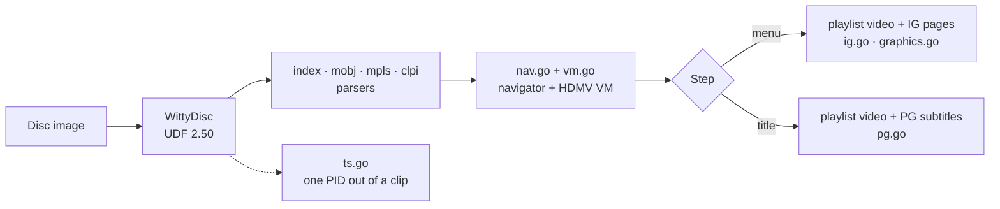

<h1 align="center">WittyBluray</h1>

<p align="center">
  <b>A Blu-ray engine in pure Go.</b><br>
  Plays a Blu-ray image or BDMV folder the way a player does: first-play, interactive and pop-up menus, titles, subtitles, 4K and HDR.
</p>

<p align="center">
  <a href="LICENSE"></a>
  
  
  
</p>

<p align="center">
  <a href="#quick-start">Quick start</a> ·
  <a href="#the-command-line-tool">Command-line tool</a> ·
  <a href="#using-the-library">Library</a> ·
  <a href="#design">Design</a> ·
  <a href="#limits">Limits</a> ·
  <a href="https://github.com/wittywilla/WittyMediaServer/blob/master/docs/BLURAY.md">Blu-ray guide</a>
</p>

> Read-only mirror of `modules/wittybluray` in [WittyMediaServer](https://github.com/wittywilla/WittyMediaServer),
> where development happens. Please open issues and pull requests there.

WittyBluray is the Blu-ray engine of [WittyMediaServer](https://github.com/wittywilla/WittyMediaServer),
and a library and tool for anyone building a player. It is an original implementation of the public
Blu-ray Disc structure (the HDMV navigation model).

## What it does

| | Capability | Details |
|---|---|---|
| 💿 | **Reads discs without mounting** | `.iso`/`.img` images (UDF 2.50 with its metadata partition) and BDMV folders, through [WittyDisc](https://github.com/wittywilla/WittyDisc) |
| 📋 | **Parses the disc's program** | `index.bdmv`, `MovieObject.bdmv`, playlists (`.mpls`: items, angles, streams, sub-paths, chapters) and clip information (`.clpi`: entry-point maps from time to byte) |
| ⚙️ | **Runs the disc's commands** | the HDMV virtual machine: 4096 general and 128 player registers; branch, compare, set and system commands |
| 🧭 | **Navigates like a player** | first play, titles, menus, calls and resumes, chapter marks, the navigation timer, direct playlist play |
| 🔘 | **Decodes menus** | interactive graphics: pages, button groups, buttons with their arrow neighbours and commands, normal/selected/activated pictures, **animated** highlights and **pop-up** menus |
| 💬 | **Decodes subtitles** | presentation graphics, read in windows so a 20 GB film is never scanned whole |
| 🌈 | **4K and HDR** | 2160p HEVC with HDR10, HDR10+ and Dolby Vision flags, so a player can tone-map for SDR screens |
| 🔒 | **Knows its limits** | AACS-encrypted discs are refused (nothing is decrypted); BD-J (Java) discs fall back to their titles; 3D (MVC) is reported |
| 🛠️ | **Diagnoses discs** | the `wittybluray` tool reports all of the above, simulates the menus, and renders menu pages |

**What it leaves to the player:** decoding the video and audio. WittyBluray tells a player *which
bytes to play, when, and what to draw over them*.

## Quick start

```bash
go install github.com/wittywilla/wittybluray/cmd/wittybluray@latest
wittybluray info THE_LORAX.iso
```

Needs Go 1.26 or newer; the tool lands in `$(go env GOPATH)/bin`. To use the library in your own
program: `go get github.com/wittywilla/wittybluray@latest`.

## The command-line tool

| Command | What it shows |
|---|---|
| `wittybluray info <disc>` | titles, the disc's program, playlists, clips and streams, 3D and HDR flags |
| `wittybluray playlist <disc> <n>` | every item, stream and chapter of one playlist |
| `wittybluray menu <disc> <playlist>` | a playlist's menu: pages, buttons, every command |
| `wittybluray walk <disc> [button…]` | simulates inserting the disc, then pressing menu buttons by id |
| `wittybluray render <disc> <dir>` | the first menu's pages as PNG files |

The output holds no video or artwork, so it's safe to attach to a bug report. The same commands are
built into WittyMediaServer as `wms bluray …`.

## Using the library

```go
import "github.com/wittywilla/wittybluray"

d, err := wittybluray.Open("THE_LORAX.iso")   // an image, or a folder holding BDMV
if err != nil { return err }
defer d.Close()
if d.Encrypted { return errors.New("AACS") }

nav := wittybluray.NewNav(d, wittybluray.NavOptions{})
step := nav.Start()                            // what to play first
for step.Kind == wittybluray.StepPlay {
    if step.Menu {                             // the playlist carries a menu
        menu, _ := d.LoadMenu(step.IGClip, step.IGPID, 0)
        page := &menu.Pages[0]
        img := menu.Render(page, page.Visible(nil, nil), page.DefaultSelected)
        _ = img                                // show the video with img over it; on OK:
        step = nav.PressButton(page.Button(page.DefaultSelected).Commands)
        continue
    }
    // play step.Playlist from step.Item at step.Time (byte ranges from d.ClipExtents
    // and the clip's entry-point map), then:
    step = nav.PlaylistEnded()
}
```

<details>
<summary><b>The navigator and decoders at a glance</b></summary>

| Call | Does |
|---|---|
| `Start`, `PlaylistEnded` | first play; what comes after a playlist |
| `PressButton`, `MenuCall`, `Resume` | menus and returning to the film |
| `PlayTitle`, `PlayPlaylist`, `SetTime`, `SetChapter` | titles, playlists and chapters |
| `SetAudio`, `SetSubtitle`, `SetAngle` | streams |
| `NavTimerFired` | the navigation timer |
| `LoadMenu`, `Menu.Render`, `Menu.DrawFrame`, `Popup` | menus, animation frames, pop-ups |
| `Subtitles`, `ReadPID` | subtitle pictures; any stream's packets |

</details>

Requirements: Go 1.26 or newer, no cgo. Its only dependency is WittyDisc.

## Design



| File | What it does |
|---|---|
| `open.go` | opens images and folders; detects AACS, BD-J and 3D; finds the main feature |
| `index.go`, `mobj.go` | `index.bdmv` and `MovieObject.bdmv` |
| `mpls.go`, `clpi.go` | playlists and clip information, with entry-point lookups |
| `vm.go`, `nav.go` | the HDMV virtual machine and the navigator |
| `ts.go`, `graphics.go` | the transport-stream demuxer; palettes, pictures, windows |
| `ig.go`, `pg.go` | menus (interactive graphics) and subtitles (presentation graphics) |
| `cli/` | the command-line tool |

**Safe with untrusted discs:** every read is bounds-checked, counts are limited, a disc's program
can't loop for ever (100 000 commands per run), and the parsers are fuzz-tested.

## Limits

| Not yet | What happens instead |
|---|---|
| AACS-encrypted discs | refused; make decrypted images of discs you own with a tool that is legal where you live |
| BD-J (Java) menus | the disc plays its titles without the menu |
| MVC 3D | the 2D view plays; the second view is reported, not decoded |
| Page transition effects | skipped (button animations play) |

Tested on custom-authored discs; retail discs exercise more of the format and may show problems not
seen yet. Reports with `wittybluray info` and `walk` output are very welcome.

## The Witty family

| Project | Role |
|---|---|
| [WittyMediaServer](https://github.com/wittywilla/WittyMediaServer) | the media server these engines power |
| [WittyDVD](https://github.com/wittywilla/WittyDVD) · **WittyBluray** | the DVD and Blu-ray engines |
| [WittyDisc](https://github.com/wittywilla/WittyDisc) | disc image reader |

## Licence

**Apache-2.0**, the same licence as WittyMediaServer. © 2026 WittyWilla and contributors.
Use, change and share it; if you redistribute it or build on it, keep the [NOTICE](NOTICE)
attribution, *“WittyBluray, developed by WittyWilla”*, in your NOTICE file, documentation or About screen.
