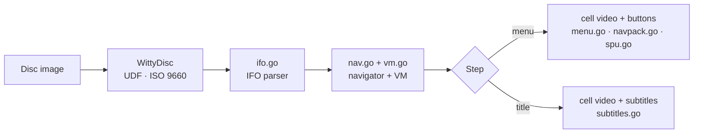

<h1 align="center">WittyDVD</h1>

<p align="center">
  <b>A DVD-Video engine in pure Go.</b><br>
  Plays a disc image the way a DVD player does: first-play, menus with highlighted buttons, titles, chapters and every command in between.
</p>

<p align="center">
  <a href="LICENSE"></a>
  
  
  
</p>

<p align="center">
  <a href="#quick-start">Quick start</a> ·
  <a href="#the-command-line-tool">Command-line tool</a> ·
  <a href="#using-the-library">Library</a> ·
  <a href="#design">Design</a> ·
  <a href="https://github.com/wittywilla/WittyMediaServer/blob/master/docs/DVD.md">DVD guide</a>
</p>

> Read-only mirror of `modules/wittydvd` in [WittyMediaServer](https://github.com/wittywilla/WittyMediaServer),
> where development happens. Please open issues and pull requests there.

WittyDVD is the DVD engine of [WittyMediaServer](https://github.com/wittywilla/WittyMediaServer), and a
library and tool for anyone building a player. It is an original implementation of the public
DVD-Video navigation model.

## What it does

| | Capability | Details |
|---|---|---|
| 💿 | **Reads discs without mounting** | `.iso`/`.img` images (UDF and ISO 9660 bridge discs) and `VIDEO_TS` folders, through [WittyDisc](https://github.com/wittywilla/WittyDisc), which gives each file's byte ranges for a decoder such as FFmpeg |
| 📋 | **Parses the disc's program** | VMG and VTS IFO tables: titles, program chains, programs and cells, menu languages, audio and sub-picture attributes, palettes, parental levels, regions |
| ⚙️ | **Runs the disc's commands** | a virtual machine with 16 general and 24 system registers: links, jumps, calls, comparisons, arithmetic, the navigation timer |
| 🧭 | **Navigates like a player** | first play, menus and titles, resume points, stills, menu loops, chapter skipping, and the title, root, audio, subtitle, angle and chapter menu keys |
| 🔘 | **Reads NAV packs** | button positions, colours and links (PCI), cell timing and seamless branching (DSI), interleaved multi-angle cells |
| 🖼️ | **Decodes sub-pictures** | menu highlights and subtitles rendered to RGBA with the disc's palette, cropped to the button or line |
| 🔒 | **Refuses scrambled discs** | CSS-protected images are detected and refused; nothing is ever decrypted |
| 🛠️ | **Diagnoses discs** | the `wittydvd` tool reports all of the above and simulates a run through the menus |

**What it leaves to the player:** decoding the video and audio. WittyDVD tells a player *which bytes
to play, when, and what to draw over them*.

## Quick start

```bash
git clone https://github.com/wittywilla/WittyMediaServer
cd WittyMediaServer/modules/wittydvd
go build ./cmd/wittydvd
./wittydvd info SHREK_2.ISO
```

> Versioned releases for `go get` are on the way; until then, build inside a WittyMediaServer checkout,
> where WittyDisc sits beside it.

## The command-line tool

| Command | What it shows |
|---|---|
| `wittydvd info <disc>` | titles, menus, languages and the first-play program |
| `wittydvd walk <disc> [button…]` | simulates inserting the disc, then pressing menu buttons by number |
| `wittydvd crawl <disc>` | presses every button of every menu and reports dead ends |
| `wittydvd pgc <disc> fp\|vmgm\|vtsm\|vts <vts> <pgcn>` | the commands of one program chain |
| `wittydvd render <disc> <dir>` | the first menu's highlight pictures |
| `wittydvd disc ls <disc>` | the files inside the image |

The output holds no video or artwork, so it's safe to attach to a bug report. The same commands are
built into WittyMediaServer as `wms dvd …`.

## Using the library

```go
import "github.com/wittywilla/wittydvd"

o, err := wittydvd.Open("SHREK_2.ISO")     // an image or a VIDEO_TS folder
if err != nil { return err }
defer o.Close()

nav := wittydvd.NewNav(o.Disc, wittydvd.NavOptions{})
step := nav.Start()                          // a menu, a title cell, or stop
for step.Kind != wittydvd.StepStop {
    switch step.Kind {
    case wittydvd.StepMenu:
        rd, _ := o.Reader(wittydvd.SpaceFor(step.Domain, step.VTS))
        pic, _ := wittydvd.ScanMenu(rd, step.FirstSector, step.LastSector,
            wittydvd.MenuScanOptions{Palette: step.Palette})
        _ = pic                              // buttons, rectangles, highlight artwork
        step = nav.PressButton(1, nil)
    case wittydvd.StepTitle:
        ext, _ := o.CellExtents(wittydvd.SpaceFor(step.Domain, step.VTS), step.Cell)
        _ = ext                              // play these byte ranges, then:
        step = nav.CellEnded()
    }
}
```

<details>
<summary><b>The navigator at a glance</b></summary>

| Call | Does |
|---|---|
| `Start`, `CellEnded` | first play; what comes after a cell |
| `PressButton`, `MenuKey`, `GoUp`, `OpenMenu` | menu interaction |
| `PlayTitle`, `NextChapter`, `PrevChapter`, `Resume` | titles and chapters |
| `SetAudio`, `SetSubpicture`, `SetAngle` | streams |
| `Tick` | the navigation timer |
| `Clone` | explore a disc without disturbing the live session |
| `CellSubpictures`, `DecodeSPU`, `SPU.Render` | subtitles as images |

</details>

Requirements: Go 1.26 or newer, no cgo. Its only dependency is WittyDisc.

## Design



| File | What it does |
|---|---|
| `open.go` | opens images and folders; title summaries; readers for each VOB address space |
| `ifo.go` | VMG and VTS IFO parsing |
| `vm.go` | registers, instruction decoding, the interpreter |
| `nav.go` | first play, menus, titles, resume, stills, keys |
| `navpack.go`, `interleave.go` | NAV packs (PCI, DSI); cell ranges including multi-angle blocks |
| `spu.go`, `menu.go`, `subtitles.go` | sub-pictures, menu buttons and highlights, subtitles |
| `cli/` | the command-line tool |

**Safe with untrusted discs:** reads are size-bounded, malformed tables, commands and sub-pictures are
refused rather than trusted, and the parsers are fuzz-tested.

## The Witty family

| Project | Role |
|---|---|
| [WittyMediaServer](https://github.com/wittywilla/WittyMediaServer) | the media server these engines power |
| **WittyDVD** · [WittyBluray](https://github.com/wittywilla/WittyBluray) | the DVD and Blu-ray engines |
| [WittyDisc](https://github.com/wittywilla/WittyDisc) | disc image reader |

## Licence

**Apache-2.0**, the same licence as WittyMediaServer. © 2026 WittyWilla and contributors.
Use, change and share it; if you redistribute it or build on it, keep the [NOTICE](NOTICE)
attribution, *“WittyDVD, developed by WittyWilla”*, in your NOTICE file, documentation or About screen.
