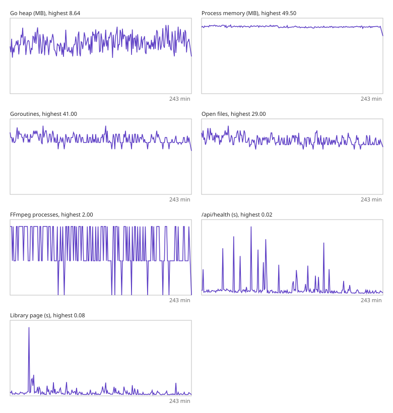

# Soak run

WittyMediaServer 0.6.2-alpha on Linux, started 2026-11-04 22:05.
Ran 4.0 hours (asked for 4.0 hours), 234 samples, 4 page clients. It ran to the end.

**PASSED**

| Measure | Start | Highest | End |
|---|---|---|---|
| Go heap (MB) | 5.94 | 8.64 | 6.89 |
| Process memory (MB) | 47.90 | 49.50 | 48.49 |
| Goroutines | 37.00 | 41.00 | 34.00 |
| Open files | 26.00 | 29.00 | 23.00 |
| FFmpeg processes | 2.00 | 2.00 | 2.00 |
| /api/health (s) | 0.00 | 0.02 | 0.00 |
| Library page (s) | 0.00 | 0.08 | 0.00 |

After everyone left: 0 FFmpeg processes, 26 goroutines, 5 MB heap.

| Activity | Done | Failed |
|---|---|---|
| channel: tune | 59 | 0 |
| music: lyrics | 436 | 0 |
| music: play | 436 | 0 |
| music: skip | 92 | 0 |
| music: stream | 436 | 0 |
| pages | 23078 | 0 |
| scan | 24 | 0 |
| segments | 6952 | 1 |
| transcode: play | 65 | 0 |

Notes:

- library DVD answered 409: {'code': 'module-missing', 'error': 'this kind of library needs WittyBluray, WittyCD or WittyDVD. Add it in Settings, Modules.', 'modules': [{'id': 'wittybluray', 'name': 'WittyBluray', 'installed': False}, {'id': 'wittycd', 'name': 'WittyCD', 'installed': False}, {'id': 'wittydvd', 'name': 'WittyDVD', 'installed': False}]}
